# I Respawned As A Super Coder In A World With AI — the path & library: Sitemap & User Stories

**Total pages: 299.** Every reachable HTML page on the site is listed below with an ID, a URL, a source, the facts the build must reproduce, a user story and acceptance criteria. If a page is not in this document it must not exist; if it is listed, it must exist. `npm test` compares the generated `public/` tree against this document's URL list in both directions and fails on any difference.

## Counts by section

- Global: 4
- The Path: 63
- Algorithms: 28
- Data Structures: 17
- Practice: 29
- Languages: 68
- System Design: 40
- Design Patterns: 24
- Security: 12
- Mindset: 3
- Atelier: 11
- **Total: 299**

## Counting rules

- A page = one URL that returns an HTML document. Trailing-slash URLs map to `<path>/index.html`.
- Group segments (`/algorithms/sorting/`, `/practice/algocasts/`, `/patterns/creational/`, …) are **not pages**; they 301 to the section landing anchor (for example `/algorithms/#sorting`).
- In-page anchors, the ⌘K palette, `search-index.json`, raw source files under `/assets/src/`, license texts under `/licenses/`, images, fonts and `sitemap.xml` are not pages.
- The 404 page is counted once; it is served for every unknown path with HTTP status 404.
- Excluded on purpose (must not become pages): Holt `intro`, `exercises`, `wrap-up`; prep `assessment-cheatsheet.md`, `game-plan.md`, `reported-assessment-questions.md`, top-level `prep/README.md`, `_scratchbox/notes.js`, `_scratchbox/codesignal-handshake-assessment.md`; AlgoCasts `events` (no solution in the repo), `portfolio`, `brendan/`, `diagrams/`, `html/`, `recursion/`, `exercises/ans.md`; other 2021 course material outside the files named here.

## Global acceptance criteria (apply to every page)

- G1 URL is exactly as listed, served as `<url>index.html`, HTTP 200 (404 page: 404).
- G2 `<title>` = "{Title} · {Section} · I Respawned As A Super Coder" (home: "I Respawned As A Super Coder In A World With AI — the path & library"; sessions: "{n.n} {Title} · The Path · I Respawned As A Super Coder"); meta description ≤ 160 chars from the page lede; canonical + Open Graph + Twitter tags; PNG favicons (`/favicon-32.png`, `/favicon-16.png`, `/apple-touch-icon.png`) and theme-color per DESIGN-REFERENCE-RESPAWN §R12.
- G3 Nav per DESIGN-REFERENCE-RESPAWN §R2–§R3: the mark lockup (Magic struck out, AI written in; accessible name "I respawned as a super coder in a world with magic, crossed out, corrected to AI"), 9 links in this order — Path · Algorithms · Data Structures · Practice · Languages · System Design · Patterns · Security · Mindset — with the current section marked, ⌘K search pill, mobile menu sheet. The site name is the correction; the retired sticker, disc and `favicon.svg` must not be referenced anywhere.
- G4 Footer per DESIGN-REFERENCE §13 with the credits link.
- G5 Only design tokens from DESIGN-REFERENCE; no pure #FFFFFF; fonts Clash Display / DM Sans / JetBrains Mono / Fraunces italic self-hosted; zero external network requests (no CDN, analytics or web-font calls) — enforced by the budget test.
- G6 Provenance: every sentence comes from the listed Source file(s) or from a `content/` file whose frontmatter has `editorial: true`. No invented facts, links, versions, quotes, names or statistics. Editorial text on imported pages is limited to: lede (≤ 40 words), group intros, "What changed" notes, UI labels.
- G7 Doc pages carry one of two cards in the rail. Pages imported from the two attributed sources (Brian Holt's lessons, the AlgoCasts exercises) show the **Source card**: origin repo + path, license, "modified" flag, raw-file link. Every other page is Arthur's own material and shows the **Creator card**: "Written by Arthur Bernier Jr (Big Poppa Code)", a short bio, a link to https://bigpoppacode.io/, and the © chip — no repository paths and no raw-file links. Both cards end with the Verified line (date + doc URLs + exec result) populated from `content/verification.json`; the build fails if the entry is missing.
- G8 No dead links or images: internal links resolve to listed pages/anchors; external links return 200/301 in the link check; every referenced image exists under `/assets/`.
- G9 Exactly one H1 = Title; H2/H3 hierarchy preserved from source; every H2/H3 has an id and appears in the right-rail "On this page" in order.
- G10 Code blocks: Shiki-highlighted, language label, copy button; complete JS programs pass `node --check`; fragments are marked `fragment` and counted in the ledger.
- G11 Responsive at 1440 / 834 / 390 per the DESIGN-REFERENCE viewport cheat-sheet; no horizontal scroll; tap targets ≥ 44 px on mobile.
- G12 Accessibility: landmarks, skip link, visible focus, body-text contrast ≥ 4.5:1, `prefers-reduced-motion` honored, search/menu/tabs/gates keyboard-operable.
- G13 Present in `search-index.json` with title, section, url, headings and (for T-PREP) SAY terms.
- G14 Prev/Next pager follows the order of this document within the section (landing → first child … last child).

## Template acceptance criteria

### T-HOME
- Hero (DESIGN-REFERENCE-RESPAWN §R4): the cover lockup as the H1 (`I RESPAWNED AS A` mono yellow · `SUPER CODER` Clash 700 green · `IN A WORLD WITH` mono yellow · the mark: *Magic* in Fraunces italic struck through in red with `AI` in Clash 700 yellow written over its corner), signature line, computed mono tagline `ONE PATH · 62 SESSIONS · {n} SIDE QUESTS`, two pills (**Start the path** → PATH-00, **Browse the library** → `#tracks`), five stats (pages · sessions · exercises · languages · patterns); on the right the save-point card for the latest written session (large stamp, week/day, title, hook, **Continue**, `{written} of 54 written`). No gate, no audio, no sticker, no disc.
- Sections in this order: 00 The path (route strip: 18 week cells with unit-coloured bars, three session dots each, one flag on the latest written week, act legend, **Latest: n.n Title →**) · 01 Side quests (8 track cards with live counts) · 02 Which pattern when (31 rows, filterable) · 03 Naive vs Optimal (one pair) · 04 Languages (13 tiles) · 05 Mindset quote break · Marquee · Footer.
- Reveal/float motion only here; all of it off under `prefers-reduced-motion`.

### T-PATH
- Landing header: eyebrow `00 / THE PATH`, H1 "The path", editorial intro, **Start with Session n.n** pill to the first written session, chip `21 weeks · 62 sessions · {written} written`.
- The path map figure (`/assets/diagrams/path/path-map-wide.png` 1600×900, `-tall.png` 900×1200 via `<picture>`), act legend; the "Not yet written" swatch appears only while unpublished sessions remain.
- The twelve units as a list (number, title, topics, artifact), then act dividers and 21 week blocks `id="week-N"`, three session cards each: a **written** card (medium stamp, day, linked title, hook, chips `n min read · n diagrams · n side quests`) or the designed **empty** card (dashed `--faint` outline, `NOT YET WRITTEN · RESPAWNS HERE`, "Side quests that cover this ground today:" with up to three library chips, or "No side quests yet."). Every one of the 62 sessions renders a card; counts are never typed in.
- Pager = next → first written session.

### T-SESSION
- 3-column doc layout; the sidebar tree is the path by week (small stamps; unwritten sessions listed unlinked; `{written}/62 WRITTEN`).
- Above the eyebrow: the chapter opener (large stamp + Fraunces italic *In a world with ~~Magic~~ AI, chapter n.n.*) — the only strike outside the logo.
- Eyebrow `THE PATH · WEEK n · {DAY} · UNIT n · ACT {I|II|III}`; H1 = Title; lede = subtitle; chips `n min read · n diagrams · n side quests · n runnable`; glance card keys WEEK · UNIT · ACT · BEFORE · AFTER · ARTIFACT · READ.
- Body H2s exactly, in order: The hook · The idea · The demonstration · Where it breaks · Your turn · The quest · Side quests · Before next session. "Where it breaks" renders inside `.callout.dont`, "Your turn" inside `.callout.turn`; single-italic-paragraph blockquotes are `blockquote.story` pull quotes.
- Diagrams: `figure.diagram` with `<picture>` (tall ≤ 600 px, wide otherwise), alt ≥ 40 chars, caption `FIG n ·`; the first is eager, the rest lazy; every figure is a row in `content/path/diagrams.json` and the frontmatter `diagrams[]` lists them in order.
- Code: fenced `js` blocks parse; blocks tagged `run=<name>` are written to `/assets/src/path/<slug>/<name>.js` and run in the worker. DOM demos pair an `html stage=<name>` fence (rendered as a live stage under its panel) with a `js live=<name>` fence (written to `/assets/live/path/<slug>/<name>.js`, run against that stage by the Run live button and by the live gate in Chromium); a session with stages carries `Live stages: n` in its facts. Shell sessions use `bash term=<name>` fences (commands as typed, no `$ `), rendered as a *you type* panel with a **Run in terminal** button over a `.term` box that replays the script in the in-page Bash emulator (`term.js`, with `git.js` supplying a faithful `git` over an in-memory GitHub, plus `ssh-keygen`/`ssh-agent`/`ssh-add`/`ssh -T` and GitHub's `gh` CLI so that every browser click a session asks for has a command in the box that does the same thing) and then takes the reader's own commands at a real prompt; `may-fail` on the fence allows a deliberate `command not found`; a session with terminals carries `Terminals: n` in its facts.
- Side quests box (`section.side-quests`) lists the session's library pages from `content/path/path.json`; each listed library page carries the `.sq-banner` back-link to `<session>#side-quests`.
- Word floor from the Facts (`Words: ≥ 2400`); Creator card; pager = previous/next written session, else **Back to the path** (`/path/#week-N`).

### T-LANDING
- Header: eyebrow `0N / {Section}`, H1, one-paragraph editorial intro.
- One card per group in the listed order; each card lists its child pages as links in this document's order with the chip noted in that page's Facts (section count / test count / "Lesson").
- Where the Facts say a README section is rendered on the landing, it is rendered verbatim (tables as tables).
- "Start here" pill to the first child page; pager = next → first child.

### T-LESSON
- 3-column doc layout (sidebar tree · article ≤ 760 px · right rail).
- Attribution card above the pager: "Adapted from Brian Holt's Complete Intro to Computer Science (Frontend Masters) · CC BY-NC 4.0 · modified" with links to the source file and the license text.
- Author photos, Frontend Masters logo and personal asides are not rendered; CodeSandbox badge images are replaced by a link row "Open exercise on CodeSandbox ↗" (count must equal Facts).
- Images/GIFs/videos copied from the repo and served locally; videos have controls + poster; no autoplay.
- At-a-glance chip only where the Facts name a cheatsheet row.

### T-PREP
- When `content/lessons/<page id>.md` exists, it renders first as the explanation (metaphor, why it matters, one small example, a walkthrough of the sections). The sheet underneath is the demonstration. The at-a-glance card, section count and section titles stay the header and the `// ──` blocks.
- At-a-glance card = the header block rendered as key/value rows, keys verbatim (Facts), `SAY` values as yellow chips.
- One block per section (`// ── N.` or `// ═══`) in order: number, title verbatim, the idea/complexity text from the separator line, the code, and the asserts folded into a "Verified by" disclosure.
- Run button executes the raw file in a Web Worker with the `node:assert/strict` shim and prints the `ok:` line from Facts; files that `require` anything else show the `node <path>` copy command instead and say why.
- The file is served under `/assets/src/prep/<path>` for the Run button, the copy-node command and the rail's Download link; the Creator card (not a Source card) carries "© Arthur Bernier Jr".

### T-EXERCISE
- Order on the page: Directions (verbatim comment header) → Examples → "Try it first" gate (button reveals the tabs; state kept in localStorage per URL) → Tabs: Solution · Alternate n (if any) · Tests · Helper (if any).
- Each tab is the verbatim file from `vendor/AlgoCasts` at the pinned SHA; Alternate tabs are the commented-out solutions with the leading `// ` removed and nothing else changed.
- Chips: test count, topic (from the group in this document), GPL-3.0.
- Source card links to the file in the repo at SHA 30cf7634cb96bdd09b552f929e8450dccc1d5e96 and to `/licenses/gpl-3.0.txt`.

### T-LANG
- Rendered from `content/overrides/…`; the override's frontmatter has `updated_from`, `verified`, `docs[]`, `exec`.
- Sticky language switcher (JavaScript · Python · Ruby · Go · Java · C# · PHP · Rust · Dart) that keeps the same sub-page; frontend pages show the four frameworks instead.
- Topic H2s from Facts present in order; paired JS/X code blocks preserved where the source has them.
- "What changed since the 2021 original" note at the bottom listing every substantive change.
- Third-party logos, dead hosted images, Repl.it/Heroku instructions removed or replaced as stated in the page's criteria.

### T-LANG-INDEX
- Intro paragraph (≤ 120 words), sub-page cards in the listed order, then the verbatim lists named in Facts.
- Language switcher present.

### T-ARTICLE
- 3-column doc layout; "Say this" / "In the interview" H2s rendered as callouts; markdown tables rendered as tables.
- Source card per G7.

### T-CREDITS
- One section per attributed source (Holt, AlgoCasts, MiniSearch) with: title, author, repo URL, license name + local license link, what was used, what was changed; one section for everything else: the creator, his bio, a link to https://bigpoppacode.io/, all rights reserved.
- Font licenses and the non-commercial statement.

### T-SEARCH
- Query input prefilled from `?q=`; results from `search-index.json` client-side; grouped by section; empty state = 8 section cards.

### T-404
- Status 404; headline, search box, 8 section links; same nav/footer.

## Sitemap

```mermaid
flowchart TB
  home["/ (G-01)"]
  home --> search["/search/ (G-02)"]
  home --> credits["/credits/ (G-03)"]
  home --> nf["/404.html (G-04)"]
  home --> pathx["/path/ (PATH-00) · 63 pages"]
  pathx --> path_w1["Week 1 · 3 written (PATH-1-1, PATH-1-2, PATH-1-3)"]
  pathx --> path_w2["Week 2 · 3 written (PATH-1-4, PATH-2-1, PATH-2-2)"]
  pathx --> path_w3["Week 3 · 3 written (PATH-2-3, PATH-2-4, PATH-2-5)"]
  pathx --> path_w4["Week 4 · 3 written (PATH-3-1, PATH-3-2, PATH-3-3)"]
  pathx --> path_w5["Week 5 · 3 written (PATH-3-4, PATH-3-5, PATH-4-1)"]
  pathx --> path_w6["Week 6 · 3 written (PATH-4-2, PATH-4-3, PATH-4-4)"]
  pathx --> path_w7["Week 7 · 3 written (PATH-4-5, PATH-4-6, PATH-4-7)"]
  pathx --> path_w8["Week 8 · 3 written (PATH-4-8, PATH-4-9, PATH-4-10)"]
  pathx --> path_w9["Week 9 · 3 written (PATH-4-11, PATH-4-12, PATH-4-13)"]
  pathx --> path_w10["Week 10 · 3 written (PATH-4-14, PATH-5-1, PATH-5-2)"]
  pathx --> path_w11["Week 11 · 3 written (PATH-5-3, PATH-5-4, PATH-6-1)"]
  pathx --> path_w12["Week 12 · 3 written (PATH-6-2, PATH-6-3, PATH-6-4)"]
  pathx --> path_w13["Week 13 · 3 written (PATH-7-1, PATH-7-2, PATH-7-3)"]
  pathx --> path_w14["Week 14 · 3 written (PATH-7-4, PATH-8-1, PATH-8-2)"]
  pathx --> path_w15["Week 15 · 3 written (PATH-8-3, PATH-8-4, PATH-9-1)"]
  pathx --> path_w16["Week 16 · 3 written (PATH-9-2, PATH-9-3, PATH-9-4)"]
  pathx --> path_w17["Week 17 · 3 written (PATH-9-5, PATH-10-1, PATH-10-2)"]
  pathx --> path_w18["Week 18 · 3 written (PATH-10-3, PATH-10-4, PATH-11-1)"]
  pathx --> path_w19["Week 19 · 3 written (PATH-11-2, PATH-11-3, PATH-11-4)"]
  pathx --> path_w20["Week 20 · 3 written (PATH-12-1, PATH-12-2, PATH-12-3)"]
  pathx --> path_w21["Week 21 · 2 written (PATH-12-4, PATH-12-5)"]
  home --> alg["/algorithms/ (ALG-00) · 28 pages"]
  alg --> alg_analysis["Analysis · 5"]
  alg --> alg_sorting["Sorting · 7"]
  alg --> alg_searching["Searching · 2"]
  alg --> alg_recursion["Recursion · 4"]
  alg --> alg_patterns["Patterns · 7"]
  alg --> alg_graph_algorithms["Graph algorithms · 1"]
  alg --> alg_naive_vs_optimal["Naive vs Optimal · 1"]
  home --> ds["/data-structures/ (DS-00) · 17 pages"]
  ds --> ds_lists["Lists · 4"]
  ds --> ds_hashing["Hashing · 2"]
  ds --> ds_trees["Trees · 8"]
  ds --> ds_graphs["Graphs · 2"]
  home --> prac["/practice/ (PRAC-00) · 29 pages"]
  prac --> prac_algocasts["AlgoCasts · 26"]
  prac --> prac_post_mortems["Post-mortems · 1"]
  prac --> prac_projects["Projects · 1"]
  home --> lang["/languages/ (LANG-00) · 68 pages"]
  lang --> lang_javascript["JavaScript · 13"]
  lang --> lang_python["Python · 6"]
  lang --> lang_ruby["Ruby · 6"]
  lang --> lang_go["Go · 6"]
  lang --> lang_java["Java · 6"]
  lang --> lang_c["C# · 6"]
  lang --> lang_php["PHP · 6"]
  lang --> lang_rust["Rust · 6"]
  lang --> lang_dart["Dart · 6"]
  lang --> lang_frontend["Frontend · 6"]
  home --> sys["/system-design/ (SYS-00) · 40 pages"]
  sys --> sys_playbook["Playbook · 4"]
  sys --> sys_concepts["Concepts · 29"]
  sys --> sys_walkthroughs["Walkthroughs · 6"]
  home --> pat["/patterns/ (PAT-00) · 24 pages"]
  pat --> pat_creational["Creational · 5"]
  pat --> pat_structural["Structural · 7"]
  pat --> pat_behavioral["Behavioral · 11"]
  home --> sec["/security/ (SEC-00) · 12 pages"]
  sec --> sec_owasp_top_10_2025["OWASP Top 10:2025 · 10"]
  sec --> sec_quick_reference["Quick reference · 1"]
  home --> mind["/mindset/ (MIND-00) · 3 pages"]
  mind --> mind_know_what_you_are_talking_about["Know what you are talking about · 1"]
  mind --> mind_grit["Grit · 1"]
```

### Global — 4 page(s)

| ID | URL | Title | Group | Template | Source | Key facts |
|---|---|---|---|---|---|---|
| G-01 | `/` | I Respawned As A Super Coder In A World With AI | — | T-HOME | `content/home.md (editorial)` | Cover lockup: I RESPAWNED AS A / SUPER CODER / IN A WORLD WITH / ~~Magic~~ AI · Signature: — the respawn guide, by Big Poppa Code · Tagline: ONE PATH · 62 SESSIONS · {n} SIDE QUESTS |
| G-02 | `/search/` | Search | — | T-SEARCH | `public/search-index.json (generated)` | Full-page fallback for the ⌘K palette (`?q=` param) · Results grouped by section with title, breadcrumb, matched heading |
| G-03 | `/credits/` | Sources, licenses & attribution | — | T-CREDITS | `content/credits.md (editorial)` | Brian Holt / Frontend Masters — CC BY-NC 4.0 (content), Apache-2.0 (code), modi… · Stephen Grider / AlgoCasts via arthurbernierjr fork — GPL-3.0, verbatim, SHA 30… · Everything else — Arthur Bernier Jr (Big Poppa Code), original material, all rights reserved, bio + https://bigpoppacode.io/ |
| G-04 | `/404.html (served for any unknown path)` | Page not found | — | T-404 | `content/404.md (editorial)` | Express catch-all returns status 404 with this page · Shows search box + the 8 section links |

### The Path — 63 page(s)

| ID | URL | Title | Group | Template | Source | Key facts |
|---|---|---|---|---|---|---|
| PATH-00 | `/path/` | The path | — | T-PATH | `content/path/path.json + build/assets/diagrams/path/` | Weeks: 21 · Sessions: 62 · One card per session; empty cards for unwritten sessions · Path map wide + tall |
| PATH-1-1 | `/path/1-1-welcome-to-the-new-world/` | Welcome to the New World | Week 1 | T-SESSION | `content/path/sessions/1-1-welcome-to-the-new-world.md (editorial)` | Session: 1.1 · Week 1 · Tuesday · Unit 1 · H2s (8) · Diagrams: 5 · Side quests: 2 · Terminals: 7 · Words: ≥ 2400 |
| PATH-1-2 | `/path/1-2-your-status-screen/` | Your Status Screen | Week 1 | T-SESSION | `content/path/sessions/1-2-your-status-screen.md (editorial)` | Session: 1.2 · Week 1 · Wednesday · Unit 1 · H2s (8) · Diagrams: 5 · Side quests: 2 · Terminals: 6 · Words: ≥ 2400 |
| PATH-1-3 | `/path/1-3-save-points-and-respawns/` | Save Points and Respawns | Week 1 | T-SESSION | `content/path/sessions/1-3-save-points-and-respawns.md (editorial)` | Session: 1.3 · Week 1 · Saturday · Unit 1 · H2s (8) · Diagrams: 5 · Side quests: 3 · Terminals: 9 · Words: ≥ 2400 |
| PATH-1-4 | `/path/1-4-guild-sync/` | Guild Sync | Week 2 | T-SESSION | `content/path/sessions/1-4-guild-sync.md (editorial)` | Session: 1.4 · Week 2 · Tuesday · Unit 1 · H2s (8) · Diagrams: 5 · Side quests: 3 · Terminals: 7 · Words: ≥ 2400 |
| PATH-2-1 | `/path/2-1-the-skeleton-frame/` | The Skeleton Frame | Week 2 | T-SESSION | `content/path/sessions/2-1-the-skeleton-frame.md (editorial)` | Session: 2.1 · Week 2 · Wednesday · Unit 2 · H2s (8) · Diagrams: 5 · Side quests: 3 · Live stages: 4 · Words: ≥ 2400 |
| PATH-2-2 | `/path/2-2-armor-and-cosmetics/` | Armor and Cosmetics | Week 2 | T-SESSION | `content/path/sessions/2-2-armor-and-cosmetics.md (editorial)` | Session: 2.2 · Week 2 · Saturday · Unit 2 · H2s (8) · Diagrams: 5 · Side quests: 5 · Live stages: 4 · Words: ≥ 2400 |
| PATH-2-3 | `/path/2-3-formation-magic/` | Formation Magic | Week 3 | T-SESSION | `content/path/sessions/2-3-formation-magic.md (editorial)` | Session: 2.3 · Week 3 · Tuesday · Unit 2 · H2s (8) · Diagrams: 5 · Side quests: 6 · Live stages: 4 · Words: ≥ 2400 |
| PATH-2-4 | `/path/2-4-enchantments/` | Enchantments | Week 3 | T-SESSION | `content/path/sessions/2-4-enchantments.md (editorial)` | Session: 2.4 · Week 3 · Wednesday · Unit 2 · H2s (8) · Diagrams: 5 · Side quests: 6 · Live stages: 4 · Words: ≥ 2400 |
| PATH-2-5 | `/path/2-5-the-character-sheet-forge/` | The Character Sheet Forge | Week 3 | T-SESSION | `content/path/sessions/2-5-the-character-sheet-forge.md (editorial)` | Session: 2.5 · Week 3 · Saturday · Unit 2 · H2s (8) · Diagrams: 3 · Side quests: 4 · Words: ≥ 2400 |
| PATH-3-1 | `/path/3-1-mana-basics/` | Mana Basics | Week 4 | T-SESSION | `content/path/sessions/3-1-mana-basics.md (editorial)` | Session: 3.1 · Week 4 · Tuesday · Unit 3 · H2s (8) · Diagrams: 5 · Side quests: 4 · Words: ≥ 2400 |
| PATH-3-2 | `/path/3-2-spell-crafting/` | Spell Crafting | Week 4 | T-SESSION | `content/path/sessions/3-2-spell-crafting.md (editorial)` | Session: 3.2 · Week 4 · Wednesday · Unit 3 · H2s (8) · Diagrams: 5 · Side quests: 4 · Words: ≥ 2400 |
| PATH-3-3 | `/path/3-3-objects-and-orcs/` | Objects and Orcs | Week 4 | T-SESSION | `content/path/sessions/3-3-objects-and-orcs.md (editorial)` | Session: 3.3 · Week 4 · Saturday · Unit 3 · H2s (8) · Diagrams: 4 · Side quests: 5 · Words: ≥ 2400 |
| PATH-3-4 | `/path/3-4-casting-on-the-world/` | Casting on the World | Week 5 | T-SESSION | `content/path/sessions/3-4-casting-on-the-world.md (editorial)` | Session: 3.4 · Week 5 · Tuesday · Unit 3 · H2s (8) · Diagrams: 5 · Side quests: 4 · Live stages: 5 · Words: ≥ 2400 |
| PATH-3-5 | `/path/3-5-the-arena/` | The Arena | Week 5 | T-SESSION | `content/path/sessions/3-5-the-arena.md (editorial)` | Session: 3.5 · Week 5 · Wednesday · Unit 3 · H2s (8) · Diagrams: 5 · Side quests: 4 · Live stages: 4 · Words: ≥ 2400 |
| PATH-4-1 | `/path/4-1-the-runtime-beyond-the-browser/` | The Runtime Beyond the Browser | Week 5 | T-SESSION | `content/path/sessions/4-1-the-runtime-beyond-the-browser.md (editorial)` | Session: 4.1 · Week 5 · Saturday · Unit 4 · H2s (8) · Diagrams: 3 · Side quests: 2 · Words: ≥ 2400 |
| PATH-4-2 | `/path/4-2-the-listening-door/` | The Listening Door | Week 6 | T-SESSION | `content/path/sessions/4-2-the-listening-door.md (editorial)` | Session: 4.2 · Week 6 · Tuesday · Unit 4 · H2s (8) · Diagrams: 3 · Side quests: 2 · Words: ≥ 2400 |
| PATH-4-3 | `/path/4-3-the-counters-three-laws/` | The Counter's Three Laws | Week 6 | T-SESSION | `content/path/sessions/4-3-the-counters-three-laws.md (editorial)` | Session: 4.3 · Week 6 · Wednesday · Unit 4 · H2s (8) · Diagrams: 3 · Side quests: 2 · Words: ≥ 2400 |
| PATH-4-4 | `/path/4-4-the-vault/` | The Vault | Week 6 | T-SESSION | `content/path/sessions/4-4-the-vault.md (editorial)` | Session: 4.4 · Week 6 · Saturday · Unit 4 · H2s (8) · Diagrams: 3 · Side quests: 2 · Words: ≥ 2400 |
| PATH-4-5 | `/path/4-5-the-vault-keeper/` | The Vault Keeper | Week 7 | T-SESSION | `content/path/sessions/4-5-the-vault-keeper.md (editorial)` | Session: 4.5 · Week 7 · Tuesday · Unit 4 · H2s (8) · Diagrams: 3 · Side quests: 2 · Words: ≥ 2400 |
| PATH-4-6 | `/path/4-6-the-paper-ledger/` | The Paper Ledger | Week 7 | T-SESSION | `content/path/sessions/4-6-the-paper-ledger.md (editorial)` | Session: 4.6 · Week 7 · Wednesday · Unit 4 · H2s (8) · Diagrams: 3 · Side quests: 2 · Words: ≥ 2400 |
| PATH-4-7 | `/path/4-7-the-courier/` | The Courier | Week 7 | T-SESSION | `content/path/sessions/4-7-the-courier.md (editorial)` | Session: 4.7 · Week 7 · Saturday · Unit 4 · H2s (8) · Diagrams: 3 · Side quests: 2 · Words: ≥ 2400 |
| PATH-4-8 | `/path/4-8-seals-and-signets/` | Seals and Signets | Week 8 | T-SESSION | `content/path/sessions/4-8-seals-and-signets.md (editorial)` | Session: 4.8 · Week 8 · Tuesday · Unit 4 · H2s (8) · Diagrams: 3 · Side quests: 3 · Words: ≥ 2400 |
| PATH-4-9 | `/path/4-9-the-illusionists-primer/` | The Illusionist's Primer | Week 8 | T-SESSION | `content/path/sessions/4-9-the-illusionists-primer.md (editorial)` | Session: 4.9 · Week 8 · Wednesday · Unit 4 · H2s (8) · Diagrams: 3 · Side quests: 2 · Words: ≥ 2400 |
| PATH-4-10 | `/path/4-10-the-second-circle/` | The Second Circle | Week 8 | T-SESSION | `content/path/sessions/4-10-the-second-circle.md (editorial)` | Session: 4.10 · Week 8 · Saturday · Unit 4 · H2s (8) · Diagrams: 3 · Side quests: 2 · Words: ≥ 2400 |
| PATH-4-11 | `/path/4-11-the-quest-slate/` | The Quest Slate | Week 9 | T-SESSION | `content/path/sessions/4-11-the-quest-slate.md (editorial)` | Session: 4.11 · Week 9 · Tuesday · Unit 4 · H2s (8) · Diagrams: 3 · Side quests: 2 · Words: ≥ 2400 |
| PATH-4-12 | `/path/4-12-the-second-contract/` | The Second Contract | Week 9 | T-SESSION | `content/path/sessions/4-12-the-second-contract.md (editorial)` | Session: 4.12 · Week 9 · Wednesday · Unit 4 · H2s (8) · Diagrams: 3 · Side quests: 2 · Words: ≥ 2400 |
| PATH-4-13 | `/path/4-13-blood-oaths/` | Blood Oaths | Week 9 | T-SESSION | `content/path/sessions/4-13-blood-oaths.md (editorial)` | Session: 4.13 · Week 9 · Saturday · Unit 4 · H2s (8) · Diagrams: 3 · Side quests: 2 · Words: ≥ 2400 |
| PATH-4-14 | `/path/4-14-the-guild-hall/` | The Guild Hall | Week 10 | T-SESSION | `content/path/sessions/4-14-the-guild-hall.md (editorial)` | Session: 4.14 · Week 10 · Tuesday · Unit 4 · H2s (8) · Diagrams: 3 · Side quests: 3 · Words: ≥ 2400 |
| PATH-5-1 | `/path/5-1-awakening-the-cheat-skill/` | Awakening the Cheat Skill | Week 10 | T-SESSION | `content/path/sessions/5-1-awakening-the-cheat-skill.md (editorial)` | Session: 5.1 · Week 10 · Wednesday · Unit 5 · H2s (8) · Diagrams: 3 · Side quests: 2 · Words: ≥ 2400 |
| PATH-5-2 | `/path/5-2-advanced-incantations/` | Advanced Incantations | Week 10 | T-SESSION | `content/path/sessions/5-2-advanced-incantations.md (editorial)` | Session: 5.2 · Week 10 · Saturday · Unit 5 · H2s (8) · Diagrams: 3 · Side quests: 2 · Words: ≥ 2400 |
| PATH-5-3 | `/path/5-3-summoned-familiars/` | Summoned Familiars | Week 11 | T-SESSION | `content/path/sessions/5-3-summoned-familiars.md (editorial)` | Session: 5.3 · Week 11 · Tuesday · Unit 5 · H2s (8) · Diagrams: 3 · Side quests: 2 · Words: ≥ 2400 |
| PATH-5-4 | `/path/5-4-cheat-skill-trials/` | Cheat Skill Trials | Week 11 | T-SESSION | `content/path/sessions/5-4-cheat-skill-trials.md (editorial)` | Session: 5.4 · Week 11 · Wednesday · Unit 5 · H2s (8) · Diagrams: 3 · Side quests: 2 · Words: ≥ 2400 |
| PATH-6-1 | `/path/6-1-claiming-territory/` | Claiming Territory | Week 11 | T-SESSION | `content/path/sessions/6-1-claiming-territory.md (editorial)` | Session: 6.1 · Week 11 · Saturday · Unit 6 · H2s (8) · Diagrams: 3 · Side quests: 2 · Words: ≥ 2400 |
| PATH-6-2 | `/path/6-2-the-gatekeeper/` | The Gatekeeper | Week 12 | T-SESSION | `content/path/sessions/6-2-the-gatekeeper.md (editorial)` | Session: 6.2 · Week 12 · Tuesday · Unit 6 · H2s (8) · Diagrams: 3 · Side quests: 2 · Words: ≥ 2400 |
| PATH-6-3 | `/path/6-3-the-teleportation-network/` | The Teleportation Network | Week 12 | T-SESSION | `content/path/sessions/6-3-the-teleportation-network.md (editorial)` | Session: 6.3 · Week 12 · Wednesday · Unit 6 · H2s (8) · Diagrams: 3 · Side quests: 2 · Words: ≥ 2400 |
| PATH-6-4 | `/path/6-4-opening-the-world-gate/` | Opening the World Gate | Week 12 | T-SESSION | `content/path/sessions/6-4-opening-the-world-gate.md (editorial)` | Session: 6.4 · Week 12 · Saturday · Unit 6 · H2s (8) · Diagrams: 3 · Side quests: 3 · Words: ≥ 2400 |
| PATH-7-1 | `/path/7-1-sparring-grounds/` | Sparring Grounds | Week 13 | T-SESSION | `content/path/sessions/7-1-sparring-grounds.md (editorial)` | Session: 7.1 · Week 13 · Tuesday · Unit 7 · H2s (8) · Diagrams: 3 · Side quests: 2 · Words: ≥ 2400 |
| PATH-7-2 | `/path/7-2-dungeon-trials/` | Dungeon Trials | Week 13 | T-SESSION | `content/path/sessions/7-2-dungeon-trials.md (editorial)` | Session: 7.2 · Week 13 · Wednesday · Unit 7 · H2s (8) · Diagrams: 3 · Side quests: 2 · Words: ≥ 2400 |
| PATH-7-3 | `/path/7-3-the-gauntlet/` | The Gauntlet | Week 13 | T-SESSION | `content/path/sessions/7-3-the-gauntlet.md (editorial)` | Session: 7.3 · Week 13 · Saturday · Unit 7 · H2s (8) · Diagrams: 3 · Side quests: 2 · Words: ≥ 2400 |
| PATH-7-4 | `/path/7-4-clearing-the-training-dungeon/` | Clearing the Training Dungeon | Week 14 | T-SESSION | `content/path/sessions/7-4-clearing-the-training-dungeon.md (editorial)` | Session: 7.4 · Week 14 · Tuesday · Unit 7 · H2s (8) · Diagrams: 3 · Side quests: 2 · Words: ≥ 2400 |
| PATH-8-1 | `/path/8-1-listening-at-the-tavern/` | Listening at the Tavern | Week 14 | T-SESSION | `content/path/sessions/8-1-listening-at-the-tavern.md (editorial)` | Session: 8.1 · Week 14 · Wednesday · Unit 8 · H2s (8) · Diagrams: 3 · Side quests: 2 · Words: ≥ 2400 |
| PATH-8-2 | `/path/8-2-the-quest-board/` | The Quest Board | Week 14 | T-SESSION | `content/path/sessions/8-2-the-quest-board.md (editorial)` | Session: 8.2 · Week 14 · Saturday · Unit 8 · H2s (8) · Diagrams: 3 · Side quests: 2 · Words: ≥ 2400 |
| PATH-8-3 | `/path/8-3-guild-operations/` | Guild Operations | Week 15 | T-SESSION | `content/path/sessions/8-3-guild-operations.md (editorial)` | Session: 8.3 · Week 15 · Tuesday · Unit 8 · H2s (8) · Diagrams: 3 · Side quests: 2 · Words: ≥ 2400 |
| PATH-8-4 | `/path/8-4-field-work/` | Field Work | Week 15 | T-SESSION | `content/path/sessions/8-4-field-work.md (editorial)` | Session: 8.4 · Week 15 · Wednesday · Unit 8 · H2s (8) · Diagrams: 3 · Side quests: 2 · Words: ≥ 2400 |
| PATH-9-1 | `/path/9-1-ancient-runes/` | Ancient Runes | Week 15 | T-SESSION | `content/path/sessions/9-1-ancient-runes.md (editorial)` | Session: 9.1 · Week 15 · Saturday · Unit 9 · H2s (8) · Diagrams: 3 · Side quests: 2 · Words: ≥ 2400 |
| PATH-9-2 | `/path/9-2-trial-of-blades/` | Trial of Blades | Week 16 | T-SESSION | `content/path/sessions/9-2-trial-of-blades.md (editorial)` | Session: 9.2 · Week 16 · Tuesday · Unit 9 · H2s (8) · Diagrams: 3 · Side quests: 3 · Words: ≥ 2400 |
| PATH-9-3 | `/path/9-3-trial-of-wits/` | Trial of Wits | Week 16 | T-SESSION | `content/path/sessions/9-3-trial-of-wits.md (editorial)` | Session: 9.3 · Week 16 · Wednesday · Unit 9 · H2s (8) · Diagrams: 3 · Side quests: 3 · Words: ≥ 2400 |
| PATH-9-4 | `/path/9-4-grand-architecture/` | Grand Architecture | Week 16 | T-SESSION | `content/path/sessions/9-4-grand-architecture.md (editorial)` | Session: 9.4 · Week 16 · Saturday · Unit 9 · H2s (8) · Diagrams: 3 · Side quests: 3 · Words: ≥ 2400 |
| PATH-9-5 | `/path/9-5-the-runesmiths-forge/` | The Runesmith's Forge | Week 17 | T-SESSION | `content/path/sessions/9-5-the-runesmiths-forge.md (editorial)` | Session: 9.5 · Week 17 · Tuesday · Unit 9 · H2s (8) · Diagrams: 3 · Side quests: 3 · Words: ≥ 2400 |
| PATH-10-1 | `/path/10-1-barrier-magic/` | Barrier Magic | Week 17 | T-SESSION | `content/path/sessions/10-1-barrier-magic.md (editorial)` | Session: 10.1 · Week 17 · Wednesday · Unit 10 · H2s (8) · Diagrams: 3 · Side quests: 3 · Words: ≥ 2400 |
| PATH-10-2 | `/path/10-2-sealed-gates/` | Sealed Gates | Week 17 | T-SESSION | `content/path/sessions/10-2-sealed-gates.md (editorial)` | Session: 10.2 · Week 17 · Saturday · Unit 10 · H2s (8) · Diagrams: 3 · Side quests: 3 · Words: ≥ 2400 |
| PATH-10-3 | `/path/10-3-binding-the-great-spirits/` | Binding the Great Spirits | Week 18 | T-SESSION | `content/path/sessions/10-3-binding-the-great-spirits.md (editorial)` | Session: 10.3 · Week 18 · Tuesday · Unit 10 · H2s (8) · Diagrams: 3 · Side quests: 3 · Words: ≥ 2400 |
| PATH-10-4 | `/path/10-4-warding-the-kingdom/` | Warding the Kingdom | Week 18 | T-SESSION | `content/path/sessions/10-4-warding-the-kingdom.md (editorial)` | Session: 10.4 · Week 18 · Wednesday · Unit 10 · H2s (8) · Diagrams: 3 · Side quests: 3 · Words: ≥ 2400 |
| PATH-11-1 | `/path/11-1-rallying-the-villagers/` | Rallying the Villagers | Week 18 | T-SESSION | `content/path/sessions/11-1-rallying-the-villagers.md (editorial)` | Session: 11.1 · Week 18 · Saturday · Unit 11 · H2s (8) · Diagrams: 3 · Side quests: 2 · Words: ≥ 2400 |
| PATH-11-2 | `/path/11-2-the-noble-houses/` | The Noble Houses | Week 19 | T-SESSION | `content/path/sessions/11-2-the-noble-houses.md (editorial)` | Session: 11.2 · Week 19 · Tuesday · Unit 11 · H2s (8) · Diagrams: 3 · Side quests: 2 · Words: ≥ 2400 |
| PATH-11-3 | `/path/11-3-the-royal-court/` | The Royal Court | Week 19 | T-SESSION | `content/path/sessions/11-3-the-royal-court.md (editorial)` | Session: 11.3 · Week 19 · Wednesday · Unit 11 · H2s (8) · Diagrams: 3 · Side quests: 2 · Words: ≥ 2400 |
| PATH-11-4 | `/path/11-4-war-council/` | War Council | Week 19 | T-SESSION | `content/path/sessions/11-4-war-council.md (editorial)` | Session: 11.4 · Week 19 · Saturday · Unit 11 · H2s (8) · Diagrams: 3 · Side quests: 2 · Words: ≥ 2400 |
| PATH-12-1 | `/path/12-1-sprint-1-foundation/` | Sprint 1 — Foundation | Week 20 | T-SESSION | `content/path/sessions/12-1-sprint-1-foundation.md (editorial)` | Session: 12.1 · Week 20 · Tuesday · Unit 12 · H2s (8) · Diagrams: 3 · Side quests: 2 · Words: ≥ 2400 |
| PATH-12-2 | `/path/12-2-sprint-2-build/` | Sprint 2 — Build | Week 20 | T-SESSION | `content/path/sessions/12-2-sprint-2-build.md (editorial)` | Session: 12.2 · Week 20 · Wednesday · Unit 12 · H2s (8) · Diagrams: 3 · Side quests: 3 · Words: ≥ 2400 |
| PATH-12-3 | `/path/12-3-sprint-3-harden/` | Sprint 3 — Harden | Week 20 | T-SESSION | `content/path/sessions/12-3-sprint-3-harden.md (editorial)` | Session: 12.3 · Week 20 · Saturday · Unit 12 · H2s (8) · Diagrams: 3 · Side quests: 3 · Words: ≥ 2400 |
| PATH-12-4 | `/path/12-4-sprint-4-polish/` | Sprint 4 — Polish | Week 21 | T-SESSION | `content/path/sessions/12-4-sprint-4-polish.md (editorial)` | Session: 12.4 · Week 21 · Tuesday · Unit 12 · H2s (8) · Diagrams: 3 · Side quests: 2 · Words: ≥ 2400 |
| PATH-12-5 | `/path/12-5-coronation-day/` | Coronation Day | Week 21 | T-SESSION | `content/path/sessions/12-5-coronation-day.md (editorial)` | Session: 12.5 · Week 21 · Wednesday · Unit 12 · H2s (8) · Diagrams: 3 · Side quests: 3 · Words: ≥ 2400 |

### Algorithms — 28 page(s)

| ID | URL | Title | Group | Template | Source | Key facts |
|---|---|---|---|---|---|---|
| ALG-00 | `/algorithms/` | Algorithms | — | T-LANDING | `content/sections/algorithms.md + _scratchbox/prep/algorithms/README.md ("Files" table)` | Pages in section: 28 · Groups: Analysis (5) · Sorting (7) · Searching (2) · Recursion (4) · Patterns (… · "Files" table from _scratchbox/prep/algorithms/README.md rendered as the Patter… |
| ALG-01 | `/algorithms/analysis/big-o/` | Big O | Analysis | T-LESSON | `complete-intro-to-computer-science/lessons/big-o.md` | H2s (1): Okay, sure, but why · CodeSandbox exercise links: 0 · Local images: graph.png, graph-log.png |
| ALG-02 | `/algorithms/analysis/spatial-complexity/` | Spatial Complexity | Analysis | T-LESSON | `complete-intro-to-computer-science/lessons/spatial-complexity.md` | H2s (5): Linear · Logrithmic · Constant · Quadratic · Okay, sure, but why · CodeSandbox exercise links: 0 · Local images: none |
| ALG-03 | `/algorithms/analysis/trade-offs/` | Trade Offs | Analysis | T-LESSON | `complete-intro-to-computer-science/lessons/trade-offs.md` | H2s (1): The Mindset · CodeSandbox exercise links: 0 · Local images: none |
| ALG-04 | `/algorithms/analysis/complexity-cheatsheet/` | Complexity cheat-sheet | Analysis | T-ARTICLE | `_scratchbox/prep/algorithms/complexity-cheatsheet.md` | H2s (4): (a) Data structure operations (average / worst) · (b) Sorting algorith… · Code blocks: 0 · Table (a): 14 structure rows · Table (b): 10 sort rows · Table (c) recurrences … |
| ALG-05 | `/algorithms/analysis/which-pattern-when/` | Which pattern when | Analysis | T-ARTICLE | `_scratchbox/prep/algorithms/README.md (sections "Which pattern when" + "Constraint -> acceptable complexity")` | H2s (3): Files · Which pattern when · Constraint -> acceptable complexity · Code blocks: 0 · "Which pattern when": 31 rows · "Constraint → acceptable complexity": 8 rows |
| ALG-06 | `/algorithms/sorting/bubble-sort/` | Bubble Sort | Sorting | T-LESSON | `complete-intro-to-computer-science/lessons/bubble-sort.md` | H2s (2): Big O · Exercises · CodeSandbox exercise links: 1 · Local images: bubblesort.gif |
| ALG-07 | `/algorithms/sorting/insertion-sort/` | Insertion Sort | Sorting | T-LESSON | `complete-intro-to-computer-science/lessons/insertion-sort.md` | H2s (2): Big O · Exercises · CodeSandbox exercise links: 1 · Local images: insertionsort.gif |
| ALG-08 | `/algorithms/sorting/merge-sort/` | Merge Sort | Sorting | T-LESSON | `complete-intro-to-computer-science/lessons/merge-sort.md` | H2s (2): Big O · Exercises · CodeSandbox exercise links: 1 · Local images: mergesort.gif, merge2.png |
| ALG-09 | `/algorithms/sorting/quick-sort/` | Quick Sort | Sorting | T-LESSON | `complete-intro-to-computer-science/lessons/quick-sort.md` | H2s (3): Big O · Variations · Exercises · CodeSandbox exercise links: 1 · Local images: quicksort.gif, quicksort-diagram.png |
| ALG-10 | `/algorithms/sorting/radix-sort/` | Radix Sort | Sorting | T-LESSON | `complete-intro-to-computer-science/lessons/radix-sort.md` | H2s (2): Big O · Exercises · CodeSandbox exercise links: 1 · Local images: none |
| ALG-11 | `/algorithms/sorting/heap-sort/` | Heap Sort | Sorting | T-LESSON | `complete-intro-to-computer-science/lessons/heap-sort.md` | H2s (1): Exercises · CodeSandbox exercise links: 1 · Local images: heapsort.gif, heap.png |
| ALG-12 | `/algorithms/sorting/sorting-in-practice/` | Sorting in practice | Sorting | T-PREP | `_scratchbox/prep/algorithms/sorting.js` | Header keys: WHAT · TELL · SAY · BIG-O · NOTE · Sections (12): 1. Comparator recap · 2. Merge sort · 3. Quick sort · 4. Quickse… · Run output: `ok: algorithms/sorting.js` |
| ALG-13 | `/algorithms/searching/binary-search/` | Binary Search | Searching | T-LESSON | `complete-intro-to-computer-science/lessons/binary-search.md` | H2s (1): Exercises · CodeSandbox exercise links: 1 · Local images: none |
| ALG-14 | `/algorithms/searching/binary-search-patterns/` | Binary search patterns | Searching | T-PREP | `_scratchbox/prep/algorithms/binary-search.js` | Header keys: WHAT · TELL · SAY · BIG-O · Sections (15): 1. TEMPLATE A: exact match (closed interval, lo <= hi) · 2. TEMP… · Run output: `ok: algorithms/binary-search.js` |
| ALG-15 | `/algorithms/recursion/recursion-explained/` | Recursion | Recursion | T-LESSON | `complete-intro-to-computer-science/lessons/recursion.md` | H2s (4): The Mechanics · When it's useful · Nested Addition Exercise · Factoria… · CodeSandbox exercise links: 2 · Local images: fibonacci.png |
| ALG-16 | `/algorithms/recursion/recursion-patterns/` | Recursion patterns | Recursion | T-PREP | `_scratchbox/prep/algorithms/recursion.js` | Header keys: WHAT · TELL · SAY · BIG-O · Sections (12): 1. Anatomy · 2. Fast exponentiation (exponentiation by squaring)… · Run output: `ok: algorithms/recursion.js` |
| ALG-17 | `/algorithms/recursion/backtracking/` | Backtracking | Recursion | T-PREP | `_scratchbox/prep/algorithms/backtracking.js` | Header keys: WHAT · TELL · SAY · BIG-O · Sections (14): 1. TEMPLATE · 1. Subsets (power set) · 2. Subsets II (with dupli… · Run output: `ok: algorithms/backtracking.js` |
| ALG-18 | `/algorithms/recursion/dynamic-programming/` | Dynamic Programming | Recursion | T-PREP | `_scratchbox/prep/algorithms/dynamic-programming.js` | Header keys: WHAT · TELL · SAY · BIG-O · Sections (19): 1. TEMPLATE · 1. [1-D] Climbing stairs / Fibonacci · 2. [1-D] Ho… · Run output: `ok: algorithms/dynamic-programming.js` |
| ALG-19 | `/algorithms/patterns/arrays/` | Arrays | Patterns | T-PREP | `_scratchbox/prep/algorithms/arrays.js` | Header keys: WHAT · TELL · SAY · BIG-O · Sections (13): 1. Prefix sums (range sum query) · 2. Kadane's algorithm (max su… · Run output: `ok: algorithms/arrays.js` |
| ALG-20 | `/algorithms/patterns/strings/` | Strings | Patterns | T-PREP | `_scratchbox/prep/algorithms/strings.js` | Header keys: WHAT · TELL · SAY · BIG-O · Sections (13): 0. Char-code arithmetic · 1. Palindrome check (two pointers) · 2… · Run output: `ok: algorithms/strings.js` |
| ALG-21 | `/algorithms/patterns/two-pointers/` | Two Pointers | Patterns | T-PREP | `_scratchbox/prep/algorithms/two-pointers.js` | Header keys: WHAT · TELL · SAY · BIG-O · Sections (9): 1. Two-sum II (sorted input) · 2. Three-sum (sort + skip duplicat… · Run output: `ok: algorithms/two-pointers.js` |
| ALG-22 | `/algorithms/patterns/sliding-window/` | Sliding Window | Patterns | T-PREP | `_scratchbox/prep/algorithms/sliding-window.js` | Header keys: WHAT · TELL · SAY · BIG-O · NOTE · Sections (10): 1. TEMPLATE A: fixed window of size k · 2. TEMPLATE B: variable … · Run output: `ok: algorithms/sliding-window.js` |
| ALG-23 | `/algorithms/patterns/intervals/` | Intervals | Patterns | T-PREP | `_scratchbox/prep/algorithms/intervals.js` | Header keys: WHAT · TELL · SAY · BIG-O · Sections (10): 1. Merge intervals · 2. Insert interval (input sorted, non-overl… · Run output: `ok: algorithms/intervals.js` |
| ALG-24 | `/algorithms/patterns/matrices/` | Matrices (2-D Grids) | Patterns | T-PREP | `_scratchbox/prep/algorithms/matrices.js` | Header keys: WHAT · TELL · SAY · BIG-O · Sections (16): 1. Directions idiom + in-bounds helper · 2. Traverse row-major /… · Run output: `ok: algorithms/matrices.js` |
| ALG-25 | `/algorithms/patterns/bit-manipulation/` | Bit Manipulation | Patterns | T-PREP | `_scratchbox/prep/algorithms/bit-manipulation.js` | Header keys: WHAT · TELL · SAY · BIG-O · NOTE · Sections (11): 0. Operators & idioms · 1. Single number (every other appears tw… · Run output: `ok: algorithms/bit-manipulation.js` |
| ALG-26 | `/algorithms/graphs/pathfinding/` | Pathfinding | Graph algorithms | T-LESSON | `complete-intro-to-computer-science/lessons/pathfinding.md` | H2s (1): Exercises · CodeSandbox exercise links: 1 · Local images: none |
| ALG-27 | `/algorithms/naive-vs-optimal/` | Naive vs optimal: four problems, two ways | Naive vs Optimal | T-ARTICLE | `content/algorithms/naive-vs-optimal.md (ported from Arthur Bernier Jr's original browser demo)` | Pairs (4): same/goodSame (frequency counter) · sumZero/goodSumZero (multiple po… · Each pair keeps the original prompt text and the original test cases |

### Data Structures — 17 page(s)

| ID | URL | Title | Group | Template | Source | Key facts |
|---|---|---|---|---|---|---|
| DS-00 | `/data-structures/` | Data Structures | — | T-LANDING | `content/sections/<id>.md (editorial intro)` | Pages in section: 17 · Groups: Lists (4) · Hashing (2) · Trees (8) · Graphs (2) |
| DS-01 | `/data-structures/lists/arraylist/` | ArrayList | Lists | T-LESSON | `complete-intro-to-computer-science/lessons/arraylist.md` | H2s (2): ArrayList · Exercises · CodeSandbox exercise links: 1 · Local images: none |
| DS-02 | `/data-structures/lists/linkedlist/` | LinkedList | Lists | T-LESSON | `complete-intro-to-computer-science/lessons/linkedlist.md` | H2s (1): Exercises · CodeSandbox exercise links: 1 · Local images: none |
| DS-03 | `/data-structures/lists/linked-list-patterns/` | Linked list patterns | Lists | T-PREP | `_scratchbox/prep/algorithms/linked-lists.js` | Header keys: WHAT · TELL · SAY · BIG-O · Sections (13): 1. Reverse (iterative) · 2. Reverse (recursive) · 3. Find middle… · Run output: `ok: algorithms/linked-lists.js` |
| DS-04 | `/data-structures/lists/stacks-queues/` | Stacks & Queues | Lists | T-PREP | `_scratchbox/prep/algorithms/stacks-queues.js` | Header keys: WHAT · TELL · SAY · BIG-O · NOTE · Sections (14): 1. Valid parentheses · 2. Min stack · 3. Evaluate reverse polish… · Run output: `ok: algorithms/stacks-queues.js` |
| DS-05 | `/data-structures/hashing/hash-maps/` | Hash Maps | Hashing | T-PREP | `_scratchbox/prep/algorithms/hash-maps.js` | Header keys: WHAT · TELL · SAY · BIG-O · Sections (11): 1. Frequency counting idiom · 2. Two-sum · 3. Group anagrams · 4… · Run output: `ok: algorithms/hash-maps.js` |
| DS-06 | `/data-structures/hashing/bloom-filters/` | Bloom Filters | Hashing | T-LESSON | `complete-intro-to-computer-science/lessons/bloom-filters.md` | H2s (1): Exercises · CodeSandbox exercise links: 1 · Local images: none |
| DS-07 | `/data-structures/trees/binary-search-tree/` | Binary Search Tree | Trees | T-LESSON | `complete-intro-to-computer-science/lessons/binary-search-tree.md` | H2s (6): Look Ups · Add · Delete · Worst Case BSTs · Why Use a Tree · Exercises · CodeSandbox exercise links: 1 · Local images: bst.png |
| DS-08 | `/data-structures/trees/avl-tree/` | AVL Tree | Trees | T-LESSON | `complete-intro-to-computer-science/lessons/avl-tree.md` | H2s (3): Single Rotation · Double Rotations · Exercises · CodeSandbox exercise links: 1 · Local images: none |
| DS-09 | `/data-structures/trees/depth-first-tree-traversals/` | Depth-First Tree Traversals | Trees | T-LESSON | `complete-intro-to-computer-science/lessons/depth-first-tree-traversals.md` | H2s (2): Depth-first Traversal · Exercises · CodeSandbox exercise links: 1 · Local images: bst.png |
| DS-10 | `/data-structures/trees/breadth-first-tree-traversals/` | Breadth-First Tree Traversals | Trees | T-LESSON | `complete-intro-to-computer-science/lessons/breadth-first-tree-traversals.md` | H2s (1): Exercises · CodeSandbox exercise links: 1 · Local images: bst.png |
| DS-11 | `/data-structures/trees/trees-bst-patterns/` | Trees & BST patterns | Trees | T-PREP | `_scratchbox/prep/algorithms/trees-bst.js` | Header keys: WHAT · TELL · SAY · BIG-O · Sections (18): 0. Node + helpers (LeetCode level-order array <-> tree; nulls ar… · Run output: `ok: algorithms/trees-bst.js` |
| DS-12 | `/data-structures/trees/heaps/` | Heaps (priority queues) | Trees | T-PREP | `_scratchbox/prep/algorithms/heaps.js` | Header keys: WHAT · TELL · SAY · BIG-O · NOTE · Sections (10): 1. MinHeap with comparator (cmp(a,b) < 0 => a has higher priorit… · Run output: `ok: algorithms/heaps.js` |
| DS-13 | `/data-structures/trees/tries/` | Tries | Trees | T-LESSON | `complete-intro-to-computer-science/lessons/tries.md` | H2s (1): Exercises · CodeSandbox exercise links: 1 · Local images: none |
| DS-14 | `/data-structures/trees/tries-patterns/` | Trie patterns | Trees | T-PREP | `_scratchbox/prep/algorithms/tries.js` | Header keys: WHAT · TELL · SAY · BIG-O · NOTE · Sections (7): 1. TrieNode / Trie · 3. Word search II idea (trie + grid DFS) · 4… · Run output: `ok: algorithms/tries.js` |
| DS-15 | `/data-structures/graphs/graphs/` | Graphs | Graphs | T-LESSON | `complete-intro-to-computer-science/lessons/graphs.md` | H2s (2): Databases · Exercises · CodeSandbox exercise links: 1 · Local images: none |
| DS-16 | `/data-structures/graphs/graph-patterns/` | Graph patterns | Graphs | T-PREP | `_scratchbox/prep/algorithms/graphs.js` | Header keys: WHAT · TELL · SAY · BIG-O · Sections (18): 1. Build adjacency list from edge list · 2. BFS TEMPLATE (shorte… · Run output: `ok: algorithms/graphs.js` |

### Practice — 29 page(s)

| ID | URL | Title | Group | Template | Source | Key facts |
|---|---|---|---|---|---|---|
| PRAC-00 | `/practice/` | Practice | — | T-LANDING | `content/sections/<id>.md (editorial intro)` | Pages in section: 29 · Groups: AlgoCasts exercises (26) · Post-mortems (1) · Projects (1) · AlgoCasts group shows a GPL-3.0 notice and the repo SHA once |
| PRAC-01 | `/practice/algocasts/reversestring/` | Reverse string | AlgoCasts | T-EXERCISE | `vendor/AlgoCasts/exercises/reversestring/ + completed_exercises/reversestring/` | Directions first line: "Given a string, return a new string with the reversed" · Tests in test.js: 3 · Solution symbols: const reverse |
| PRAC-02 | `/practice/algocasts/palindrome/` | Palindrome | AlgoCasts | T-EXERCISE | `vendor/AlgoCasts/exercises/palindrome/ + completed_exercises/palindrome/` | Directions first line: "Given a string, return true if the string is a palindro… · Tests in test.js: 8 · Solution symbols: palindrome |
| PRAC-03 | `/practice/algocasts/reverseint/` | Reverse integer | AlgoCasts | T-EXERCISE | `vendor/AlgoCasts/exercises/reverseint/ + completed_exercises/reverseint/` | Directions first line: "Given an integer, return an integer that is the reverse" · Tests in test.js: 4 · Solution symbols: reverseInt |
| PRAC-04 | `/practice/algocasts/maxchar/` | Max char | AlgoCasts | T-EXERCISE | `vendor/AlgoCasts/exercises/maxchar/ + completed_exercises/maxchar/` | Directions first line: "Given a string, return the character that is most" · Tests in test.js: 3 · Solution symbols: maxChar |
| PRAC-05 | `/practice/algocasts/fizzbuzz/` | FizzBuzz | AlgoCasts | T-EXERCISE | `vendor/AlgoCasts/exercises/fizzbuzz/ + completed_exercises/fizzbuzz/` | Directions first line: "Write a program that console logs the numbers" · Tests in test.js: 3 · Solution symbols: fizzBuzz |
| PRAC-06 | `/practice/algocasts/chunk/` | Array chunking | AlgoCasts | T-EXERCISE | `vendor/AlgoCasts/exercises/chunk/ + completed_exercises/chunk/` | Directions first line: "Given an array and chunk size, divide the array into ma… · Tests in test.js: 5 · Solution symbols: chunk |
| PRAC-07 | `/practice/algocasts/anagrams/` | Anagrams | AlgoCasts | T-EXERCISE | `vendor/AlgoCasts/exercises/anagrams/ + completed_exercises/anagrams/` | Directions first line: "Check to see if two provided strings are anagrams of ea… · Tests in test.js: 6 · Solution symbols: anagrams, cleanString |
| PRAC-08 | `/practice/algocasts/capitalize/` | Capitalize | AlgoCasts | T-EXERCISE | `vendor/AlgoCasts/exercises/capitalize/ + completed_exercises/capitalize/` | Directions first line: "Write a function that accepts a string.  The function s… · Tests in test.js: 3 · Solution symbols: capitalize |
| PRAC-09 | `/practice/algocasts/steps/` | Steps | AlgoCasts | T-EXERCISE | `vendor/AlgoCasts/exercises/steps/ + completed_exercises/steps/` | Directions first line: "Write a function that accepts a positive number N." · Tests in test.js: 4 · Solution symbols: steps |
| PRAC-10 | `/practice/algocasts/pyramid/` | Pyramid | AlgoCasts | T-EXERCISE | `vendor/AlgoCasts/exercises/pyramid/ + completed_exercises/pyramid/` | Directions first line: "Write a function that accepts a positive number N." · Tests in test.js: 4 · Solution symbols: pyramid |
| PRAC-11 | `/practice/algocasts/vowels/` | Vowels | AlgoCasts | T-EXERCISE | `vendor/AlgoCasts/exercises/vowels/ + completed_exercises/vowels/` | Directions first line: "Write a function that returns the number of vowels" · Tests in test.js: 5 · Solution symbols: vowels |
| PRAC-12 | `/practice/algocasts/matrix/` | Spiral matrix | AlgoCasts | T-EXERCISE | `vendor/AlgoCasts/exercises/matrix/ + completed_exercises/matrix/` | Directions first line: "Write a function that accepts an integer N" · Tests in test.js: 4 · Solution symbols: matrix |
| PRAC-13 | `/practice/algocasts/fib/` | Fibonacci | AlgoCasts | T-EXERCISE | `vendor/AlgoCasts/exercises/fib/ + completed_exercises/fib/` | Directions first line: "Print out the n-th entry in the fibonacci series." · Tests in test.js: 6 · Solution symbols: memoize, slowFib, const fib |
| PRAC-14 | `/practice/algocasts/queue/` | Queue | AlgoCasts | T-EXERCISE | `vendor/AlgoCasts/exercises/queue/ + completed_exercises/queue/` | Directions first line: "Create a queue data structure.  The queue" · Tests in test.js: 4 · Solution symbols: class Queue |
| PRAC-15 | `/practice/algocasts/weave/` | Weave | AlgoCasts | T-EXERCISE | `vendor/AlgoCasts/exercises/weave/ + completed_exercises/weave/` | Directions first line: "1) Complete the task in weave/queue.js" · Tests in test.js: 4 · Solution symbols: weave |
| PRAC-16 | `/practice/algocasts/stack/` | Stack | AlgoCasts | T-EXERCISE | `vendor/AlgoCasts/exercises/stack/ + completed_exercises/stack/` | Directions first line: "Create a stack data structure.  The stack" · Tests in test.js: 4 · Solution symbols: class Stack |
| PRAC-17 | `/practice/algocasts/qfroms/` | Queue from stacks | AlgoCasts | T-EXERCISE | `vendor/AlgoCasts/exercises/qfroms/ + completed_exercises/qfroms/` | Directions first line: "Implement a Queue datastructure using two stacks." · Tests in test.js: 5 · Solution symbols: class Queue |
| PRAC-18 | `/practice/algocasts/linkedlist/` | Linked list | AlgoCasts | T-EXERCISE | `vendor/AlgoCasts/exercises/linkedlist/ + completed_exercises/linkedlist/` | Directions first line: "Implement classes Node and Linked Lists" · Tests in test.js: 29 · Solution symbols: class Node, class LinkedList |
| PRAC-19 | `/practice/algocasts/midpoint/` | Midpoint of a linked list | AlgoCasts | T-EXERCISE | `vendor/AlgoCasts/exercises/midpoint/ + completed_exercises/midpoint/` | Directions first line: "Return the 'middle' node of a linked list." · Tests in test.js: 5 · Solution symbols: midpoint |
| PRAC-20 | `/practice/algocasts/circular/` | Circular linked list | AlgoCasts | T-EXERCISE | `vendor/AlgoCasts/exercises/circular/ + completed_exercises/circular/` | Directions first line: "Given a linked list, return true if the list" · Tests in test.js: 4 · Solution symbols: circular |
| PRAC-21 | `/practice/algocasts/fromlast/` | From last (nth from end) | AlgoCasts | T-EXERCISE | `vendor/AlgoCasts/exercises/fromlast/ + completed_exercises/fromlast/` | Directions first line: "Given a linked list, return the element n spaces" · Tests in test.js: 2 · Solution symbols: fromLast |
| PRAC-22 | `/practice/algocasts/tree/` | Tree | AlgoCasts | T-EXERCISE | `vendor/AlgoCasts/exercises/tree/ + completed_exercises/tree/` | Directions first line: "1) Create a node class.  The constructor" · Tests in test.js: 7 · Solution symbols: class Node, class Tree |
| PRAC-23 | `/practice/algocasts/levelwidth/` | Level width | AlgoCasts | T-EXERCISE | `vendor/AlgoCasts/exercises/levelwidth/ + completed_exercises/levelwidth/` | Directions first line: "Given the root node of a tree, return" · Tests in test.js: 3 · Solution symbols: levelWidth |
| PRAC-24 | `/practice/algocasts/bst/` | Binary search tree | AlgoCasts | T-EXERCISE | `vendor/AlgoCasts/exercises/bst/ + completed_exercises/bst/` | Directions first line: "1) Implement the Node class to create" · Tests in test.js: 4 · Solution symbols: class Node |
| PRAC-25 | `/practice/algocasts/validate/` | Validate BST | AlgoCasts | T-EXERCISE | `vendor/AlgoCasts/exercises/validate/ + completed_exercises/validate/` | Directions first line: "Given a node, validate the binary search tree," · Tests in test.js: 2 · Solution symbols: validate |
| PRAC-26 | `/practice/algocasts/sorting/` | Sorting (bubble, selection, merge) | AlgoCasts | T-EXERCISE | `vendor/AlgoCasts/exercises/sorting/ + completed_exercises/sorting/` | Directions first line: "Implement bubbleSort, selectionSort, and mergeSort" · Tests in test.js: 3 · Solution symbols: bubbleSort, insertionSort, selectionSort, mergeSort, merge, q… |
| PRAC-27 | `/practice/post-mortems/even-degrees-with-two-edges/` | Post-mortem: make all degrees even with ≤ 2 edges | Post-mortems | T-PREP | `_scratchbox/prep/post-mortems/even-degrees-with-two-edges.js` | Header keys: POST-MORTEM · TASK · KEY · CASES · SAY · Sections (1): 1. Paste your version here and uncomment the next line: · Run output: `ok: post-mortems/even-degrees-with-two-edges.js` |
| PRAC-28 | `/practice/projects/ica-project-skeletons/` | Industry-coding project skeletons: in-memory DB + banking system | Projects | T-PREP | `_scratchbox/prep/javascript/ica-project-skeletons.js` | Header keys: SHAPE · TIME · RETURNS · SORT · SAY · Sections (3): 1. A. IN-MEMORY DATABASE (records -> fields -> values; TTL; backu… · Run output: `ok: javascript/ica-project-skeletons.js` |

### Languages — 68 page(s)

| ID | URL | Title | Group | Template | Source | Key facts |
|---|---|---|---|---|---|---|
| LANG-00 | `/languages/` | Languages | — | T-LANDING | `content/sections/<id>.md (editorial intro)` | Pages in section: 68 · Groups: JavaScript (13) · Python, Ruby, Go, Java, C#, PHP, Rust, Dart (6 each =… · Language switcher component lists exactly: JavaScript · Python · Ruby · Go · Ja… |
| LANG-JS-00 | `/languages/javascript/` | JavaScript | JavaScript | T-LANG-INDEX | `_scratchbox/prep/javascript/README.md` | 12 reference pages (ica-project-skeletons lives in Practice) · README table has 13 rows; the ica row links to PRAC-28 |
| LANG-JS-01 | `/languages/javascript/arrays/` | Arrays | JavaScript | T-PREP | `_scratchbox/prep/javascript/arrays.js` | Header keys: MUTATE · COPY · TRAP · SAY · Sections (10): 1. Building · 2. 2D grid · 3. Copy vs alias; shallow vs deep · 4… · Run output: `ok: javascript/arrays.js` |
| LANG-JS-02 | `/languages/javascript/sorting/` | Sorting (comparators) | JavaScript | T-PREP | `_scratchbox/prep/javascript/sorting.js` | Header keys: RULE · MUTATES · STABLE · SAY · Sections (10): 1. Numbers · 2. Don't destroy the input · 3. Strings · 4. Multi-… · Run output: `ok: javascript/sorting.js` |
| LANG-JS-03 | `/languages/javascript/strings/` | Strings | JavaScript | T-PREP | `_scratchbox/prep/javascript/strings.js` | Header keys: INDEX · SLICE · SPLIT · TRAP · SAY · Sections (10): 1. Basics · 2. Split / join / chars · 3. Build / reverse · 4. Ch… · Run output: `ok: javascript/strings.js` |
| LANG-JS-04 | `/languages/javascript/map-set/` | Map & Set | JavaScript | T-PREP | `_scratchbox/prep/javascript/map-set.js` | Header keys: MAP · SET · OBJECT · TRAP · SAY · Sections (9): 1. The counting idiom · 2. Iterating / converting · 3. Grouping ·… · Run output: `ok: javascript/map-set.js` |
| LANG-JS-05 | `/languages/javascript/numbers-math/` | Numbers & Math | JavaScript | T-PREP | `_scratchbox/prep/javascript/numbers-math.js` | Header keys: DIVIDE · PARSE · FORMAT · LIMITS · SAY · Sections (8): 1. Division & modulo · 2. Parsing · 3. Formatting · 4. Floating p… · Run output: `ok: javascript/numbers-math.js` |
| LANG-JS-06 | `/languages/javascript/objects-destructuring/` | Objects & destructuring | JavaScript | T-PREP | `_scratchbox/prep/javascript/objects-destructuring.js` | Header keys: COPY · READ · ITERATE · TRAP · SAY · Sections (9): 1. Destructuring: defaults, rename, nesting, rest, skipping, swap… · Run output: `ok: javascript/objects-destructuring.js` |
| LANG-JS-07 | `/languages/javascript/classes-this/` | Classes & this | JavaScript | T-PREP | `_scratchbox/prep/javascript/classes-this.js` | Header keys: CLASS · THIS · PROTO · SAY · Sections (7): 1. A complete class · 2. Inheritance: extends / super / override … · Run output: `ok: javascript/classes-this.js` |
| LANG-JS-08 | `/languages/javascript/closures-scope-hoisting/` | Closures, scope & hoisting | JavaScript | T-PREP | `_scratchbox/prep/javascript/closures-scope-hoisting.js` | Header keys: SCOPE · CLOSURE · HOIST · SAY · Sections (9): 1. var vs let vs const · 2. The classic loop · 3. Function hoisti… · Run output: `ok: javascript/closures-scope-hoisting.js` |
| LANG-JS-09 | `/languages/javascript/async-promises/` | Async & Promises | JavaScript | T-PREP | `_scratchbox/prep/javascript/async-promises.js` | Header keys: COMBINATORS · ORDER · TRAPS · SAY · Sections: none (header card + one code article) · Run output: `ok: javascript/async-promises.js` |
| LANG-JS-10 | `/languages/javascript/regex/` | Regex | JavaScript | T-PREP | `_scratchbox/prep/javascript/regex.js` | Header keys: FLAGS · CLASSES · QUANT · ANCHORS · GROUPS · METHODS · TRAP · SAY · Sections (12): 1. test / match / matchAll · 2. replace with string patterns and… · Run output: `ok: javascript/regex.js` |
| LANG-JS-11 | `/languages/javascript/equality-coercion-gotchas/` | Equality & coercion gotchas | JavaScript | T-PREP | `_scratchbox/prep/javascript/equality-coercion-gotchas.js` | Header keys: RULE · FALSY · TYPEOF · COERCE · SAY · Sections (9): 1. === vs == vs Object.is · 2. Reference vs value · 3. typeof / i… · Run output: `ok: javascript/equality-coercion-gotchas.js` |
| LANG-JS-12 | `/languages/javascript/errors-generators-misc/` | Errors, generators & misc | JavaScript | T-PREP | `_scratchbox/prep/javascript/errors-generators-misc.js` | Header keys: ERRORS · ITER · SAY · Sections (8): 1. Custom errors · 2. try / catch / finally semantics · 3. Iterat… · Run output: `ok: javascript/errors-generators-misc.js` |
| LANG-PYTHON-00 | `/languages/python/` | Python | Python | T-LANG-INDEX | `content/source/polyglot/python/index.md` | Sub-pages: 5 (intro, oop, routing, models, api) · "Data Structures To Attempt": 8 items verbatim · "Algo Challenges to Attempt": 5 prompts (fizzbuzz, anagrams, capitalize, chunk,… |
| LANG-PYTHON-01 | `/languages/python/intro/` | Python · Intro to the language | Python | T-LANG | `content/source/polyglot/python/intro.md → content/overrides/languages/python/intro.md` | Source H2s (11): What you will learn · Getting Started · Creating Variables · C… · Source code blocks: 26 · Framework: Django |
| LANG-PYTHON-02 | `/languages/python/oop/` | Python · OOP | Python | T-LANG | `content/source/polyglot/python/oop.md → content/overrides/languages/python/oop.md` | Source H2s (6): What you will learn · Creating and Instantiating a Class · The … · Source code blocks: 16 · Framework: Django |
| LANG-PYTHON-03 | `/languages/python/routing/` | Python · Django: setup and routing | Python | T-LANG | `content/source/polyglot/python/routing.md → content/overrides/languages/python/routing.md` | Source H2s (11): What you will learn · Prerequisites · What is an opinionated f… · Source code blocks: 26 · Framework: Django |
| LANG-PYTHON-04 | `/languages/python/models/` | Python · Django: models and migrations | Python | T-LANG | `content/source/polyglot/python/models.md → content/overrides/languages/python/models.md` | Source H2s (6): What you will learn · Setup · Setting Up the Database Settings … · Source code blocks: 16 · Framework: Django |
| LANG-PYTHON-05 | `/languages/python/api/` | Python · Django: building and deploying an API | Python | T-LANG | `content/source/polyglot/python/api.md → content/overrides/languages/python/api.md` | Source H2s (6): What you will learn · Setup · Creating the API · Testing the AP… · Source code blocks: 20 · Framework: Django |
| LANG-RUBY-00 | `/languages/ruby/` | Ruby | Ruby | T-LANG-INDEX | `content/source/polyglot/ruby/index.md` | Sub-pages: 5 (intro, oop, routing, models, api) · "Data Structures To Attempt": 8 items verbatim · "Algo Challenges to Attempt": 5 prompts (fizzbuzz, anagrams, capitalize, chunk,… |
| LANG-RUBY-01 | `/languages/ruby/intro/` | Ruby · Intro to the language | Ruby | T-LANG | `content/source/polyglot/ruby/intro.md → content/overrides/languages/ruby/intro.md` | Source H2s (11): What you will learn · Getting Started · Creating Variables · C… · Source code blocks: 26 · Framework: Rails |
| LANG-RUBY-02 | `/languages/ruby/oop/` | Ruby · OOP | Ruby | T-LANG | `content/source/polyglot/ruby/oop.md → content/overrides/languages/ruby/oop.md` | Source H2s (6): What you will learn · Creating and Instantiating a Class · The … · Source code blocks: 16 · Framework: Rails |
| LANG-RUBY-03 | `/languages/ruby/routing/` | Ruby · Rails: setup and routing | Ruby | T-LANG | `content/source/polyglot/ruby/routing.md → content/overrides/languages/ruby/routing.md` | Source H2s (11): What you will learn · Prerequisites · What is an opinionated f… · Source code blocks: 22 · Framework: Rails |
| LANG-RUBY-04 | `/languages/ruby/models/` | Ruby · Rails: models and migrations | Ruby | T-LANG | `content/source/polyglot/ruby/models.md → content/overrides/languages/ruby/models.md` | Source H2s (5): What you will learn · Setup · Models and Migrations · Using the… · Source code blocks: 30 · Framework: Rails |
| LANG-RUBY-05 | `/languages/ruby/api/` | Ruby · Rails: building and deploying an API | Ruby | T-LANG | `content/source/polyglot/ruby/api.md → content/overrides/languages/ruby/api.md` | Source H2s (7): What you will learn · Setup · Creating the API · Testing the AP… · Source code blocks: 4 · Framework: Rails |
| LANG-GO-00 | `/languages/go/` | Go | Go | T-LANG-INDEX | `content/source/polyglot/go/index.md` | Sub-pages: 5 (intro, oop, routing, models, api) · "Data Structures To Attempt": 8 items verbatim · "Algo Challenges to Attempt": 5 prompts (fizzbuzz, anagrams, capitalize, chunk,… |
| LANG-GO-01 | `/languages/go/intro/` | Go · Intro to the language | Go | T-LANG | `content/source/polyglot/go/intro.md → content/overrides/languages/go/intro.md` | Source H2s (11): What you will learn · Getting Started · Creating Variables · C… · Source code blocks: 26 · Framework: chi |
| LANG-GO-02 | `/languages/go/oop/` | Go · OOP in an OOP-less world | Go | T-LANG | `content/source/polyglot/go/oop.md → content/overrides/languages/go/oop.md` | Source H2s (5): What you will learn · OOP in an OOP-less world · Creating a New… · Source code blocks: 12 · Framework: chi |
| LANG-GO-03 | `/languages/go/routing/` | Go · chi: setup and routing | Go | T-LANG | `content/source/polyglot/go/routing.md → content/overrides/languages/go/routing.md` | Source H2s (8): What you will learn · Prerequisites · What is an opinionated fr… · Source code blocks: 20 · Framework: chi |
| LANG-GO-04 | `/languages/go/models/` | Go · chi and pgx: models and migrations | Go | T-LANG | `content/source/polyglot/go/models.md → content/overrides/languages/go/models.md` | Source H2s (5): What you will learn · Setup · Models and Migrations · Using the… · Source code blocks: 10 · Framework: chi |
| LANG-GO-05 | `/languages/go/api/` | Go · chi: building and deploying an API | Go | T-LANG | `content/source/polyglot/go/api.md → content/overrides/languages/go/api.md` | Source H2s (6): What you will learn · Setup · Creating the API · Testing the AP… · Source code blocks: 18 · Framework: chi |
| LANG-JAVA-00 | `/languages/java/` | Java | Java | T-LANG-INDEX | `content/source/polyglot/java/index.md` | Sub-pages: 5 (intro, oop, routing, models, api) · "Data Structures To Attempt": 8 items verbatim · "Algo Challenges to Attempt": 5 prompts (fizzbuzz, anagrams, capitalize, chunk,… |
| LANG-JAVA-01 | `/languages/java/intro/` | Java · Intro to the language | Java | T-LANG | `content/source/polyglot/java/intro.md → content/overrides/languages/java/intro.md` | Source H2s (11): What you will learn · Getting Started · Creating Variables · C… · Source code blocks: 26 · Framework: Spring Boot |
| LANG-JAVA-02 | `/languages/java/oop/` | Java · OOP | Java | T-LANG | `content/source/polyglot/java/oop.md → content/overrides/languages/java/oop.md` | Source H2s (6): What you will learn · Creating and Instantiating a Class · The … · Source code blocks: 16 · Framework: Spring Boot |
| LANG-JAVA-03 | `/languages/java/routing/` | Java · Spring Boot: setup and routing | Java | T-LANG | `content/source/polyglot/java/routing.md → content/overrides/languages/java/routing.md` | Source H2s (10): What you will learn · Prerequisites · What is an opinionated f… · Source code blocks: 14 · Framework: Spring Boot |
| LANG-JAVA-04 | `/languages/java/models/` | Java · Spring Boot: models and migrations | Java | T-LANG | `content/source/polyglot/java/models.md → content/overrides/languages/java/models.md` | Source H2s (6): What you will learn · Setup · Setting Up the Database Settings … · Source code blocks: 20 · Framework: Spring Boot |
| LANG-JAVA-05 | `/languages/java/api/` | Java · Spring Boot: building and deploying an API | Java | T-LANG | `content/source/polyglot/java/api.md → content/overrides/languages/java/api.md` | Source H2s (6): What you will learn · Setup · Creating the API · Testing the AP… · Source code blocks: 10 · Framework: Spring Boot |
| LANG-CS-00 | `/languages/cs/` | C# | C# | T-LANG-INDEX | `content/source/polyglot/cs/index.md` | Sub-pages: 5 (intro, oop, routing, models, api) · "Data Structures To Attempt": 8 items verbatim · "Algo Challenges to Attempt": 5 prompts (fizzbuzz, anagrams, capitalize, chunk,… |
| LANG-CS-01 | `/languages/cs/intro/` | C# · Intro to the language | C# | T-LANG | `content/source/polyglot/cs/intro.md → content/overrides/languages/cs/intro.md` | Source H2s (11): What you will learn · Getting Started · Creating Variables · C… · Source code blocks: 20 · Framework: ASP.NET Core / Entity Framework Core |
| LANG-CS-02 | `/languages/cs/oop/` | C# · OOP | C# | T-LANG | `content/source/polyglot/cs/oop.md → content/overrides/languages/cs/oop.md` | Source H2s (5): What you will learn · Creating and Instantiating a Class · The … · Source code blocks: 10 · Framework: ASP.NET Core / Entity Framework Core |
| LANG-CS-03 | `/languages/cs/routing/` | C# · ASP.NET Core / Entity Framework Core: setup and routing | C# | T-LANG | `content/source/polyglot/cs/routing.md → content/overrides/languages/cs/routing.md` | Source H2s (6): What you will learn · Prerequisites · What is an opinionated fr… · Source code blocks: 16 · Framework: ASP.NET Core / Entity Framework Core |
| LANG-CS-04 | `/languages/cs/models/` | C# · ASP.NET Core / Entity Framework Core: models and migrations | C# | T-LANG | `content/source/polyglot/cs/models.md → content/overrides/languages/cs/models.md` | Source H2s (5): What you will learn · Setup · Setting Up the Database Settings … · Source code blocks: 16 · Framework: ASP.NET Core / Entity Framework Core |
| LANG-CS-05 | `/languages/cs/api/` | C# · ASP.NET Core / Entity Framework Core: building and deploying an API | C# | T-LANG | `content/source/polyglot/cs/api.md → content/overrides/languages/cs/api.md` | Source H2s (2): Hungry for More? · Resources to Learn More · Source code blocks: 0 · Framework: ASP.NET Core / Entity Framework Core |
| LANG-PHP-00 | `/languages/php/` | PHP | PHP | T-LANG-INDEX | `content/source/polyglot/php/index.md` | Sub-pages: 5 (intro, oop, routing, models, api) · "Data Structures To Attempt": 8 items verbatim · "Algo Challenges to Attempt": 5 prompts (fizzbuzz, anagrams, capitalize, chunk,… |
| LANG-PHP-01 | `/languages/php/intro/` | PHP · Intro to the language | PHP | T-LANG | `content/source/polyglot/php/intro.md → content/overrides/languages/php/intro.md` | Source H2s (11): What you will learn · Getting Started · Creating Variables · C… · Source code blocks: 26 · Framework: Laravel |
| LANG-PHP-02 | `/languages/php/oop/` | PHP · OOP | PHP | T-LANG | `content/source/polyglot/php/oop.md → content/overrides/languages/php/oop.md` | Source H2s (6): What you will learn · Creating and Instantiating a Class · The … · Source code blocks: 16 · Framework: Laravel |
| LANG-PHP-03 | `/languages/php/routing/` | PHP · Laravel: setup and routing | PHP | T-LANG | `content/source/polyglot/php/routing.md → content/overrides/languages/php/routing.md` | Source H2s (11): What you will learn · Prerequisites · What is an opinionated f… · Source code blocks: 14 · Framework: Laravel |
| LANG-PHP-04 | `/languages/php/models/` | PHP · Laravel: models and migrations | PHP | T-LANG | `content/source/polyglot/php/models.md → content/overrides/languages/php/models.md` | Source H2s (6): What you will learn · Setup · Setting Up the Database Settings … · Source code blocks: 26 · Framework: Laravel |
| LANG-PHP-05 | `/languages/php/api/` | PHP · Laravel: building and deploying an API | PHP | T-LANG | `content/source/polyglot/php/api.md → content/overrides/languages/php/api.md` | Source H2s (6): What you will learn · Setup · Creating the API · Testing the AP… · Source code blocks: 24 · Framework: Laravel |
| LANG-RUST-00 | `/languages/rust/` | Rust | Rust | T-LANG-INDEX | `content/source/polyglot/rust/index.md` | Sub-pages: 5 (intro, oop, routing, models, api) · "Data Structures To Attempt": 8 items verbatim · "Algo Challenges to Attempt": 5 prompts (fizzbuzz, anagrams, capitalize, chunk,… |
| LANG-RUST-01 | `/languages/rust/intro/` | Rust · Intro to the language | Rust | T-LANG | `content/source/polyglot/rust/intro.md → content/overrides/languages/rust/intro.md` | Source H2s (11): What you will learn · Getting Started · Creating Variables · C… · Source code blocks: 26 · Framework: Axum |
| LANG-RUST-02 | `/languages/rust/oop/` | Rust · OOP in an OOP-less world | Rust | T-LANG | `content/source/polyglot/rust/oop.md → content/overrides/languages/rust/oop.md` | Source H2s (5): What you will learn · OOP in an OOP-less world · Creating a New… · Source code blocks: 12 · Framework: Axum |
| LANG-RUST-03 | `/languages/rust/routing/` | Rust · Axum: setup and routing | Rust | T-LANG | `content/source/polyglot/rust/routing.md → content/overrides/languages/rust/routing.md` | Source H2s (8): What you will learn · Prerequisites · What is an opinionated fr… · Source code blocks: 22 · Framework: Axum |
| LANG-RUST-04 | `/languages/rust/models/` | Rust · Axum and SQLx: models and migrations | Rust | T-LANG | `content/source/polyglot/rust/models.md → content/overrides/languages/rust/models.md` | Source H2s (10): What you will learn · Setup · Create a New Set of Routes · Con… · Source code blocks: 26 · Framework: Axum |
| LANG-RUST-05 | `/languages/rust/api/` | Rust · Axum: API routes and CORS | Rust | T-LANG | `content/source/polyglot/rust/api.md → content/overrides/languages/rust/api.md` | Source H2s (11): What you will learn · Setup · Create a New Set of Routes · Con… · Source code blocks: 30 · Framework: Axum |
| LANG-DART-00 | `/languages/dart/` | Dart | Dart | T-LANG-INDEX | `content/source/polyglot/dart/index.md` | Sub-pages: 5 (intro, oop, routing, models, api) · "Data Structures To Attempt": 8 items verbatim · "Algo Challenges to Attempt": 5 prompts (fizzbuzz, anagrams, capitalize, chunk,… |
| LANG-DART-01 | `/languages/dart/intro/` | Dart · Intro to the language | Dart | T-LANG | `content/source/polyglot/dart/intro.md → content/overrides/languages/dart/intro.md` | Source H2s (11): What you will learn · Getting Started · Creating Variables · C… · Source code blocks: 26 · Framework: shelf |
| LANG-DART-02 | `/languages/dart/oop/` | Dart · OOP | Dart | T-LANG | `content/source/polyglot/dart/oop.md → content/overrides/languages/dart/oop.md` | Source H2s (6): What you will learn · Creating and Instantiating a Class · The … · Source code blocks: 16 · Framework: shelf |
| LANG-DART-03 | `/languages/dart/routing/` | Dart · shelf: setup and routing | Dart | T-LANG | `content/source/polyglot/dart/routing.md → content/overrides/languages/dart/routing.md` | Source H2s (10): What you will learn · Prerequisites · What is an opinionated f… · Source code blocks: 12 · Framework: shelf |
| LANG-DART-04 | `/languages/dart/models/` | Dart · shelf: models and migrations | Dart | T-LANG | `content/source/polyglot/dart/models.md → content/overrides/languages/dart/models.md` | Source H2s (6): What you will learn · Setup · Setting Up the Database Settings … · Source code blocks: 10 · Framework: shelf |
| LANG-DART-05 | `/languages/dart/api/` | Dart · shelf: building and deploying an API | Dart | T-LANG | `content/source/polyglot/dart/api.md → content/overrides/languages/dart/api.md` | Source H2s (6): What you will learn · Setup · Creating the API · Testing the AP… · Source code blocks: 12 · Framework: shelf |
| LANG-FE-00 | `/languages/frontend/` | Frontend frameworks | Frontend | T-LANG-INDEX | `content/source/polyglot/frontend/index.md` | Sub-pages: React · Vue · Angular · Svelte · React cheatsheet |
| LANG-FE-01 | `/languages/frontend/react/` | React: consume the API | Frontend | T-LANG | `content/source/polyglot/frontend/react.md → content/overrides/languages/frontend/react.md` | Source H2s (4): Prerequisites · Setup · Setting Up React Router · Setting Up Ou… · Source code blocks: 54 · Rewrite scope: current scaffolding tool, current router, current data-fetching … |
| LANG-FE-02 | `/languages/frontend/vue/` | Vue: consume the API | Frontend | T-LANG | `content/source/polyglot/frontend/vue.md → content/overrides/languages/frontend/vue.md` | Source H2s (5): Prerequisites · Setup · Setting Up Vue Router · What you will l… · Source code blocks: 28 · Rewrite scope: current scaffolding tool, current router, current data-fetching … |
| LANG-FE-03 | `/languages/frontend/angular/` | Angular: consume the API | Frontend | T-LANG | `content/source/polyglot/frontend/angular.md → content/overrides/languages/frontend/angular.md` | Source H2s (4): Prerequisites · Setup · Creating Our TodoService · Resources to… · Source code blocks: 26 · Rewrite scope: current scaffolding tool, current router, current data-fetching … |
| LANG-FE-04 | `/languages/frontend/svelte/` | Svelte: consume the API | Frontend | T-LANG | `content/source/polyglot/frontend/svelte.md → content/overrides/languages/frontend/svelte.md` | Source H2s (3): Prerequisites · Setup · Resources to Learn More · Source code blocks: 22 · Rewrite scope: current scaffolding tool, current router, current data-fetching … |
| LANG-FE-05 | `/languages/frontend/react-cheatsheet/` | React cheatsheet | Frontend | T-LANG | `content/source/polyglot/frontend/react-cheatsheet.md → content/overrides/languages/frontend/react-cheatsheet.md` | H2s (17): Table of Contents · Writing React Functional Components · Rules of JS… · Code blocks: 100 · 17 H2 topics (the "Table of Contents" H2 becomes the right-rail TOC, not body t… |

### System Design — 40 page(s)

| ID | URL | Title | Group | Template | Source | Key facts |
|---|---|---|---|---|---|---|
| SYS-00 | `/system-design/` | System Design | — | T-LANDING | `content/sections/system-design.md + _scratchbox/prep/system-design/README.md` | Pages in section: 40 · Groups: Playbook (4: interview framework, back-of-envelope numbers, SOLID, Digi… · README "Vocabulary dump" H2 rendered on the landing |
| SYS-01 | `/system-design/interview-framework/` | The 45-Minute System Design Interview | Playbook | T-ARTICLE | `_scratchbox/prep/system-design/interview-framework.md` | H2s (9): Time budget · Opening script (memorize) · Questions to ask (pick the r… · Code blocks: 0 |
| SYS-02 | `/system-design/back-of-envelope-numbers/` | Back-of-the-Envelope Numbers | Playbook | T-ARTICLE | `_scratchbox/prep/system-design/back-of-envelope-numbers.md` | H2s (7): Latency numbers every programmer should know (Dean/Norvig, ~2020 revis… · Code blocks: 2 |
| SYS-03 | `/system-design/solid-principles/` | SOLID and Friends (JS flavored) | Playbook | T-ARTICLE | `_scratchbox/prep/system-design/solid-principles.md` | H2s (3): SOLID · The rest of the vocabulary · In the interview (one breath each) · Code blocks: 12 |
| SYS-04 | `/system-design/digital-mansion-primer/` | System design primer: building your digital mansion | Playbook | T-ARTICLE | `content/source/system-design/digital-mansion.md` | H2s (5): Keeping that in mind you can use that framework to explain how to buil… · Code blocks: 0 · 8 numbered H3 steps (Introduction → Security) + 5 H2 applications (framework, M… |
| SYS-C01 | `/system-design/concepts/acid-vs-base/` | ACID vs BASE | Concepts | T-ARTICLE | `_scratchbox/prep/system-design/concepts/acid-vs-base.md` | H2s (5): Say this · How it works · Trade-offs · Numbers · In the interview · Code blocks: 2 |
| SYS-C02 | `/system-design/concepts/api-design-rest-graphql-grpc/` | API Design: REST vs GraphQL vs gRPC | Concepts | T-ARTICLE | `_scratchbox/prep/system-design/concepts/api-design-rest-graphql-grpc.md` | H2s (5): Say this · How it works · Trade-offs · Numbers · In the interview · Code blocks: 2 |
| SYS-C03 | `/system-design/concepts/api-gateway/` | API Gateway | Concepts | T-ARTICLE | `_scratchbox/prep/system-design/concepts/api-gateway.md` | H2s (5): Say this · How it works · Trade-offs · Numbers · In the interview · Code blocks: 2 |
| SYS-C04 | `/system-design/concepts/availability-and-nines/` | Availability and the Nines | Concepts | T-ARTICLE | `_scratchbox/prep/system-design/concepts/availability-and-nines.md` | H2s (5): Say this · How it works · Trade-offs · Numbers · In the interview · Code blocks: 2 |
| SYS-C05 | `/system-design/concepts/blob-object-storage/` | Blob / Object Storage | Concepts | T-ARTICLE | `_scratchbox/prep/system-design/concepts/blob-object-storage.md` | H2s (5): Say this · How it works · Trade-offs · Numbers · In the interview · Code blocks: 2 |
| SYS-C06 | `/system-design/concepts/caching/` | Caching | Concepts | T-ARTICLE | `_scratchbox/prep/system-design/concepts/caching.md` | H2s (5): Say this · How it works · Trade-offs · Numbers · In the interview · Code blocks: 2 |
| SYS-C07 | `/system-design/concepts/cap-theorem/` | CAP Theorem (and PACELC) | Concepts | T-ARTICLE | `_scratchbox/prep/system-design/concepts/cap-theorem.md` | H2s (5): Say this · How it works · Trade-offs · Numbers · In the interview · Code blocks: 2 |
| SYS-C08 | `/system-design/concepts/cdn/` | CDN (Content Delivery Network) | Concepts | T-ARTICLE | `_scratchbox/prep/system-design/concepts/cdn.md` | H2s (5): Say this · How it works · Trade-offs · Numbers · In the interview · Code blocks: 2 |
| SYS-C09 | `/system-design/concepts/consistency-models/` | Consistency Models | Concepts | T-ARTICLE | `_scratchbox/prep/system-design/concepts/consistency-models.md` | H2s (5): Say this · How it works · Trade-offs · Numbers · In the interview · Code blocks: 2 |
| SYS-C10 | `/system-design/concepts/consistent-hashing/` | Consistent Hashing | Concepts | T-ARTICLE | `_scratchbox/prep/system-design/concepts/consistent-hashing.md` | H2s (5): Say this · How it works · Trade-offs · Numbers · In the interview · Code blocks: 2 |
| SYS-C11 | `/system-design/concepts/database-indexing/` | Database Indexing | Concepts | T-ARTICLE | `_scratchbox/prep/system-design/concepts/database-indexing.md` | H2s (5): Say this · How it works · Trade-offs · Numbers · In the interview · Code blocks: 2 |
| SYS-C12 | `/system-design/concepts/database-replication/` | Database Replication | Concepts | T-ARTICLE | `_scratchbox/prep/system-design/concepts/database-replication.md` | H2s (5): Say this · How it works · Trade-offs · Numbers · In the interview · Code blocks: 2 |
| SYS-C13 | `/system-design/concepts/database-sharding/` | Database Sharding | Concepts | T-ARTICLE | `_scratchbox/prep/system-design/concepts/database-sharding.md` | H2s (5): Say this · How it works · Trade-offs · Numbers · In the interview · Code blocks: 2 |
| SYS-C14 | `/system-design/concepts/distributed-transactions-saga/` | Distributed Transactions and Sagas | Concepts | T-ARTICLE | `_scratchbox/prep/system-design/concepts/distributed-transactions-saga.md` | H2s (5): Say this · How it works · Trade-offs · Numbers · In the interview · Code blocks: 4 |
| SYS-C15 | `/system-design/concepts/dns/` | DNS | Concepts | T-ARTICLE | `_scratchbox/prep/system-design/concepts/dns.md` | H2s (5): Say this · How it works · Trade-offs · Numbers · In the interview · Code blocks: 2 |
| SYS-C16 | `/system-design/concepts/event-driven-architecture/` | Event-Driven Architecture | Concepts | T-ARTICLE | `_scratchbox/prep/system-design/concepts/event-driven-architecture.md` | H2s (5): Say this · How it works · Trade-offs · Numbers · In the interview · Code blocks: 2 |
| SYS-C17 | `/system-design/concepts/idempotency/` | Idempotency | Concepts | T-ARTICLE | `_scratchbox/prep/system-design/concepts/idempotency.md` | H2s (5): Say this · How it works · Trade-offs · Numbers · In the interview · Code blocks: 2 |
| SYS-C18 | `/system-design/concepts/latency-vs-throughput/` | Latency vs Throughput | Concepts | T-ARTICLE | `_scratchbox/prep/system-design/concepts/latency-vs-throughput.md` | H2s (5): Say this · How it works · Trade-offs · Numbers · In the interview · Code blocks: 2 |
| SYS-C19 | `/system-design/concepts/load-balancers/` | Load Balancers | Concepts | T-ARTICLE | `_scratchbox/prep/system-design/concepts/load-balancers.md` | H2s (5): Say this · How it works · Trade-offs · Numbers · In the interview · Code blocks: 2 |
| SYS-C20 | `/system-design/concepts/message-queues/` | Message Queues and Streams | Concepts | T-ARTICLE | `_scratchbox/prep/system-design/concepts/message-queues.md` | H2s (5): Say this · How it works · Trade-offs · Numbers · In the interview · Code blocks: 2 |
| SYS-C21 | `/system-design/concepts/microservices-vs-monolith/` | Microservices vs Monolith | Concepts | T-ARTICLE | `_scratchbox/prep/system-design/concepts/microservices-vs-monolith.md` | H2s (5): Say this · How it works · Trade-offs · Numbers · In the interview · Code blocks: 2 |
| SYS-C22 | `/system-design/concepts/observability/` | Observability | Concepts | T-ARTICLE | `_scratchbox/prep/system-design/concepts/observability.md` | H2s (5): Say this · How it works · Trade-offs · Numbers · In the interview · Code blocks: 2 |
| SYS-C23 | `/system-design/concepts/proxies-forward-vs-reverse/` | Proxies: Forward vs Reverse | Concepts | T-ARTICLE | `_scratchbox/prep/system-design/concepts/proxies-forward-vs-reverse.md` | H2s (5): Say this · How it works · Trade-offs · Numbers · In the interview · Code blocks: 2 |
| SYS-C24 | `/system-design/concepts/rate-limiting/` | Rate Limiting | Concepts | T-ARTICLE | `_scratchbox/prep/system-design/concepts/rate-limiting.md` | H2s (5): Say this · How it works · Trade-offs · Numbers · In the interview · Code blocks: 4 |
| SYS-C25 | `/system-design/concepts/scaling-horizontal-vs-vertical/` | Scaling: Horizontal vs Vertical | Concepts | T-ARTICLE | `_scratchbox/prep/system-design/concepts/scaling-horizontal-vs-vertical.md` | H2s (5): Say this · How it works · Trade-offs · Numbers · In the interview · Code blocks: 2 |
| SYS-C26 | `/system-design/concepts/security-basics-authn-authz/` | Security Basics: AuthN and AuthZ | Concepts | T-ARTICLE | `_scratchbox/prep/system-design/concepts/security-basics-authn-authz.md` | H2s (5): Say this · How it works · Trade-offs · Numbers · In the interview · Code blocks: 2 |
| SYS-C27 | `/system-design/concepts/sql-vs-nosql/` | SQL vs NoSQL | Concepts | T-ARTICLE | `_scratchbox/prep/system-design/concepts/sql-vs-nosql.md` | H2s (5): Say this · How it works · Trade-offs · Numbers · In the interview · Code blocks: 2 |
| SYS-C28 | `/system-design/concepts/unique-id-generation/` | Unique ID Generation | Concepts | T-ARTICLE | `_scratchbox/prep/system-design/concepts/unique-id-generation.md` | H2s (5): Say this · How it works · Trade-offs · Numbers · In the interview · Code blocks: 2 |
| SYS-C29 | `/system-design/concepts/websockets-sse-long-polling/` | Real-Time Delivery: Polling, Long Polling, SSE, WebSockets | Concepts | T-ARTICLE | `_scratchbox/prep/system-design/concepts/websockets-sse-long-polling.md` | H2s (5): Say this · How it works · Trade-offs · Numbers · In the interview · Code blocks: 2 |
| SYS-W01 | `/system-design/walkthroughs/chat-system/` | Walkthrough: Chat System (WhatsApp / Slack / Messenger) | Walkthroughs | T-ARTICLE | `_scratchbox/prep/system-design/walkthroughs/chat-system.md` | H2s (8): 1. Requirements · 2. Estimates · 3. API sketch · 4. Data model · 5. Hi… · Code blocks: 6 |
| SYS-W02 | `/system-design/walkthroughs/key-value-store/` | Walkthrough: Distributed Key-Value Store (Dynamo / Cassandra style) | Walkthroughs | T-ARTICLE | `_scratchbox/prep/system-design/walkthroughs/key-value-store.md` | H2s (8): 1. Requirements · 2. Estimates · 3. API sketch · 4. Data model · 5. Hi… · Code blocks: 6 |
| SYS-W03 | `/system-design/walkthroughs/news-feed/` | Walkthrough: News Feed (Twitter / Facebook timeline) | Walkthroughs | T-ARTICLE | `_scratchbox/prep/system-design/walkthroughs/news-feed.md` | H2s (8): 1. Requirements · 2. Estimates · 3. API sketch · 4. Data model · 5. Hi… · Code blocks: 6 |
| SYS-W04 | `/system-design/walkthroughs/notification-system/` | Walkthrough: Notification System (push, SMS, email) | Walkthroughs | T-ARTICLE | `_scratchbox/prep/system-design/walkthroughs/notification-system.md` | H2s (8): 1. Requirements · 2. Estimates · 3. API sketch · 4. Data model · 5. Hi… · Code blocks: 6 |
| SYS-W05 | `/system-design/walkthroughs/rate-limiter/` | Walkthrough: Distributed Rate Limiter | Walkthroughs | T-ARTICLE | `_scratchbox/prep/system-design/walkthroughs/rate-limiter.md` | H2s (8): 1. Requirements · 2. Estimates · 3. API sketch · 4. Data model · 5. Hi… · Code blocks: 6 |
| SYS-W06 | `/system-design/walkthroughs/url-shortener/` | Walkthrough: URL Shortener (bit.ly / TinyURL) | Walkthroughs | T-ARTICLE | `_scratchbox/prep/system-design/walkthroughs/url-shortener.md` | H2s (8): 1. Requirements · 2. Estimates · 3. API sketch · 4. Data model · 5. Hi… · Code blocks: 6 |

### Design Patterns — 24 page(s)

| ID | URL | Title | Group | Template | Source | Key facts |
|---|---|---|---|---|---|---|
| PAT-00 | `/patterns/` | Design Patterns | — | T-LANDING | `_scratchbox/prep/system-design/design-patterns/README.md` | Pages in section: 24 · Groups: Creational (5) · Structural (7) · Behavioral (11) · README tables (3) rendered as the three groups; "Confusables" and "How to answe… |
| PAT-01 | `/patterns/creational/abstract-factory/` | Abstract Factory | Creational | T-PREP | `_scratchbox/prep/system-design/design-patterns/creational/abstract-factory.js` | Header keys: INTENT · PROBLEM · SAY · SEEN IN · VS · Sections (2): 1. Classic shape (classes, so the participant names are visible) … · Run output: `ok: design-patterns/creational/abstract-factory.js` |
| PAT-02 | `/patterns/creational/builder/` | Builder | Creational | T-PREP | `_scratchbox/prep/system-design/design-patterns/creational/builder.js` | Header keys: INTENT · PROBLEM · SAY · SEEN IN · VS · Sections (2): 1. Classic shape (classes, so the participant names are visible) … · Run output: `ok: design-patterns/creational/builder.js` |
| PAT-03 | `/patterns/creational/factory-method/` | Factory Method | Creational | T-PREP | `_scratchbox/prep/system-design/design-patterns/creational/factory-method.js` | Header keys: INTENT · PROBLEM · SAY · SEEN IN · VS · Sections (2): 1. Classic shape (classes, so the participant names are visible) … · Run output: `ok: design-patterns/creational/factory-method.js` |
| PAT-04 | `/patterns/creational/prototype/` | Prototype | Creational | T-PREP | `_scratchbox/prep/system-design/design-patterns/creational/prototype.js` | Header keys: INTENT · PROBLEM · SAY · SEEN IN · VS · Sections (2): 1. Classic shape (classes, so the participant names are visible) … · Run output: `ok: design-patterns/creational/prototype.js` |
| PAT-05 | `/patterns/creational/singleton/` | Singleton | Creational | T-PREP | `_scratchbox/prep/system-design/design-patterns/creational/singleton.js` | Header keys: INTENT · PROBLEM · SAY · SEEN IN · VS · Sections (2): 1. Classic shape (classes, so the participant names are visible) … · Run output: `ok: design-patterns/creational/singleton.js` |
| PAT-06 | `/patterns/structural/adapter/` | Adapter | Structural | T-PREP | `_scratchbox/prep/system-design/design-patterns/structural/adapter.js` | Header keys: INTENT · PROBLEM · SAY · SEEN IN · VS · Sections (2): 1. Classic shape (classes, so the participant names are visible) … · Run output: `ok: design-patterns/structural/adapter.js` |
| PAT-07 | `/patterns/structural/bridge/` | Bridge | Structural | T-PREP | `_scratchbox/prep/system-design/design-patterns/structural/bridge.js` | Header keys: INTENT · PROBLEM · SAY · SEEN IN · VS · Sections (2): 1. Classic shape (classes, so the participant names are visible) … · Run output: `ok: design-patterns/structural/bridge.js` |
| PAT-08 | `/patterns/structural/composite/` | Composite | Structural | T-PREP | `_scratchbox/prep/system-design/design-patterns/structural/composite.js` | Header keys: INTENT · PROBLEM · SAY · SEEN IN · VS · Sections (2): 1. Classic shape (classes, so the participant names are visible) … · Run output: `ok: design-patterns/structural/composite.js` |
| PAT-09 | `/patterns/structural/decorator/` | Decorator | Structural | T-PREP | `_scratchbox/prep/system-design/design-patterns/structural/decorator.js` | Header keys: INTENT · PROBLEM · SAY · SEEN IN · VS · Sections (2): 1. Classic shape (classes, so the participant names are visible) … · Run output: `ok: design-patterns/structural/decorator.js` |
| PAT-10 | `/patterns/structural/facade/` | Facade | Structural | T-PREP | `_scratchbox/prep/system-design/design-patterns/structural/facade.js` | Header keys: INTENT · PROBLEM · SAY · SEEN IN · VS · Sections (2): 1. Classic shape (classes, so the participant names are visible) … · Run output: `ok: design-patterns/structural/facade.js` |
| PAT-11 | `/patterns/structural/flyweight/` | Flyweight | Structural | T-PREP | `_scratchbox/prep/system-design/design-patterns/structural/flyweight.js` | Header keys: INTENT · PROBLEM · SAY · SEEN IN · VS · Sections (2): 1. Classic shape (classes, so the participant names are visible) … · Run output: `ok: design-patterns/structural/flyweight.js` |
| PAT-12 | `/patterns/structural/proxy/` | Proxy | Structural | T-PREP | `_scratchbox/prep/system-design/design-patterns/structural/proxy.js` | Header keys: INTENT · PROBLEM · SAY · SEEN IN · VS · Sections (2): 1. Classic shape (classes, so the participant names are visible) … · Run output: `ok: design-patterns/structural/proxy.js` |
| PAT-13 | `/patterns/behavioral/chain-of-responsibility/` | Chain of Responsibility | Behavioral | T-PREP | `_scratchbox/prep/system-design/design-patterns/behavioral/chain-of-responsibility.js` | Header keys: INTENT · PROBLEM · SAY · SEEN IN · VS · Sections (2): 1. Classic shape (classes, so the participant names are visible) … · Run output: `ok: design-patterns/behavioral/chain-of-responsibility.js` |
| PAT-14 | `/patterns/behavioral/command/` | Command | Behavioral | T-PREP | `_scratchbox/prep/system-design/design-patterns/behavioral/command.js` | Header keys: INTENT · PROBLEM · SAY · SEEN IN · VS · Sections (2): 1. Classic shape (classes, so the participant names are visible) … · Run output: `ok: design-patterns/behavioral/command.js` |
| PAT-15 | `/patterns/behavioral/interpreter/` | Interpreter | Behavioral | T-PREP | `_scratchbox/prep/system-design/design-patterns/behavioral/interpreter.js` | Header keys: INTENT · PROBLEM · SAY · SEEN IN · VS · Sections (2): 1. Classic shape (classes, so the participant names are visible) … · Run output: `ok: design-patterns/behavioral/interpreter.js` |
| PAT-16 | `/patterns/behavioral/iterator/` | Iterator | Behavioral | T-PREP | `_scratchbox/prep/system-design/design-patterns/behavioral/iterator.js` | Header keys: INTENT · PROBLEM · SAY · SEEN IN · VS · Sections (2): 1. Classic shape (classes, so the participant names are visible) … · Run output: `ok: design-patterns/behavioral/iterator.js` |
| PAT-17 | `/patterns/behavioral/mediator/` | Mediator | Behavioral | T-PREP | `_scratchbox/prep/system-design/design-patterns/behavioral/mediator.js` | Header keys: INTENT · PROBLEM · SAY · SEEN IN · VS · Sections (2): 1. Classic shape (classes, so the participant names are visible) … · Run output: `ok: design-patterns/behavioral/mediator.js` |
| PAT-18 | `/patterns/behavioral/memento/` | Memento | Behavioral | T-PREP | `_scratchbox/prep/system-design/design-patterns/behavioral/memento.js` | Header keys: INTENT · PROBLEM · SAY · SEEN IN · VS · Sections (2): 1. Classic shape (classes, so the participant names are visible) … · Run output: `ok: design-patterns/behavioral/memento.js` |
| PAT-19 | `/patterns/behavioral/observer/` | Observer | Behavioral | T-PREP | `_scratchbox/prep/system-design/design-patterns/behavioral/observer.js` | Header keys: INTENT · PROBLEM · SAY · SEEN IN · VS · Sections (2): 1. Classic shape (classes, so the participant names are visible) … · Run output: `ok: design-patterns/behavioral/observer.js` |
| PAT-20 | `/patterns/behavioral/state/` | State | Behavioral | T-PREP | `_scratchbox/prep/system-design/design-patterns/behavioral/state.js` | Header keys: INTENT · PROBLEM · SAY · SEEN IN · VS · Sections (2): 1. Classic shape (classes, so the participant names are visible) … · Run output: `ok: design-patterns/behavioral/state.js` |
| PAT-21 | `/patterns/behavioral/strategy/` | Strategy | Behavioral | T-PREP | `_scratchbox/prep/system-design/design-patterns/behavioral/strategy.js` | Header keys: INTENT · PROBLEM · SAY · SEEN IN · VS · Sections (2): 1. Classic shape (classes, so the participant names are visible) … · Run output: `ok: design-patterns/behavioral/strategy.js` |
| PAT-22 | `/patterns/behavioral/template-method/` | Template Method | Behavioral | T-PREP | `_scratchbox/prep/system-design/design-patterns/behavioral/template-method.js` | Header keys: INTENT · PROBLEM · SAY · SEEN IN · VS · Sections (2): 1. Classic shape (classes, so the participant names are visible) … · Run output: `ok: design-patterns/behavioral/template-method.js` |
| PAT-23 | `/patterns/behavioral/visitor/` | Visitor | Behavioral | T-PREP | `_scratchbox/prep/system-design/design-patterns/behavioral/visitor.js` | Header keys: INTENT · PROBLEM · SAY · SEEN IN · VS · Sections (2): 1. Classic shape (classes, so the participant names are visible) … · Run output: `ok: design-patterns/behavioral/visitor.js` |

### Security — 12 page(s)

| ID | URL | Title | Group | Template | Source | Key facts |
|---|---|---|---|---|---|---|
| SEC-00 | `/security/` | Security | — | T-LANDING | `_scratchbox/prep/owasp/README.md` | Pages in section: 12 · Groups: OWASP Top 10:2025 (10) · Quick reference (1) · README "The list (2025)…" table, "Glossary" and "How to talk about security…" r… |
| SEC-01 | `/security/owasp/a01-broken-access-control/` | A01:2025 Broken Access Control | OWASP Top 10:2025 | T-PREP | `_scratchbox/prep/owasp/a01-broken-access-control.js` | Header keys: WHAT · HAPPENS · SPOT · FIX · SAY · Sections (5): 1. IDOR / BOLA (Broken Object Level Authorization) · 2. Missing f… · Run output: `ok: owasp/a01-broken-access-control.js` |
| SEC-02 | `/security/owasp/a02-security-misconfiguration/` | A02:2025 Security Misconfiguration | OWASP Top 10:2025 | T-PREP | `_scratchbox/prep/owasp/a02-security-misconfiguration.js` | Header keys: WHAT · HAPPENS · SPOT · FIX · SAY · Sections (5): 1. Environment-driven config with validation at startup (fail fas… · Run output: `ok: owasp/a02-security-misconfiguration.js` |
| SEC-03 | `/security/owasp/a03-software-supply-chain-failures/` | A03:2025 Software Supply Chain Failures | OWASP Top 10:2025 | T-PREP | `_scratchbox/prep/owasp/a03-software-supply-chain-failures.js` | Header keys: WHAT · HAPPENS · SPOT · FIX · SAY · Sections (5): 1. Unpinned versions / missing lockfile · 2. Integrity verificati… · Run output: `ok: owasp/a03-software-supply-chain-failures.js` |
| SEC-04 | `/security/owasp/a04-cryptographic-failures/` | A04:2025 Cryptographic Failures | OWASP Top 10:2025 | T-PREP | `_scratchbox/prep/owasp/a04-cryptographic-failures.js` | Header keys: WHAT · HAPPENS · SPOT · FIX · SAY · Sections (6): 1. Password storage: slow salted KDF (scrypt built-in; argon2id /… · Run output: `ok: owasp/a04-cryptographic-failures.js` |
| SEC-05 | `/security/owasp/a05-injection/` | A05:2025 Injection | OWASP Top 10:2025 | T-PREP | `_scratchbox/prep/owasp/a05-injection.js` | Header keys: WHAT · HAPPENS · SPOT · FIX · SAY · Sections (6): 1. SQL injection · 2. NoSQL injection · 3. OS command injection ·… · Run output: `ok: owasp/a05-injection.js` |
| SEC-06 | `/security/owasp/a06-insecure-design/` | A06:2025 Insecure Design | OWASP Top 10:2025 | T-PREP | `_scratchbox/prep/owasp/a06-insecure-design.js` | Header keys: WHAT · HAPPENS · SPOT · FIX · SAY · Sections (4): 1. Business logic flaw: order/coupon flow · 2. Race condition / T… · Run output: `ok: owasp/a06-insecure-design.js` |
| SEC-07 | `/security/owasp/a07-authentication-failures/` | A07:2025 Authentication Failures | OWASP Top 10:2025 | T-PREP | `_scratchbox/prep/owasp/a07-authentication-failures.js` | Header keys: WHAT · HAPPENS · SPOT · FIX · SAY · Sections (5): 1. Brute force / credential stuffing: lockout with exponential ba… · Run output: `ok: owasp/a07-authentication-failures.js` |
| SEC-08 | `/security/owasp/a08-software-data-integrity-failures/` | A08:2025 Software or Data Integrity Failures | OWASP Top 10:2025 | T-PREP | `_scratchbox/prep/owasp/a08-software-data-integrity-failures.js` | Header keys: WHAT · HAPPENS · SPOT · FIX · SAY · Sections (6): 1. Prototype pollution via deserialization + merge · 2. Insecure … · Run output: `ok: owasp/a08-software-data-integrity-failures.js` |
| SEC-09 | `/security/owasp/a09-security-logging-alerting-failures/` | A09:2025 Security Logging and Alerting Failures | OWASP Top 10:2025 | T-PREP | `_scratchbox/prep/owasp/a09-security-logging-alerting-failures.js` | Header keys: WHAT · HAPPENS · SPOT · FIX · SAY · Sections (4): 1. Structured logger: redaction by key + pattern, newline/control… · Run output: `ok: owasp/a09-security-logging-alerting-failures.js` |
| SEC-10 | `/security/owasp/a10-mishandling-exceptional-conditions/` | A10:2025 Mishandling of Exceptional Conditions | OWASP Top 10:2025 | T-PREP | `_scratchbox/prep/owasp/a10-mishandling-exceptional-conditions.js` | Header keys: WHAT · HAPPENS · SPOT · FIX · SAY · Sections (6): 1. Fail open vs fail closed · 2. Centralized error handler: safe … · Run output: `ok: owasp/a10-mishandling-exceptional-conditions.js` |
| SEC-11 | `/security/web-vulns-quick-reference/` | Web vulnerability quick reference (bounty / interview names) | Quick reference | T-ARTICLE | `_scratchbox/prep/owasp/web-vulns-quick-reference.md` | H2s: none · Code blocks: 0 |

### Mindset — 3 page(s)

| ID | URL | Title | Group | Template | Source | Key facts |
|---|---|---|---|---|---|---|
| MIND-00 | `/mindset/` | Mindset | — | T-LANDING | `content/sections/<id>.md (editorial intro)` | Pages in section: 3 · Groups: Know what you are talking about (1) · Grit (1) |
| MIND-01 | `/mindset/knowing-what-you-are-talking-about/` | The Ultimate Guide to Knowing What the Heck You're Talking About | Know what you are talking about | T-ARTICLE | `content/source/mindset/knowing-what-you-are-talking-about.md → content/overrides/mindset/knowing-what-you-are-talking-about.md` | H2s (60): The destruction of imposter syndrome... · HTML · CSS · JavaScript · N… · Code blocks: 0 · 60 H2 + 19 H3 concept headings; 16,371 words |
| MIND-02 | `/mindset/grit/` | Grit: The Long Return | Grit | T-ARTICLE | `content/overrides/mindset/grit.md` | H2s (13): 01 — The skill the summoning forgot · 02 — The contract beneath the excitement · 03 — The country between level-ups · 04 — Three doors out of the workshop · 05 — Four turns of the training circle · 06 — The ledger that counts effort twice · 07 — The lantern under the practice · 08 — The evening you do not return · 09 — A beginner in front of witnesses · 10 — The gate that would not open · 11 — Morning after the victory · 12 — Your quest beyond the page · The books behind the quest · Code blocks: 0 |

### Atelier — 11 page(s)

| ID | URL | Title | Group | Template | Source | Key facts |
|---|---|---|---|---|---|---|
| ATELIER-00 | `/atelier/` | Atelier | — | T-LANDING | `content/sections/atelier.md (editorial intro)` | Pages in section: 11 · Groups: Foundation (2) · The page (4) · Motion and fit (3) · Assembly (1) |
| ATELIER-01 | `/atelier/tokens-and-type/` | Tokens and type | Foundation | T-ARTICLE | `content/overrides/atelier/01-tokens-and-type.md` | H2s (6): The two palettes · Custom properties · Self-hosted type · One accent · Where a token breaks · Write the root |
| ATELIER-02 | `/atelier/the-shell/` | The shell | Foundation | T-ARTICLE | `content/overrides/atelier/02-the-shell.md` | H2s (6): The reset · The container · Section rhythm · The skip link · Eyebrows and pills · Write the shell |
| ATELIER-03 | `/atelier/the-fixed-nav/` | The fixed nav | The page | T-ARTICLE | `content/overrides/atelier/03-the-fixed-nav.md` | H2s (6): Fixed and scrolled · The growing underline · The hamburger · The full-screen menu · Where the nav breaks · Write the nav |
| ATELIER-04 | `/atelier/the-hero/` | The hero | The page | T-ARTICLE | `content/overrides/atelier/04-the-hero.md` | H2s (6): The split · Clamp titles · Grain and orbs · Gradient text · Where the hero breaks · Write the hero |
| ATELIER-05 | `/atelier/cards-and-the-link-grid/` | Cards and the link grid | The page | T-ARTICLE | `content/overrides/atelier/05-cards-and-the-link-grid.md` | H2s (5): The link grid · The hover lift · About stats · Where a card breaks · Write the grid |
| ATELIER-06 | `/atelier/pictures/` | Pictures | The page | T-ARTICLE | `content/overrides/atelier/06-pictures.md` | H2s (6): The gallery · Object fit · The colorway grid · The image break · Where pictures break · Write the gallery |
| ATELIER-07 | `/atelier/motion/` | Motion | Motion and fit | T-ARTICLE | `content/overrides/atelier/07-motion.md` | H2s (6): The loader · The marquee · Scroll reveal · Entry choreography · Reduced motion · Write one reveal |
| ATELIER-08 | `/atelier/gate-cursor-sound/` | Gate, cursor, and sound | Motion and fit | T-ARTICLE | `content/overrides/atelier/08-gate-cursor-sound.md` | H2s (6): The welcome gate · The cursor · The mute button · Class versus stylesheet · Where it breaks · Write the gate shell |
| ATELIER-09 | `/atelier/breakpoints/` | Breakpoints | Motion and fit | T-ARTICLE | `content/overrides/atelier/09-breakpoints.md` | H2s (6): Mobile first · The hero stacks · The menu swaps · The grids collapse · Where a query breaks · Write two queries |
| ATELIER-10 | `/atelier/assembly/` | Assembly | Assembly | T-ARTICLE | `content/overrides/atelier/10-assembly.md` | H2s (6): The order · Tokens through shell · Nav and hero · One grid and one break · Marquee, footer, motion · The file you ship |

## User stories and acceptance criteria, per page

Each page = its template criteria + the global criteria + the specific items below. "Verbatim" means character-for-character from the source after markdown rendering. Lists marked "in this order" are the order the build must produce.

### Global

#### G-01 · `/` — I Respawned As A Super Coder In A World With AI
- **Template:** T-HOME · **Section:** Global · **Group:** — · **Source:** `content/home.md (editorial)` · **License:** Yours
- **Story:** As a visitor landing on the site, I want a home page that shows the one path and the library behind it, so I either start the path or pick a side quest in one scroll.
- **Facts the build must reproduce:**
  - Cover lockup text exactly: I RESPAWNED AS A / SUPER CODER / IN A WORLD WITH / ~~Magic~~ AI (the strike is a drawn red stroke, AI is written over the corner; accessible name "I respawned as a super coder in a world with magic, crossed out, corrected to AI")
  - Signature: — the respawn guide, by Big Poppa Code
  - Tagline: ONE PATH · 62 SESSIONS · {n} SIDE QUESTS (n = pages in this document minus the four Global pages and the Path pages)
  - Stats: 299 pages · 62 sessions · 26 exercises · 9 languages · 23 patterns (computed at build; build fails if the registry count differs)
  - Save-point card: the latest written session (stamp, `WEEK n · DAY`, title, hook, **Continue**, `{written} of 54 written`)
  - Route strip: 18 week cells, one flag, act legend, **Latest: n.n Title →**
  - Side quests grid: 9 cards (Algorithms 28 · Data Structures 17 · Practice 29 · Languages 68 · System Design 40 · Design Patterns 24 · Security 12 · Mindset 3 · Atelier 11)
  - Which-pattern-when strip: all 31 rows of the table in algorithms/README.md
  - Naive vs Optimal teaser: the `same` / `goodSame` pair
  - Language tiles: 9 languages + 4 frontend frameworks
  - Marquee: RESPAWNED ✦ SUPER CODER ✦ IN A WORLD WITH AI ✦ THE PATH ✦ SIDE QUESTS ✦ BIG POPPA CODE ✦
- **Acceptance:**
  - [ ] G1–G14 and T-HOME
  - [ ] Every number in the stats row and on the 8 track cards equals the count of pages in this document for that section; the route strip has exactly 18 cells and one flag
  - [ ] Every link on the page resolves to a page listed in this document (no placeholder links)
  - [ ] No gate, no autoplay audio; no sticker, disc or `favicon.svg` reference

#### G-02 · `/search/` — Search
- **Template:** T-SEARCH · **Section:** Global · **Group:** — · **Source:** `public/search-index.json (generated)` · **License:** Yours
- **Story:** As a reader without the palette open (or without JS focus), I want a search page so a query URL can be shared and bookmarked.
- **Facts the build must reproduce:**
  - Full-page fallback for the ⌘K palette (`?q=` param)
  - Results grouped by section with title, breadcrumb, matched heading
- **Acceptance:**
  - [ ] G1–G14 and T-SEARCH
  - [ ] Index contains exactly the 281 pages in this document, one entry each
  - [ ] Query `two pointers` returns ALG-21 first; query `observer` returns PAT-17 first; query `Django` returns a Python page first
  - [ ] Empty query shows the 8 section cards, not an error

#### G-03 · `/credits/` — Sources, licenses & attribution
- **Template:** T-CREDITS · **Section:** Global · **Group:** — · **Source:** `content/credits.md (editorial)` · **License:** Yours
- **Story:** As a licensor or a careful reader, I want one page that states where every piece of content came from and under which license, so the CC BY-NC and GPL conditions are visibly met.
- **Facts the build must reproduce:**
  - Brian Holt / Frontend Masters — CC BY-NC 4.0 (content), Apache-2.0 (code), modified, link to repo + license
  - Stephen Grider / AlgoCasts via arthurbernierjr fork — GPL-3.0, verbatim, SHA 30cf7634cb96bdd09b552f929e8450dccc1d5e96, full license text linked
  - Everything else — one entry: Arthur Bernier Jr (Big Poppa Code), original material, all rights reserved, with his bio and a link to https://bigpoppacode.io/ (no repository paths)
  - Fonts: Clash Display (Fontshare ITF FFL), DM Sans (OFL), JetBrains Mono (OFL), Fraunces italic (OFL)
  - Non-commercial statement
- **Acceptance:**
  - [ ] G1–G14 and T-CREDITS
  - [ ] Lists every source in this document's Source column at least once
  - [ ] Contains the literal text "This site is non-commercial: nothing is sold, no ads, no paywall."
  - [ ] Links to LICENSE files served locally under /licenses/ (cc-by-nc-4.0.txt, apache-2.0.txt, gpl-3.0.txt, mit.txt)

#### G-04 · `/404.html (served for any unknown path)` — Page not found
- **Template:** T-404 · **Section:** Global · **Group:** — · **Source:** `content/404.md (editorial)` · **License:** Yours
- **Story:** As a reader who mistypes a URL, I want a 404 page in the same design with search, so I can recover without leaving the site.
- **Facts the build must reproduce:**
  - Express catch-all returns status 404 with this page
  - Shows search box + the 8 section links
- **Acceptance:**
  - [ ] G1–G14 (G13/G14 n/a) and T-404
  - [ ] `curl -I /nope/` returns 404 (not 200)
  - [ ] Search box on the page submits to /search/?q=

### The Path

#### PATH-00 · `/path/` — The path
- **Template:** T-PATH · **Section:** The Path · **Group:** — · **Source:** `content/path/path.json + build/assets/diagrams/path/` · **License:** Yours
- **Story:** As a beginner who wants to be told what to do next, I want the whole 18-week route on one page with every session in order, so I can see where I am, what is written, and which side quests cover the ground that is not written yet.
- **Facts the build must reproduce:**
  - Weeks: 21 · Sessions: 62
  - Three acts: I Foundation (Units 1–4, weeks 1–7, green) · II Full stack (Units 5–8, weeks 7–12, yellow) · III Ship it (Units 9–12, weeks 13–18, red)
  - Twelve units listed with title, topics and artifact, from `content/path/path.json`
  - One session card per session (54); written cards link to the session, empty cards say NOT YET WRITTEN · RESPAWNS HERE and list up to three side quests from path.json
  - Path map: `/assets/diagrams/path/path-map-wide.png` + `-tall.png`, flag on the latest written session
  - Pager: next → first written session
- **Acceptance:**
  - [ ] G1–G14 and T-PATH
  - [ ] Exactly 54 session cards, `54 − written` of them empty; every week block has `id="week-N"` so the home route strip and the session pager can link to it
  - [ ] Every written card's chips (read minutes, diagrams, side quests) come from the rendered session, never typed in

#### PATH-1-1 · `/path/1-1-welcome-to-the-new-world/` — Welcome to the New World
- **Template:** T-SESSION · **Section:** The Path · **Group:** Week 1 · **Source:** `content/path/sessions/1-1-welcome-to-the-new-world.md (editorial)` · **License:** Yours
- **Story:** As a complete beginner on day one who has never opened a terminal, I want one 50-minute session that explains what the window is, gives me the shape of a command and my first six, sets up Git, Node and VS Code on my machine, and lets me make my mistakes in a terminal on the page before I make them for real, so I can build the Adventurer's Camp and the Base Camp without fear.
- **Facts the build must reproduce:**
  - Session: 1.1 · Week 1 · Tuesday · Unit 1
  - H2s (8): The hook · The idea · The demonstration · Where it breaks · Your turn · The quest · Side quests · Before next session
  - Diagrams: 5
  - Diagram files, in order: fig1-terminal-shell-conversation · fig2-command-anatomy · fig3-camp-tree · fig4-overwrite-vs-append · fig5-keyboard-map (each wide 1600×900 + tall 900×1200, alt text from `content/path/diagrams.json`)
  - Side quests: 2
  - Side quests, in order: MIND-02 · MIND-01 (each carries the banner back to this session)
  - Terminals: 7
  - Terminals, in order: five-seconds · starter-skills · verify · my-website · camp · broken (`may-fail`: `mkidr` is a deliberate `command not found`) · base-camp (each a `bash term=` fence rendered as a *you type* panel with **Run in terminal** over a `.term` box; the replay runs in the in-page Bash emulator `term.js` against a fresh `/home/adventurer`; the prompt then takes the reader's own commands; the live gate replays each in Chromium)
  - Words: ≥ 2400
  - Runnable demos: none in the worker (a shell session has no JavaScript to run; the runnable chip is omitted)
  - Artifact: a verified dev environment (`git --version`, `node --version`, `code --version`) plus `isekai-camp` (8 directories, 5 files, a three-line `day-01.txt`) and `dev-environment-practice` (notes, two practice sites, an HTML skeleton written with `echo`, an `ls -R` screenshot)
- **Acceptance:**
  - [ ] G1–G14 and T-SESSION
  - [ ] Terminal vs shell vs console, `command [options] [arguments]`, the six starter commands (`echo pwd whoami date clear history`), `mkdir`/`mkdir -p`/`touch`/`ls`/`cat`, `>` versus `>>`, `code <folder>`, the platform installs (Homebrew · WSL2 · apt) and the keyboard map all appear in the body; the Where-it-breaks beat shows the space-split argument, the overwriting `>`, a `command not found` typo and a missing parent directory
  - [ ] Every terminal replays to `7 commands run`-style completion in Chromium with no unintended `command not found`; a typed command answers; the prose says the page terminal's versions are the page's, not the reader's

#### PATH-1-2 · `/path/1-2-your-status-screen/` — Your Status Screen
- **Template:** T-SESSION · **Section:** The Path · **Group:** Week 1 · **Source:** `content/path/sessions/1-2-your-status-screen.md (editorial)` · **License:** Yours
- **Story:** As a beginner on day two who can make files but still gets lost between folders, I want one 55-minute session that shows me the filesystem as a tree, drills `cd` and the `ls` flags, teaches pipes, `grep` and redirection as one idea, and takes the fear out of Permission denied with `chmod +x`, so I can build the filesystem-quest and the Explorer's Journal and arrive at Git with a folder worth saving.
- **Facts the build must reproduce:**
  - Session: 1.2 · Week 1 · Wednesday · Unit 1
  - H2s (8): The hook · The idea · The demonstration · Where it breaks · Your turn · The quest · Side quests · Before next session
  - Diagrams: 5
  - Diagram files, in order: fig1-filesystem-tree · fig2-reading-ls-la · fig3-pipes-and-redirects · fig4-dungeon-moves · fig5-permissions (each wide 1600×900 + tall 900×1200, alt text from `content/path/diagrams.json`)
  - Side quests: 2
  - Side quests, in order: DS-09 · SEC-01 (each carries the banner back to this session)
  - Terminals: 6
  - Terminals, in order: navigation-drill · ls-powers · pipes · permissions · broken (`may-fail`: `grpe` is a deliberate `command not found`) · explorer (each a `bash term=` fence replayed in the in-page Bash emulator against a fresh `/home/adventurer` with its three dot-files; `ls` prints one name per line into a pipe or a file; `grep` patterns are GNU basic regular expressions; the live gate replays each in Chromium)
  - Words: ≥ 2400
  - Runnable demos: none in the worker (the runnable chip is omitted)
  - Artifact: `filesystem-quest` (three enemy files, `maps/inventory-report.txt` from `ls -lR`, an executable `quest-start.sh`) and `explorers-journal` (notes, commands, a pipe-built `discoveries.txt`, `grep-results.txt`, `greet.sh` and `system-info.sh` runnable after `chmod +x`)
- **Acceptance:**
  - [ ] G1–G14 and T-SESSION
  - [ ] The tree with `/`, `~`, `.`, `..`, `-`; absolute versus relative paths; `cd` in every direction; `ls -l -a -la -lh -lt -lS -R`; reading a long-format line; hidden dot-files; `man`/`--help`; `|`, `>`, `>>`; `grep` with `-i` and `-r` and the any-character dot; `head tail wc cp mv rm rm -r`; owner/group/others × rwx; `chmod +x`, `u+x`, `755`/`644`/`700`; and the shebang all appear in the body. The Where-it-breaks beat shows a correct relative path from the wrong folder, `cd` into a file, the `grep` dot over-matching, a typo, `rm` with no undo, `rm` refusing a directory, and `cd ..` stopping at `/`
  - [ ] Every terminal replays to completion in Chromium with no unintended `command not found`; `./quest-start.sh` is denied before `chmod +x` and prints the log after; a typed command answers

#### PATH-1-3 · `/path/1-3-save-points-and-respawns/` — Save Points and Respawns
- **Template:** T-SESSION · **Section:** The Path · **Group:** Week 1 · **Source:** `content/path/sessions/1-3-save-points-and-respawns.md (editorial)` · **License:** Yours
- **Story:** As a beginner at the end of week one who can navigate and make files but has no way back from a bad edit, I want one 60-minute session that gives me Git as a save system: the three states and the two doors, a first repository saved four times, `.gitignore`, a branch and a fast-forward merge, a conflict I cause and resolve myself, and the identity and `master` traps named before I hit them, so I arrive at GitHub with three repositories and a history I can read aloud.
- **Facts the build must reproduce:**
  - Session: 1.3 · Week 1 · Saturday · Unit 1
  - H2s (8): The hook · The idea · The demonstration · Where it breaks · Your turn · The quest · Side quests · Before next session
  - Diagrams: 5
  - Diagram files, in order: fig1-three-states · fig2-commit-chain · fig3-branch-timelines · fig4-two-merges · fig5-conflict-markers (each wide 1600×900 + tall 900×1200, alt text from `content/path/diagrams.json`)
  - Side quests: 3
  - Side quests, in order: DS-02 · PAT-18 · DS-15 (each carries the banner back to this session)
  - Terminals: 9
  - Terminals, in order: identity · first-repo · more-saves · gitignore · branching · conflict · broken (`may-fail`: `gti status` is a deliberate `command not found`; the box also shows `fatal: not a git repository`, the `master` hint, `Author identity unknown`, a commit with nothing staged, `'chekout' is not a git command` and `not fully merged`) · branch-quest · quest-log (each a `bash term=` fence replayed in the in-page Bash emulator; `git` is supplied by `git.js`, a faithful Git 2.47 over an in-memory repository on the box's `.git` node: identity is not pre-set, so every committing script begins with `git config --global`; the live gate replays each in Chromium)
  - Words: ≥ 2400
  - Runnable demos: none in the worker (the runnable chip is omitted)
  - Artifact: `explorers-journal` turned into a repository with one commit; `branch-quest` (≥ 4 commits, a created-and-resolved conflict in `character.txt`, `skills.txt` on `main`, one branch left); `quest-log` (README, `quests/` with three files, `.gitignore`, `add-inventory` and `add-journal` merged into `main` and deleted, a final README commit, readable `git log --oneline --graph`)
- **Acceptance:**
  - [ ] G1–G14 and T-SESSION
  - [ ] Git versus GitHub; repository, commit, staging area, branch, merge; modified · staged · committed; `git config --global` ×3 and `~/.gitconfig`; `init`, `status`, `add`, `commit -m`, `log`, `log --oneline`, `diff`, `diff --staged`; `.gitignore` with a name, a `dir/` and `*.log`; `branch`, `checkout -b`, `switch -c`, `checkout` rewriting the folder; fast-forward versus merge commit; `<<<<<<< HEAD` · `=======` · `>>>>>>> branch`; `merge --abort`; `branch -d` versus `-D`; `log --oneline --graph`; and the commit-message rule all appear in the body. The Where-it-breaks beat shows `not a git repository`, the `master` hint, `Author identity unknown`, a commit with nothing staged, a shell typo versus a git typo, and `not fully merged`
  - [ ] Every terminal replays to completion in Chromium with no unintended `command not found`; `git merge dragon-slayer` prints `CONFLICT (content)` and the resolved merge commit appears in `git log --oneline --graph` with two lanes; a typed command answers

#### PATH-1-4 · `/path/1-4-guild-sync/` — Guild Sync
- **Template:** T-SESSION · **Section:** The Path · **Group:** Week 2 · **Source:** `content/path/sessions/1-4-guild-sync.md (editorial)` · **License:** Yours
- **Story:** As a beginner at the start of week two whose three repositories live on one laptop, I want one 65-minute session that takes the save system online: Git versus GitHub and what a remote is, an SSH key pair I understand and can test, `quest-log` pushed and tracking `origin/main`, clone and pull, a push refused because the remote is ahead and the pull that fixes it, a pull request I open and merge on my own repository and the fork dance for one I do not own, `stash` and `amend` for messy moments, a Markdown crash course, and a dotfiles repository built, documented and shipped, so I leave Unit 1 with a public artefact and the daily pull-edit-commit-push loop.
- **Facts the build must reproduce:**
  - Session: 1.4 · Week 2 · Tuesday · Unit 1
  - H2s (8): The hook · The idea · The demonstration · Where it breaks · Your turn · The quest · Side quests · Before next session
  - Diagrams: 5
  - Diagram files, in order: fig1-local-and-remote · fig2-ssh-handshake · fig3-push-pull-cycle · fig4-pull-request-flow · fig5-dotfiles-anatomy (each wide 1600×900 + tall 900×1200, alt text from `content/path/diagrams.json`)
  - Side quests: 3
  - Side quests, in order: SEC-04 · SEC-07 · MIND-02 (each carries the banner back to this session)
  - Terminals: 7
  - Terminals, in order: ssh-setup · first-push · clone-and-fork · pull-request · stash-and-amend · broken (`may-fail`: `gti push` is a deliberate `command not found`; the box also shows `Permission denied (publickey)`, `No configured push destination`, `'origin' does not appear to be a git repository`, `remote origin already exists`, `no upstream branch`, `Repository not found`, and a `! [rejected] … (fetch first)` push followed by a pull that conflicts, is resolved, and pushes) · dotfiles (each a `bash term=` fence replayed in the in-page Bash emulator; `git.js` supplies `git`, `ssh-keygen`/`ssh-agent`/`ssh-add`/`ssh -T` and GitHub's `gh` CLI over a per-box in-memory GitHub where the reader is `adventurer-dev`, `newworld-guild/quest-board` is a seeded repository the reader cannot push to, `gh auth login` is a canned device-flow transcript, `gh ssh-key add` is the New SSH key click, `gh repo create` is the New repository click, `gh repo fork --clone` adds `upstream`, `gh pr create/view/merge` are the Compare & pull request, Files changed and Merge pull request clicks, and a PR from a fork targets the parent and cannot be merged by the reader; the live gate replays each in Chromium)
  - Words: ≥ 2400
  - Runnable demos: none in the worker (the runnable chip is omitted)
  - Artifact: an SSH key that answers `ssh -T git@github.com` by name; `quest-log` pushed and tracking `origin/main`; a pull request opened, reviewed and merged on the reader's own repository; `github.com/YOU/dotfiles`, public, with README, `.zshrc`, `vscode/settings.json`, `vscode/extensions.txt`, `setup.sh`, `.gitignore`, and (homework) `git/.gitconfig`, five more aliases, two more README sections, two merged branches and one merged PR
- **Acceptance:**
  - [ ] G1–G14 and T-SESSION
  - [ ] Git versus GitHub; a remote is a name for a URL and `origin` is a convention; public means visible not editable; private key versus public key, `~/.ssh/id_ed25519` and `.pub`, the challenge-and-signature handshake, passphrase and agent, revoking a lost laptop's key; `ssh-keygen -t ed25519 -C`, `eval "$(ssh-agent -s)"`, `ssh-add`, `ssh -T git@github.com` before and after the key; `remote add`, `remote -v`, `branch -M main`, `push -u origin main` and what `-u` records, `origin/main` as a label updated only by push or fetch; `clone`, `pull` as fetch plus merge; fork versus clone and the `upstream` remote; the PR flow (branch, push, Compare & pull request, Files changed, Conversation, Merge, pull, delete branch, `push origin --delete`, `branch -a`); `stash`/`stash list`/`stash pop`; `commit --amend -m` and `--amend --no-edit` with the amend-before-push rule and the `--force` warning; the Markdown crash course (headings, bold/italic/code, lists, links, images, blockquote, rule, fences, tables); the five misconceptions; the dotfiles guided lab in two parts with the full `.zshrc`, `settings.json`, `setup.sh` and README outline, and the independent lab requirements and stretch goals all appear in the body
  - [ ] Every terminal replays to completion in Chromium with no unintended `command not found`; the second `ssh -T` prints `Hi adventurer-dev!`; `git push -u origin main` prints `* [new branch]`; the guild push prints `Permission to newworld-guild/quest-board.git denied`; `gh pr merge 1 --merge` on the reader's repository prints `✓ Merged` and the following `git log --oneline --graph` shows a two-parent merge commit; the `broken` box ends with a pushed merge after `(fetch first)`; the dotfiles box ends with `gh repo view` printing the README; a typed command answers

#### PATH-2-1 · `/path/2-1-the-skeleton-frame/` — The Skeleton Frame
- **Template:** T-SESSION · **Section:** The Path · **Group:** Week 2 · **Source:** `content/path/sessions/2-1-the-skeleton-frame.md (editorial)` · **License:** Yours
- **Story:** As a beginner at the start of Unit 2 whose work so far is a black screen, I want one 60-minute session that shows me a page is a file sent in answer to a request, teaches the document every page starts with, and has me write semantic HTML I can see rendered: an adventure log, a reference page of the elements, a form whose labels focus their fields, and a guild board I push, so that next session's CSS has an honest skeleton to attach to.
- **Facts the build must reproduce:**
  - Session: 2.1 · Week 2 · Wednesday · Unit 2
  - H2s (8): The hook · The idea · The demonstration · Where it breaks · Your turn · The quest · Side quests · Before next session
  - Diagrams: 5
  - Diagram files, in order: fig1-request-cycle · fig2-document-anatomy · fig3-semantic-skeleton · fig4-element-shapes · fig5-form-wiring (each wide 1600×900 + tall 900×1200, alt text from `content/path/diagrams.json`)
  - Side quests: 3
  - Side quests, in order: SYS-C15 · PAT-08 · DS-09 (each carries the banner back to this session)
  - Live stages: 4
  - Live stages, in order: adventure-log · elements · contact-form · broken (each an `html stage=` fence rendered as real DOM under its panel and a `js live=` fence served from `/assets/live/path/2-1-the-skeleton-frame/<name>.js`; Run live prints `ok: <name>` and, for the first three, the tree or the label wiring; the broken stage reports the paragraph the browser closed early, an empty alt on a meaningful image, and the label that matches nothing; the live gate runs each in Chromium)
  - Words: ≥ 2400
  - Runnable demos: none in the worker (the runnable chip is omitted)
  - Artifact: `html-css-foundations` with `index.html` (the adventure log), `elements.html`, `form-demo.html` or the registration form, `blog-post.html`, `guild.html` meeting the ten requirements including a table and a working form, and `about-me.html` for homework, committed and pushed
- **Acceptance:**
  - [ ] G1–G14 and T-SESSION
  - [ ] The request cycle (URL, DNS lookup, HTTP request, status, response body, then the fetches the HTML names); client, server, URL; the boilerplate (`<!DOCTYPE html>`, `html lang`, `head` with charset, viewport and title, `body`); head versus header; HTML as markup rather than a programming language; element, closing tag, void elements, attributes; the heading outline and not skipping levels; semantic elements (`header`, `nav`, `main` exactly one, `section`, `article`, `aside`, `footer`, `figure`, `figcaption`) and why div and span are the fallback; `strong` versus `b`, `em` versus `i`; links (`href`, `#id`, `target="_blank"` with `rel="noopener noreferrer"`, `mailto`); `img` with `alt`, including empty alt for decoration; lists including a nested list inside the item; tables for data (`caption`, `thead`, `th`, `tbody`, `td`) and not for layout; `details`/`summary`; form wiring (`for` matches `id`, `name` is what is sent, `method="get"` and the query string, `type` as keyboard and check, `required`, `placeholder` is not a label, `fieldset`/`legend`, `select`, `textarea`, checkbox, radio sharing a `name`, submit versus reset); the three retired misconceptions; the browser's repair of a div inside a paragraph; the four exercises' requirements; and the git add, status, commit, push that ships them, all appear in the body
  - [ ] Every live stage runs in Chromium and prints its `ok:` line; adventure-log prints one `main` and an alt; contact-form prints six labels each resolving to a control and no `NOTHING`; the broken stage prints that the div's parent is the stage and that the label matches nothing; clicking a label in the contact stage focuses its field

#### PATH-2-2 · `/path/2-2-armor-and-cosmetics/` — Armor and Cosmetics
- **Template:** T-SESSION · **Section:** The Path · **Group:** Week 2 · **Source:** `content/path/sessions/2-2-armor-and-cosmetics.md (editorial)` · **License:** Yours
- **Story:** As a beginner whose semantic pages still wear the browser's defaults, I want one 60-minute session that gives me a stylesheet, the cascade I can referee, and the box model I can measure, so my about page and a potion shop look intended, with colors and type decided once in custom properties and no inline styles in the files I ship.
- **Facts the build must reproduce:**
  - Session: 2.2 · Week 2 · Saturday · Unit 2
  - H2s (8): The hook · The idea · The demonstration · Where it breaks · Your turn · The quest · Side quests · Before next session
  - Diagrams: 5
  - Diagram files, in order: fig1-rule-homes · fig2-specificity-ladder · fig3-box-model · fig4-selector-map · fig5-custom-properties (each wide 1600×900 + tall 900×1200, alt text from `content/path/diagrams.json`)
  - Side quests: 5
  - Side quests, in order: PAT-15 · PAT-09 · PAT-23 · ATELIER-01 · ATELIER-02 (each carries the banner back to this session)
  - Live stages: 4
  - Live stages, in order: armor · specificity · boxes · broken (each an `html stage=` fence rendered as real DOM under its panel and a `js live=` fence served from `/assets/live/path/2-2-armor-and-cosmetics/<name>.js`; Run live prints `ok: <name>`; armor paints the about page with inline styles and logs the heading color before and after; specificity resolves `.muted` against `.lose` and `.win`, then an inline style, then `!important`, then removes it; boxes measures content-box against border-box and an inline width that does not apply; broken prints a collapsed margin, an ignored inline width, and a dropped `colour` property; the live gate runs each in Chromium)
  - Words: ≥ 2400
  - Runnable demos: none in the worker (the runnable chip is omitted)
  - Artifact: `style.css` linked from `about-me.html` (border-box reset, custom properties, dark header, card sections, hover); `css-playground.html`; `potion-shop.html` with `potion-shop.css`, three product cards, no inline styles, committed and pushed
- **Acceptance:**
  - [ ] G1–G14 and T-SESSION
  - [ ] A rule is a selector plus declarations; inline, internal and external CSS, with the external file the one that is kept; `link rel="stylesheet"`; specificity as columns compared from the left (inline, id, class, element) and not as a sum, including the failure of the 100/10/1 shortcut past nine; source order as the tie; `!important` as the trap; classes for styling and ids for anchors and scripts; the box model (content, padding painted, border, margin unpainted); padding shorthand clockwise; `margin: 0 auto` centering a sized block; `box-sizing: border-box` on the universal selector; block, inline, inline-block, and `display: none`; `rem`, `65ch`, `max-width`; `:hover`; descendant selectors; custom properties on `:root` and `var()`; Google Fonts with a fallback family; margin collapse; a dropped unknown property; the three checks (not linked, selector does not match, matched and lost); the playground, the font exercise, and the potion shop's ten requirements all appear in the body
  - [ ] Every live stage runs in Chromium and prints its `ok:` line; armor logs a heading color before and after; specificity logs the class, then the inline style, then `!important`, then the class again after the inline style is removed; boxes logs a content-box width larger than the border-box width; a typed inspection is not required, and the stage has no stylesheet of its own because a style tag is refused

#### PATH-2-3 · `/path/2-3-formation-magic/` — Formation Magic
- **Template:** T-SESSION · **Section:** The Path · **Group:** Week 3 · **Source:** `content/path/sessions/2-3-formation-magic.md (editorial)` · **License:** Yours
- **Story:** As a beginner whose styled pages are still one long column, I want one 65-minute session that gives me flex for a row, grid for a page, and mobile-first queries that add layouts as the window grows, so a navigation bar, a wrapping card grid, and a holy grail all hold together from a phone to a desktop.
- **Facts the build must reproduce:**
  - Session: 2.3 · Week 3 · Tuesday · Unit 2
  - H2s (8): The hook · The idea · The demonstration · Where it breaks · Your turn · The quest · Side quests · Before next session
  - Diagrams: 5
  - Diagram files, in order: fig1-flex-axes · fig2-grid-areas · fig3-auto-fit · fig4-mobile-first · fig5-grid-and-flex (each wide 1600×900 + tall 900×1200, alt text from `content/path/diagrams.json`)
  - Side quests: 6
  - Side quests, in order: PAT-08 · ALG-03 · PAT-10 · ATELIER-03 · ATELIER-04 · ATELIER-05 (each carries the banner back to this session)
  - Live stages: 4
  - Live stages, in order: navbar · cards · grail · broken (each an `html stage=` fence rendered as real DOM under its panel and a `js live=` fence served from `/assets/live/path/2-3-formation-magic/<name>.js`; Run live prints `ok: <name>`; navbar measures the gap under `space-between` and under `center`; cards counts columns at 640px and at 300px; grail checks that the header spans the page and the nav sits left of main; broken shows flex on the children failing to make a row, then flex on the parent succeeding, then grid tracks doing nothing until `display: grid`; the live gate runs each in Chromium)
  - Words: ≥ 2400
  - Runnable demos: none in the worker (the runnable chip is omitted)
  - Artifact: `layout-demo.html` (flex nav, auto-fit card grid); `holy-grail.html` restacked at 768px and 1024px; `formation.html` with hero, six cards, `clamp()`, two min-width queries, no horizontal scrollbar; `about-me.html` made responsive
- **Acceptance:**
  - [ ] G1–G14 and T-SESSION
  - [ ] Flex container versus item; `flex-direction` and the main and cross axes; `justify-content` (`space-between`, `center`, `space-around`, `space-evenly`) and `align-items`; `flex-wrap`; `gap`; `flex-grow`, `flex-shrink`, `flex-basis`, and `margin-top: auto`; the centering pattern; grid tracks, `fr` as remaining space, `repeat`, `minmax`, `auto-fit` versus `auto-fill`; named areas and `grid-area`; the holy grail; flex for components and grid for the page; the viewport meta; mobile-first `min-width` queries at 768 and 1024, written smallest first; `clamp`; `100vh` and the `100vw` scrollbar trap; the failures (flex on the child, tracks without `display: grid`, `order` versus source order) all appear in the body
  - [ ] Every live stage runs in Chromium and prints its `ok:` line; navbar logs a larger gap for `space-between` than for `center`; cards logs fewer columns at 300px than at 640px; grail logs that the header spans the page and the nav is left of main

#### PATH-2-4 · `/path/2-4-enchantments/` — Enchantments
- **Template:** T-SESSION · **Section:** The Path · **Group:** Week 3 · **Source:** `content/path/sessions/2-4-enchantments.md (editorial)` · **License:** Yours
- **Story:** As a beginner with a responsive page, I want to add purposeful motion, fit images to their frames, and name components consistently, so my workshop responds to interaction and respects reduced motion.
- **Facts the build must reproduce:**
  - Session: 2.4 · Week 3 · Wednesday · Unit 2
  - H2s (8): The hook · The idea · The demonstration · Where it breaks · Your turn · The quest · Side quests · Before next session
  - Diagrams: 5
  - Diagram files, in order: fig1-transition · fig2-transform · fig3-keyframes · fig4-bem · fig5-image-frame (each wide 1600×900 + tall 900×1200, alt text from `content/path/diagrams.json`)
  - Side quests: 6
  - Side quests, in order: PAT-09 · PAT-20 · PAT-08 · ATELIER-06 · ATELIER-07 · ATELIER-08 (each carries the banner back to this session)
  - Live stages: 4
  - Live stages, in order: lift · spin · bem · broken (each runs twice in Chromium and prints its ok line)
  - Words: ≥ 2400
  - Runnable demos: none in the worker (the runnable chip is omitted)
  - Artifact: `enchantments.html` with BEM components, transitions, keyframes, a fitted image and reduced-motion support; animated card and hero; potion-shop class rename
- **Acceptance:**
  - [ ] G1–G14 and T-SESSION
  - [ ] Transitions, transforms, keyframe stops, animation fill mode, object-fit, aspect-ratio, BEM naming and prefers-reduced-motion appear in the body
  - [ ] All five figures have descriptive alt text and both responsive crops
  - [ ] Every live stage prints its ok line, supports rerunning, and produces no uncaught error or CSP violation

#### PATH-2-5 · `/path/2-5-the-character-sheet-forge/` — The Character Sheet Forge
- **Template:** T-SESSION · **Section:** The Path · **Group:** Week 3 · **Source:** `content/path/sessions/2-5-the-character-sheet-forge.md (editorial)` · **License:** Yours
- **Story:** As a learner in Unit 2, I want to complete Build and Deploy Your Landing Page, so I can produce a responsive personal landing page, deployment url, and accessibility review.
- **Facts the build must reproduce:**
  - Session: 2.5 · Week 3 · Saturday · Unit 2
  - H2s (8): The hook · The idea · The demonstration · Where it breaks · Your turn · The quest · Side quests · Before next session
  - Diagrams: 3
  - Diagram files, in order: fig1-model · fig2-diagnosis · fig3-evidence (each wide 1600×900 + tall 900×1200)
  - Side quests: 4
  - Side quests, in order: PAT-08 · PAT-09 · ATELIER-09 · ATELIER-10
  - Words: ≥ 2400
  - Runnable demos: one deterministic checkpoint; local services and external integrations require separate manual verification
  - Artifact: A responsive personal landing page, deployment URL, and accessibility review
- **Acceptance:**
  - [ ] G1–G14 and T-SESSION
  - [ ] All eight teaching beats, three responsive diagrams, guided practice, independent work, and manual setup guidance are present
  - [ ] The checkpoint passes valid and invalid cases without network access or new toolchains
  - [ ] Verification distinguishes the browser model from local, deployed, and provider checks

#### PATH-3-1 · `/path/3-1-mana-basics/` — Mana Basics
- **Template:** T-SESSION · **Section:** The Path · **Group:** Week 4 · **Source:** `content/path/sessions/3-1-mana-basics.md (editorial)` · **License:** Yours
- **Story:** As a beginner in week 4 who has only ever built static pages, I want one 45-minute session that gives me variables, the seven types, operators and branching with a reason for every rule, so I can write the NPC Dialogue System and read the JavaScript reference sheets without guessing.
- **Facts the build must reproduce:**
  - Session: 3.1 · Week 4 · Tuesday · Unit 3
  - H2s (8): The hook · The idea · The demonstration · Where it breaks · Your turn · The quest · Side quests · Before next session
  - Diagrams: 5
  - Diagram files, in order: fig1-three-containers · fig2-seven-primitives · fig3-two-passes · fig4-branching-road · fig5-two-equals-signs (each wide 1600×900 + tall 900×1200, alt text from `content/path/diagrams.json`)
  - Side quests: 4
  - Side quests, in order: LANG-JS-11 · LANG-JS-05 · LANG-JS-03 · LANG-JS-08 (each carries the banner back to this session)
  - Words: ≥ 2400
  - Runnable demos: the `run=` fenced blocks execute in the worker with the printed `ok:` line
  - Artifact: the NPC Dialogue System (`npc-dialogue.js`: eight player variables, a reputation ladder, a class `switch`, three ternaries, template literals only)
- **Acceptance:**
  - [ ] G1–G14 and T-SESSION
  - [ ] `let`/`const`/`var`, the seven primitives with `typeof null`, hoisting as two passes, the falsy six, and `==` versus `===` all appear in the body; the Where-it-breaks beat shows `==` agreeing with things that are not equal
  - [ ] Every `js` block parses; every `run=` block prints its `ok:` line in the worker

#### PATH-3-2 · `/path/3-2-spell-crafting/` — Spell Crafting
- **Template:** T-SESSION · **Section:** The Path · **Group:** Week 4 · **Source:** `content/path/sessions/3-2-spell-crafting.md (editorial)` · **License:** Yours
- **Story:** As a learner in week 4 who keeps copying the same block of logic into every place it is needed, I want one 45-minute session that gives me functions, scope, closures and the array methods with a picture for each, so I can build the Spell Book and read the arrays and closures reference sheets without fear.
- **Facts the build must reproduce:**
  - Session: 3.2 · Week 4 · Wednesday · Unit 3
  - H2s (8): The hook · The idea · The demonstration · Where it breaks · Your turn · The quest · Side quests · Before next session
  - Diagrams: 5
  - Diagram files, in order: fig1-three-spellings · fig2-scope-rings · fig3-backpack · fig4-combo-chain · fig5-missing-return (each wide 1600×900 + tall 900×1200, alt text from `content/path/diagrams.json`)
  - Side quests: 4
  - Side quests, in order: LANG-JS-08 · LANG-JS-01 · LANG-JS-06 · LANG-JS-02 (each carries the banner back to this session)
  - Words: ≥ 2400
  - Runnable demos: the `run=` fenced blocks execute in the worker with the printed `ok:` line
  - Artifact: the Spell Book (`spellbook.js`: ten spells, six query functions on `filter`/`map`/`reduce`, and a closure-based `createManaPool`)
- **Acceptance:**
  - [ ] G1–G14 and T-SESSION
  - [ ] The three function spellings, the scope chain, a closure with private state, destructuring/spread/rest, and `filter`/`map`/`reduce` all appear in the body; the Where-it-breaks beat shows a function returning `undefined` because `return` is missing
  - [ ] Every `js` block parses; every `run=` block prints its `ok:` line in the worker

#### PATH-3-3 · `/path/3-3-objects-and-orcs/` — Objects and Orcs
- **Template:** T-SESSION · **Section:** The Path · **Group:** Week 4 · **Source:** `content/path/sessions/3-3-objects-and-orcs.md (editorial)` · **License:** Yours
- **Story:** As a learner in week 4 who can write functions and arrays but keeps copying the same code into every object, I want one 45-minute session that makes classes, prototypes and `this` feel inevitable, so I can build the Monster Manual and read the JavaScript side quests without fear.
- **Facts the build must reproduce:**
  - Session: 3.3 · Week 4 · Saturday · Unit 3
  - H2s (8): The hook · The idea · The demonstration · Where it breaks · Your turn · The quest · Side quests · Before next session
  - Diagrams: 4
  - Diagram files, in order: fig1-hand-copied · fig2-blueprint · fig3-prototype-chain · fig4-this-loses-character (each wide 1600×900 + tall 900×1200, alt text from `content/path/diagrams.json`)
  - Side quests: 5
  - Side quests, in order: LANG-JS-07 · LANG-JS-06 · LANG-JS-08 · PAT-04 · PAT-03 (each carries the banner back to this session)
  - Words: ≥ 2400
  - Runnable demos: the `run=` fenced blocks execute in the worker with the printed `ok:` line
  - Artifact: the Monster Manual (`monster-manual.js`: a `Monster` class, five subclasses, a three-phase `Boss` and a battle loop)
- **Acceptance:**
  - [ ] G1–G14 and T-SESSION
  - [ ] The four rules of `this` (method call, plain call, explicit bind, `new`) all appear in the body, and the Where-it-breaks beat shows a method losing its object
  - [ ] Every `js` block parses; every `run=` block prints its `ok:` line in the worker
  - [ ] Read in the browser against the unit script before any other session is written (plan step 4)

#### PATH-3-4 · `/path/3-4-casting-on-the-world/` — Casting on the World
- **Template:** T-SESSION · **Section:** The Path · **Group:** Week 5 · **Source:** `content/path/sessions/3-4-casting-on-the-world.md (editorial)` · **License:** Yours
- **Story:** As a learner in week 5 whose JavaScript has only ever printed to a console, I want one 50-minute session where the page itself changes under my hands, with every demo running live on the page, so I can build the Quest Log and arrive at the Arena with a plan.
- **Facts the build must reproduce:**
  - Session: 3.4 · Week 5 · Tuesday · Unit 3
  - H2s (8): The hook · The idea · The demonstration · Where it breaks · Your turn · The quest · Side quests · Before next session
  - Diagrams: 5
  - Diagram files, in order: fig1-file-and-tree · fig2-three-selectors · fig3-four-dials · fig4-event-delegation · fig5-null-and-reload (each wide 1600×900 + tall 900×1200, alt text from `content/path/diagrams.json`)
  - Side quests: 4
  - Side quests, in order: PAT-19 · PAT-17 · PAT-14 · LANG-JS-07 (each carries the banner back to this session)
  - Live stages: 5
  - Live stages, in order: playground · builder · events · quest-board · broken (each an `html stage=` fence rendered as real DOM under its panel and a `js live=` fence served from `/assets/live/path/3-4-casting-on-the-world/<name>.js`; Run live prints `ok: <name>`; the live gate runs each in Chromium)
  - Words: ≥ 2400
  - Runnable demos: none in the worker; the five live stages are the demos
  - Artifact: the To-Do Quest Log (`quest-log.html` + `quest-log.js`: a `Quest` class, a form that adds cards, event delegation on the list, a live counter and one-button Clear Completed)
- **Acceptance:**
  - [ ] G1–G14 and T-SESSION
  - [ ] The DOM tree, the three selectors, the four dials, createElement/appendChild/remove, addEventListener with the event object, bubbling and delegation, and preventDefault all appear in the body; the Where-it-breaks stage shows a null selector's TypeError and a submit without preventDefault stopped and reported by the stage
  - [ ] Every `js` block parses; every live stage prints its `ok:` line in Chromium and survives a second run

#### PATH-3-5 · `/path/3-5-the-arena/` — The Arena
- **Template:** T-SESSION · **Section:** The Path · **Group:** Week 5 · **Source:** `content/path/sessions/3-5-the-arena.md (editorial)` · **License:** Yours
- **Story:** As a learner on project day who has every piece of Unit 3 but has never assembled them, I want one session that names the architecture every browser game shares, shows me a complete reference game I can run and read, lets the two project-day bugs happen in front of me, and walks me through the sprints and the deploy, so I ship a game with a URL before Unit 4.
- **Facts the build must reproduce:**
  - Session: 3.5 · Week 5 · Wednesday · Unit 3
  - H2s (8): The hook · The idea · The demonstration · Where it breaks · Your turn · The quest · Side quests · Before next session
  - Diagrams: 5
  - Diagram files, in order: fig1-game-loop · fig2-single-source-of-truth · fig3-skeleton-and-order · fig4-timer-leak · fig5-four-arenas (each wide 1600×900 + tall 900×1200, alt text from `content/path/diagrams.json`)
  - Side quests: 4
  - Side quests, in order: PAT-20 · PAT-22 · LANG-JS-05 · MIND-02 (each carries the banner back to this session)
  - Live stages: 4
  - Live stages, in order: skeleton · arena-timer · tictactoe · broken (each an `html stage=` fence rendered as real DOM under its panel and a `js live=` fence served from `/assets/live/path/3-5-the-arena/<name>.js`; Run live prints `ok: <name>`; the live gate runs each in Chromium; timers started by a stage are stopped when it is run again)
  - Words: ≥ 2400
  - Runnable demos (1, in the worker): `utils` (randomInt range and the missing `+ 1`, Fisher-Yates shuffle preserves the deck and does not mutate, `Math.random()` stays below 1)
  - Artifact: the Arena Championship game (Option A–E) in `index.html` + `style.css` + `app.js`, with a win, a lose, a restart, one real class, two event types, a README and a live GitHub Pages URL
- **Acceptance:**
  - [ ] G1–G14 and T-SESSION
  - [ ] The five-part architecture (state, render, handlers, win/lose, reset), the rules of the arena (single source of truth, do not store what you can compute, constants, grouped state, cached elements, guard → update → render, split renders), `setInterval`/`clearInterval`, `randomInt`, Fisher-Yates, GitHub Pages deployment, the five labelled sections and the proven order, the four game options with their classes, the must/should/could lists and the 70/20/10 rubric all appear in the body; the Where-it-breaks stage shows a leaked interval printing Game Over repeatedly and `parseInt` of a label producing NaN
  - [ ] Every `js` block parses; `utils` prints its `ok:` line in the worker; every live stage prints its `ok:` line in Chromium and survives a second run

#### PATH-4-1 · `/path/4-1-the-runtime-beyond-the-browser/` — The Runtime Beyond the Browser
- **Template:** T-SESSION · **Section:** The Path · **Group:** Week 5 · **Source:** `content/path/sessions/4-1-the-runtime-beyond-the-browser.md (editorial)` · **License:** Yours
- **Story:** As a learner in Unit 4, I want to learn What Node.js is, and what Express is, so I can produce a one-file Express app that answers GET / with text, and a note of what Node is doing underneath.
- **Facts the build must reproduce:**
  - Session: 4.1 · Week 5 · Saturday · Unit 4
  - H2s (8): The hook · The idea · The demonstration · Where it breaks · Your turn · The quest · Side quests · Before next session
  - Diagrams: 3
  - Diagram files, in order: fig1-model · fig2-diagnosis · fig3-evidence (each wide 1600×900 + tall 900×1200)
  - Side quests: 2
  - Side quests, in order: PAT-10 · PAT-12
  - Words: ≥ 2400
  - Runnable demos: one deterministic checkpoint; local services and external integrations require separate manual verification
  - Artifact: A one-file Express app that answers GET / with text, and a note of what Node is doing underneath
- **Acceptance:**
  - [ ] G1–G14 and T-SESSION
  - [ ] All eight teaching beats, three responsive diagrams, guided practice, independent work, and manual setup guidance are present
  - [ ] The checkpoint passes valid and invalid cases without network access or new toolchains
  - [ ] Verification distinguishes the browser model from local, deployed, and provider checks

#### PATH-4-2 · `/path/4-2-the-listening-door/` — The Listening Door
- **Template:** T-SESSION · **Section:** The Path · **Group:** Week 6 · **Source:** `content/path/sessions/4-2-the-listening-door.md (editorial)` · **License:** Yours
- **Story:** As a learner in Unit 4, I want to learn Create a server with Express, so I can produce an Express server with a router, JSON parsing, a logging middleware, and a four-argument error handler.
- **Facts the build must reproduce:**
  - Session: 4.2 · Week 6 · Tuesday · Unit 4
  - H2s (8): The hook · The idea · The demonstration · Where it breaks · Your turn · The quest · Side quests · Before next session
  - Diagrams: 3
  - Diagram files, in order: fig1-model · fig2-diagnosis · fig3-evidence (each wide 1600×900 + tall 900×1200)
  - Side quests: 2
  - Side quests, in order: PAT-13 · PAT-10
  - Words: ≥ 2400
  - Runnable demos: one deterministic checkpoint; local services and external integrations require separate manual verification
  - Artifact: An Express server with a router, JSON parsing, a logging middleware, and a four-argument error handler
- **Acceptance:**
  - [ ] G1–G14 and T-SESSION
  - [ ] All eight teaching beats, three responsive diagrams, guided practice, independent work, and manual setup guidance are present
  - [ ] The checkpoint passes valid and invalid cases without network access or new toolchains
  - [ ] Verification distinguishes the browser model from local, deployed, and provider checks

#### PATH-4-3 · `/path/4-3-the-counters-three-laws/` — The Counter's Three Laws
- **Template:** T-SESSION · **Section:** The Path · **Group:** Week 6 · **Source:** `content/path/sessions/4-3-the-counters-three-laws.md (editorial)` · **License:** Yours
- **Story:** As a learner in Unit 4, I want to learn REST, MVC, and JSON, so I can produce a resource map for quests: method, path, status, and which of model, view, or controller owns it.
- **Facts the build must reproduce:**
  - Session: 4.3 · Week 6 · Wednesday · Unit 4
  - H2s (8): The hook · The idea · The demonstration · Where it breaks · Your turn · The quest · Side quests · Before next session
  - Diagrams: 3
  - Diagram files, in order: fig1-model · fig2-diagnosis · fig3-evidence (each wide 1600×900 + tall 900×1200)
  - Side quests: 2
  - Side quests, in order: SYS-C02 · PAT-17
  - Words: ≥ 2400
  - Runnable demos: one deterministic checkpoint; local services and external integrations require separate manual verification
  - Artifact: A resource map for quests: method, path, status, and which of model, view, or controller owns it
- **Acceptance:**
  - [ ] G1–G14 and T-SESSION
  - [ ] All eight teaching beats, three responsive diagrams, guided practice, independent work, and manual setup guidance are present
  - [ ] The checkpoint passes valid and invalid cases without network access or new toolchains
  - [ ] Verification distinguishes the browser model from local, deployed, and provider checks

#### PATH-4-4 · `/path/4-4-the-vault/` — The Vault
- **Template:** T-SESSION · **Section:** The Path · **Group:** Week 6 · **Source:** `content/path/sessions/4-4-the-vault.md (editorial)` · **License:** Yours
- **Story:** As a learner in Unit 4, I want to learn MongoDB and databases in general, so I can produce a written model of a quest collection: documents, a unique field, and the difference between a find and a scan.
- **Facts the build must reproduce:**
  - Session: 4.4 · Week 6 · Saturday · Unit 4
  - H2s (8): The hook · The idea · The demonstration · Where it breaks · Your turn · The quest · Side quests · Before next session
  - Diagrams: 3
  - Diagram files, in order: fig1-model · fig2-diagnosis · fig3-evidence (each wide 1600×900 + tall 900×1200)
  - Side quests: 2
  - Side quests, in order: SYS-C27 · SYS-C11
  - Words: ≥ 2400
  - Runnable demos: one deterministic checkpoint; local services and external integrations require separate manual verification
  - Artifact: A written model of a quest collection: documents, a unique field, and the difference between a find and a scan
- **Acceptance:**
  - [ ] G1–G14 and T-SESSION
  - [ ] All eight teaching beats, three responsive diagrams, guided practice, independent work, and manual setup guidance are present
  - [ ] The checkpoint passes valid and invalid cases without network access or new toolchains
  - [ ] Verification distinguishes the browser model from local, deployed, and provider checks

#### PATH-4-5 · `/path/4-5-the-vault-keeper/` — The Vault Keeper
- **Template:** T-SESSION · **Section:** The Path · **Group:** Week 7 · **Source:** `content/path/sessions/4-5-the-vault-keeper.md (editorial)` · **License:** Yours
- **Story:** As a learner in Unit 4, I want to learn Mongoose and ODMs, so I can produce a Mongoose model for quests with required fields, an enum, a unique index, and create, find, update, and delete.
- **Facts the build must reproduce:**
  - Session: 4.5 · Week 7 · Tuesday · Unit 4
  - H2s (8): The hook · The idea · The demonstration · Where it breaks · Your turn · The quest · Side quests · Before next session
  - Diagrams: 3
  - Diagram files, in order: fig1-model · fig2-diagnosis · fig3-evidence (each wide 1600×900 + tall 900×1200)
  - Side quests: 2
  - Side quests, in order: SYS-C11 · SYS-C27
  - Words: ≥ 2400
  - Runnable demos: one deterministic checkpoint; local services and external integrations require separate manual verification
  - Artifact: A Mongoose model for quests with required fields, an enum, a unique index, and create, find, update, and delete
- **Acceptance:**
  - [ ] G1–G14 and T-SESSION
  - [ ] All eight teaching beats, three responsive diagrams, guided practice, independent work, and manual setup guidance are present
  - [ ] The checkpoint passes valid and invalid cases without network access or new toolchains
  - [ ] Verification distinguishes the browser model from local, deployed, and provider checks

#### PATH-4-6 · `/path/4-6-the-paper-ledger/` — The Paper Ledger
- **Template:** T-SESSION · **Section:** The Path · **Group:** Week 7 · **Source:** `content/path/sessions/4-6-the-paper-ledger.md (editorial)` · **License:** Yours
- **Story:** As a learner in Unit 4, I want to learn Server-rendered HTML with Express, Mongoose, and INDUCES, so I can produce a server-rendered quest board: index, new, delete, update, create, edit, show, backed by a Mongoose model.
- **Facts the build must reproduce:**
  - Session: 4.6 · Week 7 · Wednesday · Unit 4
  - H2s (8): The hook · The idea · The demonstration · Where it breaks · Your turn · The quest · Side quests · Before next session
  - Diagrams: 3
  - Diagram files, in order: fig1-model · fig2-diagnosis · fig3-evidence (each wide 1600×900 + tall 900×1200)
  - Side quests: 2
  - Side quests, in order: PAT-17 · PAT-13
  - Words: ≥ 2400
  - Runnable demos: one deterministic checkpoint; local services and external integrations require separate manual verification
  - Artifact: A server-rendered quest board: index, new, delete, update, create, edit, show, backed by a Mongoose model
- **Acceptance:**
  - [ ] G1–G14 and T-SESSION
  - [ ] All eight teaching beats, three responsive diagrams, guided practice, independent work, and manual setup guidance are present
  - [ ] The checkpoint passes valid and invalid cases without network access or new toolchains
  - [ ] Verification distinguishes the browser model from local, deployed, and provider checks

#### PATH-4-7 · `/path/4-7-the-courier/` — The Courier
- **Template:** T-SESSION · **Section:** The Path · **Group:** Week 7 · **Source:** `content/path/sessions/4-7-the-courier.md (editorial)` · **License:** Yours
- **Story:** As a learner in Unit 4, I want to learn A RESTful API that returns JSON, so I can produce a JSON API for quests: GET, POST, PUT, DELETE, validation errors as 400, missing records as 404.
- **Facts the build must reproduce:**
  - Session: 4.7 · Week 7 · Saturday · Unit 4
  - H2s (8): The hook · The idea · The demonstration · Where it breaks · Your turn · The quest · Side quests · Before next session
  - Diagrams: 3
  - Diagram files, in order: fig1-model · fig2-diagnosis · fig3-evidence (each wide 1600×900 + tall 900×1200)
  - Side quests: 2
  - Side quests, in order: SYS-C02 · SYS-C27
  - Words: ≥ 2400
  - Runnable demos: one deterministic checkpoint; local services and external integrations require separate manual verification
  - Artifact: A JSON API for quests: GET, POST, PUT, DELETE, validation errors as 400, missing records as 404
- **Acceptance:**
  - [ ] G1–G14 and T-SESSION
  - [ ] All eight teaching beats, three responsive diagrams, guided practice, independent work, and manual setup guidance are present
  - [ ] The checkpoint passes valid and invalid cases without network access or new toolchains
  - [ ] Verification distinguishes the browser model from local, deployed, and provider checks

#### PATH-4-8 · `/path/4-8-seals-and-signets/` — Seals and Signets
- **Template:** T-SESSION · **Section:** The Path · **Group:** Week 8 · **Source:** `content/path/sessions/4-8-seals-and-signets.md (editorial)` · **License:** Yours
- **Story:** As a learner in Unit 4, I want to learn bcrypt, JWT, and authentication in Postman, so I can produce register, login, and a protected route, exercised from Postman with a Bearer token.
- **Facts the build must reproduce:**
  - Session: 4.8 · Week 8 · Tuesday · Unit 4
  - H2s (8): The hook · The idea · The demonstration · Where it breaks · Your turn · The quest · Side quests · Before next session
  - Diagrams: 3
  - Diagram files, in order: fig1-model · fig2-diagnosis · fig3-evidence (each wide 1600×900 + tall 900×1200)
  - Side quests: 3
  - Side quests, in order: SYS-C26 · SEC-07 · SEC-01
  - Words: ≥ 2400
  - Runnable demos: one deterministic checkpoint; local services and external integrations require separate manual verification
  - Artifact: Register, login, and a protected route, exercised from Postman with a Bearer token
- **Acceptance:**
  - [ ] G1–G14 and T-SESSION
  - [ ] All eight teaching beats, three responsive diagrams, guided practice, independent work, and manual setup guidance are present
  - [ ] The checkpoint passes valid and invalid cases without network access or new toolchains
  - [ ] Verification distinguishes the browser model from local, deployed, and provider checks

#### PATH-4-9 · `/path/4-9-the-illusionists-primer/` — The Illusionist's Primer
- **Template:** T-SESSION · **Section:** The Path · **Group:** Week 8 · **Source:** `content/path/sessions/4-9-the-illusionists-primer.md (editorial)` · **License:** Yours
- **Story:** As a learner in Unit 4, I want to learn React, the basics, so I can produce a small React app: components, props, useState, a list with keys, and a controlled input.
- **Facts the build must reproduce:**
  - Session: 4.9 · Week 8 · Wednesday · Unit 4
  - H2s (8): The hook · The idea · The demonstration · Where it breaks · Your turn · The quest · Side quests · Before next session
  - Diagrams: 3
  - Diagram files, in order: fig1-model · fig2-diagnosis · fig3-evidence (each wide 1600×900 + tall 900×1200)
  - Side quests: 2
  - Side quests, in order: PAT-08 · PAT-19
  - Words: ≥ 2400
  - Runnable demos: one deterministic checkpoint; local services and external integrations require separate manual verification
  - Artifact: A small React app: components, props, useState, a list with keys, and a controlled input
- **Acceptance:**
  - [ ] G1–G14 and T-SESSION
  - [ ] All eight teaching beats, three responsive diagrams, guided practice, independent work, and manual setup guidance are present
  - [ ] The checkpoint passes valid and invalid cases without network access or new toolchains
  - [ ] Verification distinguishes the browser model from local, deployed, and provider checks

#### PATH-4-10 · `/path/4-10-the-second-circle/` — The Second Circle
- **Template:** T-SESSION · **Section:** The Path · **Group:** Week 8 · **Source:** `content/path/sessions/4-10-the-second-circle.md (editorial)` · **License:** Yours
- **Story:** As a learner in Unit 4, I want to learn Effects, forms, and shared state, so I can produce a quest list with the state lifted, a controlled form, and one effect that loads a fixture.
- **Facts the build must reproduce:**
  - Session: 4.10 · Week 8 · Saturday · Unit 4
  - H2s (8): The hook · The idea · The demonstration · Where it breaks · Your turn · The quest · Side quests · Before next session
  - Diagrams: 3
  - Diagram files, in order: fig1-model · fig2-diagnosis · fig3-evidence (each wide 1600×900 + tall 900×1200)
  - Side quests: 2
  - Side quests, in order: PAT-20 · PAT-19
  - Words: ≥ 2400
  - Runnable demos: one deterministic checkpoint; local services and external integrations require separate manual verification
  - Artifact: A quest list with the state lifted, a controlled form, and one effect that loads a fixture
- **Acceptance:**
  - [ ] G1–G14 and T-SESSION
  - [ ] All eight teaching beats, three responsive diagrams, guided practice, independent work, and manual setup guidance are present
  - [ ] The checkpoint passes valid and invalid cases without network access or new toolchains
  - [ ] Verification distinguishes the browser model from local, deployed, and provider checks

#### PATH-4-11 · `/path/4-11-the-quest-slate/` — The Quest Slate
- **Template:** T-SESSION · **Section:** The Path · **Group:** Week 9 · **Source:** `content/path/sessions/4-11-the-quest-slate.md (editorial)` · **License:** Yours
- **Story:** As a learner in Unit 4, I want to learn A React todo on your API, with JWT auth, so I can produce a todo app: register, login, and CRUD against your API, with the token on each request.
- **Facts the build must reproduce:**
  - Session: 4.11 · Week 9 · Tuesday · Unit 4
  - H2s (8): The hook · The idea · The demonstration · Where it breaks · Your turn · The quest · Side quests · Before next session
  - Diagrams: 3
  - Diagram files, in order: fig1-model · fig2-diagnosis · fig3-evidence (each wide 1600×900 + tall 900×1200)
  - Side quests: 2
  - Side quests, in order: SEC-01 · SYS-C26
  - Words: ≥ 2400
  - Runnable demos: one deterministic checkpoint; local services and external integrations require separate manual verification
  - Artifact: A todo app: register, login, and CRUD against your API, with the token on each request
- **Acceptance:**
  - [ ] G1–G14 and T-SESSION
  - [ ] All eight teaching beats, three responsive diagrams, guided practice, independent work, and manual setup guidance are present
  - [ ] The checkpoint passes valid and invalid cases without network access or new toolchains
  - [ ] Verification distinguishes the browser model from local, deployed, and provider checks

#### PATH-4-12 · `/path/4-12-the-second-contract/` — The Second Contract
- **Template:** T-SESSION · **Section:** The Path · **Group:** Week 9 · **Source:** `content/path/sessions/4-12-the-second-contract.md (editorial)` · **License:** Yours
- **Story:** As a learner in Unit 4, I want to learn Another CRUD app with the same JWT auth, so I can produce a second authenticated CRUD app, a spellbook, built from the same contract without copying the todo files.
- **Facts the build must reproduce:**
  - Session: 4.12 · Week 9 · Wednesday · Unit 4
  - H2s (8): The hook · The idea · The demonstration · Where it breaks · Your turn · The quest · Side quests · Before next session
  - Diagrams: 3
  - Diagram files, in order: fig1-model · fig2-diagnosis · fig3-evidence (each wide 1600×900 + tall 900×1200)
  - Side quests: 2
  - Side quests, in order: PAT-10 · SEC-07
  - Words: ≥ 2400
  - Runnable demos: one deterministic checkpoint; local services and external integrations require separate manual verification
  - Artifact: A second authenticated CRUD app, a spellbook, built from the same contract without copying the todo files
- **Acceptance:**
  - [ ] G1–G14 and T-SESSION
  - [ ] All eight teaching beats, three responsive diagrams, guided practice, independent work, and manual setup guidance are present
  - [ ] The checkpoint passes valid and invalid cases without network access or new toolchains
  - [ ] Verification distinguishes the browser model from local, deployed, and provider checks

#### PATH-4-13 · `/path/4-13-blood-oaths/` — Blood Oaths
- **Template:** T-SESSION · **Section:** The Path · **Group:** Week 9 · **Source:** `content/path/sessions/4-13-blood-oaths.md (editorial)` · **License:** Yours
- **Story:** As a learner in Unit 4, I want to learn Many-to-many relationships in a MERN app, so I can produce parties and adventurers as a many-to-many, with a join collection and populate.
- **Facts the build must reproduce:**
  - Session: 4.13 · Week 9 · Saturday · Unit 4
  - H2s (8): The hook · The idea · The demonstration · Where it breaks · Your turn · The quest · Side quests · Before next session
  - Diagrams: 3
  - Diagram files, in order: fig1-model · fig2-diagnosis · fig3-evidence (each wide 1600×900 + tall 900×1200)
  - Side quests: 2
  - Side quests, in order: SYS-C11 · SYS-C27
  - Words: ≥ 2400
  - Runnable demos: one deterministic checkpoint; local services and external integrations require separate manual verification
  - Artifact: Parties and adventurers as a many-to-many, with a join collection and populate
- **Acceptance:**
  - [ ] G1–G14 and T-SESSION
  - [ ] All eight teaching beats, three responsive diagrams, guided practice, independent work, and manual setup guidance are present
  - [ ] The checkpoint passes valid and invalid cases without network access or new toolchains
  - [ ] Verification distinguishes the browser model from local, deployed, and provider checks

#### PATH-4-14 · `/path/4-14-the-guild-hall/` — The Guild Hall
- **Template:** T-SESSION · **Section:** The Path · **Group:** Week 10 · **Source:** `content/path/sessions/4-14-the-guild-hall.md (editorial)` · **License:** Yours
- **Story:** As a learner in Unit 4, I want to learn Messages, inventory, and a small social world, so I can produce a guild hall: JWT accounts, an inbox of messages, and an inventory of catalog items with quantities.
- **Facts the build must reproduce:**
  - Session: 4.14 · Week 10 · Tuesday · Unit 4
  - H2s (8): The hook · The idea · The demonstration · Where it breaks · Your turn · The quest · Side quests · Before next session
  - Diagrams: 3
  - Diagram files, in order: fig1-model · fig2-diagnosis · fig3-evidence (each wide 1600×900 + tall 900×1200)
  - Side quests: 3
  - Side quests, in order: SEC-01 · PAT-08 · SYS-C11
  - Words: ≥ 2400
  - Runnable demos: one deterministic checkpoint; local services and external integrations require separate manual verification
  - Artifact: A guild hall: JWT accounts, an inbox of messages, and an inventory of catalog items with quantities
- **Acceptance:**
  - [ ] G1–G14 and T-SESSION
  - [ ] All eight teaching beats, three responsive diagrams, guided practice, independent work, and manual setup guidance are present
  - [ ] The checkpoint passes valid and invalid cases without network access or new toolchains
  - [ ] Verification distinguishes the browser model from local, deployed, and provider checks

#### PATH-5-1 · `/path/5-1-awakening-the-cheat-skill/` — Awakening the Cheat Skill
- **Template:** T-SESSION · **Section:** The Path · **Group:** Week 7 · **Source:** `content/path/sessions/5-1-awakening-the-cheat-skill.md (editorial)` · **License:** Yours
- **Story:** As a learner in Unit 5, I want to complete The RTTPOC Prompt Framework, so I can produce an rttpoc prompt packet with a baseline, revised output, and evaluation rubric.
- **Facts the build must reproduce:**
  - Session: 5.1 · Week 10 · Wednesday · Unit 5
  - H2s (8): The hook · The idea · The demonstration · Where it breaks · Your turn · The quest · Side quests · Before next session
  - Diagrams: 3
  - Diagram files, in order: fig1-model · fig2-diagnosis · fig3-evidence (each wide 1600×900 + tall 900×1200)
  - Side quests: 2
  - Side quests, in order: MIND-02 · SYS-03
  - Words: ≥ 2400
  - Runnable demos: one deterministic checkpoint; local services and external integrations require separate manual verification
  - Artifact: An RTTPOC prompt packet with a baseline, revised output, and evaluation rubric
- **Acceptance:**
  - [ ] G1–G14 and T-SESSION
  - [ ] All eight teaching beats, three responsive diagrams, guided practice, independent work, and manual setup guidance are present
  - [ ] The checkpoint passes valid and invalid cases without network access or new toolchains
  - [ ] Verification distinguishes the browser model from local, deployed, and provider checks

#### PATH-5-2 · `/path/5-2-advanced-incantations/` — Advanced Incantations
- **Template:** T-SESSION · **Section:** The Path · **Group:** Week 8 · **Source:** `content/path/sessions/5-2-advanced-incantations.md (editorial)` · **License:** Yours
- **Story:** As a learner in Unit 5, I want to complete Prompt Patterns, Context Windows, and Iteration, so I can produce a versioned prompt workflow with examples, context selection, and regression cases.
- **Facts the build must reproduce:**
  - Session: 5.2 · Week 10 · Saturday · Unit 5
  - H2s (8): The hook · The idea · The demonstration · Where it breaks · Your turn · The quest · Side quests · Before next session
  - Diagrams: 3
  - Diagram files, in order: fig1-model · fig2-diagnosis · fig3-evidence (each wide 1600×900 + tall 900×1200)
  - Side quests: 2
  - Side quests, in order: MIND-02 · PAT-21
  - Words: ≥ 2400
  - Runnable demos: one deterministic checkpoint; local services and external integrations require separate manual verification
  - Artifact: A versioned prompt workflow with examples, context selection, and regression cases
- **Acceptance:**
  - [ ] G1–G14 and T-SESSION
  - [ ] All eight teaching beats, three responsive diagrams, guided practice, independent work, and manual setup guidance are present
  - [ ] The checkpoint passes valid and invalid cases without network access or new toolchains
  - [ ] Verification distinguishes the browser model from local, deployed, and provider checks

#### PATH-5-3 · `/path/5-3-summoned-familiars/` — Summoned Familiars
- **Template:** T-SESSION · **Section:** The Path · **Group:** Week 8 · **Source:** `content/path/sessions/5-3-summoned-familiars.md (editorial)` · **License:** Yours
- **Story:** As a learner in Unit 5, I want to complete Claude Code, Cursor, and Agentic Workflows, so I can produce an agent task brief, reviewed patch, and reproducible verification log.
- **Facts the build must reproduce:**
  - Session: 5.3 · Week 11 · Tuesday · Unit 5
  - H2s (8): The hook · The idea · The demonstration · Where it breaks · Your turn · The quest · Side quests · Before next session
  - Diagrams: 3
  - Diagram files, in order: fig1-model · fig2-diagnosis · fig3-evidence (each wide 1600×900 + tall 900×1200)
  - Side quests: 2
  - Side quests, in order: SEC-03 · MIND-02
  - Words: ≥ 2400
  - Runnable demos: one deterministic checkpoint; local services and external integrations require separate manual verification
  - Artifact: An agent task brief, reviewed patch, and reproducible verification log
- **Acceptance:**
  - [ ] G1–G14 and T-SESSION
  - [ ] All eight teaching beats, three responsive diagrams, guided practice, independent work, and manual setup guidance are present
  - [ ] The checkpoint passes valid and invalid cases without network access or new toolchains
  - [ ] Verification distinguishes the browser model from local, deployed, and provider checks

#### PATH-5-4 · `/path/5-4-cheat-skill-trials/` — Cheat Skill Trials
- **Template:** T-SESSION · **Section:** The Path · **Group:** Week 8 · **Source:** `content/path/sessions/5-4-cheat-skill-trials.md (editorial)` · **License:** Yours
- **Story:** As a learner in Unit 5, I want to complete Rebuild a Feature at 10x Speed, so I can produce a before-and-after feature rebuild with timing, tests, and a retrospective.
- **Facts the build must reproduce:**
  - Session: 5.4 · Week 11 · Wednesday · Unit 5
  - H2s (8): The hook · The idea · The demonstration · Where it breaks · Your turn · The quest · Side quests · Before next session
  - Diagrams: 3
  - Diagram files, in order: fig1-model · fig2-diagnosis · fig3-evidence (each wide 1600×900 + tall 900×1200)
  - Side quests: 2
  - Side quests, in order: MIND-02 · SYS-03
  - Words: ≥ 2400
  - Runnable demos: one deterministic checkpoint; local services and external integrations require separate manual verification
  - Artifact: A before-and-after feature rebuild with timing, tests, and a retrospective
- **Acceptance:**
  - [ ] G1–G14 and T-SESSION
  - [ ] All eight teaching beats, three responsive diagrams, guided practice, independent work, and manual setup guidance are present
  - [ ] The checkpoint passes valid and invalid cases without network access or new toolchains
  - [ ] Verification distinguishes the browser model from local, deployed, and provider checks

#### PATH-6-1 · `/path/6-1-claiming-territory/` — Claiming Territory
- **Template:** T-SESSION · **Section:** The Path · **Group:** Week 9 · **Source:** `content/path/sessions/6-1-claiming-territory.md (editorial)` · **License:** Yours
- **Story:** As a learner in Unit 6, I want to complete Cloud Machines, SSH, and Server Setup, so I can produce a manually provisioned server access plan with a verified recovery path.
- **Facts the build must reproduce:**
  - Session: 6.1 · Week 11 · Saturday · Unit 6
  - H2s (8): The hook · The idea · The demonstration · Where it breaks · Your turn · The quest · Side quests · Before next session
  - Diagrams: 3
  - Diagram files, in order: fig1-model · fig2-diagnosis · fig3-evidence (each wide 1600×900 + tall 900×1200)
  - Side quests: 2
  - Side quests, in order: SYS-C26 · SEC-02
  - Words: ≥ 2400
  - Runnable demos: one deterministic checkpoint; local services and external integrations require separate manual verification
  - Artifact: A manually provisioned server access plan with a verified recovery path
- **Acceptance:**
  - [ ] G1–G14 and T-SESSION
  - [ ] All eight teaching beats, three responsive diagrams, guided practice, independent work, and manual setup guidance are present
  - [ ] The checkpoint passes valid and invalid cases without network access or new toolchains
  - [ ] Verification distinguishes the browser model from local, deployed, and provider checks

#### PATH-6-2 · `/path/6-2-the-gatekeeper/` — The Gatekeeper
- **Template:** T-SESSION · **Section:** The Path · **Group:** Week 9 · **Source:** `content/path/sessions/6-2-the-gatekeeper.md (editorial)` · **License:** Yours
- **Story:** As a learner in Unit 6, I want to complete Nginx, Reverse Proxies, and Process Management, so I can produce an nginx reverse proxy and process-management runbook.
- **Facts the build must reproduce:**
  - Session: 6.2 · Week 12 · Tuesday · Unit 6
  - H2s (8): The hook · The idea · The demonstration · Where it breaks · Your turn · The quest · Side quests · Before next session
  - Diagrams: 3
  - Diagram files, in order: fig1-model · fig2-diagnosis · fig3-evidence (each wide 1600×900 + tall 900×1200)
  - Side quests: 2
  - Side quests, in order: SYS-C23 · SYS-C22
  - Words: ≥ 2400
  - Runnable demos: one deterministic checkpoint; local services and external integrations require separate manual verification
  - Artifact: An Nginx reverse proxy and process-management runbook
- **Acceptance:**
  - [ ] G1–G14 and T-SESSION
  - [ ] All eight teaching beats, three responsive diagrams, guided practice, independent work, and manual setup guidance are present
  - [ ] The checkpoint passes valid and invalid cases without network access or new toolchains
  - [ ] Verification distinguishes the browser model from local, deployed, and provider checks

#### PATH-6-3 · `/path/6-3-the-teleportation-network/` — The Teleportation Network
- **Template:** T-SESSION · **Section:** The Path · **Group:** Week 9 · **Source:** `content/path/sessions/6-3-the-teleportation-network.md (editorial)` · **License:** Yours
- **Story:** As a learner in Unit 6, I want to complete DNS, Domains, and SSL Certificates, so I can produce a dns and https configuration with renewal and troubleshooting evidence.
- **Facts the build must reproduce:**
  - Session: 6.3 · Week 12 · Wednesday · Unit 6
  - H2s (8): The hook · The idea · The demonstration · Where it breaks · Your turn · The quest · Side quests · Before next session
  - Diagrams: 3
  - Diagram files, in order: fig1-model · fig2-diagnosis · fig3-evidence (each wide 1600×900 + tall 900×1200)
  - Side quests: 2
  - Side quests, in order: SYS-C15 · SEC-04
  - Words: ≥ 2400
  - Runnable demos: one deterministic checkpoint; local services and external integrations require separate manual verification
  - Artifact: A DNS and HTTPS configuration with renewal and troubleshooting evidence
- **Acceptance:**
  - [ ] G1–G14 and T-SESSION
  - [ ] All eight teaching beats, three responsive diagrams, guided practice, independent work, and manual setup guidance are present
  - [ ] The checkpoint passes valid and invalid cases without network access or new toolchains
  - [ ] Verification distinguishes the browser model from local, deployed, and provider checks

#### PATH-6-4 · `/path/6-4-opening-the-world-gate/` — Opening the World Gate
- **Template:** T-SESSION · **Section:** The Path · **Group:** Week 10 · **Source:** `content/path/sessions/6-4-opening-the-world-gate.md (editorial)` · **License:** Yours
- **Story:** As a learner in Unit 6, I want to complete Deploy Your Full Stack App to the Internet, so I can produce a reproducible full-stack deployment with smoke tests and rollback instructions.
- **Facts the build must reproduce:**
  - Session: 6.4 · Week 12 · Saturday · Unit 6
  - H2s (8): The hook · The idea · The demonstration · Where it breaks · Your turn · The quest · Side quests · Before next session
  - Diagrams: 3
  - Diagram files, in order: fig1-model · fig2-diagnosis · fig3-evidence (each wide 1600×900 + tall 900×1200)
  - Side quests: 3
  - Side quests, in order: SYS-C22 · SYS-C04 · SEC-02
  - Words: ≥ 2400
  - Runnable demos: one deterministic checkpoint; local services and external integrations require separate manual verification
  - Artifact: A reproducible full-stack deployment with smoke tests and rollback instructions
- **Acceptance:**
  - [ ] G1–G14 and T-SESSION
  - [ ] All eight teaching beats, three responsive diagrams, guided practice, independent work, and manual setup guidance are present
  - [ ] The checkpoint passes valid and invalid cases without network access or new toolchains
  - [ ] Verification distinguishes the browser model from local, deployed, and provider checks

#### PATH-7-1 · `/path/7-1-sparring-grounds/` — Sparring Grounds
- **Template:** T-SESSION · **Section:** The Path · **Group:** Week 10 · **Source:** `content/path/sessions/7-1-sparring-grounds.md (editorial)` · **License:** Yours
- **Story:** As a learner in Unit 7, I want to complete Jest, Unit Testing, and the TDD Mindset, so I can produce a focused unit-test suite with boundary cases and a demonstrated failing test.
- **Facts the build must reproduce:**
  - Session: 7.1 · Week 13 · Tuesday · Unit 7
  - H2s (8): The hook · The idea · The demonstration · Where it breaks · Your turn · The quest · Side quests · Before next session
  - Diagrams: 3
  - Diagram files, in order: fig1-model · fig2-diagnosis · fig3-evidence (each wide 1600×900 + tall 900×1200)
  - Side quests: 2
  - Side quests, in order: ALG-03 · MIND-02
  - Words: ≥ 2400
  - Runnable demos: one deterministic checkpoint; local services and external integrations require separate manual verification
  - Artifact: A focused unit-test suite with boundary cases and a demonstrated failing test
- **Acceptance:**
  - [ ] G1–G14 and T-SESSION
  - [ ] All eight teaching beats, three responsive diagrams, guided practice, independent work, and manual setup guidance are present
  - [ ] The checkpoint passes valid and invalid cases without network access or new toolchains
  - [ ] Verification distinguishes the browser model from local, deployed, and provider checks

#### PATH-7-2 · `/path/7-2-dungeon-trials/` — Dungeon Trials
- **Template:** T-SESSION · **Section:** The Path · **Group:** Week 10 · **Source:** `content/path/sessions/7-2-dungeon-trials.md (editorial)` · **License:** Yours
- **Story:** As a learner in Unit 7, I want to complete Supertest, API Testing, and Integration Tests, so I can produce api integration tests with isolated data and authorization failures.
- **Facts the build must reproduce:**
  - Session: 7.2 · Week 13 · Wednesday · Unit 7
  - H2s (8): The hook · The idea · The demonstration · Where it breaks · Your turn · The quest · Side quests · Before next session
  - Diagrams: 3
  - Diagram files, in order: fig1-model · fig2-diagnosis · fig3-evidence (each wide 1600×900 + tall 900×1200)
  - Side quests: 2
  - Side quests, in order: SYS-C02 · SEC-01
  - Words: ≥ 2400
  - Runnable demos: one deterministic checkpoint; local services and external integrations require separate manual verification
  - Artifact: API integration tests with isolated data and authorization failures
- **Acceptance:**
  - [ ] G1–G14 and T-SESSION
  - [ ] All eight teaching beats, three responsive diagrams, guided practice, independent work, and manual setup guidance are present
  - [ ] The checkpoint passes valid and invalid cases without network access or new toolchains
  - [ ] Verification distinguishes the browser model from local, deployed, and provider checks

#### PATH-7-3 · `/path/7-3-the-gauntlet/` — The Gauntlet
- **Template:** T-SESSION · **Section:** The Path · **Group:** Week 11 · **Source:** `content/path/sessions/7-3-the-gauntlet.md (editorial)` · **License:** Yours
- **Story:** As a learner in Unit 7, I want to complete Playwright, E2E Testing, and CI Basics, so I can produce a browser test for a core journey and a ci workflow that retains failure evidence.
- **Facts the build must reproduce:**
  - Session: 7.3 · Week 13 · Saturday · Unit 7
  - H2s (8): The hook · The idea · The demonstration · Where it breaks · Your turn · The quest · Side quests · Before next session
  - Diagrams: 3
  - Diagram files, in order: fig1-model · fig2-diagnosis · fig3-evidence (each wide 1600×900 + tall 900×1200)
  - Side quests: 2
  - Side quests, in order: SYS-C22 · MIND-02
  - Words: ≥ 2400
  - Runnable demos: one deterministic checkpoint; local services and external integrations require separate manual verification
  - Artifact: A browser test for a core journey and a CI workflow that retains failure evidence
- **Acceptance:**
  - [ ] G1–G14 and T-SESSION
  - [ ] All eight teaching beats, three responsive diagrams, guided practice, independent work, and manual setup guidance are present
  - [ ] The checkpoint passes valid and invalid cases without network access or new toolchains
  - [ ] Verification distinguishes the browser model from local, deployed, and provider checks

#### PATH-7-4 · `/path/7-4-clearing-the-training-dungeon/` — Clearing the Training Dungeon
- **Template:** T-SESSION · **Section:** The Path · **Group:** Week 11 · **Source:** `content/path/sessions/7-4-clearing-the-training-dungeon.md (editorial)` · **License:** Yours
- **Story:** As a learner in Unit 7, I want to complete Build a Real Test Suite, so I can produce a risk-based test suite and release-quality evidence report.
- **Facts the build must reproduce:**
  - Session: 7.4 · Week 14 · Tuesday · Unit 7
  - H2s (8): The hook · The idea · The demonstration · Where it breaks · Your turn · The quest · Side quests · Before next session
  - Diagrams: 3
  - Diagram files, in order: fig1-model · fig2-diagnosis · fig3-evidence (each wide 1600×900 + tall 900×1200)
  - Side quests: 2
  - Side quests, in order: SEC-11 · SYS-C22
  - Words: ≥ 2400
  - Runnable demos: one deterministic checkpoint; local services and external integrations require separate manual verification
  - Artifact: A risk-based test suite and release-quality evidence report
- **Acceptance:**
  - [ ] G1–G14 and T-SESSION
  - [ ] All eight teaching beats, three responsive diagrams, guided practice, independent work, and manual setup guidance are present
  - [ ] The checkpoint passes valid and invalid cases without network access or new toolchains
  - [ ] Verification distinguishes the browser model from local, deployed, and provider checks

#### PATH-8-1 · `/path/8-1-listening-at-the-tavern/` — Listening at the Tavern
- **Template:** T-SESSION · **Section:** The Path · **Group:** Week 11 · **Source:** `content/path/sessions/8-1-listening-at-the-tavern.md (editorial)` · **License:** Yours
- **Story:** As a learner in Unit 8, I want to complete User Research, Interviews, and Empathy Maps, so I can produce an interview guide, anonymized notes, and an evidence-based empathy map.
- **Facts the build must reproduce:**
  - Session: 8.1 · Week 14 · Wednesday · Unit 8
  - H2s (8): The hook · The idea · The demonstration · Where it breaks · Your turn · The quest · Side quests · Before next session
  - Diagrams: 3
  - Diagram files, in order: fig1-model · fig2-diagnosis · fig3-evidence (each wide 1600×900 + tall 900×1200)
  - Side quests: 2
  - Side quests, in order: MIND-01 · MIND-02
  - Words: ≥ 2400
  - Runnable demos: one deterministic checkpoint; local services and external integrations require separate manual verification
  - Artifact: An interview guide, anonymized notes, and an evidence-based empathy map
- **Acceptance:**
  - [ ] G1–G14 and T-SESSION
  - [ ] All eight teaching beats, three responsive diagrams, guided practice, independent work, and manual setup guidance are present
  - [ ] The checkpoint passes valid and invalid cases without network access or new toolchains
  - [ ] Verification distinguishes the browser model from local, deployed, and provider checks

#### PATH-8-2 · `/path/8-2-the-quest-board/` — The Quest Board
- **Template:** T-SESSION · **Section:** The Path · **Group:** Week 12 · **Source:** `content/path/sessions/8-2-the-quest-board.md (editorial)` · **License:** Yours
- **Story:** As a learner in Unit 8, I want to complete User Stories, Backlogs, and Prioritization, so I can produce a prioritized backlog with user stories and testable acceptance criteria.
- **Facts the build must reproduce:**
  - Session: 8.2 · Week 14 · Saturday · Unit 8
  - H2s (8): The hook · The idea · The demonstration · Where it breaks · Your turn · The quest · Side quests · Before next session
  - Diagrams: 3
  - Diagram files, in order: fig1-model · fig2-diagnosis · fig3-evidence (each wide 1600×900 + tall 900×1200)
  - Side quests: 2
  - Side quests, in order: SYS-03 · PAT-21
  - Words: ≥ 2400
  - Runnable demos: one deterministic checkpoint; local services and external integrations require separate manual verification
  - Artifact: A prioritized backlog with user stories and testable acceptance criteria
- **Acceptance:**
  - [ ] G1–G14 and T-SESSION
  - [ ] All eight teaching beats, three responsive diagrams, guided practice, independent work, and manual setup guidance are present
  - [ ] The checkpoint passes valid and invalid cases without network access or new toolchains
  - [ ] Verification distinguishes the browser model from local, deployed, and provider checks

#### PATH-8-3 · `/path/8-3-guild-operations/` — Guild Operations
- **Template:** T-SESSION · **Section:** The Path · **Group:** Week 12 · **Source:** `content/path/sessions/8-3-guild-operations.md (editorial)` · **License:** Yours
- **Story:** As a learner in Unit 8, I want to complete Agile, SCRUM, Sprints, and Retros, so I can produce a sprint goal, working board, review agenda, and retrospective action.
- **Facts the build must reproduce:**
  - Session: 8.3 · Week 15 · Tuesday · Unit 8
  - H2s (8): The hook · The idea · The demonstration · Where it breaks · Your turn · The quest · Side quests · Before next session
  - Diagrams: 3
  - Diagram files, in order: fig1-model · fig2-diagnosis · fig3-evidence (each wide 1600×900 + tall 900×1200)
  - Side quests: 2
  - Side quests, in order: MIND-02 · SYS-03
  - Words: ≥ 2400
  - Runnable demos: one deterministic checkpoint; local services and external integrations require separate manual verification
  - Artifact: A sprint goal, working board, review agenda, and retrospective action
- **Acceptance:**
  - [ ] G1–G14 and T-SESSION
  - [ ] All eight teaching beats, three responsive diagrams, guided practice, independent work, and manual setup guidance are present
  - [ ] The checkpoint passes valid and invalid cases without network access or new toolchains
  - [ ] Verification distinguishes the browser model from local, deployed, and provider checks

#### PATH-8-4 · `/path/8-4-field-work/` — Field Work
- **Template:** T-SESSION · **Section:** The Path · **Group:** Week 12 · **Source:** `content/path/sessions/8-4-field-work.md (editorial)` · **License:** Yours
- **Story:** As a learner in Unit 8, I want to complete Real User Interviews and Sprint Planning, so I can produce a research-to-backlog handoff and a realistic first sprint plan.
- **Facts the build must reproduce:**
  - Session: 8.4 · Week 15 · Wednesday · Unit 8
  - H2s (8): The hook · The idea · The demonstration · Where it breaks · Your turn · The quest · Side quests · Before next session
  - Diagrams: 3
  - Diagram files, in order: fig1-model · fig2-diagnosis · fig3-evidence (each wide 1600×900 + tall 900×1200)
  - Side quests: 2
  - Side quests, in order: MIND-02 · SYS-03
  - Words: ≥ 2400
  - Runnable demos: one deterministic checkpoint; local services and external integrations require separate manual verification
  - Artifact: A research-to-backlog handoff and a realistic first sprint plan
- **Acceptance:**
  - [ ] G1–G14 and T-SESSION
  - [ ] All eight teaching beats, three responsive diagrams, guided practice, independent work, and manual setup guidance are present
  - [ ] The checkpoint passes valid and invalid cases without network access or new toolchains
  - [ ] Verification distinguishes the browser model from local, deployed, and provider checks

#### PATH-9-1 · `/path/9-1-ancient-runes/` — Ancient Runes
- **Template:** T-SESSION · **Section:** The Path · **Group:** Week 13 · **Source:** `content/path/sessions/9-1-ancient-runes.md (editorial)` · **License:** Yours
- **Story:** As a learner in Unit 9, I want to complete TypeScript Fundamentals and Type Safety, so I can produce a strict typescript module with validated external input and explicit domain types.
- **Facts the build must reproduce:**
  - Session: 9.1 · Week 15 · Saturday · Unit 9
  - H2s (8): The hook · The idea · The demonstration · Where it breaks · Your turn · The quest · Side quests · Before next session
  - Diagrams: 3
  - Diagram files, in order: fig1-model · fig2-diagnosis · fig3-evidence (each wide 1600×900 + tall 900×1200)
  - Side quests: 2
  - Side quests, in order: LANG-JS-10 · SYS-03
  - Words: ≥ 2400
  - Runnable demos: one deterministic checkpoint; local services and external integrations require separate manual verification
  - Artifact: A strict TypeScript module with validated external input and explicit domain types
- **Acceptance:**
  - [ ] G1–G14 and T-SESSION
  - [ ] All eight teaching beats, three responsive diagrams, guided practice, independent work, and manual setup guidance are present
  - [ ] The checkpoint passes valid and invalid cases without network access or new toolchains
  - [ ] Verification distinguishes the browser model from local, deployed, and provider checks

#### PATH-9-2 · `/path/9-2-trial-of-blades/` — Trial of Blades
- **Template:** T-SESSION · **Section:** The Path · **Group:** Week 13 · **Source:** `content/path/sessions/9-2-trial-of-blades.md (editorial)` · **License:** Yours
- **Story:** As a learner in Unit 9, I want to complete Arrays, Objects, Big O, and Core Data Structures, so I can produce typed data structures with operation tests and time/space analysis.
- **Facts the build must reproduce:**
  - Session: 9.2 · Week 16 · Tuesday · Unit 9
  - H2s (8): The hook · The idea · The demonstration · Where it breaks · Your turn · The quest · Side quests · Before next session
  - Diagrams: 3
  - Diagram files, in order: fig1-model · fig2-diagnosis · fig3-evidence (each wide 1600×900 + tall 900×1200)
  - Side quests: 3
  - Side quests, in order: ALG-01 · ALG-02 · ALG-19
  - Words: ≥ 2400
  - Runnable demos: one deterministic checkpoint; local services and external integrations require separate manual verification
  - Artifact: Typed data structures with operation tests and time/space analysis
- **Acceptance:**
  - [ ] G1–G14 and T-SESSION
  - [ ] All eight teaching beats, three responsive diagrams, guided practice, independent work, and manual setup guidance are present
  - [ ] The checkpoint passes valid and invalid cases without network access or new toolchains
  - [ ] Verification distinguishes the browser model from local, deployed, and provider checks

#### PATH-9-3 · `/path/9-3-trial-of-wits/` — Trial of Wits
- **Template:** T-SESSION · **Section:** The Path · **Group:** Week 13 · **Source:** `content/path/sessions/9-3-trial-of-wits.md (editorial)` · **License:** Yours
- **Story:** As a learner in Unit 9, I want to complete Algorithm Patterns and Whiteboard Practice, so I can produce algorithm solutions with invariants, edge cases, and comparative complexity.
- **Facts the build must reproduce:**
  - Session: 9.3 · Week 16 · Wednesday · Unit 9
  - H2s (8): The hook · The idea · The demonstration · Where it breaks · Your turn · The quest · Side quests · Before next session
  - Diagrams: 3
  - Diagram files, in order: fig1-model · fig2-diagnosis · fig3-evidence (each wide 1600×900 + tall 900×1200)
  - Side quests: 3
  - Side quests, in order: ALG-05 · ALG-21 · ALG-22
  - Words: ≥ 2400
  - Runnable demos: one deterministic checkpoint; local services and external integrations require separate manual verification
  - Artifact: Algorithm solutions with invariants, edge cases, and comparative complexity
- **Acceptance:**
  - [ ] G1–G14 and T-SESSION
  - [ ] All eight teaching beats, three responsive diagrams, guided practice, independent work, and manual setup guidance are present
  - [ ] The checkpoint passes valid and invalid cases without network access or new toolchains
  - [ ] Verification distinguishes the browser model from local, deployed, and provider checks

#### PATH-9-4 · `/path/9-4-grand-architecture/` — Grand Architecture
- **Template:** T-SESSION · **Section:** The Path · **Group:** Week 14 · **Source:** `content/path/sessions/9-4-grand-architecture.md (editorial)` · **License:** Yours
- **Story:** As a learner in Unit 9, I want to complete System Design Fundamentals, so I can produce a system design document with estimates, failure paths, and explicit tradeoffs.
- **Facts the build must reproduce:**
  - Session: 9.4 · Week 16 · Saturday · Unit 9
  - H2s (8): The hook · The idea · The demonstration · Where it breaks · Your turn · The quest · Side quests · Before next session
  - Diagrams: 3
  - Diagram files, in order: fig1-model · fig2-diagnosis · fig3-evidence (each wide 1600×900 + tall 900×1200)
  - Side quests: 3
  - Side quests, in order: SYS-01 · SYS-02 · SYS-C06
  - Words: ≥ 2400
  - Runnable demos: one deterministic checkpoint; local services and external integrations require separate manual verification
  - Artifact: A system design document with estimates, failure paths, and explicit tradeoffs
- **Acceptance:**
  - [ ] G1–G14 and T-SESSION
  - [ ] All eight teaching beats, three responsive diagrams, guided practice, independent work, and manual setup guidance are present
  - [ ] The checkpoint passes valid and invalid cases without network access or new toolchains
  - [ ] Verification distinguishes the browser model from local, deployed, and provider checks

#### PATH-9-5 · `/path/9-5-the-runesmiths-forge/` — The Runesmith's Forge
- **Template:** T-SESSION · **Section:** The Path · **Group:** Week 14 · **Source:** `content/path/sessions/9-5-the-runesmiths-forge.md (editorial)` · **License:** Yours
- **Story:** As a learner in Unit 9, I want to complete TypeScript Conversion and Design Doc, so I can produce a reviewed typescript migration and a capstone architecture decision record.
- **Facts the build must reproduce:**
  - Session: 9.5 · Week 17 · Tuesday · Unit 9
  - H2s (8): The hook · The idea · The demonstration · Where it breaks · Your turn · The quest · Side quests · Before next session
  - Diagrams: 3
  - Diagram files, in order: fig1-model · fig2-diagnosis · fig3-evidence (each wide 1600×900 + tall 900×1200)
  - Side quests: 3
  - Side quests, in order: SYS-03 · SYS-04 · ALG-03
  - Words: ≥ 2400
  - Runnable demos: one deterministic checkpoint; local services and external integrations require separate manual verification
  - Artifact: A reviewed TypeScript migration and a capstone architecture decision record
- **Acceptance:**
  - [ ] G1–G14 and T-SESSION
  - [ ] All eight teaching beats, three responsive diagrams, guided practice, independent work, and manual setup guidance are present
  - [ ] The checkpoint passes valid and invalid cases without network access or new toolchains
  - [ ] Verification distinguishes the browser model from local, deployed, and provider checks

#### PATH-10-1 · `/path/10-1-barrier-magic/` — Barrier Magic
- **Template:** T-SESSION · **Section:** The Path · **Group:** Week 14 · **Source:** `content/path/sessions/10-1-barrier-magic.md (editorial)` · **License:** Yours
- **Story:** As a learner in Unit 10, I want to complete OWASP, Input Validation, and Secrets Management, so I can produce a threat model, validated server boundaries, and a secrets-handling checklist.
- **Facts the build must reproduce:**
  - Session: 10.1 · Week 17 · Wednesday · Unit 10
  - H2s (8): The hook · The idea · The demonstration · Where it breaks · Your turn · The quest · Side quests · Before next session
  - Diagrams: 3
  - Diagram files, in order: fig1-model · fig2-diagnosis · fig3-evidence (each wide 1600×900 + tall 900×1200)
  - Side quests: 3
  - Side quests, in order: SEC-01 · SEC-05 · SEC-11
  - Words: ≥ 2400
  - Runnable demos: one deterministic checkpoint; local services and external integrations require separate manual verification
  - Artifact: A threat model, validated server boundaries, and a secrets-handling checklist
- **Acceptance:**
  - [ ] G1–G14 and T-SESSION
  - [ ] All eight teaching beats, three responsive diagrams, guided practice, independent work, and manual setup guidance are present
  - [ ] The checkpoint passes valid and invalid cases without network access or new toolchains
  - [ ] Verification distinguishes the browser model from local, deployed, and provider checks

#### PATH-10-2 · `/path/10-2-sealed-gates/` — Sealed Gates
- **Template:** T-SESSION · **Section:** The Path · **Group:** Week 15 · **Source:** `content/path/sessions/10-2-sealed-gates.md (editorial)` · **License:** Yours
- **Story:** As a learner in Unit 10, I want to complete Stripe, Paid APIs, Webhooks, and Rate Limits, so I can produce a sandbox checkout and verified, durable payment-event processing design.
- **Facts the build must reproduce:**
  - Session: 10.2 · Week 17 · Saturday · Unit 10
  - H2s (8): The hook · The idea · The demonstration · Where it breaks · Your turn · The quest · Side quests · Before next session
  - Diagrams: 3
  - Diagram files, in order: fig1-model · fig2-diagnosis · fig3-evidence (each wide 1600×900 + tall 900×1200)
  - Side quests: 3
  - Side quests, in order: SYS-C17 · SYS-C24 · SEC-08
  - Words: ≥ 2400
  - Runnable demos: one deterministic checkpoint; local services and external integrations require separate manual verification
  - Artifact: A sandbox checkout and verified, durable payment-event processing design
- **Acceptance:**
  - [ ] G1–G14 and T-SESSION
  - [ ] All eight teaching beats, three responsive diagrams, guided practice, independent work, and manual setup guidance are present
  - [ ] The checkpoint passes valid and invalid cases without network access or new toolchains
  - [ ] Verification distinguishes the browser model from local, deployed, and provider checks

#### PATH-10-3 · `/path/10-3-binding-the-great-spirits/` — Binding the Great Spirits
- **Template:** T-SESSION · **Section:** The Path · **Group:** Week 15 · **Source:** `content/path/sessions/10-3-binding-the-great-spirits.md (editorial)` · **License:** Yours
- **Story:** As a learner in Unit 10, I want to complete LLM APIs, Safe Integration, and Cost Control, so I can produce a server-side ai feature with bounded input, output, cost, and evaluation cases.
- **Facts the build must reproduce:**
  - Session: 10.3 · Week 18 · Tuesday · Unit 10
  - H2s (8): The hook · The idea · The demonstration · Where it breaks · Your turn · The quest · Side quests · Before next session
  - Diagrams: 3
  - Diagram files, in order: fig1-model · fig2-diagnosis · fig3-evidence (each wide 1600×900 + tall 900×1200)
  - Side quests: 3
  - Side quests, in order: SEC-06 · SYS-C24 · SYS-C22
  - Words: ≥ 2400
  - Runnable demos: one deterministic checkpoint; local services and external integrations require separate manual verification
  - Artifact: A server-side AI feature with bounded input, output, cost, and evaluation cases
- **Acceptance:**
  - [ ] G1–G14 and T-SESSION
  - [ ] All eight teaching beats, three responsive diagrams, guided practice, independent work, and manual setup guidance are present
  - [ ] The checkpoint passes valid and invalid cases without network access or new toolchains
  - [ ] Verification distinguishes the browser model from local, deployed, and provider checks

#### PATH-10-4 · `/path/10-4-warding-the-kingdom/` — Warding the Kingdom
- **Template:** T-SESSION · **Section:** The Path · **Group:** Week 15 · **Source:** `content/path/sessions/10-4-warding-the-kingdom.md (editorial)` · **License:** Yours
- **Story:** As a learner in Unit 10, I want to complete Add Payments and AI to Your Capstone, so I can produce a capstone security and integration release packet with explicit go/no-go criteria.
- **Facts the build must reproduce:**
  - Session: 10.4 · Week 18 · Wednesday · Unit 10
  - H2s (8): The hook · The idea · The demonstration · Where it breaks · Your turn · The quest · Side quests · Before next session
  - Diagrams: 3
  - Diagram files, in order: fig1-model · fig2-diagnosis · fig3-evidence (each wide 1600×900 + tall 900×1200)
  - Side quests: 3
  - Side quests, in order: SEC-11 · SYS-C17 · SYS-C22
  - Words: ≥ 2400
  - Runnable demos: one deterministic checkpoint; local services and external integrations require separate manual verification
  - Artifact: A capstone security and integration release packet with explicit go/no-go criteria
- **Acceptance:**
  - [ ] G1–G14 and T-SESSION
  - [ ] All eight teaching beats, three responsive diagrams, guided practice, independent work, and manual setup guidance are present
  - [ ] The checkpoint passes valid and invalid cases without network access or new toolchains
  - [ ] Verification distinguishes the browser model from local, deployed, and provider checks

#### PATH-11-1 · `/path/11-1-rallying-the-villagers/` — Rallying the Villagers
- **Template:** T-SESSION · **Section:** The Path · **Group:** Week 16 · **Source:** `content/path/sessions/11-1-rallying-the-villagers.md (editorial)` · **License:** Yours
- **Story:** As a learner in Unit 11, I want to complete Crowdfunding, Community Rounds, and Pre-Sales, so I can produce a funding-options brief and a hypothetical pre-sale fulfillment model.
- **Facts the build must reproduce:**
  - Session: 11.1 · Week 18 · Saturday · Unit 11
  - H2s (8): The hook · The idea · The demonstration · Where it breaks · Your turn · The quest · Side quests · Before next session
  - Diagrams: 3
  - Diagram files, in order: fig1-model · fig2-diagnosis · fig3-evidence (each wide 1600×900 + tall 900×1200)
  - Side quests: 2
  - Side quests, in order: SYS-02 · MIND-02
  - Words: ≥ 2400
  - Runnable demos: one deterministic checkpoint; local services and external integrations require separate manual verification
  - Artifact: A funding-options brief and a hypothetical pre-sale fulfillment model
- **Acceptance:**
  - [ ] G1–G14 and T-SESSION
  - [ ] All eight teaching beats, three responsive diagrams, guided practice, independent work, and manual setup guidance are present
  - [ ] The checkpoint passes valid and invalid cases without network access or new toolchains
  - [ ] Verification distinguishes the browser model from local, deployed, and provider checks

#### PATH-11-2 · `/path/11-2-the-noble-houses/` — The Noble Houses
- **Template:** T-SESSION · **Section:** The Path · **Group:** Week 16 · **Source:** `content/path/sessions/11-2-the-noble-houses.md (editorial)` · **License:** Yours
- **Story:** As a learner in Unit 11, I want to complete Angel Investors, SAFEs, and Term Sheets, so I can produce a fictional cap table, safe scenario analysis, and term-sheet questions.
- **Facts the build must reproduce:**
  - Session: 11.2 · Week 19 · Tuesday · Unit 11
  - H2s (8): The hook · The idea · The demonstration · Where it breaks · Your turn · The quest · Side quests · Before next session
  - Diagrams: 3
  - Diagram files, in order: fig1-model · fig2-diagnosis · fig3-evidence (each wide 1600×900 + tall 900×1200)
  - Side quests: 2
  - Side quests, in order: SYS-02 · MIND-02
  - Words: ≥ 2400
  - Runnable demos: one deterministic checkpoint; local services and external integrations require separate manual verification
  - Artifact: A fictional cap table, SAFE scenario analysis, and term-sheet questions
- **Acceptance:**
  - [ ] G1–G14 and T-SESSION
  - [ ] All eight teaching beats, three responsive diagrams, guided practice, independent work, and manual setup guidance are present
  - [ ] The checkpoint passes valid and invalid cases without network access or new toolchains
  - [ ] Verification distinguishes the browser model from local, deployed, and provider checks

#### PATH-11-3 · `/path/11-3-the-royal-court/` — The Royal Court
- **Template:** T-SESSION · **Section:** The Path · **Group:** Week 16 · **Source:** `content/path/sessions/11-3-the-royal-court.md (editorial)` · **License:** Yours
- **Story:** As a learner in Unit 11, I want to complete Venture Capital, Pitch Decks, and the Raise, so I can produce a venture-fit assessment, evidence-backed pitch narrative, and fundraising process map.
- **Facts the build must reproduce:**
  - Session: 11.3 · Week 19 · Wednesday · Unit 11
  - H2s (8): The hook · The idea · The demonstration · Where it breaks · Your turn · The quest · Side quests · Before next session
  - Diagrams: 3
  - Diagram files, in order: fig1-model · fig2-diagnosis · fig3-evidence (each wide 1600×900 + tall 900×1200)
  - Side quests: 2
  - Side quests, in order: SYS-02 · MIND-02
  - Words: ≥ 2400
  - Runnable demos: one deterministic checkpoint; local services and external integrations require separate manual verification
  - Artifact: A venture-fit assessment, evidence-backed pitch narrative, and fundraising process map
- **Acceptance:**
  - [ ] G1–G14 and T-SESSION
  - [ ] All eight teaching beats, three responsive diagrams, guided practice, independent work, and manual setup guidance are present
  - [ ] The checkpoint passes valid and invalid cases without network access or new toolchains
  - [ ] Verification distinguishes the browser model from local, deployed, and provider checks

#### PATH-11-4 · `/path/11-4-war-council/` — War Council
- **Template:** T-SESSION · **Section:** The Path · **Group:** Week 17 · **Source:** `content/path/sessions/11-4-war-council.md (editorial)` · **License:** Yours
- **Story:** As a learner in Unit 11, I want to complete Pitch Deck and Financial Narrative Workshop, so I can produce a complete fictional pitch deck narrative and auditable financial model.
- **Facts the build must reproduce:**
  - Session: 11.4 · Week 19 · Saturday · Unit 11
  - H2s (8): The hook · The idea · The demonstration · Where it breaks · Your turn · The quest · Side quests · Before next session
  - Diagrams: 3
  - Diagram files, in order: fig1-model · fig2-diagnosis · fig3-evidence (each wide 1600×900 + tall 900×1200)
  - Side quests: 2
  - Side quests, in order: SYS-02 · MIND-02
  - Words: ≥ 2400
  - Runnable demos: one deterministic checkpoint; local services and external integrations require separate manual verification
  - Artifact: A complete fictional pitch deck narrative and auditable financial model
- **Acceptance:**
  - [ ] G1–G14 and T-SESSION
  - [ ] All eight teaching beats, three responsive diagrams, guided practice, independent work, and manual setup guidance are present
  - [ ] The checkpoint passes valid and invalid cases without network access or new toolchains
  - [ ] Verification distinguishes the browser model from local, deployed, and provider checks

#### PATH-12-1 · `/path/12-1-sprint-1-foundation/` — Sprint 1 — Foundation
- **Template:** T-SESSION · **Section:** The Path · **Group:** Week 17 · **Source:** `content/path/sessions/12-1-sprint-1-foundation.md (editorial)` · **License:** Yours
- **Story:** As a learner in Unit 12, I want to complete Core Features and Architecture, so I can produce a capstone foundation with one complete vertical slice and an architecture record.
- **Facts the build must reproduce:**
  - Session: 12.1 · Week 20 · Tuesday · Unit 12
  - H2s (8): The hook · The idea · The demonstration · Where it breaks · Your turn · The quest · Side quests · Before next session
  - Diagrams: 3
  - Diagram files, in order: fig1-model · fig2-diagnosis · fig3-evidence (each wide 1600×900 + tall 900×1200)
  - Side quests: 2
  - Side quests, in order: SYS-03 · SYS-04
  - Words: ≥ 2400
  - Runnable demos: one deterministic checkpoint; local services and external integrations require separate manual verification
  - Artifact: A capstone foundation with one complete vertical slice and an architecture record
- **Acceptance:**
  - [ ] G1–G14 and T-SESSION
  - [ ] All eight teaching beats, three responsive diagrams, guided practice, independent work, and manual setup guidance are present
  - [ ] The checkpoint passes valid and invalid cases without network access or new toolchains
  - [ ] Verification distinguishes the browser model from local, deployed, and provider checks

#### PATH-12-2 · `/path/12-2-sprint-2-build/` — Sprint 2 — Build
- **Template:** T-SESSION · **Section:** The Path · **Group:** Week 17 · **Source:** `content/path/sessions/12-2-sprint-2-build.md (editorial)` · **License:** Yours
- **Story:** As a learner in Unit 12, I want to complete Feature Completion and Integration, so I can produce a feature-complete core journey with integration and recovery evidence.
- **Facts the build must reproduce:**
  - Session: 12.2 · Week 20 · Wednesday · Unit 12
  - H2s (8): The hook · The idea · The demonstration · Where it breaks · Your turn · The quest · Side quests · Before next session
  - Diagrams: 3
  - Diagram files, in order: fig1-model · fig2-diagnosis · fig3-evidence (each wide 1600×900 + tall 900×1200)
  - Side quests: 3
  - Side quests, in order: PAT-06 · PAT-20 · SYS-C02
  - Words: ≥ 2400
  - Runnable demos: one deterministic checkpoint; local services and external integrations require separate manual verification
  - Artifact: A feature-complete core journey with integration and recovery evidence
- **Acceptance:**
  - [ ] G1–G14 and T-SESSION
  - [ ] All eight teaching beats, three responsive diagrams, guided practice, independent work, and manual setup guidance are present
  - [ ] The checkpoint passes valid and invalid cases without network access or new toolchains
  - [ ] Verification distinguishes the browser model from local, deployed, and provider checks

#### PATH-12-3 · `/path/12-3-sprint-3-harden/` — Sprint 3 — Harden
- **Template:** T-SESSION · **Section:** The Path · **Group:** Week 18 · **Source:** `content/path/sessions/12-3-sprint-3-harden.md (editorial)` · **License:** Yours
- **Story:** As a learner in Unit 12, I want to complete Testing, Security, and Deployment, so I can produce a tested release candidate with a security review and deployment recovery drill.
- **Facts the build must reproduce:**
  - Session: 12.3 · Week 20 · Saturday · Unit 12
  - H2s (8): The hook · The idea · The demonstration · Where it breaks · Your turn · The quest · Side quests · Before next session
  - Diagrams: 3
  - Diagram files, in order: fig1-model · fig2-diagnosis · fig3-evidence (each wide 1600×900 + tall 900×1200)
  - Side quests: 3
  - Side quests, in order: SEC-11 · SYS-C22 · SYS-C04
  - Words: ≥ 2400
  - Runnable demos: one deterministic checkpoint; local services and external integrations require separate manual verification
  - Artifact: A tested release candidate with a security review and deployment recovery drill
- **Acceptance:**
  - [ ] G1–G14 and T-SESSION
  - [ ] All eight teaching beats, three responsive diagrams, guided practice, independent work, and manual setup guidance are present
  - [ ] The checkpoint passes valid and invalid cases without network access or new toolchains
  - [ ] Verification distinguishes the browser model from local, deployed, and provider checks

#### PATH-12-4 · `/path/12-4-sprint-4-polish/` — Sprint 4 — Polish
- **Template:** T-SESSION · **Section:** The Path · **Group:** Week 18 · **Source:** `content/path/sessions/12-4-sprint-4-polish.md (editorial)` · **License:** Yours
- **Story:** As a learner in Unit 12, I want to complete Final Touches and Presentation Prep, so I can produce a polished release, timed demo script, and tested presentation fallback.
- **Facts the build must reproduce:**
  - Session: 12.4 · Week 21 · Tuesday · Unit 12
  - H2s (8): The hook · The idea · The demonstration · Where it breaks · Your turn · The quest · Side quests · Before next session
  - Diagrams: 3
  - Diagram files, in order: fig1-model · fig2-diagnosis · fig3-evidence (each wide 1600×900 + tall 900×1200)
  - Side quests: 2
  - Side quests, in order: MIND-02 · PAT-20
  - Words: ≥ 2400
  - Runnable demos: one deterministic checkpoint; local services and external integrations require separate manual verification
  - Artifact: A polished release, timed demo script, and tested presentation fallback
- **Acceptance:**
  - [ ] G1–G14 and T-SESSION
  - [ ] All eight teaching beats, three responsive diagrams, guided practice, independent work, and manual setup guidance are present
  - [ ] The checkpoint passes valid and invalid cases without network access or new toolchains
  - [ ] Verification distinguishes the browser model from local, deployed, and provider checks

#### PATH-12-5 · `/path/12-5-coronation-day/` — Coronation Day
- **Template:** T-SESSION · **Section:** The Path · **Group:** Week 18 · **Source:** `content/path/sessions/12-5-coronation-day.md (editorial)` · **License:** Yours
- **Story:** As a learner in Unit 12, I want to complete Demo Day, Launch, and Your Next Quest, so I can produce a final capstone handoff, demo retrospective, and measurable next-step plan.
- **Facts the build must reproduce:**
  - Session: 12.5 · Week 21 · Wednesday · Unit 12
  - H2s (8): The hook · The idea · The demonstration · Where it breaks · Your turn · The quest · Side quests · Before next session
  - Diagrams: 3
  - Diagram files, in order: fig1-model · fig2-diagnosis · fig3-evidence (each wide 1600×900 + tall 900×1200)
  - Side quests: 3
  - Side quests, in order: MIND-01 · MIND-02 · SYS-C22
  - Words: ≥ 2400
  - Runnable demos: one deterministic checkpoint; local services and external integrations require separate manual verification
  - Artifact: A final capstone handoff, demo retrospective, and measurable next-step plan
- **Acceptance:**
  - [ ] G1–G14 and T-SESSION
  - [ ] All eight teaching beats, three responsive diagrams, guided practice, independent work, and manual setup guidance are present
  - [ ] The checkpoint passes valid and invalid cases without network access or new toolchains
  - [ ] Verification distinguishes the browser model from local, deployed, and provider checks

### Algorithms

#### ALG-00 · `/algorithms/` — Algorithms
- **Template:** T-LANDING · **Section:** Algorithms · **Group:** — · **Source:** `content/sections/algorithms.md + _scratchbox/prep/algorithms/README.md ("Files" table)` · **License:** Yours
- **Story:** As a learner, I want the Algorithms index so I can see analysis, sorts, searches, recursion and the interview patterns as one map.
- **Facts the build must reproduce:**
  - Pages in section: 28
  - Groups: Analysis (5) · Sorting (7) · Searching (2) · Recursion (4) · Patterns (7) · Graph algorithms (1) · Naive vs Optimal (1)
  - "Files" table from _scratchbox/prep/algorithms/README.md rendered as the Patterns group description
- **Acceptance:**
  - [ ] G1–G14 and T-LANDING
  - [ ] Cards list exactly the 27 child pages of this section in the order of this document, with the titles used here
  - [ ] Intro paragraph ≤ 120 words, marked editorial
  - [ ] "Start here" pill links to the first child page

#### ALG-01 · `/algorithms/analysis/big-o/` — Big O
- **Template:** T-LESSON · **Section:** Algorithms · **Group:** Analysis · **Source:** `complete-intro-to-computer-science/lessons/big-o.md` · **License:** CC BY-NC 4.0 (modified)
- **Story:** As a learner, I want the Big O lesson so I can reason about time complexity from code shape.
- **Facts the build must reproduce:**
  - H2s (1): Okay, sure, but why
  - CodeSandbox exercise links: 0
  - Local images: graph.png, graph-log.png
  - Videos: 0
  - Code blocks: 8
- **Acceptance:**
  - [ ] G1–G14 and T-LESSON
  - [ ] All 1 H2 headings present in source order
  - [ ] No CodeSandbox link row (source has none)
  - [ ] Images graph.png, graph-log.png copied to /assets/content/holt/ and referenced locally
  - [ ] Attribution card: Brian Holt · Frontend Masters · CC BY-NC 4.0 · "modified" · link to source file

#### ALG-02 · `/algorithms/analysis/spatial-complexity/` — Spatial Complexity
- **Template:** T-LESSON · **Section:** Algorithms · **Group:** Analysis · **Source:** `complete-intro-to-computer-science/lessons/spatial-complexity.md` · **License:** CC BY-NC 4.0 (modified)
- **Story:** As a learner, I want the spatial complexity lesson so I can talk about memory the same way I talk about time.
- **Facts the build must reproduce:**
  - H2s (5): Linear · Logrithmic · Constant · Quadratic · Okay, sure, but why
  - CodeSandbox exercise links: 0
  - Local images: none
  - Videos: 0
  - Code blocks: 0
- **Acceptance:**
  - [ ] G1–G14 and T-LESSON
  - [ ] All 5 H2 headings present in source order
  - [ ] No CodeSandbox link row (source has none)
  - [ ] Attribution card: Brian Holt · Frontend Masters · CC BY-NC 4.0 · "modified" · link to source file

#### ALG-03 · `/algorithms/analysis/trade-offs/` — Trade Offs
- **Template:** T-LESSON · **Section:** Algorithms · **Group:** Analysis · **Source:** `complete-intro-to-computer-science/lessons/trade-offs.md` · **License:** CC BY-NC 4.0 (modified)
- **Story:** As a learner, I want the trade-offs lesson so I stop treating Big O as the only axis.
- **Facts the build must reproduce:**
  - H2s (1): The Mindset
  - CodeSandbox exercise links: 0
  - Local images: none
  - Videos: 0
  - Code blocks: 0
- **Acceptance:**
  - [ ] G1–G14 and T-LESSON
  - [ ] All 1 H2 headings present in source order
  - [ ] No CodeSandbox link row (source has none)
  - [ ] Attribution card: Brian Holt · Frontend Masters · CC BY-NC 4.0 · "modified" · link to source file

#### ALG-04 · `/algorithms/analysis/complexity-cheatsheet/` — Complexity cheat-sheet
- **Template:** T-ARTICLE · **Section:** Algorithms · **Group:** Analysis · **Source:** `_scratchbox/prep/algorithms/complexity-cheatsheet.md` · **License:** Yours
- **Story:** As a candidate, I want every structure, sort and recurrence on one page so I can quote the number without deriving it.
- **Facts the build must reproduce:**
  - H2s (4): (a) Data structure operations (average / worst) · (b) Sorting algorithms · (c) Common recurrences · (d) How to say it out loud
  - Code blocks: 0
  - Table (a): 14 structure rows · Table (b): 10 sort rows · Table (c) recurrences · Table (d) "How to say it out loud"
- **Acceptance:**
  - [ ] G1–G14 and T-ARTICLE
  - [ ] All 4 H2 headings present in source order
  - [ ] All four tables rendered as tables (not code), row counts equal to source
  - [ ] Complexity cells colored with the badge scale from DESIGN-REFERENCE (O(1)/O(log n) green · O(n log n) yellow · O(n²)+ red)

#### ALG-05 · `/algorithms/analysis/which-pattern-when/` — Which pattern when
- **Template:** T-ARTICLE · **Section:** Algorithms · **Group:** Analysis · **Source:** `_scratchbox/prep/algorithms/README.md (sections "Which pattern when" + "Constraint -> acceptable complexity")` · **License:** Yours
- **Story:** As a candidate reading a prompt, I want the tell → pattern table so I can name the technique in the first minute.
- **Facts the build must reproduce:**
  - H2s (3): Files · Which pattern when · Constraint -> acceptable complexity
  - Code blocks: 0
  - "Which pattern when": 31 rows · "Constraint → acceptable complexity": 8 rows
  - "Files" H2 is NOT rendered here (it feeds ALG-00)
- **Acceptance:**
  - [ ] G1–G14 and T-ARTICLE
  - [ ] All 3 H2 headings present in source order
  - [ ] 31 + 8 table rows, each pattern cell linking to the matching page in this section
  - [ ] Interactive filter box narrows rows by tell/pattern text (client JS, no network)

#### ALG-06 · `/algorithms/sorting/bubble-sort/` — Bubble Sort
- **Template:** T-LESSON · **Section:** Algorithms · **Group:** Sorting · **Source:** `complete-intro-to-computer-science/lessons/bubble-sort.md` · **License:** CC BY-NC 4.0 (modified)
- **Story:** As a learner, I want bubble sort first so the idea of a comparison sort is concrete before the fast ones.
- **Facts the build must reproduce:**
  - H2s (2): Big O · Exercises
  - CodeSandbox exercise links: 1
  - Local images: bubblesort.gif
  - Videos: 0
  - Code blocks: 2
- **Acceptance:**
  - [ ] G1–G14 and T-LESSON
  - [ ] All 2 H2 headings present in source order
  - [ ] Exactly 1 "Open exercise on CodeSandbox ↗" link(s)
  - [ ] Images bubblesort.gif copied to /assets/content/holt/ and referenced locally
  - [ ] At-a-glance chip = row "Bubble" of table (b) in algorithms/complexity-cheatsheet.md
  - [ ] Attribution card: Brian Holt · Frontend Masters · CC BY-NC 4.0 · "modified" · link to source file

#### ALG-07 · `/algorithms/sorting/insertion-sort/` — Insertion Sort
- **Template:** T-LESSON · **Section:** Algorithms · **Group:** Sorting · **Source:** `complete-intro-to-computer-science/lessons/insertion-sort.md` · **License:** CC BY-NC 4.0 (modified)
- **Story:** As a learner, I want insertion sort so I know the one simple sort that is actually used on small/nearly-sorted input.
- **Facts the build must reproduce:**
  - H2s (2): Big O · Exercises
  - CodeSandbox exercise links: 1
  - Local images: insertionsort.gif
  - Videos: 0
  - Code blocks: 2
- **Acceptance:**
  - [ ] G1–G14 and T-LESSON
  - [ ] All 2 H2 headings present in source order
  - [ ] Exactly 1 "Open exercise on CodeSandbox ↗" link(s)
  - [ ] Images insertionsort.gif copied to /assets/content/holt/ and referenced locally
  - [ ] At-a-glance chip = row "Insertion" of table (b) in algorithms/complexity-cheatsheet.md
  - [ ] Attribution card: Brian Holt · Frontend Masters · CC BY-NC 4.0 · "modified" · link to source file

#### ALG-08 · `/algorithms/sorting/merge-sort/` — Merge Sort
- **Template:** T-LESSON · **Section:** Algorithms · **Group:** Sorting · **Source:** `complete-intro-to-computer-science/lessons/merge-sort.md` · **License:** CC BY-NC 4.0 (modified)
- **Story:** As a learner, I want merge sort so I understand divide and conquer and stability.
- **Facts the build must reproduce:**
  - H2s (2): Big O · Exercises
  - CodeSandbox exercise links: 1
  - Local images: mergesort.gif, merge2.png
  - Videos: 0
  - Code blocks: 2
- **Acceptance:**
  - [ ] G1–G14 and T-LESSON
  - [ ] All 2 H2 headings present in source order
  - [ ] Exactly 1 "Open exercise on CodeSandbox ↗" link(s)
  - [ ] Images mergesort.gif, merge2.png copied to /assets/content/holt/ and referenced locally
  - [ ] At-a-glance chip = row "Merge" of table (b) in algorithms/complexity-cheatsheet.md
  - [ ] Attribution card: Brian Holt · Frontend Masters · CC BY-NC 4.0 · "modified" · link to source file

#### ALG-09 · `/algorithms/sorting/quick-sort/` — Quick Sort
- **Template:** T-LESSON · **Section:** Algorithms · **Group:** Sorting · **Source:** `complete-intro-to-computer-science/lessons/quick-sort.md` · **License:** CC BY-NC 4.0 (modified)
- **Story:** As a learner, I want quick sort so I understand partitioning and why the pivot matters.
- **Facts the build must reproduce:**
  - H2s (3): Big O · Variations · Exercises
  - CodeSandbox exercise links: 1
  - Local images: quicksort.gif, quicksort-diagram.png
  - Videos: 0
  - Code blocks: 2
- **Acceptance:**
  - [ ] G1–G14 and T-LESSON
  - [ ] All 3 H2 headings present in source order
  - [ ] Exactly 1 "Open exercise on CodeSandbox ↗" link(s)
  - [ ] Images quicksort.gif, quicksort-diagram.png copied to /assets/content/holt/ and referenced locally
  - [ ] At-a-glance chip = row "Quick" of table (b) in algorithms/complexity-cheatsheet.md
  - [ ] Attribution card: Brian Holt · Frontend Masters · CC BY-NC 4.0 · "modified" · link to source file

#### ALG-10 · `/algorithms/sorting/radix-sort/` — Radix Sort
- **Template:** T-LESSON · **Section:** Algorithms · **Group:** Sorting · **Source:** `complete-intro-to-computer-science/lessons/radix-sort.md` · **License:** CC BY-NC 4.0 (modified)
- **Story:** As a learner, I want radix sort so I know a sort that beats n log n by not comparing.
- **Facts the build must reproduce:**
  - H2s (2): Big O · Exercises
  - CodeSandbox exercise links: 1
  - Local images: none
  - Videos: 1
  - Code blocks: 0
- **Acceptance:**
  - [ ] G1–G14 and T-LESSON
  - [ ] All 2 H2 headings present in source order
  - [ ] Exactly 1 "Open exercise on CodeSandbox ↗" link(s)
  - [ ] 1 video(s) copied from the repo static/ folder, served locally with controls and poster frame
  - [ ] At-a-glance chip = row "Radix" of table (b) in algorithms/complexity-cheatsheet.md
  - [ ] Attribution card: Brian Holt · Frontend Masters · CC BY-NC 4.0 · "modified" · link to source file

#### ALG-11 · `/algorithms/sorting/heap-sort/` — Heap Sort
- **Template:** T-LESSON · **Section:** Algorithms · **Group:** Sorting · **Source:** `complete-intro-to-computer-science/lessons/heap-sort.md` · **License:** CC BY-NC 4.0 (modified)
- **Story:** As a learner, I want heap sort so I see a heap used as a sorting machine.
- **Facts the build must reproduce:**
  - H2s (1): Exercises
  - CodeSandbox exercise links: 1
  - Local images: heapsort.gif, heap.png
  - Videos: 0
  - Code blocks: 4
- **Acceptance:**
  - [ ] G1–G14 and T-LESSON
  - [ ] All 1 H2 headings present in source order
  - [ ] Exactly 1 "Open exercise on CodeSandbox ↗" link(s)
  - [ ] Images heapsort.gif, heap.png copied to /assets/content/holt/ and referenced locally
  - [ ] At-a-glance chip = row "Heap" of table (b) in algorithms/complexity-cheatsheet.md
  - [ ] Attribution card: Brian Holt · Frontend Masters · CC BY-NC 4.0 · "modified" · link to source file

#### ALG-12 · `/algorithms/sorting/sorting-in-practice/` — Sorting in practice
- **Template:** T-PREP · **Section:** Algorithms · **Group:** Sorting · **Source:** `_scratchbox/prep/algorithms/sorting.js` · **License:** Yours
- **Story:** As a candidate, I want the sorting reference so I can pick the right sort and write quickselect, counting and bucket sort from memory.
- **Facts the build must reproduce:**
  - Header keys: WHAT · TELL · SAY · BIG-O · NOTE
  - Sections (12): 1. Comparator recap · 2. Merge sort · 3. Quick sort · 4. Quickselect (kth smallest, 0-indexed) · 5. Counting sort · 6. Bucket sort · 7. Heap sort sketch · 8. Insertion sort · 9. When to choose which · 10. Sort by custom key then slice (top-N) · 11. Sort colors (Dutch national flag) · 12. Merge intervals (sorting application)
  - Run output: `ok: algorithms/sorting.js`
- **Acceptance:**
  - [ ] G1–G14 and T-PREP
  - [ ] At-a-glance card shows these 5 keys verbatim: WHAT, TELL, SAY, BIG-O, NOTE
  - [ ] Exactly 12 section blocks, in the order listed, titles verbatim
  - [ ] Run button prints `ok: algorithms/sorting.js` (worker) or offers the `node` fallback if the file requires a non-shimmable module
  - [ ] Verification docs: MDN (developer.mozilla.org) · Node.js docs (nodejs.org/docs)

#### ALG-13 · `/algorithms/searching/binary-search/` — Binary Search
- **Template:** T-LESSON · **Section:** Algorithms · **Group:** Searching · **Source:** `complete-intro-to-computer-science/lessons/binary-search.md` · **License:** CC BY-NC 4.0 (modified)
- **Story:** As a learner, I want the binary search lesson so I can find an element in a sorted array in log time.
- **Facts the build must reproduce:**
  - H2s (1): Exercises
  - CodeSandbox exercise links: 1
  - Local images: none
  - Videos: 0
  - Code blocks: 2
- **Acceptance:**
  - [ ] G1–G14 and T-LESSON
  - [ ] All 1 H2 headings present in source order
  - [ ] Exactly 1 "Open exercise on CodeSandbox ↗" link(s)
  - [ ] Attribution card: Brian Holt · Frontend Masters · CC BY-NC 4.0 · "modified" · link to source file

#### ALG-14 · `/algorithms/searching/binary-search-patterns/` — Binary search patterns
- **Template:** T-PREP · **Section:** Algorithms · **Group:** Searching · **Source:** `_scratchbox/prep/algorithms/binary-search.js` · **License:** Yours
- **Story:** As a candidate, I want the binary-search patterns so I recognize "search on the answer" and rotated-array variants.
- **Facts the build must reproduce:**
  - Header keys: WHAT · TELL · SAY · BIG-O
  - Sections (15): 1. TEMPLATE A: exact match (closed interval, lo <= hi) · 2. TEMPLATE B: first index where predicate(i) is true (half-open [lo, hi), lo < hi) · 1. Classic binary search · 2. Lower bound / upper bound · 3. Search insert position · 4. First bad version · 5. Search in rotated sorted array · 6. Find minimum in rotated sorted array · 7. Peak element · 10. TEMPLATE C: binary search on the answer · 8. Koko eating bananas · 9. Min capacity to ship within D days · 10. Split array largest sum (into k parts) · 11. Search a 2D matrix (rows sorted, row[0] > prev row last) · 12. sqrt(x) (integer floor)
  - Run output: `ok: algorithms/binary-search.js`
- **Acceptance:**
  - [ ] G1–G14 and T-PREP
  - [ ] At-a-glance card shows these 4 keys verbatim: WHAT, TELL, SAY, BIG-O
  - [ ] Exactly 15 section blocks, in the order listed, titles verbatim
  - [ ] Run button prints `ok: algorithms/binary-search.js` (worker) or offers the `node` fallback if the file requires a non-shimmable module
  - [ ] Verification docs: MDN (developer.mozilla.org) · Node.js docs (nodejs.org/docs)

#### ALG-15 · `/algorithms/recursion/recursion-explained/` — Recursion
- **Template:** T-LESSON · **Section:** Algorithms · **Group:** Recursion · **Source:** `complete-intro-to-computer-science/lessons/recursion.md` · **License:** CC BY-NC 4.0 (modified)
- **Story:** As a learner, I want recursion explained with the call stack so recursive sorts make sense.
- **Facts the build must reproduce:**
  - H2s (4): The Mechanics · When it's useful · Nested Addition Exercise · Factorials Exercise
  - CodeSandbox exercise links: 2
  - Local images: fibonacci.png
  - Videos: 0
  - Code blocks: 6
- **Acceptance:**
  - [ ] G1–G14 and T-LESSON
  - [ ] All 4 H2 headings present in source order
  - [ ] Exactly 2 "Open exercise on CodeSandbox ↗" link(s)
  - [ ] Images fibonacci.png copied to /assets/content/holt/ and referenced locally
  - [ ] Attribution card: Brian Holt · Frontend Masters · CC BY-NC 4.0 · "modified" · link to source file

#### ALG-16 · `/algorithms/recursion/recursion-patterns/` — Recursion patterns
- **Template:** T-PREP · **Section:** Algorithms · **Group:** Recursion · **Source:** `_scratchbox/prep/algorithms/recursion.js` · **License:** Yours
- **Story:** As a candidate, I want the recursion reference so I can memoize, convert to an explicit stack and talk about depth limits.
- **Facts the build must reproduce:**
  - Header keys: WHAT · TELL · SAY · BIG-O
  - Sections (12): 1. Anatomy · 2. Fast exponentiation (exponentiation by squaring) · 3. Sum of digits · 4. Reverse string recursively · 5. Flatten nested arrays · 6. Deep clone (plain data) · 7. Tower of Hanoi · 8. Fibonacci: naive vs memoized · 9. Recursion -> iteration with an explicit stack · 10. Tail-call note · 11. Max recursion depth in Node · 12. Mutual recursion
  - Run output: `ok: algorithms/recursion.js`
- **Acceptance:**
  - [ ] G1–G14 and T-PREP
  - [ ] At-a-glance card shows these 4 keys verbatim: WHAT, TELL, SAY, BIG-O
  - [ ] Exactly 12 section blocks, in the order listed, titles verbatim
  - [ ] Run button prints `ok: algorithms/recursion.js` (worker) or offers the `node` fallback if the file requires a non-shimmable module
  - [ ] Verification docs: MDN (developer.mozilla.org) · Node.js docs (nodejs.org/docs)

#### ALG-17 · `/algorithms/recursion/backtracking/` — Backtracking
- **Template:** T-PREP · **Section:** Algorithms · **Group:** Recursion · **Source:** `_scratchbox/prep/algorithms/backtracking.js` · **License:** Yours
- **Story:** As a candidate, I want the backtracking reference so subsets, permutations, N-Queens and word search come from one template.
- **Facts the build must reproduce:**
  - Header keys: WHAT · TELL · SAY · BIG-O
  - Sections (14): 1. TEMPLATE · 1. Subsets (power set) · 2. Subsets II (with duplicates) · 3. Permutations · 4. Permutations II (with duplicates) · 5. Combinations C(n, k) · 6. Combination sum I (reuse allowed) · 7. Combination sum II (each once, duplicates in input) · 8. Generate parentheses · 9. Letter combinations of a phone number · 10. N-Queens · 11. Word search (grid DFS with visited) · 12. Palindrome partitioning · 13. Sudoku solver sketch
  - Run output: `ok: algorithms/backtracking.js`
- **Acceptance:**
  - [ ] G1–G14 and T-PREP
  - [ ] At-a-glance card shows these 4 keys verbatim: WHAT, TELL, SAY, BIG-O
  - [ ] Exactly 14 section blocks, in the order listed, titles verbatim
  - [ ] Run button prints `ok: algorithms/backtracking.js` (worker) or offers the `node` fallback if the file requires a non-shimmable module
  - [ ] Verification docs: MDN (developer.mozilla.org) · Node.js docs (nodejs.org/docs)

#### ALG-18 · `/algorithms/recursion/dynamic-programming/` — Dynamic Programming
- **Template:** T-PREP · **Section:** Algorithms · **Group:** Recursion · **Source:** `_scratchbox/prep/algorithms/dynamic-programming.js` · **License:** Yours
- **Story:** As a candidate, I want the DP reference so I can classify a problem (1-D, grid, knapsack, string) and write the table.
- **Facts the build must reproduce:**
  - Header keys: WHAT · TELL · SAY · BIG-O
  - Sections (19): 1. TEMPLATE · 1. [1-D] Climbing stairs / Fibonacci · 2. [1-D] House robber I · 3. [1-D] House robber II (circular) · 4. [knapsack, unbounded, min] Coin change (fewest coins) · 5. [knapsack, unbounded, count] Coin change II (number of combinations) · 6. [sequence] Longest increasing subsequence · 7. [string, 2-D] Longest common subsequence · 8. [string, 2-D] Edit distance (Levenshtein) · 9. [knapsack 0/1] max value with capacity W · 10. [knapsack unbounded] same but capacity ASCENDING so items can repeat · 11. [2-D grid] Unique paths · 12. [2-D grid] Min path sum · 13. [string, 1-D] Word break · 14. [knapsack 0/1, boolean] Partition equal subset sum · 15. [1-D string] Decode ways · 16. [1-D] Maximum product subarray · 17. [interval DP] Longest palindromic subsequence · 18. [1-D] Kadane as DP
  - Run output: `ok: algorithms/dynamic-programming.js`
- **Acceptance:**
  - [ ] G1–G14 and T-PREP
  - [ ] At-a-glance card shows these 4 keys verbatim: WHAT, TELL, SAY, BIG-O
  - [ ] Exactly 19 section blocks, in the order listed, titles verbatim
  - [ ] Run button prints `ok: algorithms/dynamic-programming.js` (worker) or offers the `node` fallback if the file requires a non-shimmable module
  - [ ] Verification docs: MDN (developer.mozilla.org) · Node.js docs (nodejs.org/docs)

#### ALG-19 · `/algorithms/patterns/arrays/` — Arrays
- **Template:** T-PREP · **Section:** Algorithms · **Group:** Patterns · **Source:** `_scratchbox/prep/algorithms/arrays.js` · **License:** Yours
- **Story:** As a candidate, I want the array patterns so prefix sums, Kadane, cyclic sort and Boyer–Moore are one click away.
- **Facts the build must reproduce:**
  - Header keys: WHAT · TELL · SAY · BIG-O
  - Sections (13): 1. Prefix sums (range sum query) · 2. Kadane's algorithm (max subarray) · 3. Two-sum (hash map) · 4. Rotate array right by k in place (triple reverse) · 5. Dutch national flag (sort colors / 3-way partition) · 6. Product of array except self · 7. Merge two sorted arrays · 8. Cyclic sort · 9. Find missing number (0..n, one missing) · 10. Find the duplicate (1..n, one repeated, read-only, O(1) space) · 11. Majority element (> n/2) · 12. Best time to buy and sell stock (one transaction) · 13. Move zeroes (keep order, in place)
  - Run output: `ok: algorithms/arrays.js`
- **Acceptance:**
  - [ ] G1–G14 and T-PREP
  - [ ] At-a-glance card shows these 4 keys verbatim: WHAT, TELL, SAY, BIG-O
  - [ ] Exactly 13 section blocks, in the order listed, titles verbatim
  - [ ] Run button prints `ok: algorithms/arrays.js` (worker) or offers the `node` fallback if the file requires a non-shimmable module
  - [ ] Verification docs: MDN (developer.mozilla.org) · Node.js docs (nodejs.org/docs)

#### ALG-20 · `/algorithms/patterns/strings/` — Strings
- **Template:** T-PREP · **Section:** Algorithms · **Group:** Patterns · **Source:** `_scratchbox/prep/algorithms/strings.js` · **License:** Yours
- **Story:** As a candidate, I want the string patterns so palindromes, anagrams, KMP and atoi are ready.
- **Facts the build must reproduce:**
  - Header keys: WHAT · TELL · SAY · BIG-O
  - Sections (13): 0. Char-code arithmetic · 1. Palindrome check (two pointers) · 2. Valid anagram (frequency array of 26) · 3. Reverse words · 4. Longest palindromic substring (expand around center) · 5. Longest common prefix · 6. String compression (run-length) · 7. First unique character · 8. Isomorphic strings · 9. Group anagrams (sorted key) · 10. atoi-style parse with overflow clamp · 11. Roman to integer · 12. KMP failure table (LPS: longest proper prefix that is also a suffix)
  - Run output: `ok: algorithms/strings.js`
- **Acceptance:**
  - [ ] G1–G14 and T-PREP
  - [ ] At-a-glance card shows these 4 keys verbatim: WHAT, TELL, SAY, BIG-O
  - [ ] Exactly 13 section blocks, in the order listed, titles verbatim
  - [ ] Run button prints `ok: algorithms/strings.js` (worker) or offers the `node` fallback if the file requires a non-shimmable module
  - [ ] Verification docs: MDN (developer.mozilla.org) · Node.js docs (nodejs.org/docs)

#### ALG-21 · `/algorithms/patterns/two-pointers/` — Two Pointers
- **Template:** T-PREP · **Section:** Algorithms · **Group:** Patterns · **Source:** `_scratchbox/prep/algorithms/two-pointers.js` · **License:** Yours
- **Story:** As a developer who knows two pointers but forgets the vocabulary under pressure, I want this reference so the header block and solved problems come back in one read.
- **Facts the build must reproduce:**
  - Header keys: WHAT · TELL · SAY · BIG-O
  - Sections (9): 1. Two-sum II (sorted input) · 2. Three-sum (sort + skip duplicates) · 3. Container with most water · 4. Remove duplicates from sorted array in place · 5. Squares of a sorted array · 6. Trapping rain water · 7. Valid palindrome II (at most one deletion) · 8. Merge sorted arrays from the back (nums1 has m valid + n slack) · 9. Partition / Lomuto
  - Run output: `ok: algorithms/two-pointers.js`
- **Acceptance:**
  - [ ] G1–G14 and T-PREP
  - [ ] At-a-glance card shows these 4 keys verbatim: WHAT, TELL, SAY, BIG-O
  - [ ] Exactly 9 section blocks, in the order listed, titles verbatim
  - [ ] Run button prints `ok: algorithms/two-pointers.js` (worker) or offers the `node` fallback if the file requires a non-shimmable module
  - [ ] Verification docs: MDN (developer.mozilla.org) · Node.js docs (nodejs.org/docs)

#### ALG-22 · `/algorithms/patterns/sliding-window/` — Sliding Window
- **Template:** T-PREP · **Section:** Algorithms · **Group:** Patterns · **Source:** `_scratchbox/prep/algorithms/sliding-window.js` · **License:** Yours
- **Story:** As a candidate, I want the sliding-window templates so fixed and variable windows are mechanical.
- **Facts the build must reproduce:**
  - Header keys: WHAT · TELL · SAY · BIG-O · NOTE
  - Sections (10): 1. TEMPLATE A: fixed window of size k · 2. TEMPLATE B: variable window (longest valid) · 3. TEMPLATE C: variable window (shortest valid) · 1. Max sum subarray of size k (fixed) · 2. Longest substring without repeating chars (variable, longest) · 3. Longest substring with at most k distinct · 4. Minimum window substring (variable, shortest) · 5. Find all anagrams / permutation in string (fixed window = |p|) · 6. Max consecutive ones III (flip at most k zeros) · 7. Sliding window maximum (monotonic deque)
  - Run output: `ok: algorithms/sliding-window.js`
- **Acceptance:**
  - [ ] G1–G14 and T-PREP
  - [ ] At-a-glance card shows these 5 keys verbatim: WHAT, TELL, SAY, BIG-O, NOTE
  - [ ] Exactly 10 section blocks, in the order listed, titles verbatim
  - [ ] Run button prints `ok: algorithms/sliding-window.js` (worker) or offers the `node` fallback if the file requires a non-shimmable module
  - [ ] Verification docs: MDN (developer.mozilla.org) · Node.js docs (nodejs.org/docs)

#### ALG-23 · `/algorithms/patterns/intervals/` — Intervals
- **Template:** T-PREP · **Section:** Algorithms · **Group:** Patterns · **Source:** `_scratchbox/prep/algorithms/intervals.js` · **License:** Yours
- **Story:** As a candidate, I want the interval patterns so merge/insert/meeting-rooms are one sort away.
- **Facts the build must reproduce:**
  - Header keys: WHAT · TELL · SAY · BIG-O
  - Sections (10): 1. Merge intervals · 2. Insert interval (input sorted, non-overlapping) · 3. Non-overlapping intervals (min removals) · 4. Meeting rooms I (can attend all?) · 5. Meeting rooms II (min rooms), two-pointer · 6. Meeting rooms II, heap version · 7. Minimum arrows to burst balloons · 8. Interval list intersections (two sorted lists) · 9. Employee free time sketch · 10. Sort-by-start vs sort-by-end heuristic
  - Run output: `ok: algorithms/intervals.js`
- **Acceptance:**
  - [ ] G1–G14 and T-PREP
  - [ ] At-a-glance card shows these 4 keys verbatim: WHAT, TELL, SAY, BIG-O
  - [ ] Exactly 10 section blocks, in the order listed, titles verbatim
  - [ ] Run button prints `ok: algorithms/intervals.js` (worker) or offers the `node` fallback if the file requires a non-shimmable module
  - [ ] Verification docs: MDN (developer.mozilla.org) · Node.js docs (nodejs.org/docs)

#### ALG-24 · `/algorithms/patterns/matrices/` — Matrices (2-D Grids)
- **Template:** T-PREP · **Section:** Algorithms · **Group:** Patterns · **Source:** `_scratchbox/prep/algorithms/matrices.js` · **License:** Yours
- **Story:** As a candidate, I want the matrix patterns so directions, rotation, spiral and grid BFS are ready.
- **Facts the build must reproduce:**
  - Header keys: WHAT · TELL · SAY · BIG-O
  - Sections (16): 1. Directions idiom + in-bounds helper · 2. Traverse row-major / col-major · 3. Transpose · 4. Rotate 90 clockwise in place · 5. Spiral order · 6. Set matrix zeroes, O(1) space · 7. Search 2D matrix I (fully sorted as flat) · 8. Search 2D matrix II (rows and cols sorted), staircase · 9. Number of islands (DFS) · 10. Flood fill · 11. Max area of island · 12. Rotting oranges (multi-source BFS) · 13. Diagonal traversal (zigzag) · 14. Game of life neighbor counting · 15. Pascal's triangle · 16. Word search (grid DFS + backtrack)
  - Run output: `ok: algorithms/matrices.js`
- **Acceptance:**
  - [ ] G1–G14 and T-PREP
  - [ ] At-a-glance card shows these 4 keys verbatim: WHAT, TELL, SAY, BIG-O
  - [ ] Exactly 16 section blocks, in the order listed, titles verbatim
  - [ ] Run button prints `ok: algorithms/matrices.js` (worker) or offers the `node` fallback if the file requires a non-shimmable module
  - [ ] Verification docs: MDN (developer.mozilla.org) · Node.js docs (nodejs.org/docs)

#### ALG-25 · `/algorithms/patterns/bit-manipulation/` — Bit Manipulation
- **Template:** T-PREP · **Section:** Algorithms · **Group:** Patterns · **Source:** `_scratchbox/prep/algorithms/bit-manipulation.js` · **License:** Yours
- **Story:** As a candidate, I want the bit tricks so XOR, popcount and bitmask subsets are not a surprise.
- **Facts the build must reproduce:**
  - Header keys: WHAT · TELL · SAY · BIG-O · NOTE
  - Sections (11): 0. Operators & idioms · 1. Single number (every other appears twice) · 2. Single number II (others appear three times) sketch · 3. Number of 1 bits (Hamming weight), Brian Kernighan · 4. Counting bits 0..n (DP) · 5. Reverse bits (32-bit unsigned) · 6. Missing number via XOR · 7. Sum of two integers without + · 8. Subsets via bitmask enumeration · 9. Bitmask as visited-set for small n (n <= ~20) · 10. > 2^31 guard
  - Run output: `ok: algorithms/bit-manipulation.js`
- **Acceptance:**
  - [ ] G1–G14 and T-PREP
  - [ ] At-a-glance card shows these 5 keys verbatim: WHAT, TELL, SAY, BIG-O, NOTE
  - [ ] Exactly 11 section blocks, in the order listed, titles verbatim
  - [ ] Run button prints `ok: algorithms/bit-manipulation.js` (worker) or offers the `node` fallback if the file requires a non-shimmable module
  - [ ] Verification docs: MDN (developer.mozilla.org) · Node.js docs (nodejs.org/docs)

#### ALG-26 · `/algorithms/graphs/pathfinding/` — Pathfinding
- **Template:** T-LESSON · **Section:** Algorithms · **Group:** Graph algorithms · **Source:** `complete-intro-to-computer-science/lessons/pathfinding.md` · **License:** CC BY-NC 4.0 (modified)
- **Story:** As a learner, I want the pathfinding lesson so BFS on a grid becomes a real program.
- **Facts the build must reproduce:**
  - H2s (1): Exercises
  - CodeSandbox exercise links: 1
  - Local images: none
  - Videos: 0
  - Code blocks: 18
- **Acceptance:**
  - [ ] G1–G14 and T-LESSON
  - [ ] All 1 H2 headings present in source order
  - [ ] Exactly 1 "Open exercise on CodeSandbox ↗" link(s)
  - [ ] Attribution card: Brian Holt · Frontend Masters · CC BY-NC 4.0 · "modified" · link to source file

#### ALG-27 · `/algorithms/naive-vs-optimal/` — Naive vs optimal: four problems, two ways
- **Template:** T-ARTICLE · **Section:** Algorithms · **Group:** Naive vs Optimal · **Source:** `content/algorithms/naive-vs-optimal.md (ported from Arthur Bernier Jr's original browser demo)` · **License:** Yours
- **Story:** As a learner, I want to see the naive and the optimal solution side by side with the same tests so the pattern names stop being abstract.
- **Facts the build must reproduce:**
  - Pairs (4): same/goodSame (frequency counter) · sumZero/goodSumZero (multiple pointers) · maxSubarraySum/goodMaxSubarraySum (sliding window) · search/goodSearch (binary search)
  - Each pair keeps the original prompt text and the original test cases
- **Acceptance:**
  - [ ] G1–G14 and T-ARTICLE
  - [ ] Exactly 4 pairs, side-by-side on desktop (naive left, optimal right), stacked on mobile
  - [ ] Each pair shows both complexities as badges and a one-line "why it is faster"
  - [ ] The 4 prompt texts are verbatim from the source; the test cases run in the Run worker and all pass

### Data Structures

#### DS-00 · `/data-structures/` — Data Structures
- **Template:** T-LANDING · **Section:** Data Structures · **Group:** — · **Source:** `content/sections/<id>.md (editorial intro)` · **License:** Yours
- **Story:** As a learner, I want the Data Structures index so lists, hashing, trees and graphs read as one progression.
- **Facts the build must reproduce:**
  - Pages in section: 17
  - Groups: Lists (4) · Hashing (2) · Trees (8) · Graphs (2)
- **Acceptance:**
  - [ ] G1–G14 and T-LANDING
  - [ ] Cards list exactly the 16 child pages of this section in the order of this document, with the titles used here
  - [ ] Intro paragraph ≤ 120 words, marked editorial
  - [ ] "Start here" pill links to the first child page

#### DS-01 · `/data-structures/lists/arraylist/` — ArrayList
- **Template:** T-LESSON · **Section:** Data Structures · **Group:** Lists · **Source:** `complete-intro-to-computer-science/lessons/arraylist.md` · **License:** CC BY-NC 4.0 (modified)
- **Story:** As a learner, I want ArrayList so I understand what a dynamic array costs.
- **Facts the build must reproduce:**
  - H2s (2): ArrayList · Exercises
  - CodeSandbox exercise links: 1
  - Local images: none
  - Videos: 0
  - Code blocks: 2
- **Acceptance:**
  - [ ] G1–G14 and T-LESSON
  - [ ] All 2 H2 headings present in source order
  - [ ] Exactly 1 "Open exercise on CodeSandbox ↗" link(s)
  - [ ] Attribution card: Brian Holt · Frontend Masters · CC BY-NC 4.0 · "modified" · link to source file

#### DS-02 · `/data-structures/lists/linkedlist/` — LinkedList
- **Template:** T-LESSON · **Section:** Data Structures · **Group:** Lists · **Source:** `complete-intro-to-computer-science/lessons/linkedlist.md` · **License:** CC BY-NC 4.0 (modified)
- **Story:** As a learner, I want LinkedList so I can implement get/push/pop/delete with nodes.
- **Facts the build must reproduce:**
  - H2s (1): Exercises
  - CodeSandbox exercise links: 1
  - Local images: none
  - Videos: 1
  - Code blocks: 2
- **Acceptance:**
  - [ ] G1–G14 and T-LESSON
  - [ ] All 1 H2 headings present in source order
  - [ ] Exactly 1 "Open exercise on CodeSandbox ↗" link(s)
  - [ ] 1 video(s) copied from the repo static/ folder, served locally with controls and poster frame
  - [ ] Attribution card: Brian Holt · Frontend Masters · CC BY-NC 4.0 · "modified" · link to source file

#### DS-03 · `/data-structures/lists/linked-list-patterns/` — Linked list patterns
- **Template:** T-PREP · **Section:** Data Structures · **Group:** Lists · **Source:** `_scratchbox/prep/algorithms/linked-lists.js` · **License:** Yours
- **Story:** As a candidate, I want the linked-list patterns so reverse, fast/slow and k-groups are ready.
- **Facts the build must reproduce:**
  - Header keys: WHAT · TELL · SAY · BIG-O
  - Sections (13): 1. Reverse (iterative) · 2. Reverse (recursive) · 3. Find middle (fast/slow) · 4. Detect cycle + find cycle start (Floyd) · 5. Merge two sorted lists · 6. Remove nth from end · 7. Reorder list (L0 Ln L1 Ln-1 ...) · 8. Palindrome linked list · 9. Add two numbers (digits reversed) · 10. Intersection of two lists · 11. Remove duplicates from sorted list · 12. Doubly linked list sketch + LRU structure · 13. Reverse in k-groups
  - Run output: `ok: algorithms/linked-lists.js`
- **Acceptance:**
  - [ ] G1–G14 and T-PREP
  - [ ] At-a-glance card shows these 4 keys verbatim: WHAT, TELL, SAY, BIG-O
  - [ ] Exactly 13 section blocks, in the order listed, titles verbatim
  - [ ] Run button prints `ok: algorithms/linked-lists.js` (worker) or offers the `node` fallback if the file requires a non-shimmable module
  - [ ] Verification docs: MDN (developer.mozilla.org) · Node.js docs (nodejs.org/docs)

#### DS-04 · `/data-structures/lists/stacks-queues/` — Stacks & Queues
- **Template:** T-PREP · **Section:** Data Structures · **Group:** Lists · **Source:** `_scratchbox/prep/algorithms/stacks-queues.js` · **License:** Yours
- **Story:** As a candidate, I want stacks and queues so parentheses, monotonic stack and ring buffers are ready.
- **Facts the build must reproduce:**
  - Header keys: WHAT · TELL · SAY · BIG-O · NOTE
  - Sections (14): 1. Valid parentheses · 2. Min stack · 3. Evaluate reverse polish notation · 4. Decode string · 5. Simplify path (Unix) · 6. Queue via two stacks · 7. Stack via one queue · 8. MONOTONIC STACK TEMPLATE (next greater to the right; stack holds INDICES with decreasing values) · 8. Next greater element (circular optional) · 9. Daily temperatures · 10. Largest rectangle in histogram · 11. Remove k digits (smallest result) · 12. Circular queue (ring buffer) · 13. O(1) queue in JS (head-index trick)
  - Run output: `ok: algorithms/stacks-queues.js`
- **Acceptance:**
  - [ ] G1–G14 and T-PREP
  - [ ] At-a-glance card shows these 5 keys verbatim: WHAT, TELL, SAY, BIG-O, NOTE
  - [ ] Exactly 14 section blocks, in the order listed, titles verbatim
  - [ ] Run button prints `ok: algorithms/stacks-queues.js` (worker) or offers the `node` fallback if the file requires a non-shimmable module
  - [ ] Verification docs: MDN (developer.mozilla.org) · Node.js docs (nodejs.org/docs)

#### DS-05 · `/data-structures/hashing/hash-maps/` — Hash Maps
- **Template:** T-PREP · **Section:** Data Structures · **Group:** Hashing · **Source:** `_scratchbox/prep/algorithms/hash-maps.js` · **License:** Yours
- **Story:** As a candidate, I want the hash-map patterns so frequency, two-sum, LRU and bucket top-k are ready.
- **Facts the build must reproduce:**
  - Header keys: WHAT · TELL · SAY · BIG-O
  - Sections (11): 1. Frequency counting idiom · 2. Two-sum · 3. Group anagrams · 4. Longest consecutive sequence · 5. Subarray sum equals k (count) · 6. Contains duplicate within distance k · 7. LRU cache via Map insertion order · 8. First non-repeating character · 9. Intersection of two arrays (unique) · 10. Top-k frequent elements (bucket sort variant) · 11. Design a HashMap (buckets + chaining)
  - Run output: `ok: algorithms/hash-maps.js`
- **Acceptance:**
  - [ ] G1–G14 and T-PREP
  - [ ] At-a-glance card shows these 4 keys verbatim: WHAT, TELL, SAY, BIG-O
  - [ ] Exactly 11 section blocks, in the order listed, titles verbatim
  - [ ] Run button prints `ok: algorithms/hash-maps.js` (worker) or offers the `node` fallback if the file requires a non-shimmable module
  - [ ] Verification docs: MDN (developer.mozilla.org) · Node.js docs (nodejs.org/docs)

#### DS-06 · `/data-structures/hashing/bloom-filters/` — Bloom Filters
- **Template:** T-LESSON · **Section:** Data Structures · **Group:** Hashing · **Source:** `complete-intro-to-computer-science/lessons/bloom-filters.md` · **License:** CC BY-NC 4.0 (modified)
- **Story:** As a learner, I want Bloom filters so I know a probabilistic structure and when it is acceptable.
- **Facts the build must reproduce:**
  - H2s (1): Exercises
  - CodeSandbox exercise links: 1
  - Local images: none
  - Videos: 0
  - Code blocks: 0
- **Acceptance:**
  - [ ] G1–G14 and T-LESSON
  - [ ] All 1 H2 headings present in source order
  - [ ] Exactly 1 "Open exercise on CodeSandbox ↗" link(s)
  - [ ] Attribution card: Brian Holt · Frontend Masters · CC BY-NC 4.0 · "modified" · link to source file

#### DS-07 · `/data-structures/trees/binary-search-tree/` — Binary Search Tree
- **Template:** T-LESSON · **Section:** Data Structures · **Group:** Trees · **Source:** `complete-intro-to-computer-science/lessons/binary-search-tree.md` · **License:** CC BY-NC 4.0 (modified)
- **Story:** As a learner, I want the BST lesson so lookups, add, delete and the worst case are concrete.
- **Facts the build must reproduce:**
  - H2s (6): Look Ups · Add · Delete · Worst Case BSTs · Why Use a Tree · Exercises
  - CodeSandbox exercise links: 1
  - Local images: bst.png
  - Videos: 0
  - Code blocks: 14
- **Acceptance:**
  - [ ] G1–G14 and T-LESSON
  - [ ] All 6 H2 headings present in source order
  - [ ] Exactly 1 "Open exercise on CodeSandbox ↗" link(s)
  - [ ] Images bst.png copied to /assets/content/holt/ and referenced locally
  - [ ] Attribution card: Brian Holt · Frontend Masters · CC BY-NC 4.0 · "modified" · link to source file

#### DS-08 · `/data-structures/trees/avl-tree/` — AVL Tree
- **Template:** T-LESSON · **Section:** Data Structures · **Group:** Trees · **Source:** `complete-intro-to-computer-science/lessons/avl-tree.md` · **License:** CC BY-NC 4.0 (modified)
- **Story:** As a learner, I want the AVL lesson with the rotation videos so self-balancing is visible.
- **Facts the build must reproduce:**
  - H2s (3): Single Rotation · Double Rotations · Exercises
  - CodeSandbox exercise links: 1
  - Local images: none
  - Videos: 2
  - Code blocks: 6
- **Acceptance:**
  - [ ] G1–G14 and T-LESSON
  - [ ] All 3 H2 headings present in source order
  - [ ] Exactly 1 "Open exercise on CodeSandbox ↗" link(s)
  - [ ] 2 video(s) copied from the repo static/ folder, served locally with controls and poster frame
  - [ ] Attribution card: Brian Holt · Frontend Masters · CC BY-NC 4.0 · "modified" · link to source file

#### DS-09 · `/data-structures/trees/depth-first-tree-traversals/` — Depth-First Tree Traversals
- **Template:** T-LESSON · **Section:** Data Structures · **Group:** Trees · **Source:** `complete-intro-to-computer-science/lessons/depth-first-tree-traversals.md` · **License:** CC BY-NC 4.0 (modified)
- **Story:** As a learner, I want DFS traversals so pre/in/post-order are three lines apart.
- **Facts the build must reproduce:**
  - H2s (2): Depth-first Traversal · Exercises
  - CodeSandbox exercise links: 1
  - Local images: bst.png
  - Videos: 0
  - Code blocks: 4
- **Acceptance:**
  - [ ] G1–G14 and T-LESSON
  - [ ] All 2 H2 headings present in source order
  - [ ] Exactly 1 "Open exercise on CodeSandbox ↗" link(s)
  - [ ] Images bst.png copied to /assets/content/holt/ and referenced locally
  - [ ] Attribution card: Brian Holt · Frontend Masters · CC BY-NC 4.0 · "modified" · link to source file

#### DS-10 · `/data-structures/trees/breadth-first-tree-traversals/` — Breadth-First Tree Traversals
- **Template:** T-LESSON · **Section:** Data Structures · **Group:** Trees · **Source:** `complete-intro-to-computer-science/lessons/breadth-first-tree-traversals.md` · **License:** CC BY-NC 4.0 (modified)
- **Story:** As a learner, I want BFS traversal so the queue-based walk is obvious.
- **Facts the build must reproduce:**
  - H2s (1): Exercises
  - CodeSandbox exercise links: 1
  - Local images: bst.png
  - Videos: 0
  - Code blocks: 2
- **Acceptance:**
  - [ ] G1–G14 and T-LESSON
  - [ ] All 1 H2 headings present in source order
  - [ ] Exactly 1 "Open exercise on CodeSandbox ↗" link(s)
  - [ ] Images bst.png copied to /assets/content/holt/ and referenced locally
  - [ ] Attribution card: Brian Holt · Frontend Masters · CC BY-NC 4.0 · "modified" · link to source file

#### DS-11 · `/data-structures/trees/trees-bst-patterns/` — Trees & BST patterns
- **Template:** T-PREP · **Section:** Data Structures · **Group:** Trees · **Source:** `_scratchbox/prep/algorithms/trees-bst.js` · **License:** Yours
- **Story:** As a candidate, I want the tree patterns so views, depth, LCA, validate, kth and serialize are one page.
- **Facts the build must reproduce:**
  - Header keys: WHAT · TELL · SAY · BIG-O
  - Sections (18): 0. Node + helpers (LeetCode level-order array <-> tree; nulls are holes) · 1. DFS recursive · 2. DFS iterative · 3. BFS · 4. VIEWS · 5. Depth / height / size family · 6. Shape questions · 7. Path questions · 8. Lowest Common Ancestor · 9. Search / insert / min / max · 10. Delete · 11. Validate BST · 12. Kth smallest / inorder successor / closest / range sum / two-sum · 13. Sorted array -> balanced BST (pick the middle, recurse) · 14. Build from preorder + inorder · 15. Serialize / deserialize · 16. Flatten to linked list (preorder, via right pointers) · 17. N-ary trees: node.children = []; every traversal above is identical with
  - Run output: `ok: algorithms/trees-bst.js`
- **Acceptance:**
  - [ ] G1–G14 and T-PREP
  - [ ] At-a-glance card shows these 4 keys verbatim: WHAT, TELL, SAY, BIG-O
  - [ ] Exactly 18 section blocks, in the order listed, titles verbatim
  - [ ] Run button prints `ok: algorithms/trees-bst.js` (worker) or offers the `node` fallback if the file requires a non-shimmable module
  - [ ] Verification docs: MDN (developer.mozilla.org) · Node.js docs (nodejs.org/docs)

#### DS-12 · `/data-structures/trees/heaps/` — Heaps (priority queues)
- **Template:** T-PREP · **Section:** Data Structures · **Group:** Trees · **Source:** `_scratchbox/prep/algorithms/heaps.js` · **License:** Yours
- **Story:** As a candidate, I want a MinHeap class and the heap problems since JS has no heap.
- **Facts the build must reproduce:**
  - Header keys: WHAT · TELL · SAY · BIG-O · NOTE
  - Sections (10): 1. MinHeap with comparator (cmp(a,b) < 0 => a has higher priority); pass (a,b)=>b-a for a MaxHeap · 2. Kth largest element · 3. Top-k frequent elements · 4. Merge k sorted arrays · 5. Find median from data stream (two heaps) · 6. K closest points to origin · 7. Task scheduler (greedy, math form) · 8. Meeting rooms II (min rooms) with heap · 9. Reorganize string (no two adjacent same) · 10. Ugly number II (nth with only factors 2,3,5)
  - Run output: `ok: algorithms/heaps.js`
- **Acceptance:**
  - [ ] G1–G14 and T-PREP
  - [ ] At-a-glance card shows these 5 keys verbatim: WHAT, TELL, SAY, BIG-O, NOTE
  - [ ] Exactly 10 section blocks, in the order listed, titles verbatim
  - [ ] Run button prints `ok: algorithms/heaps.js` (worker) or offers the `node` fallback if the file requires a non-shimmable module
  - [ ] Verification docs: MDN (developer.mozilla.org) · Node.js docs (nodejs.org/docs)

#### DS-13 · `/data-structures/trees/tries/` — Tries
- **Template:** T-LESSON · **Section:** Data Structures · **Group:** Trees · **Source:** `complete-intro-to-computer-science/lessons/tries.md` · **License:** CC BY-NC 4.0 (modified)
- **Story:** As a learner, I want the Trie lesson so autocomplete is a data structure, not magic.
- **Facts the build must reproduce:**
  - H2s (1): Exercises
  - CodeSandbox exercise links: 1
  - Local images: none
  - Videos: 0
  - Code blocks: 2
- **Acceptance:**
  - [ ] G1–G14 and T-LESSON
  - [ ] All 1 H2 headings present in source order
  - [ ] Exactly 1 "Open exercise on CodeSandbox ↗" link(s)
  - [ ] Attribution card: Brian Holt · Frontend Masters · CC BY-NC 4.0 · "modified" · link to source file

#### DS-14 · `/data-structures/trees/tries-patterns/` — Trie patterns
- **Template:** T-PREP · **Section:** Data Structures · **Group:** Trees · **Source:** `_scratchbox/prep/algorithms/tries.js` · **License:** Yours
- **Story:** As a candidate, I want the Trie class and the wildcard/autocomplete problems ready.
- **Facts the build must reproduce:**
  - Header keys: WHAT · TELL · SAY · BIG-O · NOTE
  - Sections (7): 1. TrieNode / Trie · 3. Word search II idea (trie + grid DFS) · 4. Longest common prefix via trie · 5. Replace words (shortest root in dictionary) · 6. Add and search word with '.' wildcard · 7. Count words with given prefix · 8. Children representation note (say it when asked about space)
  - Run output: `ok: algorithms/tries.js`
- **Acceptance:**
  - [ ] G1–G14 and T-PREP
  - [ ] At-a-glance card shows these 5 keys verbatim: WHAT, TELL, SAY, BIG-O, NOTE
  - [ ] Exactly 7 section blocks, in the order listed, titles verbatim
  - [ ] Run button prints `ok: algorithms/tries.js` (worker) or offers the `node` fallback if the file requires a non-shimmable module
  - [ ] Verification docs: MDN (developer.mozilla.org) · Node.js docs (nodejs.org/docs)

#### DS-15 · `/data-structures/graphs/graphs/` — Graphs
- **Template:** T-LESSON · **Section:** Data Structures · **Group:** Graphs · **Source:** `complete-intro-to-computer-science/lessons/graphs.md` · **License:** CC BY-NC 4.0 (modified)
- **Story:** As a learner, I want the graphs lesson so adjacency and traversal are clear before algorithms.
- **Facts the build must reproduce:**
  - H2s (2): Databases · Exercises
  - CodeSandbox exercise links: 1
  - Local images: none
  - Videos: 0
  - Code blocks: 4
- **Acceptance:**
  - [ ] G1–G14 and T-LESSON
  - [ ] All 2 H2 headings present in source order
  - [ ] Exactly 1 "Open exercise on CodeSandbox ↗" link(s)
  - [ ] Attribution card: Brian Holt · Frontend Masters · CC BY-NC 4.0 · "modified" · link to source file

#### DS-16 · `/data-structures/graphs/graph-patterns/` — Graph patterns
- **Template:** T-PREP · **Section:** Data Structures · **Group:** Graphs · **Source:** `_scratchbox/prep/algorithms/graphs.js` · **License:** Yours
- **Story:** As a candidate, I want the graph patterns so BFS/DFS, topo sort, Dijkstra and union-find are ready.
- **Facts the build must reproduce:**
  - Header keys: WHAT · TELL · SAY · BIG-O
  - Sections (18): 1. Build adjacency list from edge list · 2. BFS TEMPLATE (shortest path in unweighted graph; parent map for path reconstruction) · 2. BFS shortest path with reconstruction · 4. DFS TEMPLATE: recursive dfs(u): visited.add(u); for v in adj[u]: if !visited: dfs(v) · 3. DFS recursive + iterative (visit order) · 4. Connected components (undirected) · 5. Number of islands (grid as graph) · 6. Clone graph · 7. Cycle detection, directed (3-color: WHITE unvisited, GRAY on stack, BLACK done) · 8. Cycle detection, undirected (parent check) · 9. Topological sort: Kahn's (BFS on in-degree) · 10. Topological sort: DFS post-order · 11. Dijkstra (non-negative weights) · 12. Bellman-Ford sketch · 13. Union-Find / Disjoint Set Union · 14. Kruskal's MST · 15. Bipartite check (2-coloring) · 16. Word ladder (BFS on implicit graph)
  - Run output: `ok: algorithms/graphs.js`
- **Acceptance:**
  - [ ] G1–G14 and T-PREP
  - [ ] At-a-glance card shows these 4 keys verbatim: WHAT, TELL, SAY, BIG-O
  - [ ] Exactly 18 section blocks, in the order listed, titles verbatim
  - [ ] Run button prints `ok: algorithms/graphs.js` (worker) or offers the `node` fallback if the file requires a non-shimmable module
  - [ ] Verification docs: MDN (developer.mozilla.org) · Node.js docs (nodejs.org/docs)

### Practice

#### PRAC-00 · `/practice/` — Practice
- **Template:** T-LANDING · **Section:** Practice · **Group:** — · **Source:** `content/sections/<id>.md (editorial intro)` · **License:** Yours
- **Story:** As a learner, I want the Practice index so I can pick an exercise by topic and difficulty.
- **Facts the build must reproduce:**
  - Pages in section: 29
  - Groups: AlgoCasts exercises (26) · Post-mortems (1) · Projects (1)
  - AlgoCasts group shows a GPL-3.0 notice and the repo SHA once
- **Acceptance:**
  - [ ] G1–G14 and T-LANDING
  - [ ] Cards list exactly the 28 child pages of this section in the order of this document, with the titles used here
  - [ ] Intro paragraph ≤ 120 words, marked editorial
  - [ ] "Start here" pill links to the first child page

#### PRAC-01 · `/practice/algocasts/reversestring/` — Reverse string
- **Template:** T-EXERCISE · **Section:** Practice · **Group:** AlgoCasts · **Source:** `vendor/AlgoCasts/exercises/reversestring/ + completed_exercises/reversestring/` · **License:** GPL-3.0 (verbatim)
- **Story:** As a learner, I want the Reverse string exercise with directions, a hidden solution and its tests, so I can attempt it before reading the answer.
- **Facts the build must reproduce:**
  - Directions first line: "Given a string, return a new string with the reversed"
  - Tests in test.js: 3
  - Solution symbols: const reverse
  - Alternate (commented) solutions: 2
  - Helper files: none
- **Acceptance:**
  - [ ] G1–G14 and T-EXERCISE
  - [ ] Directions block is the verbatim comment header from exercises/reversestring/index.js
  - [ ] Tests tab shows test.js with 3 test(s); the count is displayed as a chip
  - [ ] Solution tab shows completed_exercises/reversestring/index.js; 2 "Alternate" tab(s) restore the commented-out solution(s)
  - [ ] GPL-3.0 notice + link to the file at SHA 30cf7634 in the Source card

#### PRAC-02 · `/practice/algocasts/palindrome/` — Palindrome
- **Template:** T-EXERCISE · **Section:** Practice · **Group:** AlgoCasts · **Source:** `vendor/AlgoCasts/exercises/palindrome/ + completed_exercises/palindrome/` · **License:** GPL-3.0 (verbatim)
- **Story:** As a learner, I want the Palindrome exercise with directions, a hidden solution and its tests, so I can attempt it before reading the answer.
- **Facts the build must reproduce:**
  - Directions first line: "Given a string, return true if the string is a palindrome"
  - Tests in test.js: 8
  - Solution symbols: palindrome
  - Alternate (commented) solutions: 1
  - Helper files: none
- **Acceptance:**
  - [ ] G1–G14 and T-EXERCISE
  - [ ] Directions block is the verbatim comment header from exercises/palindrome/index.js
  - [ ] Tests tab shows test.js with 8 test(s); the count is displayed as a chip
  - [ ] Solution tab shows completed_exercises/palindrome/index.js; 1 "Alternate" tab(s) restore the commented-out solution(s)
  - [ ] GPL-3.0 notice + link to the file at SHA 30cf7634 in the Source card

#### PRAC-03 · `/practice/algocasts/reverseint/` — Reverse integer
- **Template:** T-EXERCISE · **Section:** Practice · **Group:** AlgoCasts · **Source:** `vendor/AlgoCasts/exercises/reverseint/ + completed_exercises/reverseint/` · **License:** GPL-3.0 (verbatim)
- **Story:** As a learner, I want the Reverse integer exercise with directions, a hidden solution and its tests, so I can attempt it before reading the answer.
- **Facts the build must reproduce:**
  - Directions first line: "Given an integer, return an integer that is the reverse"
  - Tests in test.js: 4
  - Solution symbols: reverseInt
  - Alternate (commented) solutions: 0
  - Helper files: none
- **Acceptance:**
  - [ ] G1–G14 and T-EXERCISE
  - [ ] Directions block is the verbatim comment header from exercises/reverseint/index.js
  - [ ] Tests tab shows test.js with 4 test(s); the count is displayed as a chip
  - [ ] Solution tab shows completed_exercises/reverseint/index.js; no Alternate tab
  - [ ] GPL-3.0 notice + link to the file at SHA 30cf7634 in the Source card

#### PRAC-04 · `/practice/algocasts/maxchar/` — Max char
- **Template:** T-EXERCISE · **Section:** Practice · **Group:** AlgoCasts · **Source:** `vendor/AlgoCasts/exercises/maxchar/ + completed_exercises/maxchar/` · **License:** GPL-3.0 (verbatim)
- **Story:** As a learner, I want the Max char exercise with directions, a hidden solution and its tests, so I can attempt it before reading the answer.
- **Facts the build must reproduce:**
  - Directions first line: "Given a string, return the character that is most"
  - Tests in test.js: 3
  - Solution symbols: maxChar
  - Alternate (commented) solutions: 0
  - Helper files: none
- **Acceptance:**
  - [ ] G1–G14 and T-EXERCISE
  - [ ] Directions block is the verbatim comment header from exercises/maxchar/index.js
  - [ ] Tests tab shows test.js with 3 test(s); the count is displayed as a chip
  - [ ] Solution tab shows completed_exercises/maxchar/index.js; no Alternate tab
  - [ ] GPL-3.0 notice + link to the file at SHA 30cf7634 in the Source card

#### PRAC-05 · `/practice/algocasts/fizzbuzz/` — FizzBuzz
- **Template:** T-EXERCISE · **Section:** Practice · **Group:** AlgoCasts · **Source:** `vendor/AlgoCasts/exercises/fizzbuzz/ + completed_exercises/fizzbuzz/` · **License:** GPL-3.0 (verbatim)
- **Story:** As a learner, I want the FizzBuzz exercise with directions, a hidden solution and its tests, so I can attempt it before reading the answer.
- **Facts the build must reproduce:**
  - Directions first line: "Write a program that console logs the numbers"
  - Tests in test.js: 3
  - Solution symbols: fizzBuzz
  - Alternate (commented) solutions: 0
  - Helper files: none
- **Acceptance:**
  - [ ] G1–G14 and T-EXERCISE
  - [ ] Directions block is the verbatim comment header from exercises/fizzbuzz/index.js
  - [ ] Tests tab shows test.js with 3 test(s); the count is displayed as a chip
  - [ ] Solution tab shows completed_exercises/fizzbuzz/index.js; no Alternate tab
  - [ ] GPL-3.0 notice + link to the file at SHA 30cf7634 in the Source card

#### PRAC-06 · `/practice/algocasts/chunk/` — Array chunking
- **Template:** T-EXERCISE · **Section:** Practice · **Group:** AlgoCasts · **Source:** `vendor/AlgoCasts/exercises/chunk/ + completed_exercises/chunk/` · **License:** GPL-3.0 (verbatim)
- **Story:** As a learner, I want the Array chunking exercise with directions, a hidden solution and its tests, so I can attempt it before reading the answer.
- **Facts the build must reproduce:**
  - Directions first line: "Given an array and chunk size, divide the array into many subarrays"
  - Tests in test.js: 5
  - Solution symbols: chunk
  - Alternate (commented) solutions: 1
  - Helper files: none
- **Acceptance:**
  - [ ] G1–G14 and T-EXERCISE
  - [ ] Directions block is the verbatim comment header from exercises/chunk/index.js
  - [ ] Tests tab shows test.js with 5 test(s); the count is displayed as a chip
  - [ ] Solution tab shows completed_exercises/chunk/index.js; 1 "Alternate" tab(s) restore the commented-out solution(s)
  - [ ] GPL-3.0 notice + link to the file at SHA 30cf7634 in the Source card

#### PRAC-07 · `/practice/algocasts/anagrams/` — Anagrams
- **Template:** T-EXERCISE · **Section:** Practice · **Group:** AlgoCasts · **Source:** `vendor/AlgoCasts/exercises/anagrams/ + completed_exercises/anagrams/` · **License:** GPL-3.0 (verbatim)
- **Story:** As a learner, I want the Anagrams exercise with directions, a hidden solution and its tests, so I can attempt it before reading the answer.
- **Facts the build must reproduce:**
  - Directions first line: "Check to see if two provided strings are anagrams of eachother."
  - Tests in test.js: 6
  - Solution symbols: anagrams, cleanString
  - Alternate (commented) solutions: 2
  - Helper files: none
- **Acceptance:**
  - [ ] G1–G14 and T-EXERCISE
  - [ ] Directions block is the verbatim comment header from exercises/anagrams/index.js
  - [ ] Tests tab shows test.js with 6 test(s); the count is displayed as a chip
  - [ ] Solution tab shows completed_exercises/anagrams/index.js; 2 "Alternate" tab(s) restore the commented-out solution(s)
  - [ ] GPL-3.0 notice + link to the file at SHA 30cf7634 in the Source card

#### PRAC-08 · `/practice/algocasts/capitalize/` — Capitalize
- **Template:** T-EXERCISE · **Section:** Practice · **Group:** AlgoCasts · **Source:** `vendor/AlgoCasts/exercises/capitalize/ + completed_exercises/capitalize/` · **License:** GPL-3.0 (verbatim)
- **Story:** As a learner, I want the Capitalize exercise with directions, a hidden solution and its tests, so I can attempt it before reading the answer.
- **Facts the build must reproduce:**
  - Directions first line: "Write a function that accepts a string.  The function should"
  - Tests in test.js: 3
  - Solution symbols: capitalize
  - Alternate (commented) solutions: 1
  - Helper files: none
- **Acceptance:**
  - [ ] G1–G14 and T-EXERCISE
  - [ ] Directions block is the verbatim comment header from exercises/capitalize/index.js
  - [ ] Tests tab shows test.js with 3 test(s); the count is displayed as a chip
  - [ ] Solution tab shows completed_exercises/capitalize/index.js; 1 "Alternate" tab(s) restore the commented-out solution(s)
  - [ ] GPL-3.0 notice + link to the file at SHA 30cf7634 in the Source card

#### PRAC-09 · `/practice/algocasts/steps/` — Steps
- **Template:** T-EXERCISE · **Section:** Practice · **Group:** AlgoCasts · **Source:** `vendor/AlgoCasts/exercises/steps/ + completed_exercises/steps/` · **License:** GPL-3.0 (verbatim)
- **Story:** As a learner, I want the Steps exercise with directions, a hidden solution and its tests, so I can attempt it before reading the answer.
- **Facts the build must reproduce:**
  - Directions first line: "Write a function that accepts a positive number N."
  - Tests in test.js: 4
  - Solution symbols: steps
  - Alternate (commented) solutions: 1
  - Helper files: none
- **Acceptance:**
  - [ ] G1–G14 and T-EXERCISE
  - [ ] Directions block is the verbatim comment header from exercises/steps/index.js
  - [ ] Tests tab shows test.js with 4 test(s); the count is displayed as a chip
  - [ ] Solution tab shows completed_exercises/steps/index.js; 1 "Alternate" tab(s) restore the commented-out solution(s)
  - [ ] GPL-3.0 notice + link to the file at SHA 30cf7634 in the Source card

#### PRAC-10 · `/practice/algocasts/pyramid/` — Pyramid
- **Template:** T-EXERCISE · **Section:** Practice · **Group:** AlgoCasts · **Source:** `vendor/AlgoCasts/exercises/pyramid/ + completed_exercises/pyramid/` · **License:** GPL-3.0 (verbatim)
- **Story:** As a learner, I want the Pyramid exercise with directions, a hidden solution and its tests, so I can attempt it before reading the answer.
- **Facts the build must reproduce:**
  - Directions first line: "Write a function that accepts a positive number N."
  - Tests in test.js: 4
  - Solution symbols: pyramid
  - Alternate (commented) solutions: 1
  - Helper files: none
- **Acceptance:**
  - [ ] G1–G14 and T-EXERCISE
  - [ ] Directions block is the verbatim comment header from exercises/pyramid/index.js
  - [ ] Tests tab shows test.js with 4 test(s); the count is displayed as a chip
  - [ ] Solution tab shows completed_exercises/pyramid/index.js; 1 "Alternate" tab(s) restore the commented-out solution(s)
  - [ ] GPL-3.0 notice + link to the file at SHA 30cf7634 in the Source card

#### PRAC-11 · `/practice/algocasts/vowels/` — Vowels
- **Template:** T-EXERCISE · **Section:** Practice · **Group:** AlgoCasts · **Source:** `vendor/AlgoCasts/exercises/vowels/ + completed_exercises/vowels/` · **License:** GPL-3.0 (verbatim)
- **Story:** As a learner, I want the Vowels exercise with directions, a hidden solution and its tests, so I can attempt it before reading the answer.
- **Facts the build must reproduce:**
  - Directions first line: "Write a function that returns the number of vowels"
  - Tests in test.js: 5
  - Solution symbols: vowels
  - Alternate (commented) solutions: 1
  - Helper files: none
- **Acceptance:**
  - [ ] G1–G14 and T-EXERCISE
  - [ ] Directions block is the verbatim comment header from exercises/vowels/index.js
  - [ ] Tests tab shows test.js with 5 test(s); the count is displayed as a chip
  - [ ] Solution tab shows completed_exercises/vowels/index.js; 1 "Alternate" tab(s) restore the commented-out solution(s)
  - [ ] GPL-3.0 notice + link to the file at SHA 30cf7634 in the Source card

#### PRAC-12 · `/practice/algocasts/matrix/` — Spiral matrix
- **Template:** T-EXERCISE · **Section:** Practice · **Group:** AlgoCasts · **Source:** `vendor/AlgoCasts/exercises/matrix/ + completed_exercises/matrix/` · **License:** GPL-3.0 (verbatim)
- **Story:** As a learner, I want the Spiral matrix exercise with directions, a hidden solution and its tests, so I can attempt it before reading the answer.
- **Facts the build must reproduce:**
  - Directions first line: "Write a function that accepts an integer N"
  - Tests in test.js: 4
  - Solution symbols: matrix
  - Alternate (commented) solutions: 0
  - Helper files: none
- **Acceptance:**
  - [ ] G1–G14 and T-EXERCISE
  - [ ] Directions block is the verbatim comment header from exercises/matrix/index.js
  - [ ] Tests tab shows test.js with 4 test(s); the count is displayed as a chip
  - [ ] Solution tab shows completed_exercises/matrix/index.js; no Alternate tab
  - [ ] GPL-3.0 notice + link to the file at SHA 30cf7634 in the Source card

#### PRAC-13 · `/practice/algocasts/fib/` — Fibonacci
- **Template:** T-EXERCISE · **Section:** Practice · **Group:** AlgoCasts · **Source:** `vendor/AlgoCasts/exercises/fib/ + completed_exercises/fib/` · **License:** GPL-3.0 (verbatim)
- **Story:** As a learner, I want the Fibonacci exercise with directions, a hidden solution and its tests, so I can attempt it before reading the answer.
- **Facts the build must reproduce:**
  - Directions first line: "Print out the n-th entry in the fibonacci series."
  - Tests in test.js: 6
  - Solution symbols: memoize, slowFib, const fib
  - Alternate (commented) solutions: 1
  - Helper files: none
- **Acceptance:**
  - [ ] G1–G14 and T-EXERCISE
  - [ ] Directions block is the verbatim comment header from exercises/fib/index.js
  - [ ] Tests tab shows test.js with 6 test(s); the count is displayed as a chip
  - [ ] Solution tab shows completed_exercises/fib/index.js; 1 "Alternate" tab(s) restore the commented-out solution(s)
  - [ ] GPL-3.0 notice + link to the file at SHA 30cf7634 in the Source card

#### PRAC-14 · `/practice/algocasts/queue/` — Queue
- **Template:** T-EXERCISE · **Section:** Practice · **Group:** AlgoCasts · **Source:** `vendor/AlgoCasts/exercises/queue/ + completed_exercises/queue/` · **License:** GPL-3.0 (verbatim)
- **Story:** As a learner, I want the Queue exercise with directions, a hidden solution and its tests, so I can attempt it before reading the answer.
- **Facts the build must reproduce:**
  - Directions first line: "Create a queue data structure.  The queue"
  - Tests in test.js: 4
  - Solution symbols: class Queue
  - Alternate (commented) solutions: 0
  - Helper files: none
- **Acceptance:**
  - [ ] G1–G14 and T-EXERCISE
  - [ ] Directions block is the verbatim comment header from exercises/queue/index.js
  - [ ] Tests tab shows test.js with 4 test(s); the count is displayed as a chip
  - [ ] Solution tab shows completed_exercises/queue/index.js; no Alternate tab
  - [ ] GPL-3.0 notice + link to the file at SHA 30cf7634 in the Source card

#### PRAC-15 · `/practice/algocasts/weave/` — Weave
- **Template:** T-EXERCISE · **Section:** Practice · **Group:** AlgoCasts · **Source:** `vendor/AlgoCasts/exercises/weave/ + completed_exercises/weave/` · **License:** GPL-3.0 (verbatim)
- **Story:** As a learner, I want the Weave exercise with directions, a hidden solution and its tests, so I can attempt it before reading the answer.
- **Facts the build must reproduce:**
  - Directions first line: "1) Complete the task in weave/queue.js"
  - Tests in test.js: 4
  - Solution symbols: weave
  - Alternate (commented) solutions: 0
  - Helper files: queue.js
- **Acceptance:**
  - [ ] G1–G14 and T-EXERCISE
  - [ ] Directions block is the verbatim comment header from exercises/weave/index.js
  - [ ] Tests tab shows test.js with 4 test(s); the count is displayed as a chip
  - [ ] Solution tab shows completed_exercises/weave/index.js; no Alternate tab; Helper tab shows queue.js
  - [ ] GPL-3.0 notice + link to the file at SHA 30cf7634 in the Source card

#### PRAC-16 · `/practice/algocasts/stack/` — Stack
- **Template:** T-EXERCISE · **Section:** Practice · **Group:** AlgoCasts · **Source:** `vendor/AlgoCasts/exercises/stack/ + completed_exercises/stack/` · **License:** GPL-3.0 (verbatim)
- **Story:** As a learner, I want the Stack exercise with directions, a hidden solution and its tests, so I can attempt it before reading the answer.
- **Facts the build must reproduce:**
  - Directions first line: "Create a stack data structure.  The stack"
  - Tests in test.js: 4
  - Solution symbols: class Stack
  - Alternate (commented) solutions: 0
  - Helper files: none
- **Acceptance:**
  - [ ] G1–G14 and T-EXERCISE
  - [ ] Directions block is the verbatim comment header from exercises/stack/index.js
  - [ ] Tests tab shows test.js with 4 test(s); the count is displayed as a chip
  - [ ] Solution tab shows completed_exercises/stack/index.js; no Alternate tab
  - [ ] GPL-3.0 notice + link to the file at SHA 30cf7634 in the Source card

#### PRAC-17 · `/practice/algocasts/qfroms/` — Queue from stacks
- **Template:** T-EXERCISE · **Section:** Practice · **Group:** AlgoCasts · **Source:** `vendor/AlgoCasts/exercises/qfroms/ + completed_exercises/qfroms/` · **License:** GPL-3.0 (verbatim)
- **Story:** As a learner, I want the Queue from stacks exercise with directions, a hidden solution and its tests, so I can attempt it before reading the answer.
- **Facts the build must reproduce:**
  - Directions first line: "Implement a Queue datastructure using two stacks."
  - Tests in test.js: 5
  - Solution symbols: class Queue
  - Alternate (commented) solutions: 0
  - Helper files: stack.js
- **Acceptance:**
  - [ ] G1–G14 and T-EXERCISE
  - [ ] Directions block is the verbatim comment header from exercises/qfroms/index.js
  - [ ] Tests tab shows test.js with 5 test(s); the count is displayed as a chip
  - [ ] Solution tab shows completed_exercises/qfroms/index.js; no Alternate tab; Helper tab shows stack.js
  - [ ] GPL-3.0 notice + link to the file at SHA 30cf7634 in the Source card

#### PRAC-18 · `/practice/algocasts/linkedlist/` — Linked list
- **Template:** T-EXERCISE · **Section:** Practice · **Group:** AlgoCasts · **Source:** `vendor/AlgoCasts/exercises/linkedlist/ + completed_exercises/linkedlist/` · **License:** GPL-3.0 (verbatim)
- **Story:** As a learner, I want the Linked list exercise with directions, a hidden solution and its tests, so I can attempt it before reading the answer.
- **Facts the build must reproduce:**
  - Directions first line: "Implement classes Node and Linked Lists"
  - Tests in test.js: 29
  - Solution symbols: class Node, class LinkedList
  - Alternate (commented) solutions: 0
  - Helper files: directions.html
- **Acceptance:**
  - [ ] G1–G14 and T-EXERCISE
  - [ ] Directions block is the verbatim comment header from exercises/linkedlist/index.js
  - [ ] Tests tab shows test.js with 29 test(s); the count is displayed as a chip
  - [ ] Solution tab shows completed_exercises/linkedlist/index.js; no Alternate tab; Helper tab shows directions.html
  - [ ] GPL-3.0 notice + link to the file at SHA 30cf7634 in the Source card

#### PRAC-19 · `/practice/algocasts/midpoint/` — Midpoint of a linked list
- **Template:** T-EXERCISE · **Section:** Practice · **Group:** AlgoCasts · **Source:** `vendor/AlgoCasts/exercises/midpoint/ + completed_exercises/midpoint/` · **License:** GPL-3.0 (verbatim)
- **Story:** As a learner, I want the Midpoint of a linked list exercise with directions, a hidden solution and its tests, so I can attempt it before reading the answer.
- **Facts the build must reproduce:**
  - Directions first line: "Return the 'middle' node of a linked list."
  - Tests in test.js: 5
  - Solution symbols: midpoint
  - Alternate (commented) solutions: 0
  - Helper files: linkedlist.js
- **Acceptance:**
  - [ ] G1–G14 and T-EXERCISE
  - [ ] Directions block is the verbatim comment header from exercises/midpoint/index.js
  - [ ] Tests tab shows test.js with 5 test(s); the count is displayed as a chip
  - [ ] Solution tab shows completed_exercises/midpoint/index.js; no Alternate tab; Helper tab shows linkedlist.js
  - [ ] GPL-3.0 notice + link to the file at SHA 30cf7634 in the Source card

#### PRAC-20 · `/practice/algocasts/circular/` — Circular linked list
- **Template:** T-EXERCISE · **Section:** Practice · **Group:** AlgoCasts · **Source:** `vendor/AlgoCasts/exercises/circular/ + completed_exercises/circular/` · **License:** GPL-3.0 (verbatim)
- **Story:** As a learner, I want the Circular linked list exercise with directions, a hidden solution and its tests, so I can attempt it before reading the answer.
- **Facts the build must reproduce:**
  - Directions first line: "Given a linked list, return true if the list"
  - Tests in test.js: 4
  - Solution symbols: circular
  - Alternate (commented) solutions: 0
  - Helper files: linkedlist.js
- **Acceptance:**
  - [ ] G1–G14 and T-EXERCISE
  - [ ] Directions block is the verbatim comment header from exercises/circular/index.js
  - [ ] Tests tab shows test.js with 4 test(s); the count is displayed as a chip
  - [ ] Solution tab shows completed_exercises/circular/index.js; no Alternate tab; Helper tab shows linkedlist.js
  - [ ] GPL-3.0 notice + link to the file at SHA 30cf7634 in the Source card

#### PRAC-21 · `/practice/algocasts/fromlast/` — From last (nth from end)
- **Template:** T-EXERCISE · **Section:** Practice · **Group:** AlgoCasts · **Source:** `vendor/AlgoCasts/exercises/fromlast/ + completed_exercises/fromlast/` · **License:** GPL-3.0 (verbatim)
- **Story:** As a learner, I want the From last (nth from end) exercise with directions, a hidden solution and its tests, so I can attempt it before reading the answer.
- **Facts the build must reproduce:**
  - Directions first line: "Given a linked list, return the element n spaces"
  - Tests in test.js: 2
  - Solution symbols: fromLast
  - Alternate (commented) solutions: 0
  - Helper files: linkedlist.js
- **Acceptance:**
  - [ ] G1–G14 and T-EXERCISE
  - [ ] Directions block is the verbatim comment header from exercises/fromlast/index.js
  - [ ] Tests tab shows test.js with 2 test(s); the count is displayed as a chip
  - [ ] Solution tab shows completed_exercises/fromlast/index.js; no Alternate tab; Helper tab shows linkedlist.js
  - [ ] GPL-3.0 notice + link to the file at SHA 30cf7634 in the Source card

#### PRAC-22 · `/practice/algocasts/tree/` — Tree
- **Template:** T-EXERCISE · **Section:** Practice · **Group:** AlgoCasts · **Source:** `vendor/AlgoCasts/exercises/tree/ + completed_exercises/tree/` · **License:** GPL-3.0 (verbatim)
- **Story:** As a learner, I want the Tree exercise with directions, a hidden solution and its tests, so I can attempt it before reading the answer.
- **Facts the build must reproduce:**
  - Directions first line: "1) Create a node class.  The constructor"
  - Tests in test.js: 7
  - Solution symbols: class Node, class Tree
  - Alternate (commented) solutions: 0
  - Helper files: none
- **Acceptance:**
  - [ ] G1–G14 and T-EXERCISE
  - [ ] Directions block is the verbatim comment header from exercises/tree/index.js
  - [ ] Tests tab shows test.js with 7 test(s); the count is displayed as a chip
  - [ ] Solution tab shows completed_exercises/tree/index.js; no Alternate tab
  - [ ] GPL-3.0 notice + link to the file at SHA 30cf7634 in the Source card

#### PRAC-23 · `/practice/algocasts/levelwidth/` — Level width
- **Template:** T-EXERCISE · **Section:** Practice · **Group:** AlgoCasts · **Source:** `vendor/AlgoCasts/exercises/levelwidth/ + completed_exercises/levelwidth/` · **License:** GPL-3.0 (verbatim)
- **Story:** As a learner, I want the Level width exercise with directions, a hidden solution and its tests, so I can attempt it before reading the answer.
- **Facts the build must reproduce:**
  - Directions first line: "Given the root node of a tree, return"
  - Tests in test.js: 3
  - Solution symbols: levelWidth
  - Alternate (commented) solutions: 0
  - Helper files: node.js
- **Acceptance:**
  - [ ] G1–G14 and T-EXERCISE
  - [ ] Directions block is the verbatim comment header from exercises/levelwidth/index.js
  - [ ] Tests tab shows test.js with 3 test(s); the count is displayed as a chip
  - [ ] Solution tab shows completed_exercises/levelwidth/index.js; no Alternate tab; Helper tab shows node.js
  - [ ] GPL-3.0 notice + link to the file at SHA 30cf7634 in the Source card

#### PRAC-24 · `/practice/algocasts/bst/` — Binary search tree
- **Template:** T-EXERCISE · **Section:** Practice · **Group:** AlgoCasts · **Source:** `vendor/AlgoCasts/exercises/bst/ + completed_exercises/bst/` · **License:** GPL-3.0 (verbatim)
- **Story:** As a learner, I want the Binary search tree exercise with directions, a hidden solution and its tests, so I can attempt it before reading the answer.
- **Facts the build must reproduce:**
  - Directions first line: "1) Implement the Node class to create"
  - Tests in test.js: 4
  - Solution symbols: class Node
  - Alternate (commented) solutions: 0
  - Helper files: none
- **Acceptance:**
  - [ ] G1–G14 and T-EXERCISE
  - [ ] Directions block is the verbatim comment header from exercises/bst/index.js
  - [ ] Tests tab shows test.js with 4 test(s); the count is displayed as a chip
  - [ ] Solution tab shows completed_exercises/bst/index.js; no Alternate tab
  - [ ] GPL-3.0 notice + link to the file at SHA 30cf7634 in the Source card

#### PRAC-25 · `/practice/algocasts/validate/` — Validate BST
- **Template:** T-EXERCISE · **Section:** Practice · **Group:** AlgoCasts · **Source:** `vendor/AlgoCasts/exercises/validate/ + completed_exercises/validate/` · **License:** GPL-3.0 (verbatim)
- **Story:** As a learner, I want the Validate BST exercise with directions, a hidden solution and its tests, so I can attempt it before reading the answer.
- **Facts the build must reproduce:**
  - Directions first line: "Given a node, validate the binary search tree,"
  - Tests in test.js: 2
  - Solution symbols: validate
  - Alternate (commented) solutions: 0
  - Helper files: node.js
- **Acceptance:**
  - [ ] G1–G14 and T-EXERCISE
  - [ ] Directions block is the verbatim comment header from exercises/validate/index.js
  - [ ] Tests tab shows test.js with 2 test(s); the count is displayed as a chip
  - [ ] Solution tab shows completed_exercises/validate/index.js; no Alternate tab; Helper tab shows node.js
  - [ ] GPL-3.0 notice + link to the file at SHA 30cf7634 in the Source card

#### PRAC-26 · `/practice/algocasts/sorting/` — Sorting (bubble, selection, merge)
- **Template:** T-EXERCISE · **Section:** Practice · **Group:** AlgoCasts · **Source:** `vendor/AlgoCasts/exercises/sorting/ + completed_exercises/sorting/` · **License:** GPL-3.0 (verbatim)
- **Story:** As a learner, I want the Sorting (bubble, selection, merge) exercise with directions, a hidden solution and its tests, so I can attempt it before reading the answer.
- **Facts the build must reproduce:**
  - Directions first line: "Implement bubbleSort, selectionSort, and mergeSort"
  - Tests in test.js: 3
  - Solution symbols: bubbleSort, insertionSort, selectionSort, mergeSort, merge, quickSort
  - Alternate (commented) solutions: 0
  - Helper files: none
- **Acceptance:**
  - [ ] G1–G14 and T-EXERCISE
  - [ ] Directions block is the verbatim comment header from exercises/sorting/index.js
  - [ ] Tests tab shows test.js with 3 test(s); the count is displayed as a chip
  - [ ] Solution tab shows completed_exercises/sorting/index.js; no Alternate tab
  - [ ] GPL-3.0 notice + link to the file at SHA 30cf7634 in the Source card

#### PRAC-27 · `/practice/post-mortems/even-degrees-with-two-edges/` — Post-mortem: make all degrees even with ≤ 2 edges
- **Template:** T-PREP · **Section:** Practice · **Group:** Post-mortems · **Source:** `_scratchbox/prep/post-mortems/even-degrees-with-two-edges.js` · **License:** Yours
- **Story:** As a candidate, I want a real post-mortem so I see how a parity/graph problem is reasoned about and tested after the fact.
- **Facts the build must reproduce:**
  - Header keys: POST-MORTEM · TASK · KEY · CASES · SAY
  - Sections (1): 1. Paste your version here and uncomment the next line:
  - Run output: `ok: post-mortems/even-degrees-with-two-edges.js`
- **Acceptance:**
  - [ ] G1–G14 and T-PREP
  - [ ] At-a-glance card shows these 5 keys verbatim: POST-MORTEM, TASK, KEY, CASES, SAY
  - [ ] Exactly 1 section blocks, in the order listed, titles verbatim
  - [ ] Run button prints `ok: post-mortems/even-degrees-with-two-edges.js` (worker) or offers the `node` fallback if the file requires a non-shimmable module
  - [ ] Verification docs: MDN (developer.mozilla.org) · Node.js docs (nodejs.org/docs)

#### PRAC-28 · `/practice/projects/ica-project-skeletons/` — Industry-coding project skeletons: in-memory DB + banking system
- **Template:** T-PREP · **Section:** Practice · **Group:** Projects · **Source:** `_scratchbox/prep/javascript/ica-project-skeletons.js` · **License:** Yours
- **Story:** As a candidate facing a multi-level "industry coding" project, I want the in-memory DB and banking skeletons so the shape is ready before the clock starts.
- **Facts the build must reproduce:**
  - Header keys: SHAPE · TIME · RETURNS · SORT · SAY
  - Sections (3): 1. A. IN-MEMORY DATABASE (records -> fields -> values; TTL; backup/restore) · 2. B. BANKING SYSTEM (accounts, deposit/transfer, top spenders, scheduled payments w/ cashback, merge) · 3. C. CHECKLIST before you submit a level
  - Run output: `ok: javascript/ica-project-skeletons.js`
- **Acceptance:**
  - [ ] G1–G14 and T-PREP
  - [ ] At-a-glance card shows these 5 keys verbatim: SHAPE, TIME, RETURNS, SORT, SAY
  - [ ] Exactly 3 section blocks, in the order listed, titles verbatim
  - [ ] Run button prints `ok: javascript/ica-project-skeletons.js` (worker) or offers the `node` fallback if the file requires a non-shimmable module
  - [ ] Verification docs: MDN (developer.mozilla.org) · Node.js docs (nodejs.org/docs)

### Languages

#### LANG-00 · `/languages/` — Languages
- **Template:** T-LANDING · **Section:** Languages · **Group:** — · **Source:** `content/sections/<id>.md (editorial intro)` · **License:** Yours
- **Story:** As a developer picking up a second language, I want the Languages index so I can jump to a language and see the same five-step path for each.
- **Facts the build must reproduce:**
  - Pages in section: 68
  - Groups: JavaScript (13) · Python, Ruby, Go, Java, C#, PHP, Rust, Dart (6 each = 48) · Frontend (6)
  - Language switcher component lists exactly: JavaScript · Python · Ruby · Go · Java · C# · PHP · Rust · Dart
- **Acceptance:**
  - [ ] G1–G14 and T-LANDING
  - [ ] Cards list exactly the 67 child pages of this section in the order of this document, with the titles used here
  - [ ] Intro paragraph ≤ 120 words, marked editorial
  - [ ] "Start here" pill links to the first child page

#### LANG-JS-00 · `/languages/javascript/` — JavaScript
- **Template:** T-LANG-INDEX · **Section:** Languages · **Group:** JavaScript · **Source:** `_scratchbox/prep/javascript/README.md` · **License:** Yours
- **Story:** As a JS developer, I want the JavaScript index so the 12 language cheat sheets are one click each.
- **Facts the build must reproduce:**
  - 12 reference pages (ica-project-skeletons lives in Practice)
  - README table has 13 rows; the ica row links to PRAC-28
- **Acceptance:**
  - [ ] G1–G14 and T-LANG-INDEX
  - [ ] Cards for exactly the 12 pages LANG-JS-01…12 in README order, one-line descriptions verbatim from the README table
  - [ ] Row for ica-project-skeletons links to /practice/projects/ica-project-skeletons/

#### LANG-JS-01 · `/languages/javascript/arrays/` — Arrays
- **Template:** T-PREP · **Section:** Languages · **Group:** JavaScript · **Source:** `_scratchbox/prep/javascript/arrays.js` · **License:** Yours
- **Story:** As a JS developer under a timer, I want the Arrays sheet so the idioms and traps are verifiable in one file.
- **Facts the build must reproduce:**
  - Header keys: MUTATE · COPY · TRAP · SAY
  - Sections (10): 1. Building · 2. 2D grid · 3. Copy vs alias; shallow vs deep · 4. slice (copy, [start, end)) vs splice (mutate: start, deleteCount, ...insert) · 5. Workhorses · 6. Max / min / sum / avg · 7. Unique / count / group / zip / chunk / partition · 8. Loops: for..of (values) · 9. Queue in O(1): shift() is O(n). Use a head index or a Map-based deque. · 10. Holes & sparse arrays
  - Run output: `ok: javascript/arrays.js`
- **Acceptance:**
  - [ ] G1–G14 and T-PREP
  - [ ] At-a-glance card shows these 4 keys verbatim: MUTATE, COPY, TRAP, SAY
  - [ ] Exactly 10 section blocks, in the order listed, titles verbatim
  - [ ] Run button prints `ok: javascript/arrays.js` (worker) or offers the `node` fallback if the file requires a non-shimmable module
  - [ ] Verification docs: MDN JavaScript reference (developer.mozilla.org/en-US/docs/Web/JavaScript) · Node.js 24 docs

#### LANG-JS-02 · `/languages/javascript/sorting/` — Sorting (comparators)
- **Template:** T-PREP · **Section:** Languages · **Group:** JavaScript · **Source:** `_scratchbox/prep/javascript/sorting.js` · **License:** Yours
- **Story:** As a JS developer under a timer, I want the Sorting (comparators) sheet so the idioms and traps are verifiable in one file.
- **Facts the build must reproduce:**
  - Header keys: RULE · MUTATES · STABLE · SAY
  - Sections (10): 1. Numbers · 2. Don't destroy the input · 3. Strings · 4. Multi-key with tie-breakers: chain with || (0 is falsy, so it falls through) · 5. Sort by a derived key (compute once: "Schwartzian transform" / decorate-sort-undecorate) · 6. Booleans / custom order / Map entries · 7. Top-N / Kth · 8. Stability demo · 9. Sorting numbers stored as strings / mixed · 10. Check "is sorted" in one pass
  - Run output: `ok: javascript/sorting.js`
- **Acceptance:**
  - [ ] G1–G14 and T-PREP
  - [ ] At-a-glance card shows these 4 keys verbatim: RULE, MUTATES, STABLE, SAY
  - [ ] Exactly 10 section blocks, in the order listed, titles verbatim
  - [ ] Run button prints `ok: javascript/sorting.js` (worker) or offers the `node` fallback if the file requires a non-shimmable module
  - [ ] Verification docs: MDN JavaScript reference (developer.mozilla.org/en-US/docs/Web/JavaScript) · Node.js 24 docs

#### LANG-JS-03 · `/languages/javascript/strings/` — Strings
- **Template:** T-PREP · **Section:** Languages · **Group:** JavaScript · **Source:** `_scratchbox/prep/javascript/strings.js` · **License:** Yours
- **Story:** As a JS developer under a timer, I want the Strings sheet so the idioms and traps are verifiable in one file.
- **Facts the build must reproduce:**
  - Header keys: INDEX · SLICE · SPLIT · TRAP · SAY
  - Sections (10): 1. Basics · 2. Split / join / chars · 3. Build / reverse · 4. Char codes · 5. Replace · 6. Compare · 7. Template literals · 8. Number <-> string · 9. Classic patterns · 10. Unicode notes (only if the problem mentions emoji/unicode)
  - Run output: `ok: javascript/strings.js`
- **Acceptance:**
  - [ ] G1–G14 and T-PREP
  - [ ] At-a-glance card shows these 5 keys verbatim: INDEX, SLICE, SPLIT, TRAP, SAY
  - [ ] Exactly 10 section blocks, in the order listed, titles verbatim
  - [ ] Run button prints `ok: javascript/strings.js` (worker) or offers the `node` fallback if the file requires a non-shimmable module
  - [ ] Verification docs: MDN JavaScript reference (developer.mozilla.org/en-US/docs/Web/JavaScript) · Node.js 24 docs

#### LANG-JS-04 · `/languages/javascript/map-set/` — Map & Set
- **Template:** T-PREP · **Section:** Languages · **Group:** JavaScript · **Source:** `_scratchbox/prep/javascript/map-set.js` · **License:** Yours
- **Story:** As a JS developer under a timer, I want the Map & Set sheet so the idioms and traps are verifiable in one file.
- **Facts the build must reproduce:**
  - Header keys: MAP · SET · OBJECT · TRAP · SAY
  - Sections (9): 1. The counting idiom · 2. Iterating / converting · 3. Grouping · 4. Set · 5. Compound keys: by reference! · 6. Map as an LRU (insertion order + delete/re-set trick) · 7. Plain object pitfalls · 8. WeakMap / WeakSet · 9. Map vs Object: when the interviewer asks
  - Run output: `ok: javascript/map-set.js`
- **Acceptance:**
  - [ ] G1–G14 and T-PREP
  - [ ] At-a-glance card shows these 5 keys verbatim: MAP, SET, OBJECT, TRAP, SAY
  - [ ] Exactly 9 section blocks, in the order listed, titles verbatim
  - [ ] Run button prints `ok: javascript/map-set.js` (worker) or offers the `node` fallback if the file requires a non-shimmable module
  - [ ] Verification docs: MDN JavaScript reference (developer.mozilla.org/en-US/docs/Web/JavaScript) · Node.js 24 docs

#### LANG-JS-05 · `/languages/javascript/numbers-math/` — Numbers & Math
- **Template:** T-PREP · **Section:** Languages · **Group:** JavaScript · **Source:** `_scratchbox/prep/javascript/numbers-math.js` · **License:** Yours
- **Story:** As a JS developer under a timer, I want the Numbers & Math sheet so the idioms and traps are verifiable in one file.
- **Facts the build must reproduce:**
  - Header keys: DIVIDE · PARSE · FORMAT · LIMITS · SAY
  - Sections (8): 1. Division & modulo · 2. Parsing · 3. Formatting · 4. Floating point · 5. BigInt · 6. Math grab-bag · 7. Bitwise · 8. Infinity / sentinels
  - Run output: `ok: javascript/numbers-math.js`
- **Acceptance:**
  - [ ] G1–G14 and T-PREP
  - [ ] At-a-glance card shows these 5 keys verbatim: DIVIDE, PARSE, FORMAT, LIMITS, SAY
  - [ ] Exactly 8 section blocks, in the order listed, titles verbatim
  - [ ] Run button prints `ok: javascript/numbers-math.js` (worker) or offers the `node` fallback if the file requires a non-shimmable module
  - [ ] Verification docs: MDN JavaScript reference (developer.mozilla.org/en-US/docs/Web/JavaScript) · Node.js 24 docs

#### LANG-JS-06 · `/languages/javascript/objects-destructuring/` — Objects & destructuring
- **Template:** T-PREP · **Section:** Languages · **Group:** JavaScript · **Source:** `_scratchbox/prep/javascript/objects-destructuring.js` · **License:** Yours
- **Story:** As a JS developer under a timer, I want the Objects & destructuring sheet so the idioms and traps are verifiable in one file.
- **Facts the build must reproduce:**
  - Header keys: COPY · READ · ITERATE · TRAP · SAY
  - Sections (9): 1. Destructuring: defaults, rename, nesting, rest, skipping, swap, in params · 2. ?. and ?? (?? treats only null/undefined as missing; || also 0, '', false) · 3. Spread / merge / immutable update · 4. Keys / computed keys / shorthand / methods · 5. Existence checks · 6. Equality is by reference; compare by value via JSON (ordered) or deepEqual · 7. JSON edge cases · 8. Freezing / sealing (shallow) · 9. Getters / setters / defineProperty
  - Run output: `ok: javascript/objects-destructuring.js`
- **Acceptance:**
  - [ ] G1–G14 and T-PREP
  - [ ] At-a-glance card shows these 5 keys verbatim: COPY, READ, ITERATE, TRAP, SAY
  - [ ] Exactly 9 section blocks, in the order listed, titles verbatim
  - [ ] Run button prints `ok: javascript/objects-destructuring.js` (worker) or offers the `node` fallback if the file requires a non-shimmable module
  - [ ] Verification docs: MDN JavaScript reference (developer.mozilla.org/en-US/docs/Web/JavaScript) · Node.js 24 docs

#### LANG-JS-07 · `/languages/javascript/classes-this/` — Classes & this
- **Template:** T-PREP · **Section:** Languages · **Group:** JavaScript · **Source:** `_scratchbox/prep/javascript/classes-this.js` · **License:** Yours
- **Story:** As a JS developer under a timer, I want the Classes & this sheet so the idioms and traps are verifiable in one file.
- **Facts the build must reproduce:**
  - Header keys: CLASS · THIS · PROTO · SAY
  - Sections (7): 1. A complete class · 2. Inheritance: extends / super / override / instanceof · 3. `this` · 4. Prototypes without class syntax (still asked) · 5. Composition / mixins (what you say when asked about deep hierarchies) · 6. Static vs instance; class expressions; private checks · 7. Abstract-ish / interface-ish patterns (JS has neither keyword)
  - Run output: `ok: javascript/classes-this.js`
- **Acceptance:**
  - [ ] G1–G14 and T-PREP
  - [ ] At-a-glance card shows these 4 keys verbatim: CLASS, THIS, PROTO, SAY
  - [ ] Exactly 7 section blocks, in the order listed, titles verbatim
  - [ ] Run button prints `ok: javascript/classes-this.js` (worker) or offers the `node` fallback if the file requires a non-shimmable module
  - [ ] Verification docs: MDN JavaScript reference (developer.mozilla.org/en-US/docs/Web/JavaScript) · Node.js 24 docs

#### LANG-JS-08 · `/languages/javascript/closures-scope-hoisting/` — Closures, scope & hoisting
- **Template:** T-PREP · **Section:** Languages · **Group:** JavaScript · **Source:** `_scratchbox/prep/javascript/closures-scope-hoisting.js` · **License:** Yours
- **Story:** As a JS developer under a timer, I want the Closures, scope & hoisting sheet so the idioms and traps are verifiable in one file.
- **Facts the build must reproduce:**
  - Header keys: SCOPE · CLOSURE · HOIST · SAY
  - Sections (9): 1. var vs let vs const · 2. The classic loop · 3. Function hoisting · 4. Closures: private state, counters, once, memoize · 5. Currying / partial application / compose / pipe · 6. Debounce / throttle shapes (timer captured in a closure) · 7. IIFE and the module pattern (pre-ESM encapsulation) · 8. Closure gotcha: captured binding changes · 9. Scope chain / shadowing
  - Run output: `ok: javascript/closures-scope-hoisting.js`
- **Acceptance:**
  - [ ] G1–G14 and T-PREP
  - [ ] At-a-glance card shows these 4 keys verbatim: SCOPE, CLOSURE, HOIST, SAY
  - [ ] Exactly 9 section blocks, in the order listed, titles verbatim
  - [ ] Run button prints `ok: javascript/closures-scope-hoisting.js` (worker) or offers the `node` fallback if the file requires a non-shimmable module
  - [ ] Verification docs: MDN JavaScript reference (developer.mozilla.org/en-US/docs/Web/JavaScript) · Node.js 24 docs

#### LANG-JS-09 · `/languages/javascript/async-promises/` — Async & Promises
- **Template:** T-PREP · **Section:** Languages · **Group:** JavaScript · **Source:** `_scratchbox/prep/javascript/async-promises.js` · **License:** Yours
- **Story:** As a JS developer under a timer, I want the Async & Promises sheet so the idioms and traps are verifiable in one file.
- **Facts the build must reproduce:**
  - Header keys: COMBINATORS · ORDER · TRAPS · SAY
  - Sections: none (header card + one code article)
  - Run output: `ok: javascript/async-promises.js`
- **Acceptance:**
  - [ ] G1–G14 and T-PREP
  - [ ] At-a-glance card shows these 4 keys verbatim: COMBINATORS, ORDER, TRAPS, SAY
  - [ ] Run button prints `ok: javascript/async-promises.js` (worker) or offers the `node` fallback if the file requires a non-shimmable module
  - [ ] Verification docs: MDN JavaScript reference (developer.mozilla.org/en-US/docs/Web/JavaScript) · Node.js 24 docs

#### LANG-JS-10 · `/languages/javascript/regex/` — Regex
- **Template:** T-PREP · **Section:** Languages · **Group:** JavaScript · **Source:** `_scratchbox/prep/javascript/regex.js` · **License:** Yours
- **Story:** As a JS developer under a timer, I want the Regex sheet so the idioms and traps are verifiable in one file.
- **Facts the build must reproduce:**
  - Header keys: FLAGS · CLASSES · QUANT · ANCHORS · GROUPS · METHODS · TRAP · SAY
  - Sections (12): 1. test / match / matchAll · 2. replace with string patterns and functions · 3. Greedy vs lazy · 4. Lookaround · 5. Backreferences · 6. Split · 7. Escaping user input into a regex · 8. The /g lastIndex trap · 9. Flags · 10. Common validators (good enough for interviews; say "RFC-complete email regex doesn't exist") · 11. Tokenizing (regex + sticky or matchAll) · 12. ReDoS smell: nested quantifiers on overlapping classes, e.g. /(a+)+$/
  - Run output: `ok: javascript/regex.js`
- **Acceptance:**
  - [ ] G1–G14 and T-PREP
  - [ ] At-a-glance card shows these 8 keys verbatim: FLAGS, CLASSES, QUANT, ANCHORS, GROUPS, METHODS, TRAP, SAY
  - [ ] Exactly 12 section blocks, in the order listed, titles verbatim
  - [ ] Run button prints `ok: javascript/regex.js` (worker) or offers the `node` fallback if the file requires a non-shimmable module
  - [ ] Verification docs: MDN JavaScript reference (developer.mozilla.org/en-US/docs/Web/JavaScript) · Node.js 24 docs

#### LANG-JS-11 · `/languages/javascript/equality-coercion-gotchas/` — Equality & coercion gotchas
- **Template:** T-PREP · **Section:** Languages · **Group:** JavaScript · **Source:** `_scratchbox/prep/javascript/equality-coercion-gotchas.js` · **License:** Yours
- **Story:** As a JS developer under a timer, I want the Equality & coercion gotchas sheet so the idioms and traps are verifiable in one file.
- **Facts the build must reproduce:**
  - Header keys: RULE · FALSY · TYPEOF · COERCE · SAY
  - Sections (9): 1. === vs == vs Object.is · 2. Reference vs value · 3. typeof / instanceof / Array.isArray · 4. Truthy / falsy · 5. + and arithmetic coercion · 6. Comparison coercion · 7. Short-circuit returns the OPERAND, not a boolean · 8. Classic trivia · 9. Safe patterns to actually use
  - Run output: `ok: javascript/equality-coercion-gotchas.js`
- **Acceptance:**
  - [ ] G1–G14 and T-PREP
  - [ ] At-a-glance card shows these 5 keys verbatim: RULE, FALSY, TYPEOF, COERCE, SAY
  - [ ] Exactly 9 section blocks, in the order listed, titles verbatim
  - [ ] Run button prints `ok: javascript/equality-coercion-gotchas.js` (worker) or offers the `node` fallback if the file requires a non-shimmable module
  - [ ] Verification docs: MDN JavaScript reference (developer.mozilla.org/en-US/docs/Web/JavaScript) · Node.js 24 docs

#### LANG-JS-12 · `/languages/javascript/errors-generators-misc/` — Errors, generators & misc
- **Template:** T-PREP · **Section:** Languages · **Group:** JavaScript · **Source:** `_scratchbox/prep/javascript/errors-generators-misc.js` · **License:** Yours
- **Story:** As a JS developer under a timer, I want the Errors, generators & misc sheet so the idioms and traps are verifiable in one file.
- **Facts the build must reproduce:**
  - Header keys: ERRORS · ITER · SAY
  - Sections (8): 1. Custom errors · 2. try / catch / finally semantics · 3. Iterator protocol by hand · 4. Generators · 5. Symbols · 6. Dates · 7. Modules · 8. Numeric separators / optional catch / logical assignment / labeled break (rare but legal)
  - Run output: `ok: javascript/errors-generators-misc.js`
- **Acceptance:**
  - [ ] G1–G14 and T-PREP
  - [ ] At-a-glance card shows these 3 keys verbatim: ERRORS, ITER, SAY
  - [ ] Exactly 8 section blocks, in the order listed, titles verbatim
  - [ ] Run button prints `ok: javascript/errors-generators-misc.js` (worker) or offers the `node` fallback if the file requires a non-shimmable module
  - [ ] Verification docs: MDN JavaScript reference (developer.mozilla.org/en-US/docs/Web/JavaScript) · Node.js 24 docs

#### LANG-PYTHON-00 · `/languages/python/` — Python
- **Template:** T-LANG-INDEX · **Section:** Languages · **Group:** Python · **Source:** `content/source/polyglot/python/index.md` · **License:** Yours
- **Story:** As a developer starting Python, I want the Python index so the five-step path and the practice list are in one place.
- **Facts the build must reproduce:**
  - Sub-pages: 5 (intro, oop, routing, models, api)
  - "Data Structures To Attempt": 8 items verbatim
  - "Algo Challenges to Attempt": 5 prompts (fizzbuzz, anagrams, capitalize, chunk, palindrome) verbatim, each linking to its Practice page
- **Acceptance:**
  - [ ] G1–G14 and T-LANG-INDEX
  - [ ] 5 sub-page cards in this order: Intro · OOP · Routing · Models · API
  - [ ] The 8 data-structure items and the 5 challenge prompts are verbatim; each prompt links to /practice/algocasts/<name>/
  - [ ] Third-party logos removed; no "Repl.it" instructions unless re-verified

#### LANG-PYTHON-01 · `/languages/python/intro/` — Python · Intro to the language
- **Template:** T-LANG · **Section:** Languages · **Group:** Python · **Source:** `content/source/polyglot/python/intro.md → content/overrides/languages/python/intro.md` · **License:** Yours, rewritten
- **Story:** As a JS developer learning Python, I want "Intro to the language" so I can map what I already know onto Python with current, working examples.
- **Facts the build must reproduce:**
  - Source H2s (11): What you will learn · Getting Started · Creating Variables · Conditionals · While Loops · 10 Minute Exercise · Collections · 10 Minute Exercise · Functions · 10 minute exercise · Resources to Learn More
  - Source code blocks: 26
  - Framework: Django
- **Acceptance:**
  - [ ] G1–G14 and T-LANG
  - [ ] Override keeps all 11 source H2 topics in order (exercise headings may be renamed "Exercise: …"); no topic dropped, none added without an `editorial` marker
  - [ ] "How we did it in JavaScript" / "How we do it in Python" paired blocks preserved for every topic that has them in the source
  - [ ] "What changed since the 2021 original" note at the bottom; verification docs: docs.python.org · docs.djangoproject.com; exec: python3 locally

#### LANG-PYTHON-02 · `/languages/python/oop/` — Python · OOP
- **Template:** T-LANG · **Section:** Languages · **Group:** Python · **Source:** `content/source/polyglot/python/oop.md → content/overrides/languages/python/oop.md` · **License:** Yours, rewritten
- **Story:** As a JS developer learning Python, I want "OOP" so I can map what I already know onto Python with current, working examples.
- **Facts the build must reproduce:**
  - Source H2s (6): What you will learn · Creating and Instantiating a Class · The Constructor and Methods · Inheritance · Static Methods and Properties · Resources to Learn More
  - Source code blocks: 16
  - Framework: Django
- **Acceptance:**
  - [ ] G1–G14 and T-LANG
  - [ ] Override keeps all 6 source H2 topics in order (exercise headings may be renamed "Exercise: …"); no topic dropped, none added without an `editorial` marker
  - [ ] "How we did it in JavaScript" / "How we do it in Python" paired blocks preserved for every topic that has them in the source
  - [ ] "What changed since the 2021 original" note at the bottom; verification docs: docs.python.org · docs.djangoproject.com; exec: python3 locally

#### LANG-PYTHON-03 · `/languages/python/routing/` — Python · Django: setup and routing
- **Template:** T-LANG · **Section:** Languages · **Group:** Python · **Source:** `content/source/polyglot/python/routing.md → content/overrides/languages/python/routing.md` · **License:** Yours, rewritten
- **Story:** As a JS developer learning Python, I want "Django: setup and routing" so I can map what I already know onto Python with current, working examples.
- **Facts the build must reproduce:**
  - Source H2s (11): What you will learn · Prerequisites · What is an opinionated framework? · Setting Up the Project · Creating a Controller · Writing an Action · Creating a Route · Using URL Params · Accessing URL Queries · Accessing the Request Body · Resources to Learn More
  - Source code blocks: 26
  - Framework: Django
- **Acceptance:**
  - [ ] G1–G14 and T-LANG
  - [ ] Override keeps all 11 source H2 topics in order (exercise headings may be renamed "Exercise: …"); no topic dropped, none added without an `editorial` marker
  - [ ] Framework kept as Django unless its official docs mark it archived/unmaintained; any replacement is named on the page and in the ledger with the reason
  - [ ] "What changed since the 2021 original" note at the bottom; verification docs: docs.python.org · docs.djangoproject.com; exec: python3 locally

#### LANG-PYTHON-04 · `/languages/python/models/` — Python · Django: models and migrations
- **Template:** T-LANG · **Section:** Languages · **Group:** Python · **Source:** `content/source/polyglot/python/models.md → content/overrides/languages/python/models.md` · **License:** Yours, rewritten
- **Story:** As a JS developer learning Python, I want "Django: models and migrations" so I can map what I already know onto Python with current, working examples.
- **Facts the build must reproduce:**
  - Source H2s (6): What you will learn · Setup · Setting Up the Database Settings · Models and Migrations · Using the Model · Resources to Learn More
  - Source code blocks: 16
  - Framework: Django
- **Acceptance:**
  - [ ] G1–G14 and T-LANG
  - [ ] Override keeps all 6 source H2 topics in order (exercise headings may be renamed "Exercise: …"); no topic dropped, none added without an `editorial` marker
  - [ ] Framework kept as Django unless its official docs mark it archived/unmaintained; any replacement is named on the page and in the ledger with the reason
  - [ ] "What changed since the 2021 original" note at the bottom; verification docs: docs.python.org · docs.djangoproject.com; exec: python3 locally

#### LANG-PYTHON-05 · `/languages/python/api/` — Python · Django: building and deploying an API
- **Template:** T-LANG · **Section:** Languages · **Group:** Python · **Source:** `content/source/polyglot/python/api.md → content/overrides/languages/python/api.md` · **License:** Yours, rewritten
- **Story:** As a JS developer learning Python, I want "Django: building and deploying an API" so I can map what I already know onto Python with current, working examples.
- **Facts the build must reproduce:**
  - Source H2s (6): What you will learn · Setup · Creating the API · Testing the API · Deploying the API · Resources to Learn More
  - Source code blocks: 20
  - Framework: Django
- **Acceptance:**
  - [ ] G1–G14 and T-LANG
  - [ ] Override keeps all 6 source H2 topics in order (exercise headings may be renamed "Exercise: …"); no topic dropped, none added without an `editorial` marker
  - [ ] "Deploying the API" rewritten for Railway (verified against docs.railway.com); Heroku steps removed
  - [ ] Framework kept as Django unless its official docs mark it archived/unmaintained; any replacement is named on the page and in the ledger with the reason
  - [ ] "What changed since the 2021 original" note at the bottom; verification docs: docs.python.org · docs.djangoproject.com; exec: python3 locally

#### LANG-RUBY-00 · `/languages/ruby/` — Ruby
- **Template:** T-LANG-INDEX · **Section:** Languages · **Group:** Ruby · **Source:** `content/source/polyglot/ruby/index.md` · **License:** Yours
- **Story:** As a developer starting Ruby, I want the Ruby index so the five-step path and the practice list are in one place.
- **Facts the build must reproduce:**
  - Sub-pages: 5 (intro, oop, routing, models, api)
  - "Data Structures To Attempt": 8 items verbatim
  - "Algo Challenges to Attempt": 5 prompts (fizzbuzz, anagrams, capitalize, chunk, palindrome) verbatim, each linking to its Practice page
- **Acceptance:**
  - [ ] G1–G14 and T-LANG-INDEX
  - [ ] 5 sub-page cards in this order: Intro · OOP · Routing · Models · API
  - [ ] The 8 data-structure items and the 5 challenge prompts are verbatim; each prompt links to /practice/algocasts/<name>/
  - [ ] Third-party logos removed; no "Repl.it" instructions unless re-verified

#### LANG-RUBY-01 · `/languages/ruby/intro/` — Ruby · Intro to the language
- **Template:** T-LANG · **Section:** Languages · **Group:** Ruby · **Source:** `content/source/polyglot/ruby/intro.md → content/overrides/languages/ruby/intro.md` · **License:** Yours, rewritten
- **Story:** As a JS developer learning Ruby, I want "Intro to the language" so I can map what I already know onto Ruby with current, working examples.
- **Facts the build must reproduce:**
  - Source H2s (11): What you will learn · Getting Started · Creating Variables · Conditionals · While Loops · 10 Minute Exercise · Collections · 10 Minute Exercise · Functions · 10 minute exercise · Resources to Learn More
  - Source code blocks: 26
  - Framework: Rails
- **Acceptance:**
  - [ ] G1–G14 and T-LANG
  - [ ] Override keeps all 11 source H2 topics in order (exercise headings may be renamed "Exercise: …"); no topic dropped, none added without an `editorial` marker
  - [ ] "How we did it in JavaScript" / "How we do it in Ruby" paired blocks preserved for every topic that has them in the source
  - [ ] "What changed since the 2021 original" note at the bottom; verification docs: docs.ruby-lang.org · guides.rubyonrails.org; exec: doc-verified only (runtime not installed here)

#### LANG-RUBY-02 · `/languages/ruby/oop/` — Ruby · OOP
- **Template:** T-LANG · **Section:** Languages · **Group:** Ruby · **Source:** `content/source/polyglot/ruby/oop.md → content/overrides/languages/ruby/oop.md` · **License:** Yours, rewritten
- **Story:** As a JS developer learning Ruby, I want "OOP" so I can map what I already know onto Ruby with current, working examples.
- **Facts the build must reproduce:**
  - Source H2s (6): What you will learn · Creating and Instantiating a Class · The Constructor and Methods · Inheritance · Static Methods and Properties · Resources to Learn More
  - Source code blocks: 16
  - Framework: Rails
- **Acceptance:**
  - [ ] G1–G14 and T-LANG
  - [ ] Override keeps all 6 source H2 topics in order (exercise headings may be renamed "Exercise: …"); no topic dropped, none added without an `editorial` marker
  - [ ] "How we did it in JavaScript" / "How we do it in Ruby" paired blocks preserved for every topic that has them in the source
  - [ ] "What changed since the 2021 original" note at the bottom; verification docs: docs.ruby-lang.org · guides.rubyonrails.org; exec: doc-verified only (runtime not installed here)

#### LANG-RUBY-03 · `/languages/ruby/routing/` — Ruby · Rails: setup and routing
- **Template:** T-LANG · **Section:** Languages · **Group:** Ruby · **Source:** `content/source/polyglot/ruby/routing.md → content/overrides/languages/ruby/routing.md` · **License:** Yours, rewritten
- **Story:** As a JS developer learning Ruby, I want "Rails: setup and routing" so I can map what I already know onto Ruby with current, working examples.
- **Facts the build must reproduce:**
  - Source H2s (11): What you will learn · Prerequisites · What is an opinionated framework? · Setting Up the Project · Creating a Controller · Writing an Action · Creating a Route · Using URL Params · Accessing URL Queries · Accessing the Request Body · Resources to Learn More
  - Source code blocks: 22
  - Framework: Rails
- **Acceptance:**
  - [ ] G1–G14 and T-LANG
  - [ ] Override keeps all 11 source H2 topics in order (exercise headings may be renamed "Exercise: …"); no topic dropped, none added without an `editorial` marker
  - [ ] Framework kept as Rails unless its official docs mark it archived/unmaintained; any replacement is named on the page and in the ledger with the reason
  - [ ] "What changed since the 2021 original" note at the bottom; verification docs: docs.ruby-lang.org · guides.rubyonrails.org; exec: doc-verified only (runtime not installed here)

#### LANG-RUBY-04 · `/languages/ruby/models/` — Ruby · Rails: models and migrations
- **Template:** T-LANG · **Section:** Languages · **Group:** Ruby · **Source:** `content/source/polyglot/ruby/models.md → content/overrides/languages/ruby/models.md` · **License:** Yours, rewritten
- **Story:** As a JS developer learning Ruby, I want "Rails: models and migrations" so I can map what I already know onto Ruby with current, working examples.
- **Facts the build must reproduce:**
  - Source H2s (5): What you will learn · Setup · Models and Migrations · Using the Model · Resources to Learn More
  - Source code blocks: 30
  - Framework: Rails
- **Acceptance:**
  - [ ] G1–G14 and T-LANG
  - [ ] Override keeps all 5 source H2 topics in order (exercise headings may be renamed "Exercise: …"); no topic dropped, none added without an `editorial` marker
  - [ ] Framework kept as Rails unless its official docs mark it archived/unmaintained; any replacement is named on the page and in the ledger with the reason
  - [ ] "What changed since the 2021 original" note at the bottom; verification docs: docs.ruby-lang.org · guides.rubyonrails.org; exec: doc-verified only (runtime not installed here)

#### LANG-RUBY-05 · `/languages/ruby/api/` — Ruby · Rails: building and deploying an API
- **Template:** T-LANG · **Section:** Languages · **Group:** Ruby · **Source:** `content/source/polyglot/ruby/api.md → content/overrides/languages/ruby/api.md` · **License:** Yours, rewritten
- **Story:** As a JS developer learning Ruby, I want "Rails: building and deploying an API" so I can map what I already know onto Ruby with current, working examples.
- **Facts the build must reproduce:**
  - Source H2s (7): What you will learn · Setup · Creating the API · Testing the API · Deploying the API · CORS · Resources to Learn More
  - Source code blocks: 4
  - Framework: Rails
- **Acceptance:**
  - [ ] G1–G14 and T-LANG
  - [ ] Override keeps all 7 source H2 topics in order (exercise headings may be renamed "Exercise: …"); no topic dropped, none added without an `editorial` marker
  - [ ] "Deploying the API" rewritten for Railway (verified against docs.railway.com); Heroku steps removed
  - [ ] Framework kept as Rails unless its official docs mark it archived/unmaintained; any replacement is named on the page and in the ledger with the reason
  - [ ] "What changed since the 2021 original" note at the bottom; verification docs: docs.ruby-lang.org · guides.rubyonrails.org; exec: doc-verified only (runtime not installed here)

#### LANG-GO-00 · `/languages/go/` — Go
- **Template:** T-LANG-INDEX · **Section:** Languages · **Group:** Go · **Source:** `content/source/polyglot/go/index.md` · **License:** Yours
- **Story:** As a developer starting Go, I want the Go index so the five-step path and the practice list are in one place.
- **Facts the build must reproduce:**
  - Sub-pages: 5 (intro, oop, routing, models, api)
  - "Data Structures To Attempt": 8 items verbatim
  - "Algo Challenges to Attempt": 5 prompts (fizzbuzz, anagrams, capitalize, chunk, palindrome) verbatim, each linking to its Practice page
- **Acceptance:**
  - [ ] G1–G14 and T-LANG-INDEX
  - [ ] 5 sub-page cards in this order: Intro · OOP · Routing · Models · API
  - [ ] The 8 data-structure items and the 5 challenge prompts are verbatim; each prompt links to /practice/algocasts/<name>/
  - [ ] Third-party logos removed; no "Repl.it" instructions unless re-verified

#### LANG-GO-01 · `/languages/go/intro/` — Go · Intro to the language
- **Template:** T-LANG · **Section:** Languages · **Group:** Go · **Source:** `content/source/polyglot/go/intro.md → content/overrides/languages/go/intro.md` · **License:** Yours, rewritten
- **Story:** As a JS developer learning Go, I want "Intro to the language" so I can map what I already know onto Go with current, working examples.
- **Facts the build must reproduce:**
  - Source H2s (11): What you will learn · Getting Started · Creating Variables · Conditionals · While Loops · 10 Minute Exercise · Collections · 10 Minute Exercise · Functions · 10 minute exercise · Resources to Learn More
  - Source code blocks: 26
  - Framework: chi
- **Acceptance:**
  - [ ] G1–G14 and T-LANG
  - [ ] Override keeps all 11 source H2 topics in order (exercise headings may be renamed "Exercise: …"); no topic dropped, none added without an `editorial` marker
  - [ ] "How we did it in JavaScript" / "How we do it in Go" paired blocks preserved for every topic that has them in the source
  - [ ] "What changed since the 2021 original" note at the bottom; verification docs: go.dev/doc · gobuffalo.io/documentation; exec: doc-verified only (runtime not installed here)

#### LANG-GO-02 · `/languages/go/oop/` — Go · OOP in an OOP-less world
- **Template:** T-LANG · **Section:** Languages · **Group:** Go · **Source:** `content/source/polyglot/go/oop.md → content/overrides/languages/go/oop.md` · **License:** Yours, rewritten
- **Story:** As a JS developer learning Go, I want "OOP" so I can map what I already know onto Go with current, working examples.
- **Facts the build must reproduce:**
  - Source H2s (5): What you will learn · OOP in an OOP-less world · Creating a New Object · Properties of the Object · Adding Methods
  - Source code blocks: 12
  - Framework: chi
- **Acceptance:**
  - [ ] G1–G14 and T-LANG
  - [ ] Override keeps all 5 source H2 topics in order (exercise headings may be renamed "Exercise: …"); no topic dropped, none added without an `editorial` marker
  - [ ] "How we did it in JavaScript" / "How we do it in Go" paired blocks preserved for every topic that has them in the source
  - [ ] "What changed since the 2021 original" note at the bottom; verification docs: go.dev/doc · gobuffalo.io/documentation; exec: doc-verified only (runtime not installed here)

#### LANG-GO-03 · `/languages/go/routing/` — Go · chi: setup and routing
- **Template:** T-LANG · **Section:** Languages · **Group:** Go · **Source:** `content/source/polyglot/go/routing.md → content/overrides/languages/go/routing.md` · **License:** Yours, rewritten
- **Story:** As a JS developer learning Go, I want "Buffalo: setup and routing" so I can map what I already know onto Go with current, working examples.
- **Facts the build must reproduce:**
  - Source H2s (8): What you will learn · Prerequisites · What is an opinionated framework? · Setting Up the Project · Creating a Controller · Using URL Params and URL Queries · Accessing the Request Body · Resources to Learn More
  - Source code blocks: 20
  - Framework: chi
- **Acceptance:**
  - [ ] G1–G14 and T-LANG
  - [ ] Override keeps all 8 source H2 topics in order (exercise headings may be renamed "Exercise: …"); no topic dropped, none added without an `editorial` marker
  - [ ] Framework kept as Buffalo unless its official docs mark it archived/unmaintained; any replacement is named on the page and in the ledger with the reason
  - [ ] "What changed since the 2021 original" note at the bottom; verification docs: go.dev/doc · gobuffalo.io/documentation; exec: doc-verified only (runtime not installed here)

#### LANG-GO-04 · `/languages/go/models/` — Go · chi and pgx: models and migrations
- **Template:** T-LANG · **Section:** Languages · **Group:** Go · **Source:** `content/source/polyglot/go/models.md → content/overrides/languages/go/models.md` · **License:** Yours, rewritten
- **Story:** As a JS developer learning Go, I want "Buffalo: models and migrations" so I can map what I already know onto Go with current, working examples.
- **Facts the build must reproduce:**
  - Source H2s (5): What you will learn · Setup · Models and Migrations · Using the Model · Resources to Learn More
  - Source code blocks: 10
  - Framework: chi
- **Acceptance:**
  - [ ] G1–G14 and T-LANG
  - [ ] Override keeps all 5 source H2 topics in order (exercise headings may be renamed "Exercise: …"); no topic dropped, none added without an `editorial` marker
  - [ ] Framework kept as Buffalo unless its official docs mark it archived/unmaintained; any replacement is named on the page and in the ledger with the reason
  - [ ] "What changed since the 2021 original" note at the bottom; verification docs: go.dev/doc · gobuffalo.io/documentation; exec: doc-verified only (runtime not installed here)

#### LANG-GO-05 · `/languages/go/api/` — Go · chi: building and deploying an API
- **Template:** T-LANG · **Section:** Languages · **Group:** Go · **Source:** `content/source/polyglot/go/api.md → content/overrides/languages/go/api.md` · **License:** Yours, rewritten
- **Story:** As a JS developer learning Go, I want "Buffalo: building and deploying an API" so I can map what I already know onto Go with current, working examples.
- **Facts the build must reproduce:**
  - Source H2s (6): What you will learn · Setup · Creating the API · Testing the API · Deploying the API · Resources to Learn More
  - Source code blocks: 18
  - Framework: chi
- **Acceptance:**
  - [ ] G1–G14 and T-LANG
  - [ ] Override keeps all 6 source H2 topics in order (exercise headings may be renamed "Exercise: …"); no topic dropped, none added without an `editorial` marker
  - [ ] "Deploying the API" rewritten for Railway (verified against docs.railway.com); Heroku steps removed
  - [ ] Framework kept as Buffalo unless its official docs mark it archived/unmaintained; any replacement is named on the page and in the ledger with the reason
  - [ ] "What changed since the 2021 original" note at the bottom; verification docs: go.dev/doc · gobuffalo.io/documentation; exec: doc-verified only (runtime not installed here)

#### LANG-JAVA-00 · `/languages/java/` — Java
- **Template:** T-LANG-INDEX · **Section:** Languages · **Group:** Java · **Source:** `content/source/polyglot/java/index.md` · **License:** Yours
- **Story:** As a developer starting Java, I want the Java index so the five-step path and the practice list are in one place.
- **Facts the build must reproduce:**
  - Sub-pages: 5 (intro, oop, routing, models, api)
  - "Data Structures To Attempt": 8 items verbatim
  - "Algo Challenges to Attempt": 5 prompts (fizzbuzz, anagrams, capitalize, chunk, palindrome) verbatim, each linking to its Practice page
- **Acceptance:**
  - [ ] G1–G14 and T-LANG-INDEX
  - [ ] 5 sub-page cards in this order: Intro · OOP · Routing · Models · API
  - [ ] The 8 data-structure items and the 5 challenge prompts are verbatim; each prompt links to /practice/algocasts/<name>/
  - [ ] Third-party logos removed; no "Repl.it" instructions unless re-verified

#### LANG-JAVA-01 · `/languages/java/intro/` — Java · Intro to the language
- **Template:** T-LANG · **Section:** Languages · **Group:** Java · **Source:** `content/source/polyglot/java/intro.md → content/overrides/languages/java/intro.md` · **License:** Yours, rewritten
- **Story:** As a JS developer learning Java, I want "Intro to the language" so I can map what I already know onto Java with current, working examples.
- **Facts the build must reproduce:**
  - Source H2s (11): What you will learn · Getting Started · Creating Variables · Conditionals · While Loops · 10 Minute Exercise · Collections · 10 Minute Exercise · Functions · 10 minute exercise · Resources to Learn More
  - Source code blocks: 26
  - Framework: Spring Boot
- **Acceptance:**
  - [ ] G1–G14 and T-LANG
  - [ ] Override keeps all 11 source H2 topics in order (exercise headings may be renamed "Exercise: …"); no topic dropped, none added without an `editorial` marker
  - [ ] "How we did it in JavaScript" / "How we do it in Java" paired blocks preserved for every topic that has them in the source
  - [ ] "What changed since the 2021 original" note at the bottom; verification docs: docs.oracle.com/en/java · docs.spring.io/spring-boot; exec: doc-verified only (runtime not installed here)

#### LANG-JAVA-02 · `/languages/java/oop/` — Java · OOP
- **Template:** T-LANG · **Section:** Languages · **Group:** Java · **Source:** `content/source/polyglot/java/oop.md → content/overrides/languages/java/oop.md` · **License:** Yours, rewritten
- **Story:** As a JS developer learning Java, I want "OOP" so I can map what I already know onto Java with current, working examples.
- **Facts the build must reproduce:**
  - Source H2s (6): What you will learn · Creating and Instantiating a Class · The Constructor and Methods · Inheritance · Static Methods and Properties · Resources to Learn More
  - Source code blocks: 16
  - Framework: Spring Boot
- **Acceptance:**
  - [ ] G1–G14 and T-LANG
  - [ ] Override keeps all 6 source H2 topics in order (exercise headings may be renamed "Exercise: …"); no topic dropped, none added without an `editorial` marker
  - [ ] "How we did it in JavaScript" / "How we do it in Java" paired blocks preserved for every topic that has them in the source
  - [ ] "What changed since the 2021 original" note at the bottom; verification docs: docs.oracle.com/en/java · docs.spring.io/spring-boot; exec: doc-verified only (runtime not installed here)

#### LANG-JAVA-03 · `/languages/java/routing/` — Java · Spring Boot: setup and routing
- **Template:** T-LANG · **Section:** Languages · **Group:** Java · **Source:** `content/source/polyglot/java/routing.md → content/overrides/languages/java/routing.md` · **License:** Yours, rewritten
- **Story:** As a JS developer learning Java, I want "Spring Boot: setup and routing" so I can map what I already know onto Java with current, working examples.
- **Facts the build must reproduce:**
  - Source H2s (10): What you will learn · Prerequisites · What is an opinionated framework? · Setting Up the Project · How to run in Development · Creating a Controller · Using URL Params · Accessing URL Queries · Accessing the Request Body · Resources to Learn More
  - Source code blocks: 14
  - Framework: Spring Boot
- **Acceptance:**
  - [ ] G1–G14 and T-LANG
  - [ ] Override keeps all 10 source H2 topics in order (exercise headings may be renamed "Exercise: …"); no topic dropped, none added without an `editorial` marker
  - [ ] Framework kept as Spring Boot unless its official docs mark it archived/unmaintained; any replacement is named on the page and in the ledger with the reason
  - [ ] "What changed since the 2021 original" note at the bottom; verification docs: docs.oracle.com/en/java · docs.spring.io/spring-boot; exec: doc-verified only (runtime not installed here)

#### LANG-JAVA-04 · `/languages/java/models/` — Java · Spring Boot: models and migrations
- **Template:** T-LANG · **Section:** Languages · **Group:** Java · **Source:** `content/source/polyglot/java/models.md → content/overrides/languages/java/models.md` · **License:** Yours, rewritten
- **Story:** As a JS developer learning Java, I want "Spring Boot: models and migrations" so I can map what I already know onto Java with current, working examples.
- **Facts the build must reproduce:**
  - Source H2s (6): What you will learn · Setup · Setting Up the Database Settings · Models and Migrations · Using the Model · Resources to Learn More
  - Source code blocks: 20
  - Framework: Spring Boot
- **Acceptance:**
  - [ ] G1–G14 and T-LANG
  - [ ] Override keeps all 6 source H2 topics in order (exercise headings may be renamed "Exercise: …"); no topic dropped, none added without an `editorial` marker
  - [ ] Framework kept as Spring Boot unless its official docs mark it archived/unmaintained; any replacement is named on the page and in the ledger with the reason
  - [ ] "What changed since the 2021 original" note at the bottom; verification docs: docs.oracle.com/en/java · docs.spring.io/spring-boot; exec: doc-verified only (runtime not installed here)

#### LANG-JAVA-05 · `/languages/java/api/` — Java · Spring Boot: building and deploying an API
- **Template:** T-LANG · **Section:** Languages · **Group:** Java · **Source:** `content/source/polyglot/java/api.md → content/overrides/languages/java/api.md` · **License:** Yours, rewritten
- **Story:** As a JS developer learning Java, I want "Spring Boot: building and deploying an API" so I can map what I already know onto Java with current, working examples.
- **Facts the build must reproduce:**
  - Source H2s (6): What you will learn · Setup · Creating the API · Testing the API · Deploying the API · Resources to Learn More
  - Source code blocks: 10
  - Framework: Spring Boot
- **Acceptance:**
  - [ ] G1–G14 and T-LANG
  - [ ] Override keeps all 6 source H2 topics in order (exercise headings may be renamed "Exercise: …"); no topic dropped, none added without an `editorial` marker
  - [ ] "Deploying the API" rewritten for Railway (verified against docs.railway.com); Heroku steps removed
  - [ ] Framework kept as Spring Boot unless its official docs mark it archived/unmaintained; any replacement is named on the page and in the ledger with the reason
  - [ ] "What changed since the 2021 original" note at the bottom; verification docs: docs.oracle.com/en/java · docs.spring.io/spring-boot; exec: doc-verified only (runtime not installed here)

#### LANG-CS-00 · `/languages/cs/` — C#
- **Template:** T-LANG-INDEX · **Section:** Languages · **Group:** C# · **Source:** `content/source/polyglot/cs/index.md` · **License:** Yours
- **Story:** As a developer starting C#, I want the C# index so the five-step path and the practice list are in one place.
- **Facts the build must reproduce:**
  - Sub-pages: 5 (intro, oop, routing, models, api)
  - "Data Structures To Attempt": 8 items verbatim
  - "Algo Challenges to Attempt": 5 prompts (fizzbuzz, anagrams, capitalize, chunk, palindrome) verbatim, each linking to its Practice page
- **Acceptance:**
  - [ ] G1–G14 and T-LANG-INDEX
  - [ ] 5 sub-page cards in this order: Intro · OOP · Routing · Models · API
  - [ ] The 8 data-structure items and the 5 challenge prompts are verbatim; each prompt links to /practice/algocasts/<name>/
  - [ ] Third-party logos removed; no "Repl.it" instructions unless re-verified

#### LANG-CS-01 · `/languages/cs/intro/` — C# · Intro to the language
- **Template:** T-LANG · **Section:** Languages · **Group:** C# · **Source:** `content/source/polyglot/cs/intro.md → content/overrides/languages/cs/intro.md` · **License:** Yours, rewritten
- **Story:** As a JS developer learning C#, I want "Intro to the language" so I can map what I already know onto C# with current, working examples.
- **Facts the build must reproduce:**
  - Source H2s (11): What you will learn · Getting Started · Creating Variables · Conditionals · While Loops · 10 Minute Exercise · Collections · 10 Minute Exercise · Functions · 10 minute exercise · Resources to Learn More
  - Source code blocks: 20
  - Framework: ASP.NET Core / Entity Framework Core
- **Acceptance:**
  - [ ] G1–G14 and T-LANG
  - [ ] Override keeps all 11 source H2 topics in order (exercise headings may be renamed "Exercise: …"); no topic dropped, none added without an `editorial` marker
  - [ ] "How we did it in JavaScript" / "How we do it in C#" paired blocks preserved for every topic that has them in the source
  - [ ] "What changed since the 2021 original" note at the bottom; verification docs: learn.microsoft.com/dotnet · learn.microsoft.com/aspnet/core · learn.microsoft.com/ef/core; exec: doc-verified only (runtime not installed here)

#### LANG-CS-02 · `/languages/cs/oop/` — C# · OOP
- **Template:** T-LANG · **Section:** Languages · **Group:** C# · **Source:** `content/source/polyglot/cs/oop.md → content/overrides/languages/cs/oop.md` · **License:** Yours, rewritten
- **Story:** As a JS developer learning C#, I want "OOP" so I can map what I already know onto C# with current, working examples.
- **Facts the build must reproduce:**
  - Source H2s (5): What you will learn · Creating and Instantiating a Class · The Constructor and Methods · Static Methods and Properties · Resources to Learn More
  - Source code blocks: 10
  - Framework: ASP.NET Core / Entity Framework Core
- **Acceptance:**
  - [ ] G1–G14 and T-LANG
  - [ ] Override keeps all 5 source H2 topics in order (exercise headings may be renamed "Exercise: …"); no topic dropped, none added without an `editorial` marker
  - [ ] "How we did it in JavaScript" / "How we do it in C#" paired blocks preserved for every topic that has them in the source
  - [ ] "What changed since the 2021 original" note at the bottom; verification docs: learn.microsoft.com/dotnet · learn.microsoft.com/aspnet/core · learn.microsoft.com/ef/core; exec: doc-verified only (runtime not installed here)

#### LANG-CS-03 · `/languages/cs/routing/` — C# · ASP.NET Core / Entity Framework Core: setup and routing
- **Template:** T-LANG · **Section:** Languages · **Group:** C# · **Source:** `content/source/polyglot/cs/routing.md → content/overrides/languages/cs/routing.md` · **License:** Yours, rewritten
- **Story:** As a JS developer learning C#, I want "ASP.NET Core / Entity Framework Core: setup and routing" so I can map what I already know onto C# with current, working examples.
- **Facts the build must reproduce:**
  - Source H2s (6): What you will learn · Prerequisites · What is an opinionated framework? · Setting Up the Project · Creating a Controller · Resources to Learn More
  - Source code blocks: 16
  - Framework: ASP.NET Core / Entity Framework Core
- **Acceptance:**
  - [ ] G1–G14 and T-LANG
  - [ ] Override keeps all 6 source H2 topics in order (exercise headings may be renamed "Exercise: …"); no topic dropped, none added without an `editorial` marker
  - [ ] Framework kept as ASP.NET Core / Entity Framework Core unless its official docs mark it archived/unmaintained; any replacement is named on the page and in the ledger with the reason
  - [ ] "What changed since the 2021 original" note at the bottom; verification docs: learn.microsoft.com/dotnet · learn.microsoft.com/aspnet/core · learn.microsoft.com/ef/core; exec: doc-verified only (runtime not installed here)

#### LANG-CS-04 · `/languages/cs/models/` — C# · ASP.NET Core / Entity Framework Core: models and migrations
- **Template:** T-LANG · **Section:** Languages · **Group:** C# · **Source:** `content/source/polyglot/cs/models.md → content/overrides/languages/cs/models.md` · **License:** Yours, rewritten
- **Story:** As a JS developer learning C#, I want "ASP.NET Core / Entity Framework Core: models and migrations" so I can map what I already know onto C# with current, working examples.
- **Facts the build must reproduce:**
  - Source H2s (5): What you will learn · Setup · Setting Up the Database Settings · Using the Model · Resources to Learn More
  - Source code blocks: 16
  - Framework: ASP.NET Core / Entity Framework Core
- **Acceptance:**
  - [ ] G1–G14 and T-LANG
  - [ ] Override keeps all 5 source H2 topics in order (exercise headings may be renamed "Exercise: …"); no topic dropped, none added without an `editorial` marker
  - [ ] Framework kept as ASP.NET Core / Entity Framework Core unless its official docs mark it archived/unmaintained; any replacement is named on the page and in the ledger with the reason
  - [ ] "What changed since the 2021 original" note at the bottom; verification docs: learn.microsoft.com/dotnet · learn.microsoft.com/aspnet/core · learn.microsoft.com/ef/core; exec: doc-verified only (runtime not installed here)

#### LANG-CS-05 · `/languages/cs/api/` — C# · ASP.NET Core / Entity Framework Core: building and deploying an API
- **Template:** T-LANG · **Section:** Languages · **Group:** C# · **Source:** `content/source/polyglot/cs/api.md → content/overrides/languages/cs/api.md` · **License:** Yours, rewritten
- **Story:** As a JS developer learning C#, I want "ASP.NET Core / Entity Framework Core: building and deploying an API" so I can map what I already know onto C# with current, working examples.
- **Facts the build must reproduce:**
  - Source H2s (2): Hungry for More? · Resources to Learn More
  - Source code blocks: 0
  - Framework: ASP.NET Core / Entity Framework Core
  - SOURCE IS A 79-WORD STUB ("Lab and Homework - MORE PETS"); this page is NEW editorial content mirroring the structure of the other seven API pages
- **Acceptance:**
  - [ ] G1–G14 and T-LANG
  - [ ] Page is flagged `editorial: true`; H2s mirror python/api.md exactly: What you will learn · Setup · Creating the API · Testing the API · Deploying the API · Resources to Learn More; every command verified against learn.microsoft.com and recorded in the ledger
  - [ ] "Deploying the API" rewritten for Railway (verified against docs.railway.com); Heroku steps removed
  - [ ] Framework kept as ASP.NET Core / Entity Framework Core unless its official docs mark it archived/unmaintained; any replacement is named on the page and in the ledger with the reason
  - [ ] "What changed since the 2021 original" note at the bottom; verification docs: learn.microsoft.com/dotnet · learn.microsoft.com/aspnet/core · learn.microsoft.com/ef/core; exec: doc-verified only (runtime not installed here)

#### LANG-PHP-00 · `/languages/php/` — PHP
- **Template:** T-LANG-INDEX · **Section:** Languages · **Group:** PHP · **Source:** `content/source/polyglot/php/index.md` · **License:** Yours
- **Story:** As a developer starting PHP, I want the PHP index so the five-step path and the practice list are in one place.
- **Facts the build must reproduce:**
  - Sub-pages: 5 (intro, oop, routing, models, api)
  - "Data Structures To Attempt": 8 items verbatim
  - "Algo Challenges to Attempt": 5 prompts (fizzbuzz, anagrams, capitalize, chunk, palindrome) verbatim, each linking to its Practice page
- **Acceptance:**
  - [ ] G1–G14 and T-LANG-INDEX
  - [ ] 5 sub-page cards in this order: Intro · OOP · Routing · Models · API
  - [ ] The 8 data-structure items and the 5 challenge prompts are verbatim; each prompt links to /practice/algocasts/<name>/
  - [ ] Third-party logos removed; no "Repl.it" instructions unless re-verified

#### LANG-PHP-01 · `/languages/php/intro/` — PHP · Intro to the language
- **Template:** T-LANG · **Section:** Languages · **Group:** PHP · **Source:** `content/source/polyglot/php/intro.md → content/overrides/languages/php/intro.md` · **License:** Yours, rewritten
- **Story:** As a JS developer learning PHP, I want "Intro to the language" so I can map what I already know onto PHP with current, working examples.
- **Facts the build must reproduce:**
  - Source H2s (11): What you will learn · Getting Started · Creating Variables · Conditionals · While Loops · 10 Minute Exercise · Collections · 10 Minute Exercise · Functions · 10 minute exercise · Resources to Learn More
  - Source code blocks: 26
  - Framework: Laravel
- **Acceptance:**
  - [ ] G1–G14 and T-LANG
  - [ ] Override keeps all 11 source H2 topics in order (exercise headings may be renamed "Exercise: …"); no topic dropped, none added without an `editorial` marker
  - [ ] "How we did it in JavaScript" / "How we do it in PHP" paired blocks preserved for every topic that has them in the source
  - [ ] "What changed since the 2021 original" note at the bottom; verification docs: php.net/manual · laravel.com/docs; exec: doc-verified only (runtime not installed here)

#### LANG-PHP-02 · `/languages/php/oop/` — PHP · OOP
- **Template:** T-LANG · **Section:** Languages · **Group:** PHP · **Source:** `content/source/polyglot/php/oop.md → content/overrides/languages/php/oop.md` · **License:** Yours, rewritten
- **Story:** As a JS developer learning PHP, I want "OOP" so I can map what I already know onto PHP with current, working examples.
- **Facts the build must reproduce:**
  - Source H2s (6): What you will learn · Creating and Instantiating a Class · The Constructor and Methods · Inheritance · Static Methods and Properties · Resources to Learn More
  - Source code blocks: 16
  - Framework: Laravel
- **Acceptance:**
  - [ ] G1–G14 and T-LANG
  - [ ] Override keeps all 6 source H2 topics in order (exercise headings may be renamed "Exercise: …"); no topic dropped, none added without an `editorial` marker
  - [ ] "How we did it in JavaScript" / "How we do it in PHP" paired blocks preserved for every topic that has them in the source
  - [ ] "What changed since the 2021 original" note at the bottom; verification docs: php.net/manual · laravel.com/docs; exec: doc-verified only (runtime not installed here)

#### LANG-PHP-03 · `/languages/php/routing/` — PHP · Laravel: setup and routing
- **Template:** T-LANG · **Section:** Languages · **Group:** PHP · **Source:** `content/source/polyglot/php/routing.md → content/overrides/languages/php/routing.md` · **License:** Yours, rewritten
- **Story:** As a JS developer learning PHP, I want "Laravel: setup and routing" so I can map what I already know onto PHP with current, working examples.
- **Facts the build must reproduce:**
  - Source H2s (11): What you will learn · Prerequisites · What is an opinionated framework? · Setting Up the Project · Creating a Controller · Writing an Action · Creating a Route · Using URL Params · Accessing URL Queries · Accessing the Request Body · Resources to Learn More
  - Source code blocks: 14
  - Framework: Laravel
- **Acceptance:**
  - [ ] G1–G14 and T-LANG
  - [ ] Override keeps all 11 source H2 topics in order (exercise headings may be renamed "Exercise: …"); no topic dropped, none added without an `editorial` marker
  - [ ] Framework kept as Laravel unless its official docs mark it archived/unmaintained; any replacement is named on the page and in the ledger with the reason
  - [ ] "What changed since the 2021 original" note at the bottom; verification docs: php.net/manual · laravel.com/docs; exec: doc-verified only (runtime not installed here)

#### LANG-PHP-04 · `/languages/php/models/` — PHP · Laravel: models and migrations
- **Template:** T-LANG · **Section:** Languages · **Group:** PHP · **Source:** `content/source/polyglot/php/models.md → content/overrides/languages/php/models.md` · **License:** Yours, rewritten
- **Story:** As a JS developer learning PHP, I want "Laravel: models and migrations" so I can map what I already know onto PHP with current, working examples.
- **Facts the build must reproduce:**
  - Source H2s (6): What you will learn · Setup · Setting Up the Database Settings · Models and Migrations · Using the Model · Resources to Learn More
  - Source code blocks: 26
  - Framework: Laravel
- **Acceptance:**
  - [ ] G1–G14 and T-LANG
  - [ ] Override keeps all 6 source H2 topics in order (exercise headings may be renamed "Exercise: …"); no topic dropped, none added without an `editorial` marker
  - [ ] Framework kept as Laravel unless its official docs mark it archived/unmaintained; any replacement is named on the page and in the ledger with the reason
  - [ ] "What changed since the 2021 original" note at the bottom; verification docs: php.net/manual · laravel.com/docs; exec: doc-verified only (runtime not installed here)

#### LANG-PHP-05 · `/languages/php/api/` — PHP · Laravel: building and deploying an API
- **Template:** T-LANG · **Section:** Languages · **Group:** PHP · **Source:** `content/source/polyglot/php/api.md → content/overrides/languages/php/api.md` · **License:** Yours, rewritten
- **Story:** As a JS developer learning PHP, I want "Laravel: building and deploying an API" so I can map what I already know onto PHP with current, working examples.
- **Facts the build must reproduce:**
  - Source H2s (6): What you will learn · Setup · Creating the API · Testing the API · Deploying the API · Resources to Learn More
  - Source code blocks: 24
  - Framework: Laravel
- **Acceptance:**
  - [ ] G1–G14 and T-LANG
  - [ ] Override keeps all 6 source H2 topics in order (exercise headings may be renamed "Exercise: …"); no topic dropped, none added without an `editorial` marker
  - [ ] "Deploying the API" rewritten for Railway (verified against docs.railway.com); Heroku steps removed
  - [ ] Framework kept as Laravel unless its official docs mark it archived/unmaintained; any replacement is named on the page and in the ledger with the reason
  - [ ] "What changed since the 2021 original" note at the bottom; verification docs: php.net/manual · laravel.com/docs; exec: doc-verified only (runtime not installed here)

#### LANG-RUST-00 · `/languages/rust/` — Rust
- **Template:** T-LANG-INDEX · **Section:** Languages · **Group:** Rust · **Source:** `content/source/polyglot/rust/index.md` · **License:** Yours
- **Story:** As a developer starting Rust, I want the Rust index so the five-step path and the practice list are in one place.
- **Facts the build must reproduce:**
  - Sub-pages: 5 (intro, oop, routing, models, api)
  - "Data Structures To Attempt": 8 items verbatim
  - "Algo Challenges to Attempt": 5 prompts (fizzbuzz, anagrams, capitalize, chunk, palindrome) verbatim, each linking to its Practice page
- **Acceptance:**
  - [ ] G1–G14 and T-LANG-INDEX
  - [ ] 5 sub-page cards in this order: Intro · OOP · Routing · Models · API
  - [ ] The 8 data-structure items and the 5 challenge prompts are verbatim; each prompt links to /practice/algocasts/<name>/
  - [ ] Third-party logos removed; no "Repl.it" instructions unless re-verified

#### LANG-RUST-01 · `/languages/rust/intro/` — Rust · Intro to the language
- **Template:** T-LANG · **Section:** Languages · **Group:** Rust · **Source:** `content/source/polyglot/rust/intro.md → content/overrides/languages/rust/intro.md` · **License:** Yours, rewritten
- **Story:** As a JS developer learning Rust, I want "Intro to the language" so I can map what I already know onto Rust with current, working examples.
- **Facts the build must reproduce:**
  - Source H2s (11): What you will learn · Getting Started · Creating Variables · Conditionals · While Loops · 10 Minute Exercise · Collections · 10 Minute Exercise · Functions · 10 minute exercise · Resources to Learn More
  - Source code blocks: 26
  - Framework: Axum
- **Acceptance:**
  - [ ] G1–G14 and T-LANG
  - [ ] Override keeps all 11 source H2 topics in order (exercise headings may be renamed "Exercise: …"); no topic dropped, none added without an `editorial` marker
  - [ ] "How we did it in JavaScript" / "How we do it in Rust" paired blocks preserved for every topic that has them in the source
  - [ ] "What changed since the 2021 original" note at the bottom; verification docs: doc.rust-lang.org/book · rocket.rs/guide; exec: doc-verified only (runtime not installed here)

#### LANG-RUST-02 · `/languages/rust/oop/` — Rust · OOP in an OOP-less world
- **Template:** T-LANG · **Section:** Languages · **Group:** Rust · **Source:** `content/source/polyglot/rust/oop.md → content/overrides/languages/rust/oop.md` · **License:** Yours, rewritten
- **Story:** As a JS developer learning Rust, I want "OOP" so I can map what I already know onto Rust with current, working examples.
- **Facts the build must reproduce:**
  - Source H2s (5): What you will learn · OOP in an OOP-less world · Creating a New Object · Properties of the Object · Adding Methods
  - Source code blocks: 12
  - Framework: Axum
- **Acceptance:**
  - [ ] G1–G14 and T-LANG
  - [ ] Override keeps all 5 source H2 topics in order (exercise headings may be renamed "Exercise: …"); no topic dropped, none added without an `editorial` marker
  - [ ] "How we did it in JavaScript" / "How we do it in Rust" paired blocks preserved for every topic that has them in the source
  - [ ] "What changed since the 2021 original" note at the bottom; verification docs: doc.rust-lang.org/book · rocket.rs/guide; exec: doc-verified only (runtime not installed here)

#### LANG-RUST-03 · `/languages/rust/routing/` — Rust · Axum: setup and routing
- **Template:** T-LANG · **Section:** Languages · **Group:** Rust · **Source:** `content/source/polyglot/rust/routing.md → content/overrides/languages/rust/routing.md` · **License:** Yours, rewritten
- **Story:** As a JS developer learning Rust, I want "Rocket: setup and routing" so I can map what I already know onto Rust with current, working examples.
- **Facts the build must reproduce:**
  - Source H2s (8): What you will learn · Prerequisites · What is an opinionated framework? · Setting Up the Project · Creating a Controller · Using URL Params & Url Queries · Accessing the Request Body · Resources to Learn More
  - Source code blocks: 22
  - Framework: Axum
- **Acceptance:**
  - [ ] G1–G14 and T-LANG
  - [ ] Override keeps all 8 source H2 topics in order (exercise headings may be renamed "Exercise: …"); no topic dropped, none added without an `editorial` marker
  - [ ] Framework kept as Rocket unless its official docs mark it archived/unmaintained; any replacement is named on the page and in the ledger with the reason
  - [ ] "What changed since the 2021 original" note at the bottom; verification docs: doc.rust-lang.org/book · rocket.rs/guide; exec: doc-verified only (runtime not installed here)

#### LANG-RUST-04 · `/languages/rust/models/` — Rust · Axum and SQLx: models and migrations
- **Template:** T-LANG · **Section:** Languages · **Group:** Rust · **Source:** `content/source/polyglot/rust/models.md → content/overrides/languages/rust/models.md` · **License:** Yours, rewritten
- **Story:** As a JS developer learning Rust, I want "Rocket: models and migrations" so I can map what I already know onto Rust with current, working examples.
- **Facts the build must reproduce:**
  - Source H2s (10): What you will learn · Setup · Create a New Set of Routes · Connecting to the Database · Setting Up Our Database · Index Route · Create Route · Update Route · Delete Route · Resources to Learn More
  - Source code blocks: 26
  - Framework: Axum
- **Acceptance:**
  - [ ] G1–G14 and T-LANG
  - [ ] Override keeps all 10 source H2 topics in order (exercise headings may be renamed "Exercise: …"); no topic dropped, none added without an `editorial` marker
  - [ ] Framework kept as Rocket unless its official docs mark it archived/unmaintained; any replacement is named on the page and in the ledger with the reason
  - [ ] "What changed since the 2021 original" note at the bottom; verification docs: doc.rust-lang.org/book · rocket.rs/guide; exec: doc-verified only (runtime not installed here)

#### LANG-RUST-05 · `/languages/rust/api/` — Rust · Axum: API routes and CORS
- **Template:** T-LANG · **Section:** Languages · **Group:** Rust · **Source:** `content/source/polyglot/rust/api.md → content/overrides/languages/rust/api.md` · **License:** Yours, rewritten
- **Story:** As a JS developer learning Rust, I want "Rocket: building and deploying an API" so I can map what I already know onto Rust with current, working examples.
- **Facts the build must reproduce:**
  - Source H2s (11): What you will learn · Setup · Create a New Set of Routes · Connecting to the Database · Setting Up Our Database · Index Route · Create Route · Update Route · Delete Route · Handling CORS · Resources to Learn More
  - Source code blocks: 30
  - Framework: Axum
- **Acceptance:**
  - [ ] G1–G14 and T-LANG
  - [ ] Override keeps all 11 source H2 topics in order (exercise headings may be renamed "Exercise: …"); no topic dropped, none added without an `editorial` marker
  - [ ] "Deploying the API" rewritten for Railway (verified against docs.railway.com); Heroku steps removed
  - [ ] Framework kept as Rocket unless its official docs mark it archived/unmaintained; any replacement is named on the page and in the ledger with the reason
  - [ ] "What changed since the 2021 original" note at the bottom; verification docs: doc.rust-lang.org/book · rocket.rs/guide; exec: doc-verified only (runtime not installed here)

#### LANG-DART-00 · `/languages/dart/` — Dart
- **Template:** T-LANG-INDEX · **Section:** Languages · **Group:** Dart · **Source:** `content/source/polyglot/dart/index.md` · **License:** Yours
- **Story:** As a developer starting Dart, I want the Dart index so the five-step path and the practice list are in one place.
- **Facts the build must reproduce:**
  - Sub-pages: 5 (intro, oop, routing, models, api)
  - "Data Structures To Attempt": 8 items verbatim
  - "Algo Challenges to Attempt": 5 prompts (fizzbuzz, anagrams, capitalize, chunk, palindrome) verbatim, each linking to its Practice page
- **Acceptance:**
  - [ ] G1–G14 and T-LANG-INDEX
  - [ ] 5 sub-page cards in this order: Intro · OOP · Routing · Models · API
  - [ ] The 8 data-structure items and the 5 challenge prompts are verbatim; each prompt links to /practice/algocasts/<name>/
  - [ ] Third-party logos removed; no "Repl.it" instructions unless re-verified

#### LANG-DART-01 · `/languages/dart/intro/` — Dart · Intro to the language
- **Template:** T-LANG · **Section:** Languages · **Group:** Dart · **Source:** `content/source/polyglot/dart/intro.md → content/overrides/languages/dart/intro.md` · **License:** Yours, rewritten
- **Story:** As a JS developer learning Dart, I want "Intro to the language" so I can map what I already know onto Dart with current, working examples.
- **Facts the build must reproduce:**
  - Source H2s (11): What you will learn · Getting Started · Creating Variables · Conditionals · While Loops · 10 Minute Exercise · Collections · 10 Minute Exercise · Functions · 10 minute exercise · Resources to Learn More
  - Source code blocks: 26
  - Framework: shelf
- **Acceptance:**
  - [ ] G1–G14 and T-LANG
  - [ ] Override keeps all 11 source H2 topics in order (exercise headings may be renamed "Exercise: …"); no topic dropped, none added without an `editorial` marker
  - [ ] "How we did it in JavaScript" / "How we do it in Dart" paired blocks preserved for every topic that has them in the source
  - [ ] "What changed since the 2021 original" note at the bottom; verification docs: dart.dev/guides · pub.dev/packages/shelf; exec: doc-verified only (runtime not installed here)

#### LANG-DART-02 · `/languages/dart/oop/` — Dart · OOP
- **Template:** T-LANG · **Section:** Languages · **Group:** Dart · **Source:** `content/source/polyglot/dart/oop.md → content/overrides/languages/dart/oop.md` · **License:** Yours, rewritten
- **Story:** As a JS developer learning Dart, I want "OOP" so I can map what I already know onto Dart with current, working examples.
- **Facts the build must reproduce:**
  - Source H2s (6): What you will learn · Creating and Instantiating a Class · The Constructor and Methods · Inheritance · Static Methods and Properties · Resources to Learn More
  - Source code blocks: 16
  - Framework: shelf
- **Acceptance:**
  - [ ] G1–G14 and T-LANG
  - [ ] Override keeps all 6 source H2 topics in order (exercise headings may be renamed "Exercise: …"); no topic dropped, none added without an `editorial` marker
  - [ ] "How we did it in JavaScript" / "How we do it in Dart" paired blocks preserved for every topic that has them in the source
  - [ ] "What changed since the 2021 original" note at the bottom; verification docs: dart.dev/guides · pub.dev/packages/shelf; exec: doc-verified only (runtime not installed here)

#### LANG-DART-03 · `/languages/dart/routing/` — Dart · shelf: setup and routing
- **Template:** T-LANG · **Section:** Languages · **Group:** Dart · **Source:** `content/source/polyglot/dart/routing.md → content/overrides/languages/dart/routing.md` · **License:** Yours, rewritten
- **Story:** As a JS developer learning Dart, I want "shelf: setup and routing" so I can map what I already know onto Dart with current, working examples.
- **Facts the build must reproduce:**
  - Source H2s (10): What you will learn · Prerequisites · What is an opinionated framework? · Setting Up the Project · Creating a Controller · Writing Routes · Using URL Params · Accessing URL Queries · Accessing the Request Body · Resources to Learn More
  - Source code blocks: 12
  - Framework: shelf
- **Acceptance:**
  - [ ] G1–G14 and T-LANG
  - [ ] Override keeps all 10 source H2 topics in order (exercise headings may be renamed "Exercise: …"); no topic dropped, none added without an `editorial` marker
  - [ ] Framework kept as shelf unless its official docs mark it archived/unmaintained; any replacement is named on the page and in the ledger with the reason
  - [ ] "What changed since the 2021 original" note at the bottom; verification docs: dart.dev/guides · pub.dev/packages/shelf; exec: doc-verified only (runtime not installed here)

#### LANG-DART-04 · `/languages/dart/models/` — Dart · shelf: models and migrations
- **Template:** T-LANG · **Section:** Languages · **Group:** Dart · **Source:** `content/source/polyglot/dart/models.md → content/overrides/languages/dart/models.md` · **License:** Yours, rewritten
- **Story:** As a JS developer learning Dart, I want "shelf: models and migrations" so I can map what I already know onto Dart with current, working examples.
- **Facts the build must reproduce:**
  - Source H2s (6): What you will learn · Setup · Setting Up the Database Settings · Models and Migrations · Using the Model · Resources to Learn More
  - Source code blocks: 10
  - Framework: shelf
- **Acceptance:**
  - [ ] G1–G14 and T-LANG
  - [ ] Override keeps all 6 source H2 topics in order (exercise headings may be renamed "Exercise: …"); no topic dropped, none added without an `editorial` marker
  - [ ] Framework kept as shelf unless its official docs mark it archived/unmaintained; any replacement is named on the page and in the ledger with the reason
  - [ ] "What changed since the 2021 original" note at the bottom; verification docs: dart.dev/guides · pub.dev/packages/shelf; exec: doc-verified only (runtime not installed here)

#### LANG-DART-05 · `/languages/dart/api/` — Dart · shelf: building and deploying an API
- **Template:** T-LANG · **Section:** Languages · **Group:** Dart · **Source:** `content/source/polyglot/dart/api.md → content/overrides/languages/dart/api.md` · **License:** Yours, rewritten
- **Story:** As a JS developer learning Dart, I want "shelf: building and deploying an API" so I can map what I already know onto Dart with current, working examples.
- **Facts the build must reproduce:**
  - Source H2s (6): What you will learn · Setup · Creating the API · Testing the API · Deploying the API · Resources to Learn More
  - Source code blocks: 12
  - Framework: shelf
- **Acceptance:**
  - [ ] G1–G14 and T-LANG
  - [ ] Override keeps all 6 source H2 topics in order (exercise headings may be renamed "Exercise: …"); no topic dropped, none added without an `editorial` marker
  - [ ] "Deploying the API" rewritten for Railway (verified against docs.railway.com); Heroku steps removed
  - [ ] Framework kept as shelf unless its official docs mark it archived/unmaintained; any replacement is named on the page and in the ledger with the reason
  - [ ] "What changed since the 2021 original" note at the bottom; verification docs: dart.dev/guides · pub.dev/packages/shelf; exec: doc-verified only (runtime not installed here)

#### LANG-FE-00 · `/languages/frontend/` — Frontend frameworks
- **Template:** T-LANG-INDEX · **Section:** Languages · **Group:** Frontend · **Source:** `content/source/polyglot/frontend/index.md` · **License:** Yours
- **Story:** As a developer who built an API in the language guides, I want the frontend index so I can pick a framework to consume it.
- **Facts the build must reproduce:**
  - Sub-pages: React · Vue · Angular · Svelte · React cheatsheet
- **Acceptance:**
  - [ ] G1–G14 and T-LANG-INDEX
  - [ ] 5 cards in the order listed; each card states the framework major version verified at build (from the ledger), not a hard-coded number

#### LANG-FE-01 · `/languages/frontend/react/` — React: consume the API
- **Template:** T-LANG · **Section:** Languages · **Group:** Frontend · **Source:** `content/source/polyglot/frontend/react.md → content/overrides/languages/frontend/react.md` · **License:** Yours, rewritten
- **Story:** As a developer, I want the React walkthrough with current tooling so the fetch-and-render flow works on today's release.
- **Facts the build must reproduce:**
  - Source H2s (4): Prerequisites · Setup · Setting Up React Router · Setting Up Our Files
  - Source code blocks: 54
  - Rewrite scope: current scaffolding tool, current router, current data-fetching idiom, same walkthrough goal (list/create/show against the API from the language guides)
- **Acceptance:**
  - [ ] G1–G14 and T-LANG
  - [ ] Same walkthrough outcome as the source (setup → routes → fetch list → show one → create) with each step's H2 present
  - [ ] No deprecated API or scaffold command (checked against react.dev · reactrouter.com); the version checked is in the ledger and in the "What changed" note
  - [ ] All code blocks are complete files or clearly marked fragments; JS/TS blocks pass a syntax check

#### LANG-FE-02 · `/languages/frontend/vue/` — Vue: consume the API
- **Template:** T-LANG · **Section:** Languages · **Group:** Frontend · **Source:** `content/source/polyglot/frontend/vue.md → content/overrides/languages/frontend/vue.md` · **License:** Yours, rewritten
- **Story:** As a developer, I want the Vue walkthrough with current tooling so the fetch-and-render flow works on today's release.
- **Facts the build must reproduce:**
  - Source H2s (5): Prerequisites · Setup · Setting Up Vue Router · What you will learn · Resources to Learn More
  - Source code blocks: 28
  - Rewrite scope: current scaffolding tool, current router, current data-fetching idiom, same walkthrough goal (list/create/show against the API from the language guides)
- **Acceptance:**
  - [ ] G1–G14 and T-LANG
  - [ ] Same walkthrough outcome as the source (setup → routes → fetch list → show one → create) with each step's H2 present
  - [ ] No deprecated API or scaffold command (checked against vuejs.org · router.vuejs.org); the version checked is in the ledger and in the "What changed" note
  - [ ] All code blocks are complete files or clearly marked fragments; JS/TS blocks pass a syntax check

#### LANG-FE-03 · `/languages/frontend/angular/` — Angular: consume the API
- **Template:** T-LANG · **Section:** Languages · **Group:** Frontend · **Source:** `content/source/polyglot/frontend/angular.md → content/overrides/languages/frontend/angular.md` · **License:** Yours, rewritten
- **Story:** As a developer, I want the Angular walkthrough with current tooling so the fetch-and-render flow works on today's release.
- **Facts the build must reproduce:**
  - Source H2s (4): Prerequisites · Setup · Creating Our TodoService · Resources to Learn More
  - Source code blocks: 26
  - Rewrite scope: current scaffolding tool, current router, current data-fetching idiom, same walkthrough goal (list/create/show against the API from the language guides)
- **Acceptance:**
  - [ ] G1–G14 and T-LANG
  - [ ] Same walkthrough outcome as the source (setup → routes → fetch list → show one → create) with each step's H2 present
  - [ ] No deprecated API or scaffold command (checked against angular.dev); the version checked is in the ledger and in the "What changed" note
  - [ ] All code blocks are complete files or clearly marked fragments; JS/TS blocks pass a syntax check

#### LANG-FE-04 · `/languages/frontend/svelte/` — Svelte: consume the API
- **Template:** T-LANG · **Section:** Languages · **Group:** Frontend · **Source:** `content/source/polyglot/frontend/svelte.md → content/overrides/languages/frontend/svelte.md` · **License:** Yours, rewritten
- **Story:** As a developer, I want the Svelte walkthrough with current tooling so the fetch-and-render flow works on today's release.
- **Facts the build must reproduce:**
  - Source H2s (3): Prerequisites · Setup · Resources to Learn More
  - Source code blocks: 22
  - Rewrite scope: current scaffolding tool, current router, current data-fetching idiom, same walkthrough goal (list/create/show against the API from the language guides)
- **Acceptance:**
  - [ ] G1–G14 and T-LANG
  - [ ] Same walkthrough outcome as the source (setup → routes → fetch list → show one → create) with each step's H2 present
  - [ ] No deprecated API or scaffold command (checked against svelte.dev/docs); the version checked is in the ledger and in the "What changed" note
  - [ ] All code blocks are complete files or clearly marked fragments; JS/TS blocks pass a syntax check

#### LANG-FE-05 · `/languages/frontend/react-cheatsheet/` — React cheatsheet
- **Template:** T-LANG · **Section:** Languages · **Group:** Frontend · **Source:** `content/source/polyglot/frontend/react-cheatsheet.md → content/overrides/languages/frontend/react-cheatsheet.md` · **License:** Yours, rewritten
- **Story:** As a React developer, I want the React cheatsheet so components, hooks, forms, state, routing and tips are one page.
- **Facts the build must reproduce:**
  - H2s (17): Table of Contents · Writing React Functional Components · Rules of JSX · Props · Using Arrays in React · Iterating Over an Object in React · The useState Hook · The useEffect Hook · The useRef hook · Form Handling · State Management · React Router · Styled Components · Conditional Rendering · Quick Tips · useMemo and useCallback · Learning More About React
  - Code blocks: 100
  - 17 H2 topics (the "Table of Contents" H2 becomes the right-rail TOC, not body text)
  - Rewrite: current router API, hooks guidance per react.dev, styled-components section kept but marked optional
- **Acceptance:**
  - [ ] G1–G14 and T-LANG
  - [ ] All 17 H2 headings present in source order
  - [ ] 16 content H2s preserved in order (TOC H2 dropped)
  - [ ] Every snippet updated to the current React major per react.dev; version in the ledger
  - [ ] Verification docs: react.dev · reactrouter.com

### System Design

#### SYS-00 · `/system-design/` — System Design
- **Template:** T-LANDING · **Section:** System Design · **Group:** — · **Source:** `content/sections/system-design.md + _scratchbox/prep/system-design/README.md` · **License:** Yours
- **Story:** As an engineer prepping for a design interview, I want the System Design index with the vocabulary dump so names come back before the call.
- **Facts the build must reproduce:**
  - Pages in section: 40
  - Groups: Playbook (4: interview framework, back-of-envelope numbers, SOLID, Digital Mansion primer) · Concepts (29) · Walkthroughs (6)
  - README "Vocabulary dump" H2 rendered on the landing
- **Acceptance:**
  - [ ] G1–G14 and T-LANDING
  - [ ] Cards list exactly the 39 child pages of this section in the order of this document, with the titles used here
  - [ ] Intro paragraph ≤ 120 words, marked editorial
  - [ ] "Start here" pill links to the first child page

#### SYS-01 · `/system-design/interview-framework/` — The 45-Minute System Design Interview
- **Template:** T-ARTICLE · **Section:** System Design · **Group:** Playbook · **Source:** `_scratchbox/prep/system-design/interview-framework.md` · **License:** Yours
- **Story:** As a candidate, I want the 45-minute framework so I can run the interview instead of reacting to it.
- **Facts the build must reproduce:**
  - H2s (9): Time budget · Opening script (memorize) · Questions to ask (pick the relevant ones) · Stating assumptions · How to drive · What to draw (minimum set) · "What if we 10x?" · Common mistakes · Closing summary (90 seconds)
  - Code blocks: 0
- **Acceptance:**
  - [ ] G1–G14 and T-ARTICLE
  - [ ] All 9 H2 headings present in source order

#### SYS-02 · `/system-design/back-of-envelope-numbers/` — Back-of-the-Envelope Numbers
- **Template:** T-ARTICLE · **Section:** System Design · **Group:** Playbook · **Source:** `_scratchbox/prep/system-design/back-of-envelope-numbers.md` · **License:** Yours
- **Story:** As a candidate, I want the latency and capacity numbers so estimates are quick and defensible.
- **Facts the build must reproduce:**
  - H2s (7): Latency numbers every programmer should know (Dean/Norvig, ~2020 revisions) · Powers of two and sizes · Time and QPS rules of thumb · Typical single-node capacities (order of magnitude; say "roughly") · Availability math · Worked example: Twitter-like feed · Mental math shortcuts
  - Code blocks: 2
- **Acceptance:**
  - [ ] G1–G14 and T-ARTICLE
  - [ ] All 7 H2 headings present in source order
  - [ ] Latency table rendered as a table; numbers cross-checked against the cited Dean/Norvig figures and flagged in the ledger if changed

#### SYS-03 · `/system-design/solid-principles/` — SOLID and Friends (JS flavored)
- **Template:** T-ARTICLE · **Section:** System Design · **Group:** Playbook · **Source:** `_scratchbox/prep/system-design/solid-principles.md` · **License:** Yours
- **Story:** As an engineer, I want SOLID and friends in JS so the smells and fixes are concrete.
- **Facts the build must reproduce:**
  - H2s (3): SOLID · The rest of the vocabulary · In the interview (one breath each)
  - Code blocks: 12
- **Acceptance:**
  - [ ] G1–G14 and T-ARTICLE
  - [ ] All 3 H2 headings present in source order

#### SYS-04 · `/system-design/digital-mansion-primer/` — System design primer: building your digital mansion
- **Template:** T-ARTICLE · **Section:** System Design · **Group:** Playbook · **Source:** `content/source/system-design/digital-mansion.md` · **License:** Yours
- **Story:** As a learner, I want the "Digital Mansion" primer so a full system (LB, servers, DB, monitoring, cloud, CDN, security) is one story.
- **Facts the build must reproduce:**
  - H2s (5): Keeping that in mind you can use that framework to explain how to build anything · Myspace · Facebook Messenger · Instagram · Discord
  - Code blocks: 0
  - 8 numbered H3 steps (Introduction → Security) + 5 H2 applications (framework, Myspace, Facebook Messenger, Instagram, Discord)
  - 2 external images (dead hosts) are dead → replaced by our own SVG diagram of the 8-part architecture
- **Acceptance:**
  - [ ] G1–G14 and T-ARTICLE
  - [ ] All 8 numbered steps and the 5 H2s present in order
  - [ ] Dead images replaced by one SVG diagram made for this site (marked editorial)
  - [ ] Cross-link to MIND-01 "Build Twitter" section

#### SYS-C01 · `/system-design/concepts/acid-vs-base/` — ACID vs BASE
- **Template:** T-ARTICLE · **Section:** System Design · **Group:** Concepts · **Source:** `_scratchbox/prep/system-design/concepts/acid-vs-base.md` · **License:** Yours
- **Story:** As a candidate, I want the acid vs base sheet so the one-liner, vocabulary, trade-offs and numbers are one screen.
- **Facts the build must reproduce:**
  - H2s (5): Say this · How it works · Trade-offs · Numbers · In the interview
  - Code blocks: 2
- **Acceptance:**
  - [ ] G1–G14 and T-ARTICLE
  - [ ] All 5 H2 headings present in source order
  - [ ] "Say this" rendered as a highlighted callout; "Numbers" rendered as a table when the source is a table

#### SYS-C02 · `/system-design/concepts/api-design-rest-graphql-grpc/` — API Design: REST vs GraphQL vs gRPC
- **Template:** T-ARTICLE · **Section:** System Design · **Group:** Concepts · **Source:** `_scratchbox/prep/system-design/concepts/api-design-rest-graphql-grpc.md` · **License:** Yours
- **Story:** As a candidate, I want the api design rest graphql grpc sheet so the one-liner, vocabulary, trade-offs and numbers are one screen.
- **Facts the build must reproduce:**
  - H2s (5): Say this · How it works · Trade-offs · Numbers · In the interview
  - Code blocks: 2
- **Acceptance:**
  - [ ] G1–G14 and T-ARTICLE
  - [ ] All 5 H2 headings present in source order
  - [ ] "Say this" rendered as a highlighted callout; "Numbers" rendered as a table when the source is a table

#### SYS-C03 · `/system-design/concepts/api-gateway/` — API Gateway
- **Template:** T-ARTICLE · **Section:** System Design · **Group:** Concepts · **Source:** `_scratchbox/prep/system-design/concepts/api-gateway.md` · **License:** Yours
- **Story:** As a candidate, I want the api gateway sheet so the one-liner, vocabulary, trade-offs and numbers are one screen.
- **Facts the build must reproduce:**
  - H2s (5): Say this · How it works · Trade-offs · Numbers · In the interview
  - Code blocks: 2
- **Acceptance:**
  - [ ] G1–G14 and T-ARTICLE
  - [ ] All 5 H2 headings present in source order
  - [ ] "Say this" rendered as a highlighted callout; "Numbers" rendered as a table when the source is a table

#### SYS-C04 · `/system-design/concepts/availability-and-nines/` — Availability and the Nines
- **Template:** T-ARTICLE · **Section:** System Design · **Group:** Concepts · **Source:** `_scratchbox/prep/system-design/concepts/availability-and-nines.md` · **License:** Yours
- **Story:** As a candidate, I want the availability and nines sheet so the one-liner, vocabulary, trade-offs and numbers are one screen.
- **Facts the build must reproduce:**
  - H2s (5): Say this · How it works · Trade-offs · Numbers · In the interview
  - Code blocks: 2
- **Acceptance:**
  - [ ] G1–G14 and T-ARTICLE
  - [ ] All 5 H2 headings present in source order
  - [ ] "Say this" rendered as a highlighted callout; "Numbers" rendered as a table when the source is a table

#### SYS-C05 · `/system-design/concepts/blob-object-storage/` — Blob / Object Storage
- **Template:** T-ARTICLE · **Section:** System Design · **Group:** Concepts · **Source:** `_scratchbox/prep/system-design/concepts/blob-object-storage.md` · **License:** Yours
- **Story:** As a candidate, I want the blob object storage sheet so the one-liner, vocabulary, trade-offs and numbers are one screen.
- **Facts the build must reproduce:**
  - H2s (5): Say this · How it works · Trade-offs · Numbers · In the interview
  - Code blocks: 2
- **Acceptance:**
  - [ ] G1–G14 and T-ARTICLE
  - [ ] All 5 H2 headings present in source order
  - [ ] "Say this" rendered as a highlighted callout; "Numbers" rendered as a table when the source is a table

#### SYS-C06 · `/system-design/concepts/caching/` — Caching
- **Template:** T-ARTICLE · **Section:** System Design · **Group:** Concepts · **Source:** `_scratchbox/prep/system-design/concepts/caching.md` · **License:** Yours
- **Story:** As a candidate, I want the caching sheet so the one-liner, vocabulary, trade-offs and numbers are one screen.
- **Facts the build must reproduce:**
  - H2s (5): Say this · How it works · Trade-offs · Numbers · In the interview
  - Code blocks: 2
- **Acceptance:**
  - [ ] G1–G14 and T-ARTICLE
  - [ ] All 5 H2 headings present in source order
  - [ ] "Say this" rendered as a highlighted callout; "Numbers" rendered as a table when the source is a table

#### SYS-C07 · `/system-design/concepts/cap-theorem/` — CAP Theorem (and PACELC)
- **Template:** T-ARTICLE · **Section:** System Design · **Group:** Concepts · **Source:** `_scratchbox/prep/system-design/concepts/cap-theorem.md` · **License:** Yours
- **Story:** As a candidate, I want the cap theorem sheet so the one-liner, vocabulary, trade-offs and numbers are one screen.
- **Facts the build must reproduce:**
  - H2s (5): Say this · How it works · Trade-offs · Numbers · In the interview
  - Code blocks: 2
- **Acceptance:**
  - [ ] G1–G14 and T-ARTICLE
  - [ ] All 5 H2 headings present in source order
  - [ ] "Say this" rendered as a highlighted callout; "Numbers" rendered as a table when the source is a table

#### SYS-C08 · `/system-design/concepts/cdn/` — CDN (Content Delivery Network)
- **Template:** T-ARTICLE · **Section:** System Design · **Group:** Concepts · **Source:** `_scratchbox/prep/system-design/concepts/cdn.md` · **License:** Yours
- **Story:** As a candidate, I want the cdn sheet so the one-liner, vocabulary, trade-offs and numbers are one screen.
- **Facts the build must reproduce:**
  - H2s (5): Say this · How it works · Trade-offs · Numbers · In the interview
  - Code blocks: 2
- **Acceptance:**
  - [ ] G1–G14 and T-ARTICLE
  - [ ] All 5 H2 headings present in source order
  - [ ] "Say this" rendered as a highlighted callout; "Numbers" rendered as a table when the source is a table

#### SYS-C09 · `/system-design/concepts/consistency-models/` — Consistency Models
- **Template:** T-ARTICLE · **Section:** System Design · **Group:** Concepts · **Source:** `_scratchbox/prep/system-design/concepts/consistency-models.md` · **License:** Yours
- **Story:** As a candidate, I want the consistency models sheet so the one-liner, vocabulary, trade-offs and numbers are one screen.
- **Facts the build must reproduce:**
  - H2s (5): Say this · How it works · Trade-offs · Numbers · In the interview
  - Code blocks: 2
- **Acceptance:**
  - [ ] G1–G14 and T-ARTICLE
  - [ ] All 5 H2 headings present in source order
  - [ ] "Say this" rendered as a highlighted callout; "Numbers" rendered as a table when the source is a table

#### SYS-C10 · `/system-design/concepts/consistent-hashing/` — Consistent Hashing
- **Template:** T-ARTICLE · **Section:** System Design · **Group:** Concepts · **Source:** `_scratchbox/prep/system-design/concepts/consistent-hashing.md` · **License:** Yours
- **Story:** As a candidate, I want the consistent hashing sheet so the one-liner, vocabulary, trade-offs and numbers are one screen.
- **Facts the build must reproduce:**
  - H2s (5): Say this · How it works · Trade-offs · Numbers · In the interview
  - Code blocks: 2
- **Acceptance:**
  - [ ] G1–G14 and T-ARTICLE
  - [ ] All 5 H2 headings present in source order
  - [ ] "Say this" rendered as a highlighted callout; "Numbers" rendered as a table when the source is a table

#### SYS-C11 · `/system-design/concepts/database-indexing/` — Database Indexing
- **Template:** T-ARTICLE · **Section:** System Design · **Group:** Concepts · **Source:** `_scratchbox/prep/system-design/concepts/database-indexing.md` · **License:** Yours
- **Story:** As a candidate, I want the database indexing sheet so the one-liner, vocabulary, trade-offs and numbers are one screen.
- **Facts the build must reproduce:**
  - H2s (5): Say this · How it works · Trade-offs · Numbers · In the interview
  - Code blocks: 2
- **Acceptance:**
  - [ ] G1–G14 and T-ARTICLE
  - [ ] All 5 H2 headings present in source order
  - [ ] "Say this" rendered as a highlighted callout; "Numbers" rendered as a table when the source is a table

#### SYS-C12 · `/system-design/concepts/database-replication/` — Database Replication
- **Template:** T-ARTICLE · **Section:** System Design · **Group:** Concepts · **Source:** `_scratchbox/prep/system-design/concepts/database-replication.md` · **License:** Yours
- **Story:** As a candidate, I want the database replication sheet so the one-liner, vocabulary, trade-offs and numbers are one screen.
- **Facts the build must reproduce:**
  - H2s (5): Say this · How it works · Trade-offs · Numbers · In the interview
  - Code blocks: 2
- **Acceptance:**
  - [ ] G1–G14 and T-ARTICLE
  - [ ] All 5 H2 headings present in source order
  - [ ] "Say this" rendered as a highlighted callout; "Numbers" rendered as a table when the source is a table

#### SYS-C13 · `/system-design/concepts/database-sharding/` — Database Sharding
- **Template:** T-ARTICLE · **Section:** System Design · **Group:** Concepts · **Source:** `_scratchbox/prep/system-design/concepts/database-sharding.md` · **License:** Yours
- **Story:** As a candidate, I want the database sharding sheet so the one-liner, vocabulary, trade-offs and numbers are one screen.
- **Facts the build must reproduce:**
  - H2s (5): Say this · How it works · Trade-offs · Numbers · In the interview
  - Code blocks: 2
- **Acceptance:**
  - [ ] G1–G14 and T-ARTICLE
  - [ ] All 5 H2 headings present in source order
  - [ ] "Say this" rendered as a highlighted callout; "Numbers" rendered as a table when the source is a table

#### SYS-C14 · `/system-design/concepts/distributed-transactions-saga/` — Distributed Transactions and Sagas
- **Template:** T-ARTICLE · **Section:** System Design · **Group:** Concepts · **Source:** `_scratchbox/prep/system-design/concepts/distributed-transactions-saga.md` · **License:** Yours
- **Story:** As a candidate, I want the distributed transactions saga sheet so the one-liner, vocabulary, trade-offs and numbers are one screen.
- **Facts the build must reproduce:**
  - H2s (5): Say this · How it works · Trade-offs · Numbers · In the interview
  - Code blocks: 4
- **Acceptance:**
  - [ ] G1–G14 and T-ARTICLE
  - [ ] All 5 H2 headings present in source order
  - [ ] "Say this" rendered as a highlighted callout; "Numbers" rendered as a table when the source is a table

#### SYS-C15 · `/system-design/concepts/dns/` — DNS
- **Template:** T-ARTICLE · **Section:** System Design · **Group:** Concepts · **Source:** `_scratchbox/prep/system-design/concepts/dns.md` · **License:** Yours
- **Story:** As a candidate, I want the dns sheet so the one-liner, vocabulary, trade-offs and numbers are one screen.
- **Facts the build must reproduce:**
  - H2s (5): Say this · How it works · Trade-offs · Numbers · In the interview
  - Code blocks: 2
- **Acceptance:**
  - [ ] G1–G14 and T-ARTICLE
  - [ ] All 5 H2 headings present in source order
  - [ ] "Say this" rendered as a highlighted callout; "Numbers" rendered as a table when the source is a table

#### SYS-C16 · `/system-design/concepts/event-driven-architecture/` — Event-Driven Architecture
- **Template:** T-ARTICLE · **Section:** System Design · **Group:** Concepts · **Source:** `_scratchbox/prep/system-design/concepts/event-driven-architecture.md` · **License:** Yours
- **Story:** As a candidate, I want the event driven architecture sheet so the one-liner, vocabulary, trade-offs and numbers are one screen.
- **Facts the build must reproduce:**
  - H2s (5): Say this · How it works · Trade-offs · Numbers · In the interview
  - Code blocks: 2
- **Acceptance:**
  - [ ] G1–G14 and T-ARTICLE
  - [ ] All 5 H2 headings present in source order
  - [ ] "Say this" rendered as a highlighted callout; "Numbers" rendered as a table when the source is a table

#### SYS-C17 · `/system-design/concepts/idempotency/` — Idempotency
- **Template:** T-ARTICLE · **Section:** System Design · **Group:** Concepts · **Source:** `_scratchbox/prep/system-design/concepts/idempotency.md` · **License:** Yours
- **Story:** As a candidate, I want the idempotency sheet so the one-liner, vocabulary, trade-offs and numbers are one screen.
- **Facts the build must reproduce:**
  - H2s (5): Say this · How it works · Trade-offs · Numbers · In the interview
  - Code blocks: 2
- **Acceptance:**
  - [ ] G1–G14 and T-ARTICLE
  - [ ] All 5 H2 headings present in source order
  - [ ] "Say this" rendered as a highlighted callout; "Numbers" rendered as a table when the source is a table

#### SYS-C18 · `/system-design/concepts/latency-vs-throughput/` — Latency vs Throughput
- **Template:** T-ARTICLE · **Section:** System Design · **Group:** Concepts · **Source:** `_scratchbox/prep/system-design/concepts/latency-vs-throughput.md` · **License:** Yours
- **Story:** As a candidate, I want the latency vs throughput sheet so the one-liner, vocabulary, trade-offs and numbers are one screen.
- **Facts the build must reproduce:**
  - H2s (5): Say this · How it works · Trade-offs · Numbers · In the interview
  - Code blocks: 2
- **Acceptance:**
  - [ ] G1–G14 and T-ARTICLE
  - [ ] All 5 H2 headings present in source order
  - [ ] "Say this" rendered as a highlighted callout; "Numbers" rendered as a table when the source is a table

#### SYS-C19 · `/system-design/concepts/load-balancers/` — Load Balancers
- **Template:** T-ARTICLE · **Section:** System Design · **Group:** Concepts · **Source:** `_scratchbox/prep/system-design/concepts/load-balancers.md` · **License:** Yours
- **Story:** As a candidate, I want the load balancers sheet so the one-liner, vocabulary, trade-offs and numbers are one screen.
- **Facts the build must reproduce:**
  - H2s (5): Say this · How it works · Trade-offs · Numbers · In the interview
  - Code blocks: 2
- **Acceptance:**
  - [ ] G1–G14 and T-ARTICLE
  - [ ] All 5 H2 headings present in source order
  - [ ] "Say this" rendered as a highlighted callout; "Numbers" rendered as a table when the source is a table

#### SYS-C20 · `/system-design/concepts/message-queues/` — Message Queues and Streams
- **Template:** T-ARTICLE · **Section:** System Design · **Group:** Concepts · **Source:** `_scratchbox/prep/system-design/concepts/message-queues.md` · **License:** Yours
- **Story:** As a candidate, I want the message queues sheet so the one-liner, vocabulary, trade-offs and numbers are one screen.
- **Facts the build must reproduce:**
  - H2s (5): Say this · How it works · Trade-offs · Numbers · In the interview
  - Code blocks: 2
- **Acceptance:**
  - [ ] G1–G14 and T-ARTICLE
  - [ ] All 5 H2 headings present in source order
  - [ ] "Say this" rendered as a highlighted callout; "Numbers" rendered as a table when the source is a table

#### SYS-C21 · `/system-design/concepts/microservices-vs-monolith/` — Microservices vs Monolith
- **Template:** T-ARTICLE · **Section:** System Design · **Group:** Concepts · **Source:** `_scratchbox/prep/system-design/concepts/microservices-vs-monolith.md` · **License:** Yours
- **Story:** As a candidate, I want the microservices vs monolith sheet so the one-liner, vocabulary, trade-offs and numbers are one screen.
- **Facts the build must reproduce:**
  - H2s (5): Say this · How it works · Trade-offs · Numbers · In the interview
  - Code blocks: 2
- **Acceptance:**
  - [ ] G1–G14 and T-ARTICLE
  - [ ] All 5 H2 headings present in source order
  - [ ] "Say this" rendered as a highlighted callout; "Numbers" rendered as a table when the source is a table

#### SYS-C22 · `/system-design/concepts/observability/` — Observability
- **Template:** T-ARTICLE · **Section:** System Design · **Group:** Concepts · **Source:** `_scratchbox/prep/system-design/concepts/observability.md` · **License:** Yours
- **Story:** As a candidate, I want the observability sheet so the one-liner, vocabulary, trade-offs and numbers are one screen.
- **Facts the build must reproduce:**
  - H2s (5): Say this · How it works · Trade-offs · Numbers · In the interview
  - Code blocks: 2
- **Acceptance:**
  - [ ] G1–G14 and T-ARTICLE
  - [ ] All 5 H2 headings present in source order
  - [ ] "Say this" rendered as a highlighted callout; "Numbers" rendered as a table when the source is a table

#### SYS-C23 · `/system-design/concepts/proxies-forward-vs-reverse/` — Proxies: Forward vs Reverse
- **Template:** T-ARTICLE · **Section:** System Design · **Group:** Concepts · **Source:** `_scratchbox/prep/system-design/concepts/proxies-forward-vs-reverse.md` · **License:** Yours
- **Story:** As a candidate, I want the proxies forward vs reverse sheet so the one-liner, vocabulary, trade-offs and numbers are one screen.
- **Facts the build must reproduce:**
  - H2s (5): Say this · How it works · Trade-offs · Numbers · In the interview
  - Code blocks: 2
- **Acceptance:**
  - [ ] G1–G14 and T-ARTICLE
  - [ ] All 5 H2 headings present in source order
  - [ ] "Say this" rendered as a highlighted callout; "Numbers" rendered as a table when the source is a table

#### SYS-C24 · `/system-design/concepts/rate-limiting/` — Rate Limiting
- **Template:** T-ARTICLE · **Section:** System Design · **Group:** Concepts · **Source:** `_scratchbox/prep/system-design/concepts/rate-limiting.md` · **License:** Yours
- **Story:** As a candidate, I want the rate limiting sheet so the one-liner, vocabulary, trade-offs and numbers are one screen.
- **Facts the build must reproduce:**
  - H2s (5): Say this · How it works · Trade-offs · Numbers · In the interview
  - Code blocks: 4
- **Acceptance:**
  - [ ] G1–G14 and T-ARTICLE
  - [ ] All 5 H2 headings present in source order
  - [ ] "Say this" rendered as a highlighted callout; "Numbers" rendered as a table when the source is a table

#### SYS-C25 · `/system-design/concepts/scaling-horizontal-vs-vertical/` — Scaling: Horizontal vs Vertical
- **Template:** T-ARTICLE · **Section:** System Design · **Group:** Concepts · **Source:** `_scratchbox/prep/system-design/concepts/scaling-horizontal-vs-vertical.md` · **License:** Yours
- **Story:** As a candidate, I want the scaling horizontal vs vertical sheet so the one-liner, vocabulary, trade-offs and numbers are one screen.
- **Facts the build must reproduce:**
  - H2s (5): Say this · How it works · Trade-offs · Numbers · In the interview
  - Code blocks: 2
- **Acceptance:**
  - [ ] G1–G14 and T-ARTICLE
  - [ ] All 5 H2 headings present in source order
  - [ ] "Say this" rendered as a highlighted callout; "Numbers" rendered as a table when the source is a table

#### SYS-C26 · `/system-design/concepts/security-basics-authn-authz/` — Security Basics: AuthN and AuthZ
- **Template:** T-ARTICLE · **Section:** System Design · **Group:** Concepts · **Source:** `_scratchbox/prep/system-design/concepts/security-basics-authn-authz.md` · **License:** Yours
- **Story:** As a candidate, I want the security basics authn authz sheet so the one-liner, vocabulary, trade-offs and numbers are one screen.
- **Facts the build must reproduce:**
  - H2s (5): Say this · How it works · Trade-offs · Numbers · In the interview
  - Code blocks: 2
- **Acceptance:**
  - [ ] G1–G14 and T-ARTICLE
  - [ ] All 5 H2 headings present in source order
  - [ ] "Say this" rendered as a highlighted callout; "Numbers" rendered as a table when the source is a table

#### SYS-C27 · `/system-design/concepts/sql-vs-nosql/` — SQL vs NoSQL
- **Template:** T-ARTICLE · **Section:** System Design · **Group:** Concepts · **Source:** `_scratchbox/prep/system-design/concepts/sql-vs-nosql.md` · **License:** Yours
- **Story:** As a candidate, I want the sql vs nosql sheet so the one-liner, vocabulary, trade-offs and numbers are one screen.
- **Facts the build must reproduce:**
  - H2s (5): Say this · How it works · Trade-offs · Numbers · In the interview
  - Code blocks: 2
- **Acceptance:**
  - [ ] G1–G14 and T-ARTICLE
  - [ ] All 5 H2 headings present in source order
  - [ ] "Say this" rendered as a highlighted callout; "Numbers" rendered as a table when the source is a table

#### SYS-C28 · `/system-design/concepts/unique-id-generation/` — Unique ID Generation
- **Template:** T-ARTICLE · **Section:** System Design · **Group:** Concepts · **Source:** `_scratchbox/prep/system-design/concepts/unique-id-generation.md` · **License:** Yours
- **Story:** As a candidate, I want the unique id generation sheet so the one-liner, vocabulary, trade-offs and numbers are one screen.
- **Facts the build must reproduce:**
  - H2s (5): Say this · How it works · Trade-offs · Numbers · In the interview
  - Code blocks: 2
- **Acceptance:**
  - [ ] G1–G14 and T-ARTICLE
  - [ ] All 5 H2 headings present in source order
  - [ ] "Say this" rendered as a highlighted callout; "Numbers" rendered as a table when the source is a table

#### SYS-C29 · `/system-design/concepts/websockets-sse-long-polling/` — Real-Time Delivery: Polling, Long Polling, SSE, WebSockets
- **Template:** T-ARTICLE · **Section:** System Design · **Group:** Concepts · **Source:** `_scratchbox/prep/system-design/concepts/websockets-sse-long-polling.md` · **License:** Yours
- **Story:** As a candidate, I want the websockets sse long polling sheet so the one-liner, vocabulary, trade-offs and numbers are one screen.
- **Facts the build must reproduce:**
  - H2s (5): Say this · How it works · Trade-offs · Numbers · In the interview
  - Code blocks: 2
- **Acceptance:**
  - [ ] G1–G14 and T-ARTICLE
  - [ ] All 5 H2 headings present in source order
  - [ ] "Say this" rendered as a highlighted callout; "Numbers" rendered as a table when the source is a table

#### SYS-W01 · `/system-design/walkthroughs/chat-system/` — Walkthrough: Chat System (WhatsApp / Slack / Messenger)
- **Template:** T-ARTICLE · **Section:** System Design · **Group:** Walkthroughs · **Source:** `_scratchbox/prep/system-design/walkthroughs/chat-system.md` · **License:** Yours
- **Story:** As a candidate, I want the chat system walkthrough so requirements → estimates → API → data → design → deep dives is rehearsed.
- **Facts the build must reproduce:**
  - H2s (8): 1. Requirements · 2. Estimates · 3. API sketch · 4. Data model · 5. High-level design · 6. Deep dives · 7. Bottlenecks & scaling · 8. Words to say
  - Code blocks: 6
- **Acceptance:**
  - [ ] G1–G14 and T-ARTICLE
  - [ ] All 8 H2 headings present in source order
  - [ ] The 8 numbered H2 steps appear as a sticky step rail on desktop

#### SYS-W02 · `/system-design/walkthroughs/key-value-store/` — Walkthrough: Distributed Key-Value Store (Dynamo / Cassandra style)
- **Template:** T-ARTICLE · **Section:** System Design · **Group:** Walkthroughs · **Source:** `_scratchbox/prep/system-design/walkthroughs/key-value-store.md` · **License:** Yours
- **Story:** As a candidate, I want the key value store walkthrough so requirements → estimates → API → data → design → deep dives is rehearsed.
- **Facts the build must reproduce:**
  - H2s (8): 1. Requirements · 2. Estimates · 3. API sketch · 4. Data model · 5. High-level design · 6. Deep dives · 7. Bottlenecks & scaling · 8. Words to say
  - Code blocks: 6
- **Acceptance:**
  - [ ] G1–G14 and T-ARTICLE
  - [ ] All 8 H2 headings present in source order
  - [ ] The 8 numbered H2 steps appear as a sticky step rail on desktop

#### SYS-W03 · `/system-design/walkthroughs/news-feed/` — Walkthrough: News Feed (Twitter / Facebook timeline)
- **Template:** T-ARTICLE · **Section:** System Design · **Group:** Walkthroughs · **Source:** `_scratchbox/prep/system-design/walkthroughs/news-feed.md` · **License:** Yours
- **Story:** As a candidate, I want the news feed walkthrough so requirements → estimates → API → data → design → deep dives is rehearsed.
- **Facts the build must reproduce:**
  - H2s (8): 1. Requirements · 2. Estimates · 3. API sketch · 4. Data model · 5. High-level design · 6. Deep dives · 7. Bottlenecks & scaling · 8. Words to say
  - Code blocks: 6
- **Acceptance:**
  - [ ] G1–G14 and T-ARTICLE
  - [ ] All 8 H2 headings present in source order
  - [ ] The 8 numbered H2 steps appear as a sticky step rail on desktop

#### SYS-W04 · `/system-design/walkthroughs/notification-system/` — Walkthrough: Notification System (push, SMS, email)
- **Template:** T-ARTICLE · **Section:** System Design · **Group:** Walkthroughs · **Source:** `_scratchbox/prep/system-design/walkthroughs/notification-system.md` · **License:** Yours
- **Story:** As a candidate, I want the notification system walkthrough so requirements → estimates → API → data → design → deep dives is rehearsed.
- **Facts the build must reproduce:**
  - H2s (8): 1. Requirements · 2. Estimates · 3. API sketch · 4. Data model · 5. High-level design · 6. Deep dives · 7. Bottlenecks & scaling · 8. Words to say
  - Code blocks: 6
- **Acceptance:**
  - [ ] G1–G14 and T-ARTICLE
  - [ ] All 8 H2 headings present in source order
  - [ ] The 8 numbered H2 steps appear as a sticky step rail on desktop

#### SYS-W05 · `/system-design/walkthroughs/rate-limiter/` — Walkthrough: Distributed Rate Limiter
- **Template:** T-ARTICLE · **Section:** System Design · **Group:** Walkthroughs · **Source:** `_scratchbox/prep/system-design/walkthroughs/rate-limiter.md` · **License:** Yours
- **Story:** As a candidate, I want the rate limiter walkthrough so requirements → estimates → API → data → design → deep dives is rehearsed.
- **Facts the build must reproduce:**
  - H2s (8): 1. Requirements · 2. Estimates · 3. API sketch · 4. Data model · 5. High-level design · 6. Deep dives · 7. Bottlenecks & scaling · 8. Words to say
  - Code blocks: 6
- **Acceptance:**
  - [ ] G1–G14 and T-ARTICLE
  - [ ] All 8 H2 headings present in source order
  - [ ] The 8 numbered H2 steps appear as a sticky step rail on desktop

#### SYS-W06 · `/system-design/walkthroughs/url-shortener/` — Walkthrough: URL Shortener (bit.ly / TinyURL)
- **Template:** T-ARTICLE · **Section:** System Design · **Group:** Walkthroughs · **Source:** `_scratchbox/prep/system-design/walkthroughs/url-shortener.md` · **License:** Yours
- **Story:** As a candidate, I want the url shortener walkthrough so requirements → estimates → API → data → design → deep dives is rehearsed.
- **Facts the build must reproduce:**
  - H2s (8): 1. Requirements · 2. Estimates · 3. API sketch · 4. Data model · 5. High-level design · 6. Deep dives · 7. Bottlenecks & scaling · 8. Words to say
  - Code blocks: 6
- **Acceptance:**
  - [ ] G1–G14 and T-ARTICLE
  - [ ] All 8 H2 headings present in source order
  - [ ] The 8 numbered H2 steps appear as a sticky step rail on desktop

### Design Patterns

#### PAT-00 · `/patterns/` — Design Patterns
- **Template:** T-LANDING · **Section:** Design Patterns · **Group:** — · **Source:** `_scratchbox/prep/system-design/design-patterns/README.md` · **License:** Yours
- **Story:** As an engineer, I want the 23 GoF patterns as cards with intent and real JS sightings so I can answer "which have you used".
- **Facts the build must reproduce:**
  - Pages in section: 24
  - Groups: Creational (5) · Structural (7) · Behavioral (11)
  - README tables (3) rendered as the three groups; "Confusables" and "How to answer…" H2s rendered on the landing
- **Acceptance:**
  - [ ] G1–G14 and T-LANDING
  - [ ] Cards list exactly the 23 child pages of this section in the order of this document, with the titles used here
  - [ ] Intro paragraph ≤ 120 words, marked editorial
  - [ ] "Start here" pill links to the first child page

#### PAT-01 · `/patterns/creational/abstract-factory/` — Abstract Factory
- **Template:** T-PREP · **Section:** Design Patterns · **Group:** Creational · **Source:** `_scratchbox/prep/system-design/design-patterns/creational/abstract-factory.js` · **License:** Yours
- **Story:** As an engineer, I want the Abstract Factory card so I can state intent, participants and where it shows up in JS/Node/React.
- **Facts the build must reproduce:**
  - Header keys: INTENT · PROBLEM · SAY · SEEN IN · VS
  - Sections (2): 1. Classic shape (classes, so the participant names are visible) · 2. Idiomatic JS shape: a plain object per family, selected once by config
  - Run output: `ok: design-patterns/creational/abstract-factory.js`
- **Acceptance:**
  - [ ] G1–G14 and T-PREP
  - [ ] At-a-glance card shows these 5 keys verbatim: INTENT, PROBLEM, SAY, SEEN IN, VS
  - [ ] Exactly 2 section blocks, in the order listed, titles verbatim
  - [ ] Run button prints `ok: design-patterns/creational/abstract-factory.js` (worker) or offers the `node` fallback if the file requires a non-shimmable module
  - [ ] Verification docs: Node.js docs · MDN · react.dev (for SEEN IN claims)

#### PAT-02 · `/patterns/creational/builder/` — Builder
- **Template:** T-PREP · **Section:** Design Patterns · **Group:** Creational · **Source:** `_scratchbox/prep/system-design/design-patterns/creational/builder.js` · **License:** Yours
- **Story:** As an engineer, I want the Builder card so I can state intent, participants and where it shows up in JS/Node/React.
- **Facts the build must reproduce:**
  - Header keys: INTENT · PROBLEM · SAY · SEEN IN · VS
  - Sections (2): 1. Classic shape (classes, so the participant names are visible) · 2. Idiomatic JS shape: immutable closure-based fluent builder → frozen plain object
  - Run output: `ok: design-patterns/creational/builder.js`
- **Acceptance:**
  - [ ] G1–G14 and T-PREP
  - [ ] At-a-glance card shows these 5 keys verbatim: INTENT, PROBLEM, SAY, SEEN IN, VS
  - [ ] Exactly 2 section blocks, in the order listed, titles verbatim
  - [ ] Run button prints `ok: design-patterns/creational/builder.js` (worker) or offers the `node` fallback if the file requires a non-shimmable module
  - [ ] Verification docs: Node.js docs · MDN · react.dev (for SEEN IN claims)

#### PAT-03 · `/patterns/creational/factory-method/` — Factory Method
- **Template:** T-PREP · **Section:** Design Patterns · **Group:** Creational · **Source:** `_scratchbox/prep/system-design/design-patterns/creational/factory-method.js` · **License:** Yours
- **Story:** As an engineer, I want the Factory Method card so I can state intent, participants and where it shows up in JS/Node/React.
- **Facts the build must reproduce:**
  - Header keys: INTENT · PROBLEM · SAY · SEEN IN · VS
  - Sections (2): 1. Classic shape (classes, so the participant names are visible) · 2. Idiomatic JS shape: a function (or keyed map) that returns the right object
  - Run output: `ok: design-patterns/creational/factory-method.js`
- **Acceptance:**
  - [ ] G1–G14 and T-PREP
  - [ ] At-a-glance card shows these 5 keys verbatim: INTENT, PROBLEM, SAY, SEEN IN, VS
  - [ ] Exactly 2 section blocks, in the order listed, titles verbatim
  - [ ] Run button prints `ok: design-patterns/creational/factory-method.js` (worker) or offers the `node` fallback if the file requires a non-shimmable module
  - [ ] Verification docs: Node.js docs · MDN · react.dev (for SEEN IN claims)

#### PAT-04 · `/patterns/creational/prototype/` — Prototype
- **Template:** T-PREP · **Section:** Design Patterns · **Group:** Creational · **Source:** `_scratchbox/prep/system-design/design-patterns/creational/prototype.js` · **License:** Yours
- **Story:** As an engineer, I want the Prototype card so I can state intent, participants and where it shows up in JS/Node/React.
- **Facts the build must reproduce:**
  - Header keys: INTENT · PROBLEM · SAY · SEEN IN · VS
  - Sections (2): 1. Classic shape (classes, so the participant names are visible) · 2. Idiomatic JS shape: Object.create, structuredClone, spread
  - Run output: `ok: design-patterns/creational/prototype.js`
- **Acceptance:**
  - [ ] G1–G14 and T-PREP
  - [ ] At-a-glance card shows these 5 keys verbatim: INTENT, PROBLEM, SAY, SEEN IN, VS
  - [ ] Exactly 2 section blocks, in the order listed, titles verbatim
  - [ ] Run button prints `ok: design-patterns/creational/prototype.js` (worker) or offers the `node` fallback if the file requires a non-shimmable module
  - [ ] Verification docs: Node.js docs · MDN · react.dev (for SEEN IN claims)

#### PAT-05 · `/patterns/creational/singleton/` — Singleton
- **Template:** T-PREP · **Section:** Design Patterns · **Group:** Creational · **Source:** `_scratchbox/prep/system-design/design-patterns/creational/singleton.js` · **License:** Yours
- **Story:** As an engineer, I want the Singleton card so I can state intent, participants and where it shows up in JS/Node/React.
- **Facts the build must reproduce:**
  - Header keys: INTENT · PROBLEM · SAY · SEEN IN · VS
  - Sections (2): 1. Classic shape (classes, so the participant names are visible) · 2. Idiomatic JS shape: module-scope export (the require() cache IS the singleton registry)
  - Run output: `ok: design-patterns/creational/singleton.js`
- **Acceptance:**
  - [ ] G1–G14 and T-PREP
  - [ ] At-a-glance card shows these 5 keys verbatim: INTENT, PROBLEM, SAY, SEEN IN, VS
  - [ ] Exactly 2 section blocks, in the order listed, titles verbatim
  - [ ] Run button prints `ok: design-patterns/creational/singleton.js` (worker) or offers the `node` fallback if the file requires a non-shimmable module
  - [ ] Verification docs: Node.js docs · MDN · react.dev (for SEEN IN claims)

#### PAT-06 · `/patterns/structural/adapter/` — Adapter
- **Template:** T-PREP · **Section:** Design Patterns · **Group:** Structural · **Source:** `_scratchbox/prep/system-design/design-patterns/structural/adapter.js` · **License:** Yours
- **Story:** As an engineer, I want the Adapter card so I can state intent, participants and where it shows up in JS/Node/React.
- **Facts the build must reproduce:**
  - Header keys: INTENT · PROBLEM · SAY · SEEN IN · VS
  - Sections (2): 1. Classic shape (classes, so the participant names are visible) · 2. Idiomatic JS shape: a function that maps one shape onto another (+ promisify as a ready-made adapter)
  - Run output: `ok: design-patterns/structural/adapter.js`
- **Acceptance:**
  - [ ] G1–G14 and T-PREP
  - [ ] At-a-glance card shows these 5 keys verbatim: INTENT, PROBLEM, SAY, SEEN IN, VS
  - [ ] Exactly 2 section blocks, in the order listed, titles verbatim
  - [ ] Run button prints `ok: design-patterns/structural/adapter.js` (worker) or offers the `node` fallback if the file requires a non-shimmable module
  - [ ] Verification docs: Node.js docs · MDN · react.dev (for SEEN IN claims)

#### PAT-07 · `/patterns/structural/bridge/` — Bridge
- **Template:** T-PREP · **Section:** Design Patterns · **Group:** Structural · **Source:** `_scratchbox/prep/system-design/design-patterns/structural/bridge.js` · **License:** Yours
- **Story:** As an engineer, I want the Bridge card so I can state intent, participants and where it shows up in JS/Node/React.
- **Facts the build must reproduce:**
  - Header keys: INTENT · PROBLEM · SAY · SEEN IN · VS
  - Sections (2): 1. Classic shape (classes, so the participant names are visible) · 2. Idiomatic JS shape: the abstraction is a function/object that takes the implementor as a parameter
  - Run output: `ok: design-patterns/structural/bridge.js`
- **Acceptance:**
  - [ ] G1–G14 and T-PREP
  - [ ] At-a-glance card shows these 5 keys verbatim: INTENT, PROBLEM, SAY, SEEN IN, VS
  - [ ] Exactly 2 section blocks, in the order listed, titles verbatim
  - [ ] Run button prints `ok: design-patterns/structural/bridge.js` (worker) or offers the `node` fallback if the file requires a non-shimmable module
  - [ ] Verification docs: Node.js docs · MDN · react.dev (for SEEN IN claims)

#### PAT-08 · `/patterns/structural/composite/` — Composite
- **Template:** T-PREP · **Section:** Design Patterns · **Group:** Structural · **Source:** `_scratchbox/prep/system-design/design-patterns/structural/composite.js` · **License:** Yours
- **Story:** As an engineer, I want the Composite card so I can state intent, participants and where it shows up in JS/Node/React.
- **Facts the build must reproduce:**
  - Header keys: INTENT · PROBLEM · SAY · SEEN IN · VS
  - Sections (2): 1. Classic shape (classes, so the participant names are visible) · 2. Idiomatic JS shape: plain nested data + recursive functions (how JSON / AST / React trees are handled)
  - Run output: `ok: design-patterns/structural/composite.js`
- **Acceptance:**
  - [ ] G1–G14 and T-PREP
  - [ ] At-a-glance card shows these 5 keys verbatim: INTENT, PROBLEM, SAY, SEEN IN, VS
  - [ ] Exactly 2 section blocks, in the order listed, titles verbatim
  - [ ] Run button prints `ok: design-patterns/structural/composite.js` (worker) or offers the `node` fallback if the file requires a non-shimmable module
  - [ ] Verification docs: Node.js docs · MDN · react.dev (for SEEN IN claims)

#### PAT-09 · `/patterns/structural/decorator/` — Decorator
- **Template:** T-PREP · **Section:** Design Patterns · **Group:** Structural · **Source:** `_scratchbox/prep/system-design/design-patterns/structural/decorator.js` · **License:** Yours
- **Story:** As an engineer, I want the Decorator card so I can state intent, participants and where it shows up in JS/Node/React.
- **Facts the build must reproduce:**
  - Header keys: INTENT · PROBLEM · SAY · SEEN IN · VS
  - Sections (2): 1. Classic shape (classes, so the participant names are visible) · 2. Idiomatic JS shape: higher-order functions + compose (fn → fn, same signature)
  - Run output: `ok: design-patterns/structural/decorator.js`
- **Acceptance:**
  - [ ] G1–G14 and T-PREP
  - [ ] At-a-glance card shows these 5 keys verbatim: INTENT, PROBLEM, SAY, SEEN IN, VS
  - [ ] Exactly 2 section blocks, in the order listed, titles verbatim
  - [ ] Run button prints `ok: design-patterns/structural/decorator.js` (worker) or offers the `node` fallback if the file requires a non-shimmable module
  - [ ] Verification docs: Node.js docs · MDN · react.dev (for SEEN IN claims)

#### PAT-10 · `/patterns/structural/facade/` — Facade
- **Template:** T-PREP · **Section:** Design Patterns · **Group:** Structural · **Source:** `_scratchbox/prep/system-design/design-patterns/structural/facade.js` · **License:** Yours
- **Story:** As an engineer, I want the Facade card so I can state intent, participants and where it shows up in JS/Node/React.
- **Facts the build must reproduce:**
  - Header keys: INTENT · PROBLEM · SAY · SEEN IN · VS
  - Sections (2): 1. Classic shape (classes, so the participant names are visible) · 2. Idiomatic JS shape: a module exporting one function over several imports/built-ins
  - Run output: `ok: design-patterns/structural/facade.js`
- **Acceptance:**
  - [ ] G1–G14 and T-PREP
  - [ ] At-a-glance card shows these 5 keys verbatim: INTENT, PROBLEM, SAY, SEEN IN, VS
  - [ ] Exactly 2 section blocks, in the order listed, titles verbatim
  - [ ] Run button prints `ok: design-patterns/structural/facade.js` (worker) or offers the `node` fallback if the file requires a non-shimmable module
  - [ ] Verification docs: Node.js docs · MDN · react.dev (for SEEN IN claims)

#### PAT-11 · `/patterns/structural/flyweight/` — Flyweight
- **Template:** T-PREP · **Section:** Design Patterns · **Group:** Structural · **Source:** `_scratchbox/prep/system-design/design-patterns/structural/flyweight.js` · **License:** Yours
- **Story:** As an engineer, I want the Flyweight card so I can state intent, participants and where it shows up in JS/Node/React.
- **Facts the build must reproduce:**
  - Header keys: INTENT · PROBLEM · SAY · SEEN IN · VS
  - Sections (2): 1. Classic shape (classes, so the participant names are visible) · 2. Idiomatic JS shape: memoized factory over a Map
  - Run output: `ok: design-patterns/structural/flyweight.js`
- **Acceptance:**
  - [ ] G1–G14 and T-PREP
  - [ ] At-a-glance card shows these 5 keys verbatim: INTENT, PROBLEM, SAY, SEEN IN, VS
  - [ ] Exactly 2 section blocks, in the order listed, titles verbatim
  - [ ] Run button prints `ok: design-patterns/structural/flyweight.js` (worker) or offers the `node` fallback if the file requires a non-shimmable module
  - [ ] Verification docs: Node.js docs · MDN · react.dev (for SEEN IN claims)

#### PAT-12 · `/patterns/structural/proxy/` — Proxy
- **Template:** T-PREP · **Section:** Design Patterns · **Group:** Structural · **Source:** `_scratchbox/prep/system-design/design-patterns/structural/proxy.js` · **License:** Yours
- **Story:** As an engineer, I want the Proxy card so I can state intent, participants and where it shows up in JS/Node/React.
- **Facts the build must reproduce:**
  - Header keys: INTENT · PROBLEM · SAY · SEEN IN · VS
  - Sections (2): 1. Classic shape (classes, so the participant names are visible) · 2. Idiomatic JS shape: the built-in Proxy object (traps = interception points)
  - Run output: `ok: design-patterns/structural/proxy.js`
- **Acceptance:**
  - [ ] G1–G14 and T-PREP
  - [ ] At-a-glance card shows these 5 keys verbatim: INTENT, PROBLEM, SAY, SEEN IN, VS
  - [ ] Exactly 2 section blocks, in the order listed, titles verbatim
  - [ ] Run button prints `ok: design-patterns/structural/proxy.js` (worker) or offers the `node` fallback if the file requires a non-shimmable module
  - [ ] Verification docs: Node.js docs · MDN · react.dev (for SEEN IN claims)

#### PAT-13 · `/patterns/behavioral/chain-of-responsibility/` — Chain of Responsibility
- **Template:** T-PREP · **Section:** Design Patterns · **Group:** Behavioral · **Source:** `_scratchbox/prep/system-design/design-patterns/behavioral/chain-of-responsibility.js` · **License:** Yours
- **Story:** As an engineer, I want the Chain of Responsibility card so I can state intent, participants and where it shows up in JS/Node/React.
- **Facts the build must reproduce:**
  - Header keys: INTENT · PROBLEM · SAY · SEEN IN · VS
  - Sections (2): 1. Classic shape (classes, so the participant names are visible) · 2. Idiomatic JS shape: Express/Koa-style middleware array with next()
  - Run output: `ok: design-patterns/behavioral/chain-of-responsibility.js`
- **Acceptance:**
  - [ ] G1–G14 and T-PREP
  - [ ] At-a-glance card shows these 5 keys verbatim: INTENT, PROBLEM, SAY, SEEN IN, VS
  - [ ] Exactly 2 section blocks, in the order listed, titles verbatim
  - [ ] Run button prints `ok: design-patterns/behavioral/chain-of-responsibility.js` (worker) or offers the `node` fallback if the file requires a non-shimmable module
  - [ ] Verification docs: Node.js docs · MDN · react.dev (for SEEN IN claims)

#### PAT-14 · `/patterns/behavioral/command/` — Command
- **Template:** T-PREP · **Section:** Design Patterns · **Group:** Behavioral · **Source:** `_scratchbox/prep/system-design/design-patterns/behavioral/command.js` · **License:** Yours
- **Story:** As an engineer, I want the Command card so I can state intent, participants and where it shows up in JS/Node/React.
- **Facts the build must reproduce:**
  - Header keys: INTENT · PROBLEM · SAY · SEEN IN · VS
  - Sections (2): 1. Classic shape (classes, so the participant names are visible) · 2. Idiomatic JS shape: plain { do, undo } objects + a history; and Redux-style serializable actions
  - Run output: `ok: design-patterns/behavioral/command.js`
- **Acceptance:**
  - [ ] G1–G14 and T-PREP
  - [ ] At-a-glance card shows these 5 keys verbatim: INTENT, PROBLEM, SAY, SEEN IN, VS
  - [ ] Exactly 2 section blocks, in the order listed, titles verbatim
  - [ ] Run button prints `ok: design-patterns/behavioral/command.js` (worker) or offers the `node` fallback if the file requires a non-shimmable module
  - [ ] Verification docs: Node.js docs · MDN · react.dev (for SEEN IN claims)

#### PAT-15 · `/patterns/behavioral/interpreter/` — Interpreter
- **Template:** T-PREP · **Section:** Design Patterns · **Group:** Behavioral · **Source:** `_scratchbox/prep/system-design/design-patterns/behavioral/interpreter.js` · **License:** Yours
- **Story:** As an engineer, I want the Interpreter card so I can state intent, participants and where it shows up in JS/Node/React.
- **Facts the build must reproduce:**
  - Header keys: INTENT · PROBLEM · SAY · SEEN IN · VS
  - Sections (2): 1. Classic shape (classes, so the participant names are visible) · 2. Idiomatic JS shape: a JSON rule language (JSON Logic / Mongo-query style) + one recursive evaluator
  - Run output: `ok: design-patterns/behavioral/interpreter.js`
- **Acceptance:**
  - [ ] G1–G14 and T-PREP
  - [ ] At-a-glance card shows these 5 keys verbatim: INTENT, PROBLEM, SAY, SEEN IN, VS
  - [ ] Exactly 2 section blocks, in the order listed, titles verbatim
  - [ ] Run button prints `ok: design-patterns/behavioral/interpreter.js` (worker) or offers the `node` fallback if the file requires a non-shimmable module
  - [ ] Verification docs: Node.js docs · MDN · react.dev (for SEEN IN claims)

#### PAT-16 · `/patterns/behavioral/iterator/` — Iterator
- **Template:** T-PREP · **Section:** Design Patterns · **Group:** Behavioral · **Source:** `_scratchbox/prep/system-design/design-patterns/behavioral/iterator.js` · **License:** Yours
- **Story:** As an engineer, I want the Iterator card so I can state intent, participants and where it shows up in JS/Node/React.
- **Facts the build must reproduce:**
  - Header keys: INTENT · PROBLEM · SAY · SEEN IN · VS
  - Sections (2): 1. Classic shape (classes, so the participant names are visible) · 2. Idiomatic JS shape: generators
  - Run output: `ok: design-patterns/behavioral/iterator.js`
- **Acceptance:**
  - [ ] G1–G14 and T-PREP
  - [ ] At-a-glance card shows these 5 keys verbatim: INTENT, PROBLEM, SAY, SEEN IN, VS
  - [ ] Exactly 2 section blocks, in the order listed, titles verbatim
  - [ ] Run button prints `ok: design-patterns/behavioral/iterator.js` (worker) or offers the `node` fallback if the file requires a non-shimmable module
  - [ ] Verification docs: Node.js docs · MDN · react.dev (for SEEN IN claims)

#### PAT-17 · `/patterns/behavioral/mediator/` — Mediator
- **Template:** T-PREP · **Section:** Design Patterns · **Group:** Behavioral · **Source:** `_scratchbox/prep/system-design/design-patterns/behavioral/mediator.js` · **License:** Yours
- **Story:** As an engineer, I want the Mediator card so I can state intent, participants and where it shows up in JS/Node/React.
- **Facts the build must reproduce:**
  - Header keys: INTENT · PROBLEM · SAY · SEEN IN · VS
  - Sections (2): 1. Classic shape (classes, so the participant names are visible) · 2. Idiomatic JS shape: a chat room
  - Run output: `ok: design-patterns/behavioral/mediator.js`
- **Acceptance:**
  - [ ] G1–G14 and T-PREP
  - [ ] At-a-glance card shows these 5 keys verbatim: INTENT, PROBLEM, SAY, SEEN IN, VS
  - [ ] Exactly 2 section blocks, in the order listed, titles verbatim
  - [ ] Run button prints `ok: design-patterns/behavioral/mediator.js` (worker) or offers the `node` fallback if the file requires a non-shimmable module
  - [ ] Verification docs: Node.js docs · MDN · react.dev (for SEEN IN claims)

#### PAT-18 · `/patterns/behavioral/memento/` — Memento
- **Template:** T-PREP · **Section:** Design Patterns · **Group:** Behavioral · **Source:** `_scratchbox/prep/system-design/design-patterns/behavioral/memento.js` · **License:** Yours
- **Story:** As an engineer, I want the Memento card so I can state intent, participants and where it shows up in JS/Node/React.
- **Facts the build must reproduce:**
  - Header keys: INTENT · PROBLEM · SAY · SEEN IN · VS
  - Sections (2): 1. Classic shape (classes, so the participant names are visible) · 2. Idiomatic JS shape: immutable state + array of snapshots (Redux DevTools–style time travel)
  - Run output: `ok: design-patterns/behavioral/memento.js`
- **Acceptance:**
  - [ ] G1–G14 and T-PREP
  - [ ] At-a-glance card shows these 5 keys verbatim: INTENT, PROBLEM, SAY, SEEN IN, VS
  - [ ] Exactly 2 section blocks, in the order listed, titles verbatim
  - [ ] Run button prints `ok: design-patterns/behavioral/memento.js` (worker) or offers the `node` fallback if the file requires a non-shimmable module
  - [ ] Verification docs: Node.js docs · MDN · react.dev (for SEEN IN claims)

#### PAT-19 · `/patterns/behavioral/observer/` — Observer
- **Template:** T-PREP · **Section:** Design Patterns · **Group:** Behavioral · **Source:** `_scratchbox/prep/system-design/design-patterns/behavioral/observer.js` · **License:** Yours
- **Story:** As an engineer, I want the Observer card so I can state intent, participants and where it shows up in JS/Node/React.
- **Facts the build must reproduce:**
  - Header keys: INTENT · PROBLEM · SAY · SEEN IN · VS
  - Sections (2): 1. Classic shape (classes, so the participant names are visible) · 2. Idiomatic JS shape: EventEmitter (Node's built-in Observer) + the minimal subscribe() store
  - Run output: `ok: design-patterns/behavioral/observer.js`
- **Acceptance:**
  - [ ] G1–G14 and T-PREP
  - [ ] At-a-glance card shows these 5 keys verbatim: INTENT, PROBLEM, SAY, SEEN IN, VS
  - [ ] Exactly 2 section blocks, in the order listed, titles verbatim
  - [ ] Run button prints `ok: design-patterns/behavioral/observer.js` (worker) or offers the `node` fallback if the file requires a non-shimmable module
  - [ ] Verification docs: Node.js docs · MDN · react.dev (for SEEN IN claims)

#### PAT-20 · `/patterns/behavioral/state/` — State
- **Template:** T-PREP · **Section:** Design Patterns · **Group:** Behavioral · **Source:** `_scratchbox/prep/system-design/design-patterns/behavioral/state.js` · **License:** Yours
- **Story:** As an engineer, I want the State card so I can state intent, participants and where it shows up in JS/Node/React.
- **Facts the build must reproduce:**
  - Header keys: INTENT · PROBLEM · SAY · SEEN IN · VS
  - Sections (2): 1. Classic shape (classes, so the participant names are visible) · 2. Idiomatic JS shape: a transition table (what XState boils down to) + a tiny interpreter
  - Run output: `ok: design-patterns/behavioral/state.js`
- **Acceptance:**
  - [ ] G1–G14 and T-PREP
  - [ ] At-a-glance card shows these 5 keys verbatim: INTENT, PROBLEM, SAY, SEEN IN, VS
  - [ ] Exactly 2 section blocks, in the order listed, titles verbatim
  - [ ] Run button prints `ok: design-patterns/behavioral/state.js` (worker) or offers the `node` fallback if the file requires a non-shimmable module
  - [ ] Verification docs: Node.js docs · MDN · react.dev (for SEEN IN claims)

#### PAT-21 · `/patterns/behavioral/strategy/` — Strategy
- **Template:** T-PREP · **Section:** Design Patterns · **Group:** Behavioral · **Source:** `_scratchbox/prep/system-design/design-patterns/behavioral/strategy.js` · **License:** Yours
- **Story:** As an engineer, I want the Strategy card so I can state intent, participants and where it shows up in JS/Node/React.
- **Facts the build must reproduce:**
  - Header keys: INTENT · PROBLEM · SAY · SEEN IN · VS
  - Sections (2): 1. Classic shape (classes, so the participant names are visible) · 2. Idiomatic JS shape: a plain object map of functions, selected by key
  - Run output: `ok: design-patterns/behavioral/strategy.js`
- **Acceptance:**
  - [ ] G1–G14 and T-PREP
  - [ ] At-a-glance card shows these 5 keys verbatim: INTENT, PROBLEM, SAY, SEEN IN, VS
  - [ ] Exactly 2 section blocks, in the order listed, titles verbatim
  - [ ] Run button prints `ok: design-patterns/behavioral/strategy.js` (worker) or offers the `node` fallback if the file requires a non-shimmable module
  - [ ] Verification docs: Node.js docs · MDN · react.dev (for SEEN IN claims)

#### PAT-22 · `/patterns/behavioral/template-method/` — Template Method
- **Template:** T-PREP · **Section:** Design Patterns · **Group:** Behavioral · **Source:** `_scratchbox/prep/system-design/design-patterns/behavioral/template-method.js` · **License:** Yours
- **Story:** As an engineer, I want the Template Method card so I can state intent, participants and where it shows up in JS/Node/React.
- **Facts the build must reproduce:**
  - Header keys: INTENT · PROBLEM · SAY · SEEN IN · VS
  - Sections (2): 1. Classic shape (classes, so the participant names are visible) · 2. Idiomatic JS shape: a function holding the skeleton + an options object of step overrides
  - Run output: `ok: design-patterns/behavioral/template-method.js`
- **Acceptance:**
  - [ ] G1–G14 and T-PREP
  - [ ] At-a-glance card shows these 5 keys verbatim: INTENT, PROBLEM, SAY, SEEN IN, VS
  - [ ] Exactly 2 section blocks, in the order listed, titles verbatim
  - [ ] Run button prints `ok: design-patterns/behavioral/template-method.js` (worker) or offers the `node` fallback if the file requires a non-shimmable module
  - [ ] Verification docs: Node.js docs · MDN · react.dev (for SEEN IN claims)

#### PAT-23 · `/patterns/behavioral/visitor/` — Visitor
- **Template:** T-PREP · **Section:** Design Patterns · **Group:** Behavioral · **Source:** `_scratchbox/prep/system-design/design-patterns/behavioral/visitor.js` · **License:** Yours
- **Story:** As an engineer, I want the Visitor card so I can state intent, participants and where it shows up in JS/Node/React.
- **Facts the build must reproduce:**
  - Header keys: INTENT · PROBLEM · SAY · SEEN IN · VS
  - Sections (2): 1. Classic shape (classes, so the participant names are visible) · 2. Idiomatic JS shape: plain `{ type }` AST nodes + a visitor object keyed by type (Babel/ESLint style)
  - Run output: `ok: design-patterns/behavioral/visitor.js`
- **Acceptance:**
  - [ ] G1–G14 and T-PREP
  - [ ] At-a-glance card shows these 5 keys verbatim: INTENT, PROBLEM, SAY, SEEN IN, VS
  - [ ] Exactly 2 section blocks, in the order listed, titles verbatim
  - [ ] Run button prints `ok: design-patterns/behavioral/visitor.js` (worker) or offers the `node` fallback if the file requires a non-shimmable module
  - [ ] Verification docs: Node.js docs · MDN · react.dev (for SEEN IN claims)

### Security

#### SEC-00 · `/security/` — Security
- **Template:** T-LANDING · **Section:** Security · **Group:** — · **Source:** `_scratchbox/prep/owasp/README.md` · **License:** Yours
- **Story:** As an engineer, I want the OWASP index with the 2025↔2021 mapping and the glossary so the names are right.
- **Facts the build must reproduce:**
  - Pages in section: 12
  - Groups: OWASP Top 10:2025 (10) · Quick reference (1)
  - README "The list (2025)…" table, "Glossary" and "How to talk about security…" rendered on the landing
- **Acceptance:**
  - [ ] G1–G14 and T-LANDING
  - [ ] Cards list exactly the 11 child pages of this section in the order of this document, with the titles used here
  - [ ] Intro paragraph ≤ 120 words, marked editorial
  - [ ] "Start here" pill links to the first child page

#### SEC-01 · `/security/owasp/a01-broken-access-control/` — A01:2025 Broken Access Control
- **Template:** T-PREP · **Section:** Security · **Group:** OWASP Top 10:2025 · **Source:** `_scratchbox/prep/owasp/a01-broken-access-control.js` · **License:** Yours
- **Story:** As a developer, I want A01:2025 Broken Access Control with vulnerable vs fixed Node code so I can spot it and fix it.
- **Facts the build must reproduce:**
  - Header keys: WHAT · HAPPENS · SPOT · FIX · SAY
  - Sections (5): 1. IDOR / BOLA (Broken Object Level Authorization) · 2. Missing function-level authorization (deny by default) · 3. Path traversal · 4. CORS misconfiguration · 5. SSRF (Server-Side Request Forgery)
  - Run output: `ok: owasp/a01-broken-access-control.js`
- **Acceptance:**
  - [ ] G1–G14 and T-PREP
  - [ ] At-a-glance card shows these 5 keys verbatim: WHAT, HAPPENS, SPOT, FIX, SAY
  - [ ] Exactly 5 section blocks, in the order listed, titles verbatim
  - [ ] Run button prints `ok: owasp/a01-broken-access-control.js` (worker) or offers the `node` fallback if the file requires a non-shimmable module
  - [ ] Verification docs: owasp.org/Top10 (2025 list) · Node.js crypto/http docs · MDN HTTP headers

#### SEC-02 · `/security/owasp/a02-security-misconfiguration/` — A02:2025 Security Misconfiguration
- **Template:** T-PREP · **Section:** Security · **Group:** OWASP Top 10:2025 · **Source:** `_scratchbox/prep/owasp/a02-security-misconfiguration.js` · **License:** Yours
- **Story:** As a developer, I want A02:2025 Security Misconfiguration with vulnerable vs fixed Node code so I can spot it and fix it.
- **Facts the build must reproduce:**
  - Header keys: WHAT · HAPPENS · SPOT · FIX · SAY
  - Sections (5): 1. Environment-driven config with validation at startup (fail fast) · 2. Security headers (what helmet sets, as a plain object) · 3. Error handler: no stack traces in prod · 4. HTTP method + default-credential checks · 5. Directory listing / static root / public bucket (checklist, not code)
  - Run output: `ok: owasp/a02-security-misconfiguration.js`
- **Acceptance:**
  - [ ] G1–G14 and T-PREP
  - [ ] At-a-glance card shows these 5 keys verbatim: WHAT, HAPPENS, SPOT, FIX, SAY
  - [ ] Exactly 5 section blocks, in the order listed, titles verbatim
  - [ ] Run button prints `ok: owasp/a02-security-misconfiguration.js` (worker) or offers the `node` fallback if the file requires a non-shimmable module
  - [ ] Verification docs: owasp.org/Top10 (2025 list) · Node.js crypto/http docs · MDN HTTP headers

#### SEC-03 · `/security/owasp/a03-software-supply-chain-failures/` — A03:2025 Software Supply Chain Failures
- **Template:** T-PREP · **Section:** Security · **Group:** OWASP Top 10:2025 · **Source:** `_scratchbox/prep/owasp/a03-software-supply-chain-failures.js` · **License:** Yours
- **Story:** As a developer, I want A03:2025 Software Supply Chain Failures with vulnerable vs fixed Node code so I can spot it and fix it.
- **Facts the build must reproduce:**
  - Header keys: WHAT · HAPPENS · SPOT · FIX · SAY
  - Sections (5): 1. Unpinned versions / missing lockfile · 2. Integrity verification (what the lockfile `integrity` field does) · 3. Dependency confusion · 4. Typosquatting: distance-to-known-name heuristic (what registries/SCA tools flag) · 5. Malicious install scripts / CI hardening (checklist)
  - Run output: `ok: owasp/a03-software-supply-chain-failures.js`
- **Acceptance:**
  - [ ] G1–G14 and T-PREP
  - [ ] At-a-glance card shows these 5 keys verbatim: WHAT, HAPPENS, SPOT, FIX, SAY
  - [ ] Exactly 5 section blocks, in the order listed, titles verbatim
  - [ ] Run button prints `ok: owasp/a03-software-supply-chain-failures.js` (worker) or offers the `node` fallback if the file requires a non-shimmable module
  - [ ] Verification docs: owasp.org/Top10 (2025 list) · Node.js crypto/http docs · MDN HTTP headers

#### SEC-04 · `/security/owasp/a04-cryptographic-failures/` — A04:2025 Cryptographic Failures
- **Template:** T-PREP · **Section:** Security · **Group:** OWASP Top 10:2025 · **Source:** `_scratchbox/prep/owasp/a04-cryptographic-failures.js` · **License:** Yours
- **Story:** As a developer, I want A04:2025 Cryptographic Failures with vulnerable vs fixed Node code so I can spot it and fix it.
- **Facts the build must reproduce:**
  - Header keys: WHAT · HAPPENS · SPOT · FIX · SAY
  - Sections (6): 1. Password storage: slow salted KDF (scrypt built-in; argon2id / bcrypt via libs) · 2. Random tokens: CSPRNG, never Math.random() · 3. Constant-time comparison · 4. Symmetric encryption: AES-256-GCM, random IV, auth tag (AEAD) · 5. HMAC for integrity (signed cookies, webhooks, tokens) · 6. JWT `alg: none` / algorithm confusion (shape of the check; use jose/jsonwebtoken in real code)
  - Run output: `ok: owasp/a04-cryptographic-failures.js`
- **Acceptance:**
  - [ ] G1–G14 and T-PREP
  - [ ] At-a-glance card shows these 5 keys verbatim: WHAT, HAPPENS, SPOT, FIX, SAY
  - [ ] Exactly 6 section blocks, in the order listed, titles verbatim
  - [ ] Run button prints `ok: owasp/a04-cryptographic-failures.js` (worker) or offers the `node` fallback if the file requires a non-shimmable module
  - [ ] Verification docs: owasp.org/Top10 (2025 list) · Node.js crypto/http docs · MDN HTTP headers

#### SEC-05 · `/security/owasp/a05-injection/` — A05:2025 Injection
- **Template:** T-PREP · **Section:** Security · **Group:** OWASP Top 10:2025 · **Source:** `_scratchbox/prep/owasp/a05-injection.js` · **License:** Yours
- **Story:** As a developer, I want A05:2025 Injection with vulnerable vs fixed Node code so I can spot it and fix it.
- **Facts the build must reproduce:**
  - Header keys: WHAT · HAPPENS · SPOT · FIX · SAY
  - Sections (6): 1. SQL injection · 2. NoSQL injection · 3. OS command injection · 4. XSS · 5. Server-side template injection (SSTI) · 6. Header injection (CRLF) / LDAP (mention)
  - Run output: `ok: owasp/a05-injection.js`
- **Acceptance:**
  - [ ] G1–G14 and T-PREP
  - [ ] At-a-glance card shows these 5 keys verbatim: WHAT, HAPPENS, SPOT, FIX, SAY
  - [ ] Exactly 6 section blocks, in the order listed, titles verbatim
  - [ ] Run button prints `ok: owasp/a05-injection.js` (worker) or offers the `node` fallback if the file requires a non-shimmable module
  - [ ] Verification docs: owasp.org/Top10 (2025 list) · Node.js crypto/http docs · MDN HTTP headers

#### SEC-06 · `/security/owasp/a06-insecure-design/` — A06:2025 Insecure Design
- **Template:** T-PREP · **Section:** Security · **Group:** OWASP Top 10:2025 · **Source:** `_scratchbox/prep/owasp/a06-insecure-design.js` · **License:** Yours
- **Story:** As a developer, I want A06:2025 Insecure Design with vulnerable vs fixed Node code so I can spot it and fix it.
- **Facts the build must reproduce:**
  - Header keys: WHAT · HAPPENS · SPOT · FIX · SAY
  - Sections (4): 1. Business logic flaw: order/coupon flow · 2. Race condition / TOCTOU on balance (double spend) · 3. Rate limiting: token bucket for OTP / password-reset attempts · 4. STRIDE in one table (say these names)
  - Run output: `ok: owasp/a06-insecure-design.js`
- **Acceptance:**
  - [ ] G1–G14 and T-PREP
  - [ ] At-a-glance card shows these 5 keys verbatim: WHAT, HAPPENS, SPOT, FIX, SAY
  - [ ] Exactly 4 section blocks, in the order listed, titles verbatim
  - [ ] Run button prints `ok: owasp/a06-insecure-design.js` (worker) or offers the `node` fallback if the file requires a non-shimmable module
  - [ ] Verification docs: owasp.org/Top10 (2025 list) · Node.js crypto/http docs · MDN HTTP headers

#### SEC-07 · `/security/owasp/a07-authentication-failures/` — A07:2025 Authentication Failures
- **Template:** T-PREP · **Section:** Security · **Group:** OWASP Top 10:2025 · **Source:** `_scratchbox/prep/owasp/a07-authentication-failures.js` · **License:** Yours
- **Story:** As a developer, I want A07:2025 Authentication Failures with vulnerable vs fixed Node code so I can spot it and fix it.
- **Facts the build must reproduce:**
  - Header keys: WHAT · HAPPENS · SPOT · FIX · SAY
  - Sections (5): 1. Brute force / credential stuffing: lockout with exponential backoff · 2. Password policy (NIST 800-63B shape: length, breach list, no silly composition rules) · 3. Session store: rotation on login, idle + absolute expiry, CSPRNG ids · 4. Cookie attributes (as an object; localStorage is XSS-readable, cookies with HttpOnly are not) · 5. Password reset token: random, hashed at rest, single-use, short TTL, constant-time compare
  - Run output: `ok: owasp/a07-authentication-failures.js`
- **Acceptance:**
  - [ ] G1–G14 and T-PREP
  - [ ] At-a-glance card shows these 5 keys verbatim: WHAT, HAPPENS, SPOT, FIX, SAY
  - [ ] Exactly 5 section blocks, in the order listed, titles verbatim
  - [ ] Run button prints `ok: owasp/a07-authentication-failures.js` (worker) or offers the `node` fallback if the file requires a non-shimmable module
  - [ ] Verification docs: owasp.org/Top10 (2025 list) · Node.js crypto/http docs · MDN HTTP headers

#### SEC-08 · `/security/owasp/a08-software-data-integrity-failures/` — A08:2025 Software or Data Integrity Failures
- **Template:** T-PREP · **Section:** Security · **Group:** OWASP Top 10:2025 · **Source:** `_scratchbox/prep/owasp/a08-software-data-integrity-failures.js` · **License:** Yours
- **Story:** As a developer, I want A08:2025 Software or Data Integrity Failures with vulnerable vs fixed Node code so I can spot it and fix it.
- **Facts the build must reproduce:**
  - Header keys: WHAT · HAPPENS · SPOT · FIX · SAY
  - Sections (6): 1. Prototype pollution via deserialization + merge · 2. Insecure deserialization: eval / new Function · 3. Trusting client-side state (price in hidden field / role in body) · 4. HMAC-signed cookie / token verified with timingSafeEqual · 5. Subresource Integrity for CDN scripts · 6. Pipeline / update integrity (checklist)
  - Run output: `ok: owasp/a08-software-data-integrity-failures.js`
- **Acceptance:**
  - [ ] G1–G14 and T-PREP
  - [ ] At-a-glance card shows these 5 keys verbatim: WHAT, HAPPENS, SPOT, FIX, SAY
  - [ ] Exactly 6 section blocks, in the order listed, titles verbatim
  - [ ] Run button prints `ok: owasp/a08-software-data-integrity-failures.js` (worker) or offers the `node` fallback if the file requires a non-shimmable module
  - [ ] Verification docs: owasp.org/Top10 (2025 list) · Node.js crypto/http docs · MDN HTTP headers

#### SEC-09 · `/security/owasp/a09-security-logging-alerting-failures/` — A09:2025 Security Logging and Alerting Failures
- **Template:** T-PREP · **Section:** Security · **Group:** OWASP Top 10:2025 · **Source:** `_scratchbox/prep/owasp/a09-security-logging-alerting-failures.js` · **License:** Yours
- **Story:** As a developer, I want A09:2025 Security Logging and Alerting Failures with vulnerable vs fixed Node code so I can spot it and fix it.
- **Facts the build must reproduce:**
  - Header keys: WHAT · HAPPENS · SPOT · FIX · SAY
  - Sections (4): 1. Structured logger: redaction by key + pattern, newline/control-char stripping · 2. What to log (event catalog) vs never log · 3. Alerting thresholds (sliding window counter) · 4. Tamper-evident log chain (what centralized WORM / hash-chained storage gives you)
  - Run output: `ok: owasp/a09-security-logging-alerting-failures.js`
- **Acceptance:**
  - [ ] G1–G14 and T-PREP
  - [ ] At-a-glance card shows these 5 keys verbatim: WHAT, HAPPENS, SPOT, FIX, SAY
  - [ ] Exactly 4 section blocks, in the order listed, titles verbatim
  - [ ] Run button prints `ok: owasp/a09-security-logging-alerting-failures.js` (worker) or offers the `node` fallback if the file requires a non-shimmable module
  - [ ] Verification docs: owasp.org/Top10 (2025 list) · Node.js crypto/http docs · MDN HTTP headers

#### SEC-10 · `/security/owasp/a10-mishandling-exceptional-conditions/` — A10:2025 Mishandling of Exceptional Conditions
- **Template:** T-PREP · **Section:** Security · **Group:** OWASP Top 10:2025 · **Source:** `_scratchbox/prep/owasp/a10-mishandling-exceptional-conditions.js` · **License:** Yours
- **Story:** As a developer, I want A10:2025 Mishandling of Exceptional Conditions with vulnerable vs fixed Node code so I can spot it and fix it.
- **Facts the build must reproduce:**
  - Header keys: WHAT · HAPPENS · SPOT · FIX · SAY
  - Sections (6): 1. Fail open vs fail closed · 2. Centralized error handler: safe message out, detail to logs · 3. Cleanup with finally (resource exhaustion on error paths) · 4. Timeouts via AbortController · 5. Bounded retries with exponential backoff + jitter, only for retryable errors · 6. Process-level: never ignore unhandled rejections (register once in the entrypoint)
  - Run output: `ok: owasp/a10-mishandling-exceptional-conditions.js`
- **Acceptance:**
  - [ ] G1–G14 and T-PREP
  - [ ] At-a-glance card shows these 5 keys verbatim: WHAT, HAPPENS, SPOT, FIX, SAY
  - [ ] Exactly 6 section blocks, in the order listed, titles verbatim
  - [ ] Run button prints `ok: owasp/a10-mishandling-exceptional-conditions.js` (worker) or offers the `node` fallback if the file requires a non-shimmable module
  - [ ] Verification docs: owasp.org/Top10 (2025 list) · Node.js crypto/http docs · MDN HTTP headers

#### SEC-11 · `/security/web-vulns-quick-reference/` — Web vulnerability quick reference (bounty / interview names)
- **Template:** T-ARTICLE · **Section:** Security · **Group:** Quick reference · **Source:** `_scratchbox/prep/owasp/web-vulns-quick-reference.md` · **License:** Yours
- **Story:** As a developer or bounty hunter, I want every web vuln as one block so the name, the tell and the fix are instant.
- **Facts the build must reproduce:**
  - H2s: none
  - Code blocks: 0
- **Acceptance:**
  - [ ] G1–G14 and T-ARTICLE
  - [ ] Body rendered under the H1 with source paragraphs intact
  - [ ] Each vulnerability block (H3 or bold-led paragraph in source) becomes an anchored card; count equals source
  - [ ] Verification docs: owasp.org · MDN

### Mindset

#### MIND-00 · `/mindset/` — Mindset
- **Template:** T-LANDING · **Section:** Mindset · **Group:** — · **Source:** `content/sections/<id>.md (editorial intro)` · **License:** Yours
- **Story:** As a learner who feels like a fraud, I want the Mindset index so the two pieces that fix that are easy to find.
- **Facts the build must reproduce:**
  - Pages in section: 3
  - Groups: Know what you are talking about (1) · Grit (1)
- **Acceptance:**
  - [ ] G1–G14 and T-LANDING
  - [ ] Cards list exactly the 2 child pages of this section in the order of this document, with the titles used here
  - [ ] Intro paragraph ≤ 120 words, marked editorial
  - [ ] "Start here" pill links to the first child page

#### MIND-01 · `/mindset/knowing-what-you-are-talking-about/` — The Ultimate Guide to Knowing What the Heck You're Talking About
- **Template:** T-ARTICLE · **Section:** Mindset · **Group:** Know what you are talking about · **Source:** `content/source/mindset/knowing-what-you-are-talking-about.md → content/overrides/mindset/knowing-what-you-are-talking-about.md` · **License:** Yours
- **Story:** As a bootcamp grad with imposter syndrome, I want the full "Ultimate Guide" so every concept I have touched has a sentence I can say out loud.
- **Facts the build must reproduce:**
  - H2s (60): The destruction of imposter syndrome... · HTML · CSS · JavaScript · Node JS · CRUD · REST · MVC · Server Side Rendering · Client Side Rendering · Consuming an API · Seperation of Concerns · Component Driven Development · How we seperated concerns in the MERN Project · Client-Server Model · IP Address · PORT · DNS · IP Packets · IP TCP HTTP · Databse · Disk, Memory & Persistent Storage · Blob Storage · Latency and Throughput · Availability, High Availability, Nines, Redundancy, SLA, SLO · Cache · Cache Hit · Cache Miss · Cache Eviction Policy · Content Delivery Network · Proxy · Forward Proxy · Reverse Proxy · Nginx · Load Balancer · Server-Selection Strategy · HotSpot · Hashing · Consistent Hashing · Rendevous Hashing · Secure Hash Algorithms (SHA) · Relational Databases · VS · Non Relational Databases · Key-Value Stores · Replication and Sharding (Note MongoDB does this under the hood) · Leader Election · Peer to Peer Networks · Rate Limiting · Logging and Monitoring · Publish/Subscribe Pattern · MapReduce · Design Systems · JavaScript Questions You Should Be Able To Answer · Build Twitter · Keeping that in mind you can use that framework to explain how to build anything · Myspace · Facebook Messenger · Instagram · Discord
  - Code blocks: 0
  - 60 H2 + 19 H3 concept headings; 16,371 words
  - 7 external images (dead hosts) → replaced by site-made SVG diagrams (MERN architecture, MVC, REST, components, client-server)
  - Tech-specific sections refreshed (tool/version names) with definitions unchanged
- **Acceptance:**
  - [ ] Left sidebar and mobile menu organize all headings into ten collapsible chapters, with H3 subtopics nested under their H2 parents and the current section highlighted
  - [ ] MERN and MVC diagrams decode in the browser; SVG sources use valid UTF-8 and content-versioned URLs
  - [ ] G1–G14 and T-ARTICLE
  - [ ] All 60 H2 and 19 H3 headings present in source order (list in the source); none merged, none dropped
  - [ ] Every concept section keeps its original one-breath definition; refreshed sentences carry the `editorial` marker in the override
  - [ ] The "JavaScript Questions You Should Be Able To Answer" H3s link to the matching /languages/javascript/ pages
  - [ ] "Build Twitter" through "Discord" sections cross-link to SYS-04
  - [ ] Verification docs: MDN · nodejs.org · owasp.org · the official docs of any tool named in a refreshed sentence

#### MIND-02 · `/mindset/grit/` — Grit: The Long Return
- **Template:** T-ARTICLE · **Section:** Mindset · **Group:** Grit · **Source:** `content/overrides/mindset/grit.md` · **License:** Yours
- **Story:** As a learner discouraged by a plateau, I want an isekai narrative about grit and mastery so I can recognize my learning habits and build a sustainable practice.
- **Facts the build must reproduce:**
  - H2s (13): 01 — The skill the summoning forgot · 02 — The contract beneath the excitement · 03 — The country between level-ups · 04 — Three doors out of the workshop · 05 — Four turns of the training circle · 06 — The ledger that counts effort twice · 07 — The lantern under the practice · 08 — The evening you do not return · 09 — A beginner in front of witnesses · 10 — The gate that would not open · 11 — Morning after the victory · 12 — Your quest beyond the page · The books behind the quest
  - Code blocks: 0
  - Words: ≥ 4000
- **Acceptance:**
  - [ ] G1–G14 and T-ARTICLE
  - [ ] All 13 H2 headings present in source order
  - [ ] At least 4,000 words of original narrative and teaching, with a complete isekai story and an actionable learner quest
  - [ ] Explain long-term passion and perseverance, plateaus, deliberate practice, feedback, sustainable return, and the Explain–Demonstrate–Imitate–Practice loop
  - [ ] Story typography and a quest briefing use the existing site palette and fonts; desktop, tablet, and mobile remain readable
  - [ ] Attribute Brian Johnson's Philosopher's Notes on Duckworth's Grit and Leonard's Mastery; distinguish original fiction from source ideas
  - [ ] Verification docs: the public grit book page and the owner's Dropbox Philosopher's Notes, read without republishing the notes

### Atelier

#### ATELIER-00 · `/atelier/` — Atelier
- **Template:** T-LANDING · **Section:** Atelier · **Group:** — · **Source:** `content/sections/atelier.md (editorial intro)` · **License:** Yours
- **Story:** As a learner who can write a rule but not a page, I want the Atelier index so the ten lessons that build a gift site are in order.
- **Facts the build must reproduce:**
  - Pages in section: 11
  - Groups: Foundation (2) · The page (4) · Motion and fit (3) · Assembly (1)
- **Acceptance:**
  - [ ] G1–G14 and T-LANDING
  - [ ] Cards list the 10 child pages in order
  - [ ] Intro paragraph ≤ 120 words, marked editorial
  - [ ] "Start here" pill links to Tokens and type
  - [ ] Verification docs: MDN CSS

#### ATELIER-01 · `/atelier/tokens-and-type/` — Tokens and type
- **Template:** T-ARTICLE · **Section:** Atelier · **Group:** Foundation · **Source:** `content/overrides/atelier/01-tokens-and-type.md` · **License:** Yours
- **Story:** As a learner painting a page, I want the color and type decided once, so every later section reads from the same tokens.
- **Facts the build must reproduce:**
  - H2s (6): The two palettes · Custom properties · Self-hosted type · One accent · Where a token breaks · Write the root
- **Acceptance:**
  - [ ] G1–G14 and T-ARTICLE
  - [ ] Verification docs: MDN CSS

#### ATELIER-02 · `/atelier/the-shell/` — The shell
- **Template:** T-ARTICLE · **Section:** Atelier · **Group:** Foundation · **Source:** `content/overrides/atelier/02-the-shell.md` · **License:** Yours
- **Story:** As a learner with tokens, I want the reset, the container, and the pill, so a heading and a button already look like the gift sites.
- **Facts the build must reproduce:**
  - H2s (6): The reset · The container · Section rhythm · The skip link · Eyebrows and pills · Write the shell
- **Acceptance:**
  - [ ] G1–G14 and T-ARTICLE
  - [ ] Verification docs: MDN CSS

#### ATELIER-03 · `/atelier/the-fixed-nav/` — The fixed nav
- **Template:** T-ARTICLE · **Section:** Atelier · **Group:** The page · **Source:** `content/overrides/atelier/03-the-fixed-nav.md` · **License:** Yours
- **Story:** As a learner, I want the fixed nav and the menu that replaces it, so the links stay reachable while the page scrolls.
- **Facts the build must reproduce:**
  - H2s (6): Fixed and scrolled · The growing underline · The hamburger · The full-screen menu · Where the nav breaks · Write the nav
- **Acceptance:**
  - [ ] G1–G14 and T-ARTICLE
  - [ ] Verification docs: MDN CSS

#### ATELIER-04 · `/atelier/the-hero/` — The hero
- **Template:** T-ARTICLE · **Section:** Atelier · **Group:** The page · **Source:** `content/overrides/atelier/04-the-hero.md` · **License:** Yours
- **Story:** As a learner, I want the split hero, so the name, the accent line, and the portrait occupy the first screen.
- **Facts the build must reproduce:**
  - H2s (6): The split · Clamp titles · Grain and orbs · Gradient text · Where the hero breaks · Write the hero
- **Acceptance:**
  - [ ] G1–G14 and T-ARTICLE
  - [ ] Verification docs: MDN CSS

#### ATELIER-05 · `/atelier/cards-and-the-link-grid/` — Cards and the link grid
- **Template:** T-ARTICLE · **Section:** Atelier · **Group:** The page · **Source:** `content/overrides/atelier/05-cards-and-the-link-grid.md` · **License:** Yours
- **Story:** As a learner, I want one card I can repeat, so a grid of links lifts on hover without moving its neighbors.
- **Facts the build must reproduce:**
  - H2s (5): The link grid · The hover lift · About stats · Where a card breaks · Write the grid
- **Acceptance:**
  - [ ] G1–G14 and T-ARTICLE
  - [ ] Verification docs: MDN CSS

#### ATELIER-06 · `/atelier/pictures/` — Pictures
- **Template:** T-ARTICLE · **Section:** Atelier · **Group:** The page · **Source:** `content/overrides/atelier/06-pictures.md` · **License:** Yours
- **Story:** As a learner, I want photographs to crop on purpose, so a gallery and a full-bleed break hold the same grid.
- **Facts the build must reproduce:**
  - H2s (6): The gallery · Object fit · The colorway grid · The image break · Where pictures break · Write the gallery
- **Acceptance:**
  - [ ] G1–G14 and T-ARTICLE
  - [ ] Verification docs: MDN CSS

#### ATELIER-07 · `/atelier/motion/` — Motion
- **Template:** T-ARTICLE · **Section:** Atelier · **Group:** Motion and fit · **Source:** `content/overrides/atelier/07-motion.md` · **License:** Yours
- **Story:** As a learner, I want motion in classes, so a reveal and a marquee can be turned off for reduced motion.
- **Facts the build must reproduce:**
  - H2s (6): The loader · The marquee · Scroll reveal · Entry choreography · Reduced motion · Write one reveal
- **Acceptance:**
  - [ ] G1–G14 and T-ARTICLE
  - [ ] Verification docs: MDN CSS

#### ATELIER-08 · `/atelier/gate-cursor-sound/` — Gate, cursor, and sound
- **Template:** T-ARTICLE · **Section:** Atelier · **Group:** Motion and fit · **Source:** `content/overrides/atelier/08-gate-cursor-sound.md` · **License:** Yours
- **Story:** As a learner, I want the gate, the cursor, and the mute button separated into CSS and a class toggle, so a phone does not inherit a custom cursor.
- **Facts the build must reproduce:**
  - H2s (6): The welcome gate · The cursor · The mute button · Class versus stylesheet · Where it breaks · Write the gate shell
- **Acceptance:**
  - [ ] G1–G14 and T-ARTICLE
  - [ ] Verification docs: MDN CSS

#### ATELIER-09 · `/atelier/breakpoints/` — Breakpoints
- **Template:** T-ARTICLE · **Section:** Atelier · **Group:** Motion and fit · **Source:** `content/overrides/atelier/09-breakpoints.md` · **License:** Yours
- **Story:** As a learner, I want two widths where the layout simplifies, so the hero stacks and the menu swaps without a sideways scroll.
- **Facts the build must reproduce:**
  - H2s (6): Mobile first · The hero stacks · The menu swaps · The grids collapse · Where a query breaks · Write two queries
- **Acceptance:**
  - [ ] G1–G14 and T-ARTICLE
  - [ ] Verification docs: MDN CSS

#### ATELIER-10 · `/atelier/assembly/` — Assembly
- **Template:** T-ARTICLE · **Section:** Atelier · **Group:** Assembly · **Source:** `content/overrides/atelier/10-assembly.md` · **License:** Yours
- **Story:** As a learner who has the pieces, I want one page built in stylesheet order, so I can see the gift-site craft in a single file.
- **Facts the build must reproduce:**
  - H2s (6): The order · Tokens through shell · Nav and hero · One grid and one break · Marquee, footer, motion · The file you ship
- **Acceptance:**
  - [ ] G1–G14 and T-ARTICLE
  - [ ] Verification docs: MDN CSS
