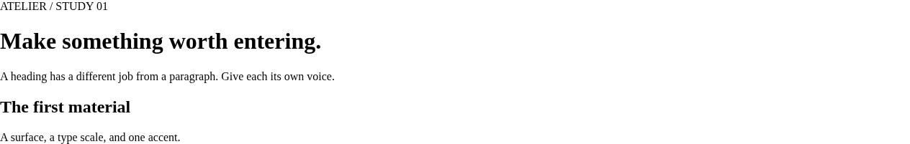
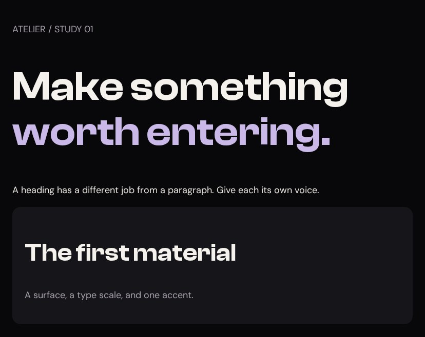

# Tokens and type

You enter the atelier with a browser, a text editor, and a blank page. Your first job is to choose the materials: background, surfaces, type, and light. By the end of this lesson, you will have a working HTML file and stylesheet, and you will be able to change the page's accent without hunting through every selector.

You are building **Nightfall Atelier**, a small portfolio page with a dramatic opening, project cards, a photo gallery, and interactive details. We will study two existing websites to see how real CSS produces those effects: **King Chrissy**, a personal landing page with gold typography and a portrait, and **ELEVEN28 by Shayla**, a fashion landing page with lilac accents and outfit photography. You do not need to know either person or project. Their names identify the reference files; screenshots show the designs, and every reconstruction includes its own complete code.

## Look at the transformation

The first picture is our HTML with its stylesheet disabled. The second is the same content after this lesson's CSS. Look at the heading's shape, the space inside the card, and the difference between the background and the surface.





**Your working files:** [Open the finished example](/assets/atelier/01/index.html) · [Download starter + finished files](/assets/atelier/downloads/01.zip) · [Read the complete CSS](/assets/atelier/01/styles.css).

Extract the download first. Open `start/index.html` by double-clicking it, and open that file in your editor too. Keep `shared/` beside `start/` and `finish/`: it contains the local fonts and images. There is no package manager, build step, or terminal command. Save an edit, then reload the browser. `finish/index.html` is your comparison when you get stuck.

## Read the palette in the real stylesheet

In Shayla's source, `:root` selects the document's root element. A name beginning with two hyphens defines a custom property. The value does nothing visually until another declaration uses it.

**Source excerpt:** ELEVEN28 by Shayla · fashion landing page, lines 15–42. [Read the complete source stylesheet](/assets/atelier/reference/shayla.css). Whitespace is expanded for readability; declarations are unchanged.

```css shayla.css
:root {
  --bg:#08080A;
  --surface:#111114;
  --card:#16161A;
  --hover:#1C1C22;
  --lilac:#C9B8E8;
  --lilac-light:#E3D9F5;
  --lilac-dark:#9B86C9;
  --lilac-rgb:201 184 232;
  --glow:rgba(201,184,232,.25);
  --champagne:#E8D5B7;
  --champagne-rgb:232 213 183;
  --text:#EAE6E1;
  --heading:#F5F2EE;
  --soft:#C6BFC4;
  --muted:#8A8A94;
  --faint:#55555E;
  --border:rgba(255,255,255,.06);
  --font-display:Clash,'Arial Narrow',Arial,sans-serif;
  --font-body:DM,Arial,sans-serif;
  --radius:16px;
  --ease:cubic-bezier(.22,.61,.36,1);
}
```

Read `--card: #16161A` as “give the card surface this named color.” Read `background: var(--card)` as “use the value of that name here.” The name lets related elements agree. Change the definition and every element using it can respond.

| Source token | Visual job | What to look for |
|---|---|---|
| `--bg` | Ground behind the page | Almost black, with room for lighter surfaces |
| `--card` | Raised surface | Enough separation to see the card without a heavy outline |
| `--heading` | Main information | Brighter than supporting copy |
| `--lilac` | Accent | Repeated in a small number of important places |
| `--lilac-rgb` | Channels for transparent color | A glow can reuse the hue at a different opacity |

King Chrissy makes a related choice with `--gold: #C8A97E`. Neither file makes every sentence an accent. The visual hierarchy depends on differences. In our reconstruction, we rename lilac to `--accent` so the components can later become green without being rewritten. We also make the muted text a little brighter for the lesson's reading surface.

## Create the HTML and connect the file

Replace `start/index.html` with this complete document. The `link` element is the connection to `styles.css`; merely creating a CSS file does not load it.

```html 01/index.html
<!doctype html>
<html lang="en">
<head>
  <meta charset="utf-8">
  <meta name="viewport" content="width=device-width, initial-scale=1">
  <title>Atelier · checkpoint 01</title>
  <link rel="stylesheet" href="styles.css">

</head>
<body>
<main class="specimen">
  <p class="muted">ATELIER / STUDY 01</p>
  <h1>Make something <span class="accent">worth entering.</span></h1>
  <p>A heading has a different job from a paragraph. Give each its own voice.</p>
  <div class="sample-card">
    <h2>The first material</h2>
    <p class="muted">A surface, a type scale, and one accent.</p>
  </div>
</main>
</body>
</html>
```

The `span` marks only the words receiving the accent. The `h1` is the main heading; the `h2` starts a smaller idea. Their meaning exists before CSS. We are styling that structure, not choosing heading levels because one happens to look bigger.

## Give each declaration a visible job

Replace `start/styles.css` with the complete block below. Both files stay in the same folder.

```css styles.css · checkpoint 01 addition
/* 01 — TOKENS AND TYPE */
@font-face {
  font-family: Clash;
  src: url('../shared/clash-600.woff2') format('woff2');
  font-weight: 600;
  font-display: swap;
}
@font-face {
  font-family: DM;
  src: url('../shared/dm-sans.ttf') format('truetype');
  font-weight: 100 900;
  font-display: swap;
}
:root {
  --bg: #08080A;
  --card: #16161A;
  --text: #EAE6E1;
  --heading: #F5F2EE;
  --muted: #A6A0AB;
  --accent: #C9B8E8;
  --accent-light: #E3D9F5;
  --accent-rgb: 201 184 232;
  --border: rgb(255 255 255 / .12);
  --display: Clash, Arial, sans-serif;
  --body: DM, Arial, sans-serif;
  --radius: 16px;
  --ease: cubic-bezier(.22, .61, .36, 1);
}
body {
  margin: 0;
  background: var(--bg);
  color: var(--text);
  font: 400 18px/1.7 var(--body);
}
h1, h2, h3 {
  color: var(--heading);
  font-family: var(--display);
  font-weight: 600;
  line-height: 1.1;
}
h1 { font-size: clamp(40px, 7vw, 80px); }
h2 { font-size: clamp(28px, 4vw, 48px); }
h3 { font-size: 24px; }
.accent { color: var(--accent); }
.muted { color: var(--muted); }
.specimen { max-width: 780px; margin: 64px auto; padding: 24px; }
.sample-card { background: var(--card); padding: 24px; border-radius: var(--radius); }
::selection { background: var(--accent); color: var(--bg); }
```

Work through it in order. The two `@font-face` rules assign local files to names used later. The path begins `../` because the browser leaves `start/`, then enters its sibling `shared/`. The URL is relative to the stylesheet. `font-display: swap` allows fallback text while the font loads.

The body declaration `font: 400 18px/1.7 var(--body)` packs four choices into one line: weight 400, size 18 pixels, line-height 1.7 times that size, and the body font family. The heading rules override the inherited family and line-height. A short heading can sit tightly; a paragraph needs more room between lines.

`clamp(40px, 7vw, 80px)` lets the heading grow with the viewport, but keeps it between 40 and 80 pixels. At 1,000 pixels wide, `7vw` is 70 pixels. At 390 pixels, that preferred size is only 27.3 pixels, so the 40-pixel lower bound wins.

The `.sample-card` selector matches `class="sample-card"`. Its background creates the surface; padding moves the content away from its edge; the radius rounds that edge. These are three separate decisions. You can switch them off one at a time in DevTools and see which part disappears.

## Change the material and predict the result

Change `--accent` to `#C8A97E`. Save and reload. **Expected:** the marked words become gold; the background and paragraph remain the same. In later lessons, change the RGB channels and light variant too when changing the whole accent family.

Now temporarily change `--display` to `Georgia, serif`. **Expected:** all three heading levels change family, while the body stays in DM Sans. Restore the display font afterward. You have proved that the text roles share a rule without becoming identical.

Finally, move the entire `:root` block to the bottom. The page still works. Custom properties are resolved through the cascade; their definitions do not have to occur earlier in the file than their uses. We keep tokens near the top because humans can find them there.

## Diagnose a missing color or font

If nothing changes, inspect the `link` path and the filename first. `style.css` and `styles.css` are different names. If the colors work but the heading looks ordinary, inspect the font request and confirm that you extracted `shared/`.

A misspelled custom property is another kind of failure. `color: var(--accnet)` has no value to substitute. For an ordinary, unregistered custom property, that invalid substitution can make `color` inherit or use its initial value; it does not simply revive an earlier color declaration. A fallback such as `var(--accent, #C9B8E8)` handles a missing token. [MDN explains this computed-value behavior](https://developer.mozilla.org/en-US/docs/Web/CSS/Guides/Cascading_variables/Using_custom_properties).

You are ready for [The shell](/atelier/the-shell/) when you can point from one visible choice to its selector and declaration, and change the accent and heading family independently. Keep your working files. The next lesson gives this palette a layout to inhabit.
