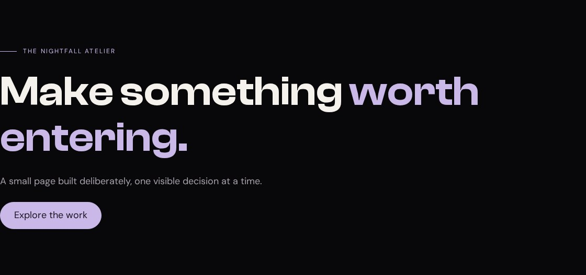

# The shell

Your palette is working. Now the page needs a skeleton. This lesson turns a specimen into a small site with aligned sections, a reusable pill, and a skip link. We will make the measurements visible instead of treating spacing as a mysterious sense of taste.

## See the shell before the decoration



**Your working files:** [Open the finished example](/assets/atelier/02/index.html) · [Download starter + finished files](/assets/atelier/downloads/02.zip) · [Read the complete CSS](/assets/atelier/02/styles.css).

The starter is the finished page from lesson 1. Keep its `styles.css`. Replace its HTML body using the block below, then append the new CSS to the bottom of that existing stylesheet. The finished files contain both lessons combined.

## Locate the source's shared measurements

Our reference is ELEVEN28 by Shayla, a fashion landing page with repeated sections aligned to a shared edge. These two rules from its actual stylesheet establish that alignment and spacing:

**Source excerpt:** ELEVEN28 by Shayla · fashion landing page, lines 62–63. [Read the complete source stylesheet](/assets/atelier/reference/shayla.css). Whitespace is expanded for readability; declarations are unchanged.

```css shayla.css
.container {
  width:calc(100% - 96px);
  max-width:1200px;
  margin:auto
}
.section {
  padding:160px 0
}
```

The container subtracts 96 pixels from the available width: 48 pixels for each side. `max-width` stops it growing beyond 1,200 pixels, and automatic margins share the remaining space equally. The section adds 160 pixels above and below its contents. That is a design choice for this particular site, not a universal minimum for attractive pages.

Our study uses a 1,120-pixel maximum, 24-pixel side gutters, and 88-pixel section padding. That makes the early exercise manageable on a phone while preserving the underlying relationship. At a 1,440-pixel viewport, the container is 1,120 pixels wide and the outside margins are 160 pixels each. At 390 pixels, it is 342 pixels wide with 24-pixel margins.

## Put the structure in the document

Keep the document's `head` from lesson 1. Replace everything between `<body>` and `</body>` with this markup. All the links point to IDs that exist here.

```html index.html · checkpoint 02 addition
<a class="skip pill" href="#main">Skip to content</a>
<main id="main" tabindex="-1">
  <section class="section container stack page-start">
    <p class="eyebrow">The nightfall atelier</p>
    <h1>Make something <span class="accent">worth entering.</span></h1>
    <p class="muted">A small page built deliberately, one visible decision at a time.</p>
    <a class="pill" href="#work">Explore the work</a>
  </section>
  <section class="section container stack" id="work" tabindex="-1">
    <p class="eyebrow">01 / The work</p>
    <h2>A place for your work</h2>
    <p>Choose one project you can explain: who it helps, what you changed, and what you learned.</p>
  </section>
  <section class="section container stack" id="gallery" tabindex="-1">
    <p class="eyebrow">02 / Observations</p>
    <h2>Look before you decorate</h2>
    <p>Notice where the headings begin. Their shared edge is doing quiet work.</p>
  </section>
  <section class="section container stack" id="motion" tabindex="-1">
    <p class="eyebrow">03 / A practice</p>
    <h2>Change one thing. Look again.</h2>
    <p>A useful experiment has a before, an after, and a reason you can explain.</p>
  </section>
</main>
<footer><div class="container">Atelier study · Arthur Bernier Jr</div></footer>
```

`main` identifies the page's central content. The skip link points to its `id`. A `section` groups a related heading and paragraph. An anchor is the right control for “Explore the work” because it navigates to a destination; later we use buttons for actions such as opening a menu.

The class list `section container stack` means the same element receives three roles. `.section` provides vertical room. `.container` provides the shared width and alignment. `.stack` spaces its children. You do not need a new class for every combination of those jobs.

## Build the reusable rules

Append this block after lesson 1's CSS:

```css styles.css · checkpoint 02 addition
/* 02 — THE SHELL */
*, *::before, *::after { box-sizing: border-box; }
h1, h2, h3, p, figure { margin: 0; }
img { display: block; max-width: 100%; }
a { color: inherit; }
button { font: inherit; cursor: pointer; }
[hidden] { display: none !important; }
html { scroll-padding-top: 120px; }
.container { width: min(1120px, calc(100% - 48px)); margin-inline: auto; }
.section { padding-block: 88px; }
.stack > * + * { margin-top: 24px; }
.eyebrow {
  display: flex;
  align-items: center;
  gap: 12px;
  color: var(--accent);
  font-size: 12px;
  letter-spacing: .18em;
  text-transform: uppercase;
}
.eyebrow::before { content: ''; width: 32px; height: 1px; background: currentColor; }
.pill {
  display: inline-flex;
  justify-content: center;
  align-items: center;
  min-height: 52px;
  padding: 12px 26px;
  border: 1px solid var(--accent);
  border-radius: 999px;
  background: var(--accent);
  color: #17101E;
  font-weight: 600;
  line-height: 1.4;
  text-decoration: none;
}
.pill.ghost { background: transparent; color: var(--text); border-color: var(--border); }
:focus-visible { outline: 3px solid var(--accent); outline-offset: 5px; }
.skip {
  position: fixed;
  top: 12px;
  left: 12px;
  z-index: 500;
  transform: translateY(-150%);
}
.skip:focus { transform: translateY(0); }
footer { padding-block: 32px; border-top: 1px solid var(--border); color: var(--muted); }
```

Start with `box-sizing: border-box`. Declared widths now include padding and borders, which makes the measurements you write easier to reconcile with the visible box. Including `::before` and `::after` applies the same accounting to generated decorations.

The reset removes margins from the elements we intend to space ourselves. It does not mean every browser default is bad. We are replacing a small set of defaults with explicit relationships. Without a replacement, zeroing every margin would simply crowd the page.

Read `.stack > * + *` slowly: inside a stack, select a direct child that follows another child. Give those later children 24 pixels of top margin. The first child gets none. This creates consistent gaps without pushing the whole group down an extra time.

The eyebrow's `::before` is a generated decorative line. `content: ''` creates its box. Flex layout places that box beside the text. `currentColor` gives the line the same color as the eyebrow, so it follows a later theme change.

The pill uses `inline-flex` so its background hugs the content rather than filling a whole row. Padding makes the target comfortable; `min-height` sets a floor while allowing taller wrapped text. A huge radius produces the rounded ends. Our ghost variant changes the surface and border while keeping the dimensions.

## Inspect the box and test the entrance

Open DevTools, select the first section, and find the box-model diagram. Temporarily change `.container` to `width: 100%`. **Expected:** the shared edge moves to the window's edge; the section's vertical padding remains. Restore it. You have separated the horizontal and vertical responsibilities.

Next change `.stack > * + *` to 48 pixels. **Expected:** the gaps inside each stack double, but the container's left edge does not move. Restore 24 pixels. When a layout feels wrong, knowing which relationship changed is more useful than trying random numbers on every element.

Reload and press Tab before clicking anything. The skip pill should appear in the top-left corner with a focus outline. Press Enter. Focus moves to `main`, whose `tabindex="-1"` allows a programmatic or fragment-navigation focus target without adding a normal Tab stop. The next Tab proceeds through the content's links.

The link is moved offscreen with a transform while unfocused; it is not removed with `display: none`. A hidden-from-layout link could not receive the keyboard focus needed to reveal itself. Keep the outline: it tells you where the next action will occur.

## Repair the common spacing mistakes

If every section has a different left edge, look for extra horizontal padding on individual children. If the pill fills a whole row, check whether another rule changed it to `display: flex` or `block`. If the eyebrow line is missing, check `content`, width, and height before changing its color.

Finish by resizing to 390 pixels. The text should wrap inside the gutters and the pill should remain readable. You have completed the shell when you can explain why the container aligns sections, why the stack spaces children, and why the skip link exists. [The fixed nav](/atelier/the-fixed-nav/) now has a stable page to sit above.
