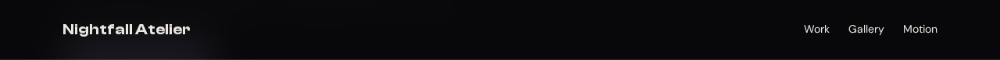
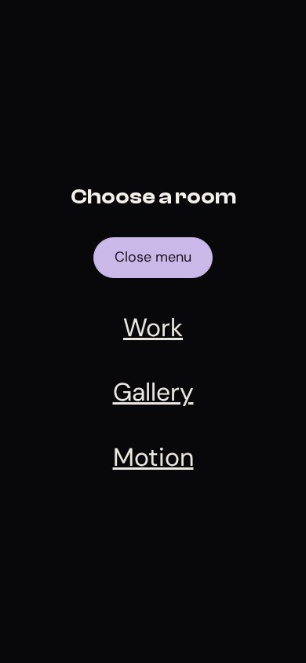

# The fixed nav

A fixed navigation bar has two relationships to manage: where it sits in the viewport and how it remains legible over the page beneath it. The subtle transformation from clear to frosted is a state change. We will build both appearances, then give the browser a way to choose between them.

## Compare the two states




**Your working files:** [Open the finished example](/assets/atelier/03/index.html) · [Download starter + finished files](/assets/atelier/downloads/03.zip) · [Read the complete CSS](/assets/atelier/03/styles.css) · [Read the complete JavaScript](/assets/atelier/03/app.js).

Start from lesson 2's files. The download also contains the complete script, so you can inspect the result even if DOM events are new to you. [Session 3.5](/path/3-5-casting-on-the-world/) develops the event-handling ideas further; the walkthrough here explains the smaller contract needed for this component.

## Read the production nav and underline

The fashion landing page ELEVEN28 by Shayla uses a navigation bar that changes as you scroll. Its actual stylesheet defines the unscrolled bar and its modifier side by side:

**Source excerpt:** ELEVEN28 by Shayla · fashion landing page, lines 139–140. [Read the complete source stylesheet](/assets/atelier/reference/shayla.css). Whitespace is expanded for readability; declarations are unchanged.

```css shayla.css
.nav {
  position:fixed;
  top:0;
  left:0;
  right:0;
  height:82px;
  padding:0 48px;
  display:flex;
  align-items:center;
  gap:40px;
  z-index:100;
  border-bottom:1px solid transparent;
  transition:opacity .65s ease,background .3s,border-color .3s
}
.nav.scrolled {
  background:rgb(8 8 10 / .88);
  backdrop-filter:blur(24px);
  -webkit-backdrop-filter:blur(24px);
  border-color:var(--border)
}
```

`position: fixed` anchors the bar to the viewport in this page. The inset coordinates span the top edge. Removing it from normal flow means the following content no longer makes room for it automatically. That is why our first section receives extra top padding.

The scrolled background is translucent. `backdrop-filter` blurs what is behind the bar; an opaque background would conceal that blurred image. The border adds a quiet separation from the content. JavaScript will add the class, but CSS owns the colors and timing.

The underline is another small box:

**Source excerpt:** ELEVEN28 by Shayla · fashion landing page, lines 145–148. [Read the complete source stylesheet](/assets/atelier/reference/shayla.css). Whitespace is expanded for readability; declarations are unchanged.

```css shayla.css
.nav-links a {
  font-size:12px;
  text-transform:uppercase;
  letter-spacing:.07em;
  color:#A4A4AD;
  position:relative;
  transition:color .2s
}
.nav-links a:hover {
  color:var(--lilac)
}
.nav-links a::after {
  content:'';
  position:absolute;
  left:0;
  bottom:-8px;
  right:100%;
  height:1px;
  background:var(--lilac);
  transition:right .25s var(--ease)
}
.nav-links a:hover::after {
  right:0
}
```

The anchor's `position: relative` establishes the containing box for its absolute pseudo-element. With `left: 0` and `right: 100%`, the underline has no width. Moving the right inset to zero lets it occupy the link's width. The transition fills in the intermediate states.

## Add the markup and the CSS

Insert this block immediately before `<main id="main" ...>` in your existing HTML. Leave the skip link first in the body. Our menu uses a native `dialog` as a deliberate adaptation: it supplies modal focus behavior instead of making you invent a focus trap while learning the styling.

```html index.html · checkpoint 03 addition
<header class="site-nav">
  <div class="nav-inner container">
    <a class="brand" href="#main">Nightfall Atelier</a>
    <nav class="nav-links" aria-label="Main navigation">
      <a href="#work">Work</a><a href="#gallery">Gallery</a><a href="#motion">Motion</a>
    </nav>
    <button class="pill ghost menu-toggle" id="menu-button" type="button"
      aria-controls="menu" aria-expanded="false" hidden>Menu</button>
  </div>
</header>
<dialog class="menu-panel" id="menu" aria-labelledby="menu-title">
  <h2 id="menu-title">Choose a room</h2>
  <button class="pill" id="close-menu" type="button" autofocus>Close menu</button>
  <nav aria-label="Mobile navigation">
    <a href="#work">Work</a><a href="#gallery">Gallery</a><a href="#motion">Motion</a>
  </nav>
</dialog>
```

Append these rules to `styles.css`. The source's underline responds to hover; our reconstruction also responds to keyboard focus.

```css styles.css · checkpoint 03 addition
/* 03 — FIXED NAVIGATION AND ITS STATES */
.site-nav {
  position: fixed;
  inset: 0 0 auto;
  z-index: 100;
  border-bottom: 1px solid transparent;
  transition: background .25s, border-color .25s;
}
.site-nav.scrolled {
  background: rgb(8 8 10 / .88);
  backdrop-filter: blur(24px);
  border-color: var(--border);
}
.nav-inner { display: flex; flex-wrap: wrap; align-items: center; justify-content: space-between; gap: 14px; min-height: 76px; padding-block: 16px; }
.brand { font-family: var(--display); font-size: 20px; text-decoration: none; }
.nav-links { display: flex; flex-wrap: wrap; gap: 24px; }
.nav-links a { position: relative; text-decoration: none; font-size: 14px; }
.nav-links a::after {
  content: '';
  position: absolute;
  left: 0;
  right: 100%;
  bottom: -6px;
  height: 2px;
  background: var(--accent);
  transition: right .25s var(--ease);
}
.nav-links a:is(:hover, :focus-visible)::after { right: 0; }
.page-start { padding-top: 150px; }
.menu-toggle { display: none; }
.menu-panel {
  position: fixed;
  inset: 0;
  width: 100%;
  height: 100%;
  max-width: none;
  max-height: none;
  margin: 0;
  border: 0;
  padding: 32px;
  background: var(--bg);
  color: var(--text);
}
.menu-panel[open] { display: flex; flex-direction: column; justify-content: center; align-items: center; gap: 36px; }
.menu-panel nav { display: grid; gap: 28px; text-align: center; font-size: 32px; }
@media (max-width: 760px) {
  .enhanced .nav-links { display: none; }
  .enhanced .menu-toggle { display: inline-flex; }
}
@media (prefers-reduced-motion: reduce) {
  .site-nav, .nav-links a::after { transition: none; }
}
```

`.site-nav` is the component's identity. `.site-nav.scrolled` means that same element has both classes. It does not mean an element named `scrolled` lives inside the nav. That distinction is worth noticing now: a space between selectors would express a descendant relationship instead.

The menu's layout is attached to `.menu-panel[open]`. A closed dialog should retain its native hidden behavior. Giving every dialog `display: flex` unconditionally would accidentally defeat that hiding.

At 760 pixels and below, enhanced pages hide the horizontal links and show the Menu button. Without JavaScript, the enhancement class is absent and the ordinary links remain usable. The button also starts with `hidden`, so a failed script does not leave a dead control.

## Connect the state changes

Create `app.js` beside `index.html`. Add this to the document's `head`, beneath the stylesheet link:

```html index.html · inside head
<script src="app.js" defer></script>
```

`defer` lets the browser finish parsing the document before the script queries its elements. Paste this complete script into `app.js`:

```js app.js · checkpoint 03 addition
// 03 — JavaScript changes state; CSS describes the appearance.
const nav = document.querySelector('.site-nav');
const menu = document.querySelector('#menu');
const menuButton = document.querySelector('#menu-button');
function updateNav() { nav.classList.toggle('scrolled', scrollY > 16); }
addEventListener('scroll', updateNav, { passive: true });
updateNav();
menuButton.addEventListener('click', () => {
  menu.showModal();
  menuButton.setAttribute('aria-expanded', 'true');
});
document.querySelector('#close-menu').addEventListener('click', () => menu.close());
menu.addEventListener('close', () => menuButton.setAttribute('aria-expanded', 'false'));
menu.querySelectorAll('a').forEach(link => {
  link.addEventListener('click', () => {
    menu.close();
    document.querySelector(link.hash)?.focus({ preventScroll: true });
  });
});
matchMedia('(min-width: 761px)').addEventListener('change', event => {
  if (event.matches && menu.open) menu.close();
});
menuButton.hidden = false;
document.documentElement.classList.add('enhanced');
```

`updateNav` asks whether the scroll position is beyond 16 pixels and makes the class match that answer. Calling it once handles a page opened at an existing scroll position; registering it as a listener handles later movement.

`showModal()` opens the menu in the browser's top layer. Content outside a modal dialog becomes inert while it is open. The native Escape behavior closes it, and the `close` listener keeps `aria-expanded` synchronized. The [dialog documentation](https://developer.mozilla.org/en-US/docs/Web/API/HTMLDialogElement/showModal) explains this relationship.

The link handler closes the dialog before moving focus to the selected section. The section has `tabindex="-1"` from lesson 2. The resize listener closes a phone menu if the viewport becomes wide enough to restore desktop navigation.

## Walk through the effect yourself

Scroll a few hundred pixels. Inspect the header and watch `scrolled` appear. Delete that class in DevTools while staying at the same scroll position: the frosted surface should disappear. This proves which part of the effect is the CSS state and which part is the event that selects it.

Hover a desktop link, then reach it with Tab. In both cases the underline should expand. Temporarily delete `content: ''` from the pseudo-element: the underline disappears because there is no generated box to paint.



At phone width, open Menu, press Tab through its controls, and press Escape. Focus should return to the opener, and `aria-expanded` should read `false`. Open it again and select Gallery: the dialog closes and the page navigates to that section. If the title hides behind the fixed bar, inspect `scroll-padding-top` on `html`.

You have finished when the bar changes on scroll, the underline works by keyboard, and the phone menu can be escaped. Keep the working script: later lessons append their own small behaviors instead of replacing this one.
