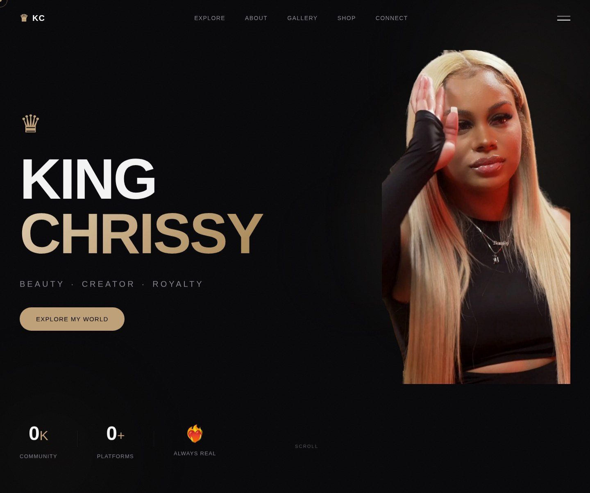
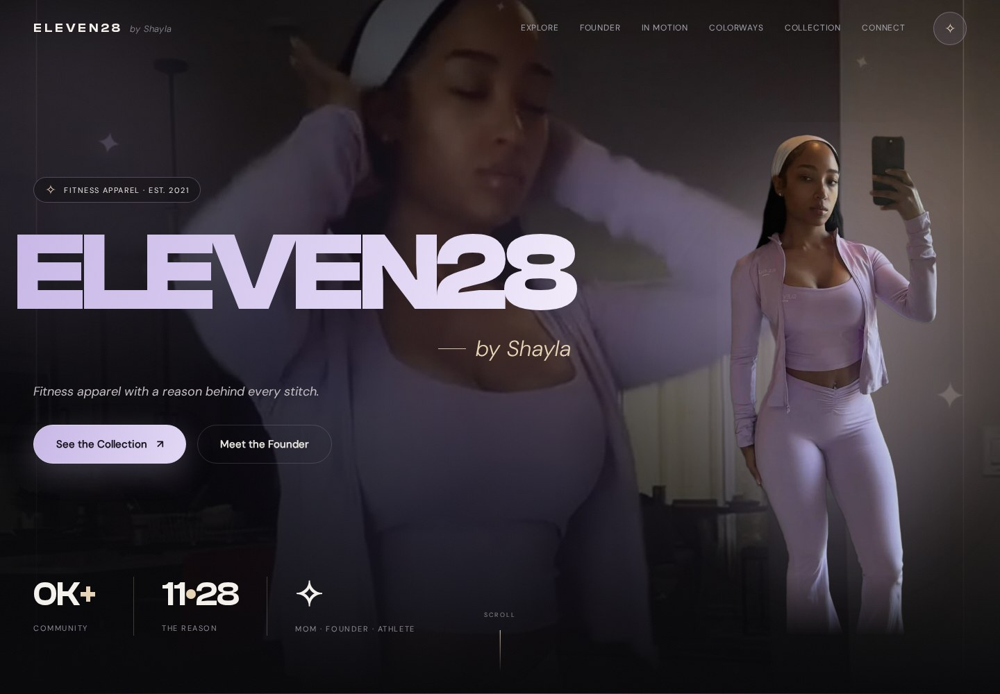
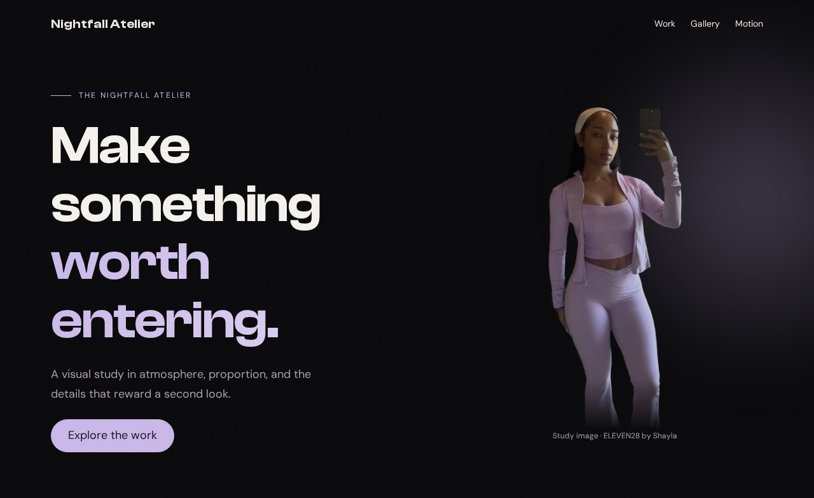
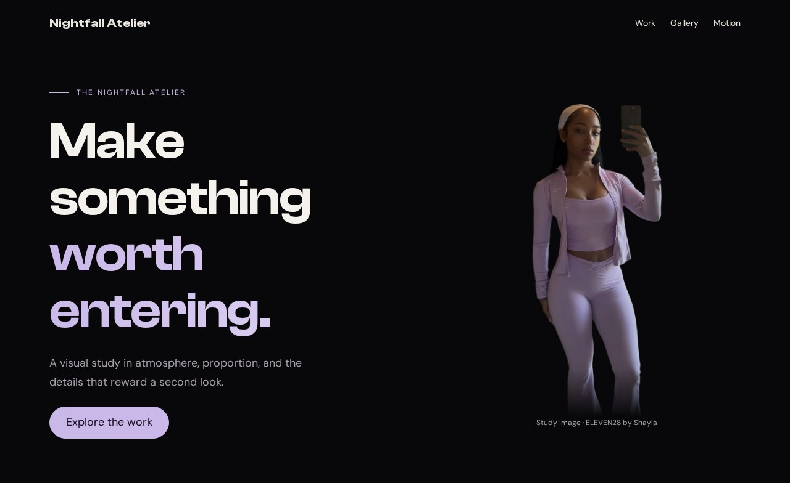

# The hero

The hero is the doorway. Before someone reads your projects, its proportions tell them whether this place feels deliberate. That impression is not one secret effect. It comes from a few decisions working together: where the text sits, how much room the portrait receives, and which details remain behind the content.

## Look at the originals, then the reconstruction

We are comparing two existing websites: King Chrissy is a personal landing page with a gold palette; ELEVEN28 by Shayla is a fashion landing page with lilac accents and outfit photography. Their names are simply labels for the source examples. Look at the compositions below before reading their CSS.





Our reconstruction borrows those relationships. The portrait is a study asset from Shayla's site; the layout and wording are deliberately smaller so you can understand every rule.



**Your working files:** [Open the finished example](/assets/atelier/04/index.html) · [Download starter + finished files](/assets/atelier/downloads/04.zip) · [Read the complete CSS](/assets/atelier/04/styles.css) · [Read the complete JavaScript](/assets/atelier/04/app.js).

Start with checkpoint 3. Keep the navigation, menu, stylesheet, and script. Replace the first section inside `main`—the one with `page-start`—with the hero markup below. Leave the Work, Gallery, and Motion sections in place.

## Read the split in the real stylesheet

King Chrissy starts with a vertical flex arrangement and changes direction when the viewport has enough room:

**Source excerpt:** King Chrissy · personal landing page, lines 281–291. [Read the complete source stylesheet](/assets/atelier/reference/chrissy.css). Whitespace is expanded for readability; declarations are unchanged.

```css chrissy.css
.hero__split  {
  display: flex;
  flex-direction: column;
  align-items: center;
  gap: 40px;
  text-align: center;
}
@media (min-width: 900px)  {
  .hero__split  {
    flex-direction: row;
    justify-content: space-between;
    text-align: left;
    gap: 0;
  }
}
```

The breakpoint changes the relationship between the two children. It does not create a second hero. Read the declarations together: a row, space between its children, and left-aligned text. Moving just `flex-direction` without reconsidering alignment would give you a different composition.

Here is the original title treatment, including its actual size range and gradient:

**Source excerpt:** King Chrissy · personal landing page, lines 302–312. [Read the complete source stylesheet](/assets/atelier/reference/chrissy.css). Whitespace is expanded for readability; declarations are unchanged.

```css chrissy.css
.hero__line  {
  font-family: var(--font-heading);
  font-size: clamp(52px, 12vw, 140px);
  font-weight: 700;
  line-height: 0.95;
  letter-spacing: -0.03em;
  color: var(--white);
  display: block;
}
.hero__line--accent  {
  background: linear-gradient(135deg, var(--gold-light), var(--gold), var(--gold-dark));
  -webkit-background-clip: text;
  -webkit-text-fill-color: transparent;
  background-clip: text;
}
```

That `12vw` means twelve percent of viewport width. At 1,000 pixels it asks for 120 pixels; the minimum and maximum stop it shrinking below 52 or growing beyond 140. Our version uses a smaller range because our headline is a sentence, not a short name. The right type scale depends on the content you put inside it.

## Place content before painting the background

Replace the first section with this HTML:

```html index.html · checkpoint 04 addition
<section class="hero">
  <div class="hero-orb" aria-hidden="true"></div>
  <div class="hero-grain" aria-hidden="true"></div>
  <div class="hero-inner container">
    <div class="hero-copy stack">
      <p class="eyebrow">The nightfall atelier</p>
      <h1>Make something <span>worth entering.</span></h1>
      <p>A visual study in atmosphere, proportion, and the details that reward a second look.</p>
      <a class="pill" href="#work">Explore the work</a>
    </div>
    <figure class="portrait">
      
      <figcaption>Study image · ELEVEN28 by Shayla</figcaption>
    </figure>
  </div>
</section>
```

The reading order is eyebrow, heading, explanation, action, portrait. CSS can arrange those pieces beside each other on a wide screen without making the document difficult to follow on a narrow one. The two atmosphere elements are empty decorations and are hidden from assistive technology.

The portrait uses a transparent cutout. A photograph with its own rectangular background will not produce this same silhouette just because you copy the CSS. The starter download includes the exact image shown here, so you can separate an asset problem from a layout problem.

Append the following to `styles.css`:

```css styles.css · checkpoint 04 addition
/* 04 — HERO: CONTENT OVER ATMOSPHERE */
.hero { position: relative; isolation: isolate; overflow: hidden; }
.hero-inner {
  display: grid;
  grid-template-columns: minmax(0, 1fr);
  gap: 48px;
  align-items: center;
  padding-block: 140px 72px;
}
.hero-copy { position: relative; z-index: 2; }
.hero h1 { font-size: clamp(42px, 6.5vw, 88px); letter-spacing: -.025em; }
.hero h1 span {
  display: block;
  color: var(--accent);
}
@supports (background-clip: text) {
  .hero h1 span {
    background: linear-gradient(105deg, var(--accent), var(--accent-light));
    background-clip: text;
    color: transparent;
  }
}
.hero-copy p:not(.eyebrow) { max-width: 38ch; color: var(--muted); }
.portrait { position: relative; z-index: 1; width: min(100%, 380px); justify-self: center; }
.portrait img {
  width: 100%;
  height: 520px;
  object-fit: contain;
  object-position: center bottom;
  mask-image: linear-gradient(#000 85%, transparent);
}
.portrait figcaption { font-size: 12px; color: var(--muted); text-align: center; }
.hero-orb {
  position: absolute;
  width: 620px;
  height: 620px;
  top: 0;
  right: -220px;
  z-index: -1;
  pointer-events: none;
  background: radial-gradient(circle, rgb(var(--accent-rgb) / .28), transparent 65%);
  filter: blur(50px);
}
.hero-grain { position: absolute; inset: 0; z-index: 3; pointer-events: none; opacity: .035; background: url('../shared/grain.svg'); }
@media (min-width: 900px) {
  .hero-inner { grid-template-columns: minmax(0, 1.3fr) minmax(0, 1fr); }
}
```

## Follow the rules from layout to light

First read `.hero-inner`. Below 900 pixels it has one column; at 900 and above it has two. `1.3fr` gives the text a larger share of the available space than the portrait's `1fr`, after the gap is deducted. `minmax(0, …)` allows a track to shrink below its contents' automatic minimum; long content must still wrap sensibly. `align-items: center` aligns the two children vertically within their grid row.

Now inspect the heading's `clamp(42px, 6.5vw, 88px)`. At 390 pixels, the preferred value is only 25.35 pixels, so the result is the 42-pixel minimum. At 1,280 pixels, it is 83.2 pixels. At 1,440 pixels, the preferred value exceeds the maximum and the result is 88. The column width controls wrapping; `clamp` controls the size of each letter. They solve related but different problems.

The accent span has a readable solid color first. Inside the feature query, a gradient is clipped to the shapes of its letters and the ordinary text color becomes transparent. The fallback remains available if that clipping feature is unsupported. Turning the text transparent without providing a clipped background would make it disappear.

Next inspect the portrait. Its box is 520 pixels tall, but `object-fit: contain` preserves the entire cutout inside that box. `object-position: center bottom` places spare room above it. The mask stays opaque through 85 percent of the image box, then fades to transparent at the bottom. That softens the end of the cutout; it does not remove the need for a suitable source image.

Finally, read the layers. The hero establishes an isolated stacking context. The orb sits behind the content; the grain sits above it at very low opacity. `pointer-events: none` lets clicks pass through those decorative layers. The radial gradient makes the glow, while blur softens it further. Neither one positions the heading—that job belongs to the grid.

## Remove an effect and explain the difference



In DevTools, set `display: none` on `.hero-orb` and `.hero-grain`. **Expected:** every content element stays in the same position; the background loses atmosphere. Restore them, then increase the orb's alpha from `.28` to `.6`. **Expected:** a stronger lilac glow, with no extra space added to the layout. Restore `.28` before continuing.

Change the desktop columns to `1fr 1fr`. **Expected:** the text receives less room and may wrap sooner, while the portrait keeps its own maximum width. This experiment changes composition, unlike the glow experiment. Being able to tell those changes apart is the beginning of controlling the design.

If the portrait is missing, inspect its `src` and keep `shared/` beside your working folder. If the glow blocks links, inspect `pointer-events`. If the hero is hidden behind the fixed nav, inspect the top padding on `.hero-inner`. Rebuild the visible relationship before adding more effects. Next, give the rest of the page destinations worth entering in [Cards and the link grid](/atelier/cards-and-the-link-grid/).
