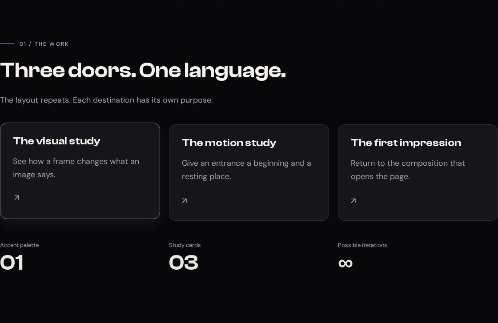

# Cards and the link grid

A good card is a promise: this whole surface takes you somewhere useful. Its appearance should make that promise easy to recognize before hover ever happens. In this lesson, three destinations share a visual language while keeping distinct labels and descriptions.

## See the resting state and the response




**Your working files:** [Open the finished example](/assets/atelier/05/index.html) · [Download starter + finished files](/assets/atelier/downloads/05.zip) · [Read the complete CSS](/assets/atelier/05/styles.css) · [Read the complete JavaScript](/assets/atelier/05/app.js).

Begin with checkpoint 4. Replace the section with `id="work"` using the HTML below, then append the CSS. Keep all earlier rules. You will have three working links: one to the gallery, one to the motion section, and one back to the beginning.

## Inspect the original link cards

Our reference, ELEVEN28 by Shayla, is a fashion landing page whose cards link visitors to its featured destinations. These are its actual grid and interaction rules:

**Source excerpt:** ELEVEN28 by Shayla · fashion landing page, lines 203–206. [Read the complete source stylesheet](/assets/atelier/reference/shayla.css). Whitespace is expanded for readability; declarations are unchanged.

```css shayla.css
.link-stack {
  display:grid;
  grid-template-columns:repeat(2,minmax(0,1fr));
  gap:16px
}
.link-card {
  background:var(--card);
  border:1px solid var(--border);
  border-radius:var(--radius);
  min-height:96px;
  display:flex;
  align-items:center;
  padding:20px;
  gap:16px;
  transition:background .25s,translate .25s var(--ease),border-color .25s,box-shadow .25s
}
.link-card:hover {
  background:var(--hover);
  border-color:rgb(var(--lilac-rgb) / .42);
  translate:0 -4px;
  box-shadow:0 8px 28px rgb(var(--lilac-rgb) / .08)
}
.link-card.featured {
  grid-column:1/-1;
  padding:20px 28px;
  gap:24px;
  background:linear-gradient(135deg,rgb(var(--lilac-rgb) / .09),transparent 70%),var(--card);
  border-color:rgb(var(--lilac-rgb) / .18)
}
```

The original grid uses two equal columns. The featured card spans both, so it can carry more emphasis without requiring a completely different component. Hover translates a card upward by four pixels and changes its border and shadow. The small movement matters because the resting state already provides a clear shape.

Notice the separation of jobs. Grid decides where the card belongs. Padding decides the room inside it. Translation changes where it is painted without reserving a new layout position. A shadow suggests depth but does not make the box physically taller. If you try to create the lift by adding margin on hover, you can push surrounding content around instead of making the card feel responsive.

Our version keeps the visual language and replaces the fixed two-column arrangement with a grid that fits as many useful-width cards as it can. That lets you inspect a different layout decision while rebuilding the same kind of component.

## Give each surface a destination

Replace the existing Work section with this block:

```html index.html · checkpoint 05 addition
<section class="section container" id="work" tabindex="-1">
  <div class="section-head stack">
    <p class="eyebrow">01 / The work</p><h2>Three doors. One language.</h2>
    <p class="muted">The layout repeats. Each destination has its own purpose.</p>
  </div>
  <div class="cards">
    <a class="card reveal" href="#gallery"><h3>The visual study</h3><p>See how a frame changes what an image says.</p><span class="arrow" aria-hidden="true">↗</span></a>
    <a class="card reveal" href="#motion"><h3>The motion study</h3><p>Give an entrance a beginning and a resting place.</p><span class="arrow" aria-hidden="true">↗</span></a>
    <a class="card reveal" href="#main"><h3>The first impression</h3><p>Return to the composition that opens the page.</p><span class="arrow" aria-hidden="true">↗</span></a>
  </div>
  <dl class="stats">
    <div><dt>Accent palette</dt><dd>01</dd></div>
    <div><dt>Study cards</dt><dd>03</dd></div>
    <div><dt>Possible iterations</dt><dd>∞</dd></div>
  </dl>
</section>
```

Each card is a single anchor. You can click anywhere inside it or focus it with Tab. Do not put another button or anchor inside the card: that would create competing interactive controls. If your future card needs several independent actions, make its outer element a non-interactive article and give those actions their own controls instead.

The arrow is decorative, so it has `aria-hidden="true"`. The heading and description provide the actual meaning. “The visual study” is more useful than three repeated links called “Click here.” A destination should still make sense when a person cannot see the arrow.

The statistics use a description list: each `dt` names a measure and each `dd` supplies its value. These are actual properties of this small study, not invented follower counts or fake accomplishments. You do not need animated numbers to make this row belong to the design.

## Make the grid and interaction

Append the following CSS:

```css styles.css · checkpoint 05 addition
/* 05 — ONE CARD, MANY DESTINATIONS */
.section-head { max-width: 680px; margin-bottom: 40px; }
.cards { display: grid; grid-template-columns: repeat(auto-fit, minmax(min(100%, 250px), 1fr)); gap: 20px; }
.card {
  display: block;
  position: relative;
  min-width: 0;
  padding: 28px;
  border: 1px solid var(--border);
  border-radius: var(--radius);
  background: var(--card);
  text-decoration: none;
  overflow-wrap: anywhere;
  transition: translate .25s var(--ease), border-color .25s, box-shadow .25s;
}
.card p { margin-top: 16px; color: var(--muted); }
.card .arrow { display: inline-block; margin-top: 24px; color: var(--accent); transition: translate .25s; }
.card:focus-visible { border-color: var(--accent); }
@media (hover: hover) and (pointer: fine) {
  .card:hover { translate: 0 -4px; border-color: rgb(var(--accent-rgb) / .6); box-shadow: 0 12px 32px rgb(var(--accent-rgb) / .08); }
  .card:hover .arrow { translate: 3px -3px; }
}
.stats { display: grid; grid-template-columns: repeat(3, minmax(0, 1fr)); gap: 20px; margin-top: 44px; }
.stats dt { color: var(--muted); font-size: 13px; }
.stats dd { margin: 0; font: 600 clamp(28px, 5vw, 48px)/1.2 var(--display); }
@media (prefers-reduced-motion: reduce) {
  .card, .card .arrow { transition: none; }
  .card:hover, .card:hover .arrow { translate: none; }
}
```

Read the long grid declaration from the inside out. `min(100%, 250px)` says the minimum card width should be 250 pixels unless the container itself is narrower. `minmax(…, 1fr)` lets each column grow beyond that minimum. `auto-fit` repeats as many such columns as fit and collapses empty tracks so the available cards can use the space.

At a container width of 1,120 pixels, three cards with two 20-pixel gaps receive 360 pixels each: `(1120 - 40) / 3`. At a 342-pixel container, two 250-pixel cards plus a gap cannot fit, so the cards stack. We did not have to guess a phone breakpoint for this particular grid.

The nested `min()` matters at very narrow widths. A hard 250-pixel minimum can force overflow when the available space is smaller than that. Allowing the minimum to shrink to the container width solves that part of the problem; `overflow-wrap: anywhere` also gives unusually long text somewhere to break.

The base card declares the properties that transition. The hover rule supplies their new values. `translate: 0 -4px` moves the card upward, while the arrow moves slightly up and right. The alpha in the shadow is intentionally small. The goal is a response you notice when you interact, not a permanent glowing box around every item.

## Try the interaction with different inputs

Use a mouse to hover the first card. The neighbors should remain still. Move away and the card should settle back. Now use Tab: the focused card should have a visible outline from the shell rules and the accent border from this lesson. Press Enter and confirm that it reaches its named section.

The lift is inside a hover-and-fine-pointer query. A touch screen should not depend on hover to communicate that these are links. A keyboard user receives a visible focus treatment. With reduced motion enabled, the card still has its border and focus treatment, but the movement and transitions are removed.

Try changing the grid's 250-pixel preferred minimum to 400 pixels. **Expected at a 1,120-pixel container:** only two columns fit, so the third card moves to the next row. Restore 250. Then change the card radius to zero. **Expected:** square corners, with the grid, destinations, and typography unchanged. These two experiments affect different layers of the design.

## Diagnose a card before decorating it again

If one card stretches the page sideways, inspect its text and minimum width. If hovering shifts the next section, look for a margin or height change that is affecting layout. If clicking does nothing, inspect the destination ID before touching CSS. If the cards appear crowded, distinguish between padding inside a card and the grid gap between cards.

Your finished component should survive a longer heading. Replace “The visual study” with “A study of how framing changes a photograph,” then narrow the browser. The card may become taller; it should not cut off the text or cover the next card. Restore the original label after the test. You are ready for [Pictures](/atelier/pictures/) when the component works with real content, not just with the shortest possible demo text.
