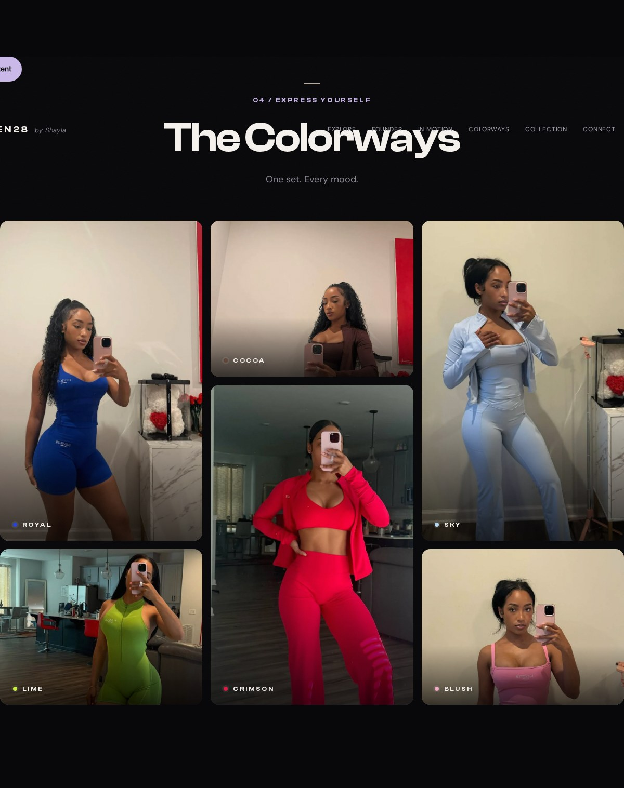
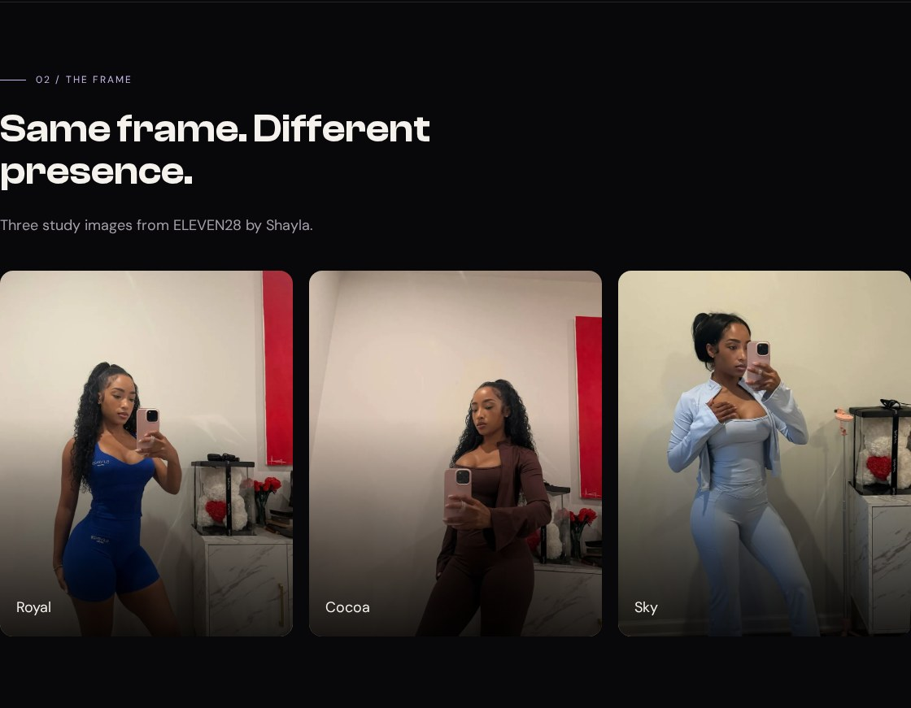
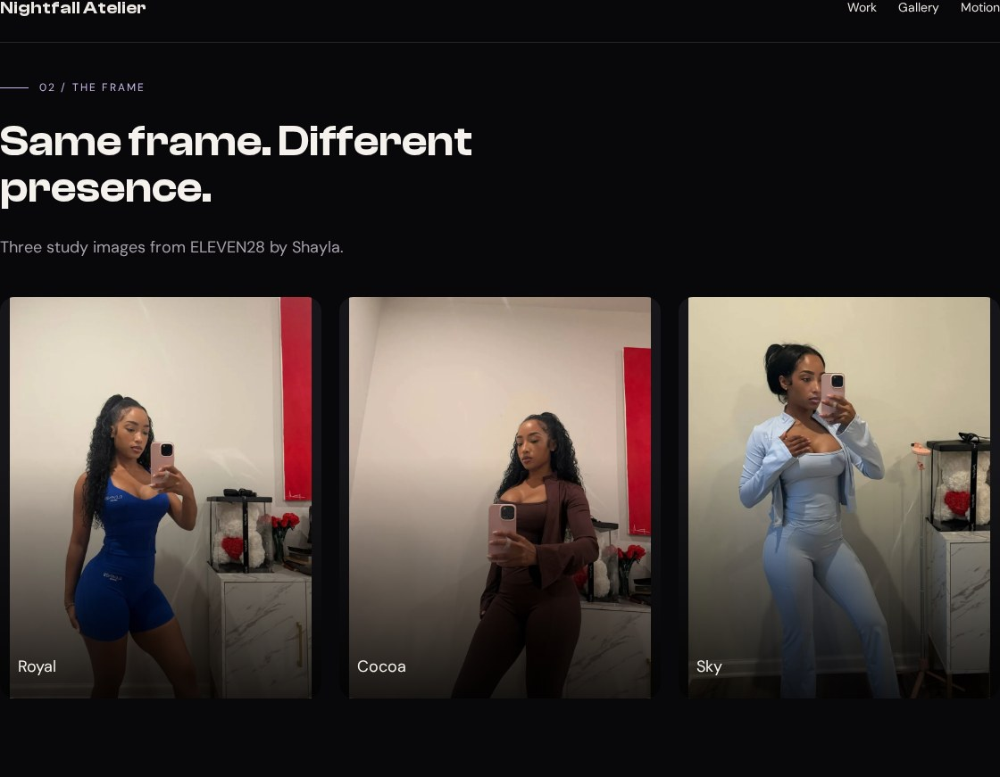
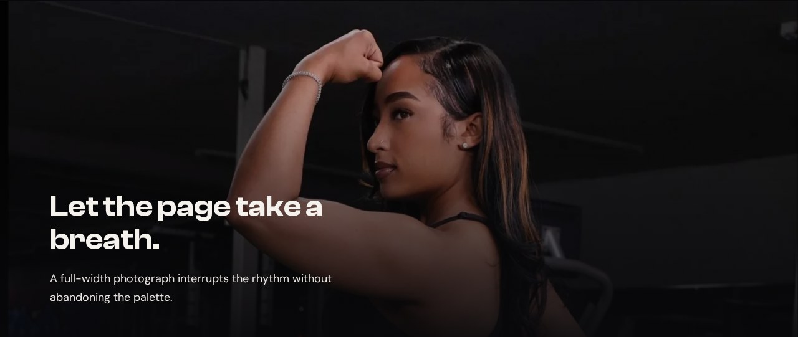

# Pictures

The image file and the image frame are different things. A single photograph can feel intimate, spacious, awkward, or dramatic depending on the box you give it and the part you keep visible. This lesson makes those decisions explicit, using photographs from ELEVEN28 by Shayla, a fashion landing page that presents different outfit colors. You do not need to know the brand; the gallery below is the design we are examining.

## Read the original gallery as a layout



Here is the real grid definition and its tile assignments:

**Source excerpt:** ELEVEN28 by Shayla · fashion landing page, lines 270–278. [Read the complete source stylesheet](/assets/atelier/reference/shayla.css). Whitespace is expanded for readability; declarations are unchanged.

```css shayla.css
.gallery {
  display:grid;
  grid-template-columns:repeat(3,minmax(0,1fr));
  grid-auto-rows:300px;
  gap:16px;
  grid-template-areas: "royal cocoa   sky" "royal crimson sky" "lime  crimson blush"
}
.tile {
  position:relative;
  border-radius:var(--radius);
  overflow:hidden;
  background:var(--card)
}
.tile.royal {
  grid-area:royal
}
.tile.cocoa {
  grid-area:cocoa
}
.tile.sky {
  grid-area:sky
}
.tile.crimson {
  grid-area:crimson
}
.tile.lime {
  grid-area:lime
}
.tile.blush {
  grid-area:blush
}
.tile img {
  height:100%;
  width:100%;
  object-fit:cover;
  object-position:var(--focal,50% 12%);
  filter:saturate(1.08);
  transition:transform .7s var(--ease)
}
```

There are nine grid cells, but **six photographs**. Repeating `royal` in two rows makes the royal tile span those rows. The same happens for `sky` and `crimson`. The named areas form rectangles. The class on each tile connects it to one of those areas through `grid-area`.

This is why counting the cells and asking someone to add nine pictures would fail to reproduce the source. The composition depends on different heights. Before copying a layout, count both its tracks and its actual elements.

We will first build three equal frames. You can see the cropping behavior more clearly when every frame has the same shape. The original named-area arrangement remains in the source block above for your next experiment.

## Build the equal-frame study



**Your working files:** [Open the finished example](/assets/atelier/06/index.html) · [Download starter + finished files](/assets/atelier/downloads/06.zip) · [Read the complete CSS](/assets/atelier/06/styles.css) · [Read the complete JavaScript](/assets/atelier/06/app.js).

Start from checkpoint 5. Replace its Gallery section with the entire block below. Notice that this replacement also adds a second section immediately after the gallery: the full-width image break.

```html index.html · checkpoint 06 addition
<section class="section container" id="gallery" tabindex="-1">
  <div class="section-head stack"><p class="eyebrow">02 / The frame</p><h2>Same frame. Different presence.</h2><p class="muted">Three study images from ELEVEN28 by Shayla.</p></div>
  <div class="gallery">
    <figure class="tile"><figcaption>Royal</figcaption></figure>
    <figure class="tile"><figcaption>Cocoa</figcaption></figure>
    <figure class="tile"><figcaption>Sky</figcaption></figure>
  </div>
</section>
<section class="image-break" aria-labelledby="break-title">
  
  <div class="break-copy container"><h2 id="break-title">Let the page take a breath.</h2><p>A full-width photograph interrupts the rhythm without abandoning the palette.</p></div>
</section>
```

The `width` and `height` attributes describe the source images' actual dimensions. They help the browser know their intrinsic proportions before decoding finishes. CSS then controls the displayed frame. The photographs farther down the page use lazy loading; the hero image does not, because it is part of the opening view.

Each `figure` contains an image and its caption. The alternative text describes the photograph, while the visible caption names the colorway. Neither one is a filename. If the file fails to load, its alternative text still tells the reader what was meant to be there.

Append this CSS to your existing stylesheet:

```css styles.css · checkpoint 06 addition
/* 06 — CROP, FRAME, AND SCRIM */
.gallery { display: grid; grid-template-columns: repeat(3, minmax(0, 1fr)); gap: 20px; }
.tile { position: relative; aspect-ratio: 4 / 5; overflow: hidden; border-radius: var(--radius); background: var(--card); }
.tile img { width: 100%; height: 100%; object-fit: cover; object-position: 50% 12%; }
.tile::after { content: ''; position: absolute; inset: 0; background: linear-gradient(0deg, rgb(0 0 0 / .85), transparent 60%); pointer-events: none; }
.tile figcaption { position: absolute; z-index: 1; bottom: 20px; left: 20px; color: var(--heading); }
.image-break { position: relative; height: clamp(420px, 60vh, 620px); overflow: hidden; background: var(--card); }
.image-break > img { width: 100%; height: 100%; object-fit: cover; object-position: 50% 17%; }
.image-break::after { content: ''; position: absolute; inset: 0; background: linear-gradient(0deg, rgb(8 8 10 / .94), rgb(8 8 10 / .2) 80%); }
.break-copy { position: absolute; z-index: 1; inset: auto 0 48px; }
.break-copy h2 { max-width: 18ch; }
.break-copy p { max-width: 42ch; margin-top: 20px; }
@media (max-width: 700px) { .gallery { grid-template-columns: 1fr; } }
```

## Predict what cover will cut away

The tile's `aspect-ratio: 4 / 5` defines its frame. Its image fills that frame's width and height. `object-fit: cover` scales the photograph proportionally until it covers the box, allowing part of it to be cropped. It does not stretch a person to a new shape.

Our gallery files are 960 by 1,280 pixels. Imagine a tile that is 360 by 450 pixels. Scaling its photo to a width of 360 gives an image 480 pixels tall, so 30 vertical pixels cannot fit inside the 450-pixel frame. `object-position: 50% 12%` biases the crop toward the top. That is why the faces remain visible instead of letting a centered crop choose the framing for us.

Now replace `cover` with `contain` on `.tile img` in DevTools:



**Expected:** the whole image fits, but some frame area remains uncovered. At the dimensions above, the contained image is 337.5 pixels wide and 450 pixels tall, leaving 22.5 pixels of spare horizontal space. The dark tile background shows through that space. Restore `cover` to match the finished study.

Neither value is automatically correct. Use `contain` when the entire object must remain visible, as with the hero cutout. Use `cover` when filling the frame matters and you can choose an acceptable crop. If neither gives a good composition, change the frame or choose a more suitable image.

## Put readable words over a photograph

The tile's pseudo-element paints a transparent-to-dark gradient over the image. This is a scrim: a layer that quiets the picture where the text needs to sit. The caption is positioned above it. `overflow: hidden` clips the image and gradient to the tile's rounded corners.

Try disabling the gradient in DevTools. **Expected:** the caption stays in place, but its background becomes as bright or busy as the underlying photo. Re-enable it. We have improved the reading surface without darkening every part of the image equally.

Positioning also has a relationship to remember. The tile is `position: relative`; its caption and pseudo-element are absolutely positioned within that tile. If you remove the tile's positioning, those children can use a different ancestor as their containing block and appear in the wrong place. Before increasing a `z-index`, confirm that the element is positioned against the intended box.

## Let one image escape the container



Compare our break rules with the original:

**Source excerpt:** ELEVEN28 by Shayla · fashion landing page, lines 285–289. [Read the complete source stylesheet](/assets/atelier/reference/shayla.css). Whitespace is expanded for readability; declarations are unchanged.

```css shayla.css
.image-break {
  height:clamp(480px,60vh,720px);
  position:relative;
  overflow:hidden;
  background:var(--surface)
}
.image-break>img {
  width:100%;
  height:100%;
  object-fit:cover;
  object-position:50% 17%
}
.image-break::after {
  content:'';
  position:absolute;
  inset:0;
  background:linear-gradient(0deg,rgb(8 8 10 / .92),rgb(8 8 10 / .35) 45%,transparent 78%)
}
.break-quote {
  position:absolute;
  inset:0;
  z-index:2;
  display:flex;
  flex-direction:column;
  align-items:flex-start;
  justify-content:flex-end;
  gap:12px;
  padding:0 max(48px,calc((100vw - 1200px) / 2)) 56px
}
.break-quote .spark {
  font-size:40px;
  line-height:1
}
```

The break section sits outside the gallery's `.container`. That is what lets it reach both edges of the page. Inside it, `.break-copy` still uses the container class, preserving the text alignment established in lesson 2. Full-width imagery does not require abandoning the rest of your layout.

Its photograph is much taller than the wide frame. A substantial crop is unavoidable. Change `object-position` from `50% 17%` to `50% 70%` and observe which part becomes visible. **Expected:** the crop moves farther down the photograph; the frame itself does not move. Restore 17 percent. This is an art-direction decision you can inspect rather than a lucky default.

If an image is missing, verify its path and decode it before debugging `object-fit`. If it is distorted, check whether the image has both a constrained box and a fitting rule. If the break stops at the content gutters, check where you placed the section in the HTML. When all three frames and the full-width break behave as predicted, continue to [Motion](/atelier/motion/) and give the page a controlled rhythm.
