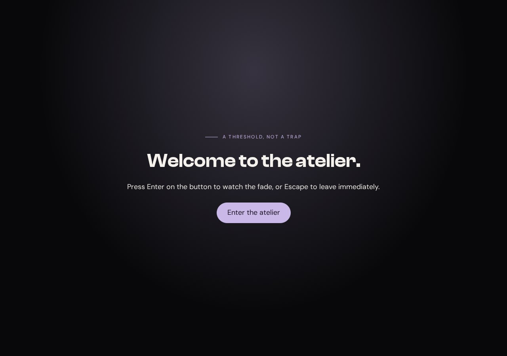
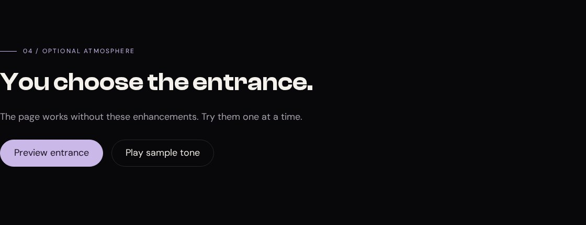

# Gate, cursor, and sound

These effects are the finishing touches people notice in a polished landing page. They also cross a boundary: CSS can draw a welcome screen or a glowing control, but it cannot decide whether an audio file successfully started playing. We need a small amount of JavaScript to connect appearance to what is actually happening.

You do not need to invent that JavaScript. Each complete piece is provided below, with its role explained. Work through one effect at a time. The page you built in the previous lessons remains useful throughout.

## Start with an optional entrance



**Your working files:** [Open the finished example](/assets/atelier/08/index.html) · [Download starter + finished files](/assets/atelier/downloads/08.zip) · [Read the complete CSS](/assets/atelier/08/styles.css) · [Read the complete JavaScript](/assets/atelier/08/app.js).

The reference is ELEVEN28 by Shayla, a fashion landing page that opens with a full-screen welcome treatment. These are the rules that give its gate a size, a hidden state, and a leaving state:

**Source excerpt:** ELEVEN28 by Shayla · fashion landing page, lines 95–97. [Read the complete source stylesheet](/assets/atelier/reference/shayla.css). Whitespace is expanded for readability; declarations are unchanged.

```css shayla.css
.gate {
  position:fixed;
  inset:0;
  z-index:2000;
  isolation:isolate;
  display:grid;
  place-items:center;
  overflow:hidden;
  background:var(--bg);
  opacity:1;
  transition:opacity .6s ease,transform .6s ease;
  touch-action:manipulation;
  cursor:pointer
}
.gate[hidden] {
  display:none
}
.gate.is-leaving {
  opacity:0;
  transform:scale(1.02);
  pointer-events:none
}
```

The visual idea is straightforward: cover the viewport, then fade and slightly enlarge the surface when entering. Our version uses a native dialog and an explicit preview button. That lets a learner open, close, and inspect the effect repeatedly without blocking access to the lesson's page.

Start from checkpoint 7. Add the following markup just before `</main>`. Keep the existing menu dialog; this is a separate dialog with a separate ID.

```html index.html · checkpoint 08 addition
<section class="section container stack" id="polish" tabindex="-1">
  <p class="eyebrow">04 / Optional atmosphere</p><h2>You choose the entrance.</h2>
  <p class="muted">The page works without these enhancements. Try them one at a time.</p>
  <div class="polish-controls">
    <button class="pill" id="preview-gate" type="button" hidden>Preview entrance</button>
    <button class="pill ghost" id="cursor-button" type="button" aria-pressed="false" hidden>Cursor accent</button>
    <button class="pill ghost sound-button" id="sound-button" type="button" aria-pressed="false" hidden>Play sample tone</button>
  </div>
  <p id="sound-status" role="status"></p>
  <audio id="tone" src="../shared/tone.wav" preload="none"></audio>
</section>
<dialog class="gate" id="gate" aria-labelledby="gate-title">
  <div class="gate-content stack">
    <p class="eyebrow">A threshold, not a trap</p>
    <h2 id="gate-title">Welcome to the atelier.</h2>
    <p>Press Enter on the button to watch the fade, or Escape to leave immediately.</p>
    <button class="pill" id="enter-gate" type="button" autofocus>Enter the atelier</button>
  </div>
</dialog>
<div class="cursor-dot" aria-hidden="true"></div>
```

The controls begin hidden because they require JavaScript. The script reveals each control after connecting its behavior. The content does not begin hidden behind the gate. A failed script therefore leaves you with the page, rather than a permanent entrance screen.

## Give the effects visible states

Append this CSS after the existing motion rules:

```css styles.css · checkpoint 08 addition
/* 08 — AN OPTIONAL ENTRANCE, CURSOR ACCENT, AND SOUND */
.gate {
  inset: 0;
  width: 100%;
  height: 100%;
  max-width: none;
  max-height: none;
  margin: 0;
  border: 0;
  padding: 32px;
  color: var(--text);
  background: radial-gradient(ellipse at 50% 20%, rgb(var(--accent-rgb) / .24), transparent 60%), var(--bg);
  opacity: 1;
  transition: opacity .45s, transform .45s;
}
.gate[open] { display: grid; place-items: center; }
.gate::backdrop { background: var(--bg); }
.gate-content { width: min(680px, 100%); text-align: center; }
.gate-content .eyebrow { justify-content: center; }
.gate.is-leaving { opacity: 0; transform: scale(1.02); }
.polish-controls { display: flex; flex-wrap: wrap; gap: 16px; margin-top: 28px; }
.cursor-dot { display: none; position: fixed; top: 0; left: 0; width: 16px; height: 16px; margin: -8px; border: 1px solid var(--accent); border-radius: 50%; pointer-events: none; z-index: 200; }
@media (hover: hover) and (pointer: fine) and (prefers-reduced-motion: no-preference) {
  .cursor-on .cursor-dot { display: block; }
}
.sound-button[aria-pressed="true"] { background: var(--accent); color: var(--bg); box-shadow: 0 0 24px rgb(var(--accent-rgb) / .3); }
@media (prefers-reduced-motion: reduce) { .gate { transition: none; } }
```

The dialog's `[open]` selector applies the grid layout only while the dialog is open. An unconditional `display: grid` on a closed dialog can override the browser's default hidden display. Keeping the open state explicit avoids showing an entrance that has not been opened.

The `is-leaving` class changes opacity and scale. It does not close the dialog by itself. That distinction matters: a transparent modal can still intercept interaction. The behavior must finish by actually closing it.

The cursor element is fixed to the viewport and ignores pointer events. It adds a ring beside the normal pointer; the normal pointer remains available. The sound button's pressed state has its own style, so the control can reflect playback without inventing a separate CSS class for the same state.

## Connect the entrance to its buttons

Append this first block to `app.js`:

```js app.js · checkpoint 08-gate addition
// 08a — Optional gate. The page is usable before this script runs.
const gate = document.querySelector('#gate');
const previewGate = document.querySelector('#preview-gate');
const enterGate = document.querySelector('#enter-gate');
previewGate.hidden = false;
previewGate.addEventListener('click', () => { gate.classList.remove('is-leaving'); gate.showModal(); });
enterGate.addEventListener('click', () => {
  enterGate.disabled = true;
  gate.classList.add('is-leaving');
  let finished = false;
  let timer;
  function finish() {
    if (finished) return;
    finished = true;
    clearTimeout(timer);
    gate.removeEventListener('transitionend', onTransition);
    gate.removeEventListener('close', finish);
    if (gate.open) gate.close();
    enterGate.disabled = false;
  }
  function onTransition(event) {
    if (event.target === gate && event.propertyName === 'opacity') finish();
  }
  gate.addEventListener('transitionend', onTransition);
  gate.addEventListener('close', finish, { once: true });
  if (matchMedia('(prefers-reduced-motion: reduce)').matches) finish();
  else timer = setTimeout(finish, 550);
});
```

`showModal()` opens the dialog in the browser's top layer and makes the rest of the document inert while it is open. The autofocus button receives the initial focus. The native dialog also supports Escape, and closing returns focus to the control that opened it.

Pressing Enter on the button starts the leaving transition. The handler waits for the gate's own opacity transition, then closes it. It ignores transition events from other elements or other properties. The timer provides a fallback if the expected event never arrives, and reduced motion closes immediately instead of waiting for an animation that has been removed.

The `finished` flag prevents two completion paths from doing the work twice. The close listener also cleans up if you press Escape during the fade. Without that cleanup, an old timer could still be waiting when you reopen the entrance. This is a small example of why animation behavior needs more than “toggle a class and hope.”

Try Preview entrance, then Enter. Try Preview entrance, then Escape. Try pressing Enter and immediately Escape, then reopening it. **Expected:** the dialog never remains as an invisible barrier and never closes unexpectedly from an old timer.

## Make a cursor accent follow the pointer

Append this second block:

```js app.js · checkpoint 08-cursor addition
// 08b — Keep the normal pointer; this ring is decoration.
const cursorButton = document.querySelector('#cursor-button');
const dot = document.querySelector('.cursor-dot');
const finePointer = matchMedia('(hover: hover) and (pointer: fine) and (prefers-reduced-motion: no-preference)');
function syncCursor() {
  cursorButton.hidden = !finePointer.matches;
  if (!finePointer.matches) {
    document.body.classList.remove('cursor-on');
    cursorButton.setAttribute('aria-pressed', 'false');
  }
}
finePointer.addEventListener('change', syncCursor);
syncCursor();
cursorButton.addEventListener('click', () => {
  const enabled = document.body.classList.toggle('cursor-on');
  cursorButton.setAttribute('aria-pressed', String(enabled));
});
addEventListener('pointermove', event => {
  if (!document.body.classList.contains('cursor-on')) return;
  dot.style.translate = `${event.clientX}px ${event.clientY}px`;
});
```

The media query asks whether the device supports hover with a fine pointer and whether reduced motion is not requested. Only then is the opt-in cursor control shown. A narrow browser window on a desktop can still have a mouse; screen width alone does not answer this question.

`clientX` and `clientY` are coordinates within the viewport, matching the ring's fixed positioning. A translation moves it to those coordinates. The negative margin centers the 16-pixel ring around the point. `pointer-events: none` ensures the decoration cannot become the target of the very click you intended for a link.

Enable the accent and move across a card. **Expected:** the ring follows, and the card remains clickable. Disable it and the ring disappears. If reduced motion is enabled while the page is open, the query listener removes the enabled state. The ordinary pointer needs no recovery because we never removed it.

## Make the sound control tell the truth



Append this final block:

```js app.js · checkpoint 08-sound addition
// 08c — A local tone, started only by a click.
const audio = document.querySelector('#tone');
const soundButton = document.querySelector('#sound-button');
const soundStatus = document.querySelector('#sound-status');
soundButton.hidden = false;
function syncSound() {
  soundButton.setAttribute('aria-pressed', String(!audio.paused));
  soundButton.textContent = audio.paused ? 'Play sample tone' : 'Stop sample tone';
}
audio.addEventListener('play', syncSound);
audio.addEventListener('pause', syncSound);
audio.addEventListener('ended', syncSound);
soundButton.addEventListener('click', async () => {
  if (!audio.paused) { audio.pause(); return; }
  soundStatus.textContent = '';
  audio.currentTime = 0;
  try { await audio.play(); }
  catch { soundStatus.textContent = 'Audio could not play. The rest of the page still works.'; syncSound(); }
});
```

The supplied sound is a short, locally generated tone. Nothing plays on page load. The user presses Play sample tone, and the handler calls `play()`. That method returns a promise, so the code can handle a playback failure instead of showing a false success state.

The button listens to the audio element's play, pause, and ended events. Its label and `aria-pressed` value follow the actual media state. When the short file finishes, the label returns to Play sample tone. Pressing Stop pauses it; pressing Play again starts from the beginning. The status paragraph reports a failure without replacing the rest of the page.

Test playback at a comfortable volume. **Expected:** a single short tone after your click, a temporary Stop label, then a return to Play. If the file is missing, the control should report the problem and the navigation should still work. A glowing button is not evidence that audio played; the media element is the source of truth.

You now have three effects with different triggers and clear exits. Keep them optional when adapting this page. Next, [Breakpoints](/atelier/breakpoints/) examines what the whole composition needs as its available space changes.
