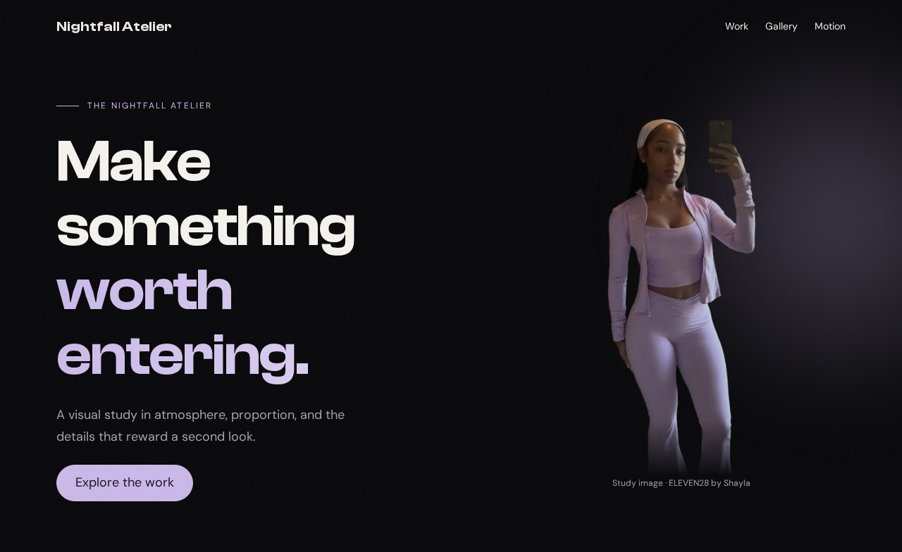
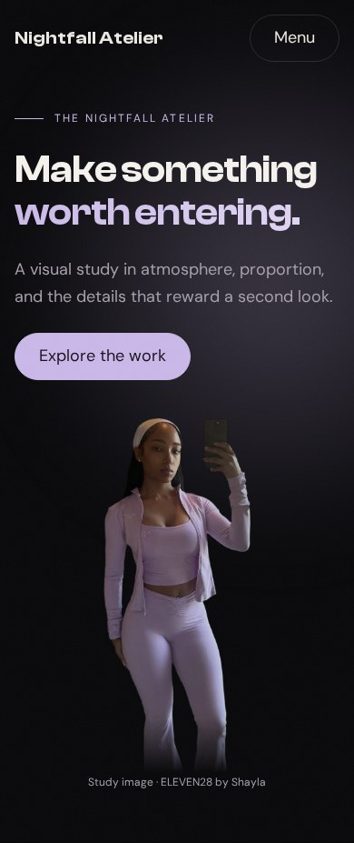

# Breakpoints

Responsive design starts when you notice a relationship becoming uncomfortable: a navigation row crowds its logo, a portrait overwhelms a short screen, or a card has too little room for its words. A breakpoint is a place to change that relationship. It is not a requirement to invent three different websites called desktop, tablet, and mobile.

## Compare the same document at two widths





**Your working files:** [Open the finished example](/assets/atelier/09/index.html) · [Download starter + finished files](/assets/atelier/downloads/09.zip) · [Read the complete CSS](/assets/atelier/09/styles.css) · [Read the complete JavaScript](/assets/atelier/09/app.js).

Start with checkpoint 8. This lesson changes only `styles.css`. Keep the HTML and JavaScript. The earlier checkpoints already have basic responsive behavior; now we refine their spacing and test the interactions together.

## Read a breakpoint with a specific job

In our fashion-site reference, ELEVEN28 by Shayla, this query changes the card grid:

**Source excerpt:** ELEVEN28 by Shayla · fashion landing page, lines 427–429. [Read the complete source stylesheet](/assets/atelier/reference/shayla.css). Whitespace is expanded for readability; declarations are unchanged.

```css shayla.css
@media (max-width:900px) {
  .link-stack {
    grid-template-columns:1fr
  }
}
```

At a viewport width of 900 pixels or less, `.link-stack` has one column. It does not change every layout on the page. Nearby, a different query handles the portrait:

**Source excerpt:** ELEVEN28 by Shayla · fashion landing page, lines 432–437. [Read the complete source stylesheet](/assets/atelier/reference/shayla.css). Whitespace is expanded for readability; declarations are unchanged.

```css shayla.css
@media (max-width:767px) {
  .scroll-cue {
    display:none
  }
  .hero-image {
    height:auto;
    width:min(360px,80%);
    aspect-ratio:547/683;
    overflow:hidden;
    align-items:flex-start;
    -webkit-mask-image:linear-gradient(#000 74%,transparent 100%);
    mask-image:linear-gradient(#000 74%,transparent 100%)
  }
  .hero-image img {
    object-fit:cover;
    object-position:center top;
    -webkit-mask-image:none;
    mask-image:none;
    animation:none
  }
  .portrait-glow {
    inset:0 -10%
  }
}
```

That portrait query changes several connected decisions: the frame's proportions, fitting behavior, mask, and animation. The comment mentions a corresponding HTML `picture` source swap; CSS alone does not select that alternative image file. Read the HTML and stylesheet together when investigating a source site's crop.

Our study keeps one cutout file so the exercise remains self-contained. Its narrow-screen adjustment changes the displayed height. This is a deliberate simplification you can see in the finished files, not a claim that we copied the source's entire art-direction system.

## Refine the page where the space becomes tight

First, confirm that your document still contains this line in its `head`:

```html index.html · inside head
<meta name="viewport" content="width=device-width, initial-scale=1">
```

It tells mobile browsers to use the device's layout width rather than presenting a wider virtual page scaled down. A correct media query can seem ineffective when the viewport setup is wrong.

Append the following to the end of `styles.css`:

```css styles.css · checkpoint 09 addition
/* 09 — MEASURED REFINEMENTS, AFTER THE BASE RULES */
@media (max-width: 600px) {
  .container { width: calc(100% - 32px); }
  .section { padding-block: 64px; }
  .hero-inner { padding-block: 120px 56px; gap: 32px; }
  .portrait img { height: 400px; }
  .card { padding: 22px; }
  .stats { gap: 12px; }
  .break-copy { bottom: 32px; }
  .pill { max-width: 100%; white-space: normal; }
}
h1, h2, h3, .brand { overflow-wrap: anywhere; }
@media (max-width: 360px) {
  .stats { grid-template-columns: 1fr; gap: 24px; }
}
```

At 600 pixels and below, the container uses 16-pixel gutters instead of 24. At a 390-pixel viewport, this leaves 358 pixels for content. Section padding falls from 88 to 64 pixels. That preserves separation between ideas while reducing the amount of scrolling spent on empty space.

The portrait becomes 400 pixels tall, and the hero's spacing tightens. We do not reduce every dimension by the same percentage. A button still needs enough room to press, while an atmospheric portrait can comfortably take less space. The stats become a single column only at the narrower 360-pixel threshold, where keeping three text-and-number pairs together stops helping readability.

`overflow-wrap: anywhere` gives unusually long words a way to wrap. It is a safeguard for content, not a substitute for diagnosing a container that is wider than the viewport. Avoid hiding page-wide overflow just to make a horizontal scrollbar disappear; the hidden part may contain something a reader needs.

## Predict which queries match

Copy this temporary experiment to the end of the stylesheet, observe it, and then remove it:

```css styles.css · temporary experiment, remove afterward
@media (max-width: 768px) {
  .card { padding: 16px; }
}
@media (min-width: 700px) {
  .card { padding: 32px; }
}
```

| Viewport width | First query | Second query | Result in this experiment |
|---|---|---|---|
| 600 pixels | Matches | Does not match | 16-pixel card padding |
| 720 pixels | Matches | Matches | 32-pixel card padding |
| 800 pixels | Does not match | Matches | 32-pixel card padding |

The overlap is 700 through 768 pixels. At 600, the minimum-700 query does not apply. At 720, both declarations apply with equal specificity and importance, so the later one wins. The media query condition does not itself make a selector more specific.

Open DevTools at 720 pixels and inspect a card's computed padding. Find the crossed-out declaration and the winning declaration. This is more reliable than guessing that “the mobile rule” always wins. Remove both experimental queries when you finish so your result matches the screenshot.

## Follow the existing transitions in the layout

Resize slowly around 900 pixels: the hero moves between one column and two. Around 760 pixels, the enhanced navigation replaces its links with Menu. Around 700 pixels, the gallery changes from three columns to one. Around 600 pixels, the refinements from this lesson apply. These numbers differ because these components need different amounts of space.

The cards are a useful contrast. Their `auto-fit` grid can choose its column count based on the available room without a dedicated viewport breakpoint. Responsive behavior can come from intrinsic layout rules, media queries, or both. Use the mechanism that expresses the actual constraint.

Open the mobile menu, then widen the window past its breakpoint. **Expected:** the dialog closes, the button's expanded state resets, and the desktop links become available. A CSS-only visual swap cannot reliably manage that open-dialog state; the resize listener from lesson 3 handles it.

## Test words and controls, not just silhouettes

At 390 pixels, read every heading and press every link. Then try 320 pixels and increase browser zoom. Replace a short card title with a longer one. **Expected:** text can wrap, cards can grow, and the document remains usable without horizontal scrolling. The page need not retain identical line breaks at every width.

Use Tab to open and close the menu. Enable reduced motion and confirm that cards stay visible. With JavaScript disabled, the ordinary navigation links should remain available and the optional effect controls should remain hidden. These are different conditions; a narrow screenshot alone cannot prove they work.

If something overflows, inspect the widest element first. Look for a fixed width, an unbreakable string, a grid minimum, or a large gap. Fix the responsible relationship, then inspect the page again. When you can explain both the stacked and split versions, you are ready for [Assembly](/atelier/assembly/) and your own variation on the finished page.
