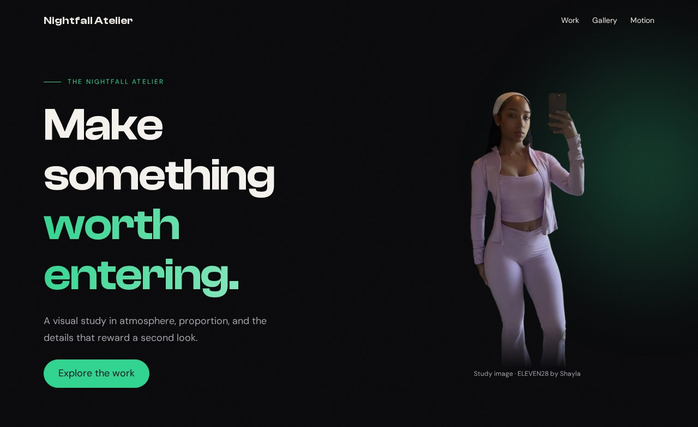
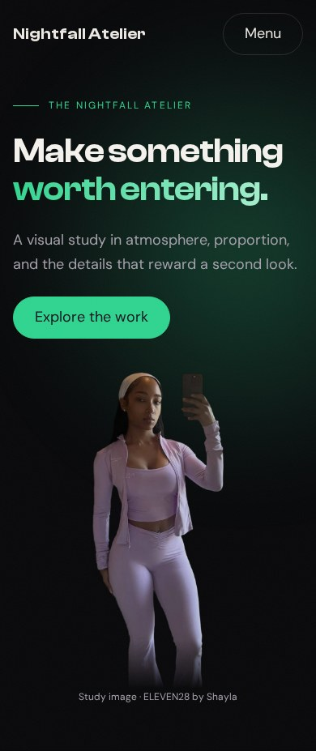

# Assembly

You have built one page through nine checkpoints. This lesson gives you the complete document in one place and asks you to make it yours without losing the relationships that made it work. The goal is to leave with an understandable starting point for a portfolio, not a folder of disconnected effects.

## See the complete composition in a new palette





**Your working files:** [Open the finished example](/assets/atelier/10/index.html) · [Download starter + finished files](/assets/atelier/downloads/10.zip) · [Read the complete CSS](/assets/atelier/10/styles.css) · [Read the complete JavaScript](/assets/atelier/10/app.js).

You can also [download all ten checkpoints together](/assets/atelier/downloads/complete-workshop.zip). Extract the entire archive and open `10/index.html`. Keep `shared/` beside the numbered folders. Everything needed for the examples is local; no framework, package installation, or development server is required.

The original visual references were a personal landing page called King Chrissy and a fashion landing page called ELEVEN28 by Shayla. Their screenshots and source excerpts helped us examine real design choices. The page you built is a smaller teaching reconstruction called Nightfall Atelier. Its portraits are credited study assets, not photographs of you or claims about your own work.

## Read the final document from entrance to footer

Here is the complete HTML for the final checkpoint. If you followed the lessons, compare it with your own `index.html`. If you are joining here, use the download for the accompanying complete CSS, JavaScript, fonts, and images.

```html 10/index.html
<!doctype html>
<html lang="en">
<head>
  <meta charset="utf-8">
  <meta name="viewport" content="width=device-width, initial-scale=1">
  <title>Atelier · checkpoint 10</title>
  <link rel="stylesheet" href="styles.css">
  <script src="app.js" defer></script>
</head>
<body>
<a class="skip pill" href="#main">Skip to content</a>
<header class="site-nav">
  <div class="nav-inner container">
    <a class="brand" href="#main">Nightfall Atelier</a>
    <nav class="nav-links" aria-label="Main navigation">
      <a href="#work">Work</a><a href="#gallery">Gallery</a><a href="#motion">Motion</a>
    </nav>
    <button class="pill ghost menu-toggle" id="menu-button" type="button"
      aria-controls="menu" aria-expanded="false" hidden>Menu</button>
  </div>
</header>
<dialog class="menu-panel" id="menu" aria-labelledby="menu-title">
  <h2 id="menu-title">Choose a room</h2>
  <button class="pill" id="close-menu" type="button" autofocus>Close menu</button>
  <nav aria-label="Mobile navigation">
    <a href="#work">Work</a><a href="#gallery">Gallery</a><a href="#motion">Motion</a>
  </nav>
</dialog>
<main id="main" tabindex="-1">
  <section class="hero">
  <div class="hero-orb" aria-hidden="true"></div>
  <div class="hero-grain" aria-hidden="true"></div>
  <div class="hero-inner container">
    <div class="hero-copy stack">
      <p class="eyebrow">The nightfall atelier</p>
      <h1>Make something <span>worth entering.</span></h1>
      <p>A visual study in atmosphere, proportion, and the details that reward a second look.</p>
      <a class="pill" href="#work">Explore the work</a>
    </div>
    <figure class="portrait">
      
      <figcaption>Study image · ELEVEN28 by Shayla</figcaption>
    </figure>
  </div>
</section>

  <section class="section container" id="work" tabindex="-1">
  <div class="section-head stack">
    <p class="eyebrow">01 / The work</p><h2>Three doors. One language.</h2>
    <p class="muted">The layout repeats. Each destination has its own purpose.</p>
  </div>
  <div class="cards">
    <a class="card reveal" href="#gallery"><h3>The visual study</h3><p>See how a frame changes what an image says.</p><span class="arrow" aria-hidden="true">↗</span></a>
    <a class="card reveal" href="#motion"><h3>The motion study</h3><p>Give an entrance a beginning and a resting place.</p><span class="arrow" aria-hidden="true">↗</span></a>
    <a class="card reveal" href="#main"><h3>The first impression</h3><p>Return to the composition that opens the page.</p><span class="arrow" aria-hidden="true">↗</span></a>
  </div>
  <dl class="stats">
    <div><dt>Accent palette</dt><dd>01</dd></div>
    <div><dt>Study cards</dt><dd>03</dd></div>
    <div><dt>Possible iterations</dt><dd>∞</dd></div>
  </dl>
</section>

  <section class="section container" id="gallery" tabindex="-1">
  <div class="section-head stack"><p class="eyebrow">02 / The frame</p><h2>Same frame. Different presence.</h2><p class="muted">Three study images from ELEVEN28 by Shayla.</p></div>
  <div class="gallery">
    <figure class="tile"><figcaption>Royal</figcaption></figure>
    <figure class="tile"><figcaption>Cocoa</figcaption></figure>
    <figure class="tile"><figcaption>Sky</figcaption></figure>
  </div>
</section>
<section class="image-break" aria-labelledby="break-title">
  
  <div class="break-copy container"><h2 id="break-title">Let the page take a breath.</h2><p>A full-width photograph interrupts the rhythm without abandoning the palette.</p></div>
</section>

  <section class="section container stack" id="motion" tabindex="-1">
  <p class="eyebrow">03 / A rhythm</p><h2>Build. Observe. Refine.</h2>
  <p class="muted">The strip below moves continuously. You control whether it keeps moving.</p>
  <div class="motion-controls"><button class="pill ghost" id="pause-motion" type="button" aria-pressed="false" hidden>Pause marquee</button></div>
</section>
<div class="marquee" aria-hidden="true">
  <div class="marquee-track">
    <div class="marquee-group"><span>BUILD</span><span>OBSERVE</span><span>REFINE</span><span>REPEAT</span></div>
    <div class="marquee-group"><span>BUILD</span><span>OBSERVE</span><span>REFINE</span><span>REPEAT</span></div>
  </div>
</div>

<section class="section container stack" id="polish" tabindex="-1">
  <p class="eyebrow">04 / Optional atmosphere</p><h2>You choose the entrance.</h2>
  <p class="muted">The page works without these enhancements. Try them one at a time.</p>
  <div class="polish-controls">
    <button class="pill" id="preview-gate" type="button" hidden>Preview entrance</button>
    <button class="pill ghost" id="cursor-button" type="button" aria-pressed="false" hidden>Cursor accent</button>
    <button class="pill ghost sound-button" id="sound-button" type="button" aria-pressed="false" hidden>Play sample tone</button>
  </div>
  <p id="sound-status" role="status"></p>
  <audio id="tone" src="../shared/tone.wav" preload="none"></audio>
</section>
<dialog class="gate" id="gate" aria-labelledby="gate-title">
  <div class="gate-content stack">
    <p class="eyebrow">A threshold, not a trap</p>
    <h2 id="gate-title">Welcome to the atelier.</h2>
    <p>Press Enter on the button to watch the fade, or Escape to leave immediately.</p>
    <button class="pill" id="enter-gate" type="button" autofocus>Enter the atelier</button>
  </div>
</dialog>
<div class="cursor-dot" aria-hidden="true"></div>
</main>
<footer><div class="container">Atelier study · Arthur Bernier Jr</div></footer>
</body>
</html>
```

Notice the order. The skip link comes first. Navigation has its own header, followed by its menu dialog. The main content begins with the hero, then the work cards, gallery, image break, motion section, and optional effects. The footer ends the page. The image break is outside a width-constrained section, while its caption uses the shared container.

IDs connect the document. A link to `#gallery` needs an element with `id="gallery"`. The menu button's `aria-controls` needs the menu's ID. The gate's accessible label needs the heading identified by `gate-title`. Changing one end without the other can break behavior even if the page still looks attractive.

The stylesheet link loads presentation. The deferred script waits until the document has been parsed before looking for its buttons and dialogs. Neither file needs to be pasted into an inline block. Keeping the three responsibilities in separate files makes them easier to inspect.

## Follow the stylesheet's dependencies

Open [the complete final stylesheet](/assets/atelier/10/styles.css) alongside the page. Its numbered comments match the lesson sequence. Start at a visible element, search for its class, and follow the custom properties back to their definitions.

For example, the card border uses `--border`; the card surface uses `--card`; the arrow uses `--accent`; its hover glow uses `--accent-rgb`. The `.container` rule determines the section's width before `.cards` divides that space. The card component does not need its own copy of the site's maximum width.

This order is useful for people reading the file. It is not an execution sequence in which each CSS rule runs once. The cascade combines matching declarations. A custom property's definition can appear below a rule that uses it, and a later matching declaration can override an earlier one according to the cascade's rules.

Our sources illustrate different palettes built from the same idea. Here is the personal landing page's original token block:

**Source excerpt:** King Chrissy · personal landing page, lines 6–35. [Read the complete source stylesheet](/assets/atelier/reference/chrissy.css). Whitespace is expanded for readability; declarations are unchanged.

```css chrissy.css
:root  {
  --bg: #08080A;
  --bg-elevated: #111114;
  --bg-card: #16161A;
  --bg-card-hover: #1C1C22;
  --gold: #C8A97E;
  --gold-light: #E8D5B7;
  --gold-dark: #A8864E;
  --gold-glow: rgba(200, 169, 126, 0.25);
  --white: #FFFFFF;
  --text: #E8E8EC;
  --text-muted: #8A8A94;
  --text-dim: #55555E;
  --border: rgba(255, 255, 255, 0.06);
  --border-gold: rgba(200, 169, 126, 0.2);
  --font-heading: 'Clash Display', 'Inter', sans-serif;
  --font-body: 'DM Sans', 'Inter', -apple-system, BlinkMacSystemFont, sans-serif;
  --ease-out: cubic-bezier(0.16, 1, 0.3, 1);
  --ease-in-out: cubic-bezier(0.65, 0, 0.35, 1);
  --radius-sm: 8px;
  --radius-md: 16px;
  --radius-lg: 24px;
  --radius-full: 9999px;
}
```

Read the named roles rather than memorizing its particular colors. The colors help express that page's identity. Your portfolio needs its own coherent decisions, not somebody else's name pasted onto the same theme.

## Change one family of values together

To produce the green result shown above, append this block after checkpoint 9's CSS:

```css styles.css · checkpoint 10 addition
/* 10 — A NEW THEME, USING THE SAME COMPONENTS */
:root {
  --accent: #2FD48F;
  --accent-light: #B9F2D7;
  --accent-rgb: 47 212 143;
}
```

The main accent changes the pills, arrows, and other direct uses. The lighter variant supplies the other end of the heading gradient. The RGB channels let translucent glows use the same hue. Changing only `--accent` would leave parts of the atmosphere lilac because those declarations read different tokens.

Compare checkpoint 9 and checkpoint 10 at the same width. **Expected:** the accent family changes while the heading size, card count, gutters, crop, and navigation behavior remain the same. This is a controlled visual variation. If the layout changes too, look for an unrelated edit rather than blaming the color token.

Now choose your own accent family. Keep the background and text colors initially, so you can judge one change at a time. Inspect text and focus indicators against their actual backgrounds; a color that looks beautiful in a large swatch may be hard to read as a small label.

## Make a small portfolio that says something real

Replace the hero heading with a sentence about what you make. Replace the supporting paragraph with who it helps or what interests you. Give the work cards actual destinations and specific descriptions. If you have only one project, one honest project is a better starting point than three fictional accomplishments.

For a concrete layout exercise, add a fourth card by copying one existing anchor and changing its title, description, and destination to `#polish`. **Expected:** at the wide container, four 250-pixel minimum tracks plus three 20-pixel gaps can fit in 1,120 pixels. At narrower widths, the same grid chooses fewer columns. Remove the extra card if you want to return to the supplied checkpoint.

Replace a study photograph with one you have permission to use, then update its alternative text and intrinsic dimensions. Inspect the crop before deciding it is finished. A different face position may need a different `object-position`; a landscape photograph may need a different frame entirely. The previous image's numbers are a starting hypothesis, not a rule for every photograph.

## Verify the page you actually built

Open your final file at a wide width and at 390 pixels. Follow each card and navigation link. Use the keyboard to find the skip link, open the menu, close it with Escape, and continue through the content. No invisible overlay should keep you from reaching the page.

Pause and resume the marquee. Try the entrance twice. Play the tone and let it end, checking that the button returns to its idle state. Enable reduced motion and reload; the content should remain visible. Disable JavaScript and reload; the basic document and ordinary navigation should still work. These checks connect the visual polish to actual use.

If you later publish the page, upload the files with their relative folder relationships intact and test the hosted copy. The archive is a working static example, not an automatic deployment. Before sharing your own portfolio, replace the teaching labels and study assets with content appropriate to you.

You have completed the workshop when you can pick an effect, locate the declarations that produce it, explain the supporting HTML or behavior, and change it without losing the rest of the page. Keep the original checkpoints beside your variation: they give you a known working comparison when your next experiment goes wrong.
